# The admin's guide: looking after Drashti

This guide is for the **admins**: whoever sets Drashti up at the mandir and keeps it right from week to week. The operators' side, running a sabha in Pro Mode, is in `docs/operator-guide.md`; the first evenings beside the old presentation program are in `docs/parallel-run.md`; the day Drashti is set up on the mandir's computers has its own list, `docs/setup-day.md`.

On the Mac, **Cmd** is the ⌘ key; on Windows use **Ctrl** instead. On Windows the menu bar is hidden: press **Alt** to show it. Since alpha.13, Drashti opens only on a computer the owner of its access list has let in (a node follows its Main: section 3).

---

## 1. The two computers

Drashti runs on both of the mandir's computers. One is **Main**: it keeps the library and the playlists, and the operators run the show on it. The other can be a **node**: it shows Main's screens on its own displays, in step, and has no controls of its own (section 6). Or both can be Mains with libraries of their own, as with the old program today; the plan is to try the node on the parallel-run evenings first.

**What each computer needs:**

- **macOS 13 (Ventura) or later**, or **64-bit Windows 10 or 11**. The audit report says what each computer has.
- **The same version of Drashti on both.** A node refuses a Main on another version, and says so (section 2).
- **A graphics chip that decodes video by itself**: every Mac that runs macOS 13 has one; a PC needs Intel, AMD or NVIDIA graphics (not a basic display adapter). Section 13 has what the speed tests found.
- **The internet** on Main (and on any other computer used as a Main), to check its access as it starts and every 15 seconds while it runs (section 3): a wired connection if at all possible, and a phone's hotspot ready as a spare. A node needs none for this: it follows its Main.
- **A wired network between Main and the node** if at all possible, and a fixed address for Main (section 8).
- **Room on the disk**: the media library (with a copy beside each file Drashti converts, section 20), plus 2 GB that Drashti keeps free, plus the recordings (about 3 GB an hour). A recording goes on in parts of 3.5 GB (`… part 2.mkv`, `part 3`…), so even a USB stick formatted FAT32 takes a long sabha; Drashti says so when the folder is on one, and when the disk has room for less than an hour.
- Each computer's **user account with a password of its own**: once the computer is let in (section 3), anyone who can use its account can use Drashti there.

---

## 2. Installing and updating

**Installing.** Drashti is free. Each computer has one download link, and it always gives the newest version:

| Computer                                                                        | Download                                                                                       |
| ------------------------------------------------------------------------------- | ---------------------------------------------------------------------------------------------- |
| A Mac with Apple silicon (**About This Mac** shows **Chip**: Apple M1 or later) | https://github.com/Priyansh9121/drashti/releases/latest/download/Drashti-mac-apple-silicon.dmg |
| A Mac with an Intel processor (**About This Mac** shows **Processor**: Intel)   | https://github.com/Priyansh9121/drashti/releases/latest/download/Drashti-mac-intel.dmg         |
| A Windows 10 or 11 PC (64-bit)                                                  | https://github.com/Priyansh9121/drashti/releases/latest/download/Drashti-windows-setup.exe     |

On the Mac, open the `.dmg` and drag Drashti into **Applications**; on Windows, run the setup program, which adds Drashti to the Start menu. Drashti shows its own logo in the Dock, in Cmd+Tab and in the Windows taskbar (if a Mac still shows an older picture, restart it). The links work once a version has been published (README, "Releases, signing and updates": the Release workflow, from `main`, with **publish** ticked); until then they say Not Found. Every release is at https://github.com/Priyansh9121/drashti/releases, with `SHA256SUMS.txt` to check a download by hand (on a Mac `shasum -a 256 <file>` in Terminal, on Windows `Get-FileHash <file>` in PowerShell). On its very first start, Drashti asks how the computer will be used: **Main** or **Node**. A computer that already has a library is a Main. Since alpha.13, a Main is let in once, with a Gmail the owner approves, before Drashti opens on it; a node needs no Gmail of its own (section 3).

**Opening Drashti the first time.** Drashti has no paid Apple Developer ID (the only real fix for the Mac's warning is a paid one, so Drashti is not signed), and on Windows it is not signed either. So each computer warns once, the first time. Nothing is wrong with Drashti: the computer only cannot check who made it.

- **On a Mac**, the disk image's window shows the two steps: "1 Drag Drashti to Applications" and "2 The first time you open it". The first time Drashti is opened from **Applications**, the Mac says it can't be opened and to contact the developer (newer versions say Apple could not verify it). Close that message with **Done** or **OK**, never **Move to Trash**. Then **System Settings**, **Privacy & Security**: near the bottom, beside the message about Drashti, press **Open Anyway** (it is there only after that first try, for about an hour) and confirm with the Mac's password or Touch ID. Open Drashti again, and press **Open Anyway** once more if the Mac asks. From then on it opens as any app does.
- **For whoever looks after Drashti**, one line in Terminal does the same on a Mac, once Drashti is in Applications: `xattr -dr com.apple.quarantine /Applications/Drashti.app`. It takes away the mark the Mac puts on a downloaded app, so the Mac opens it without asking. Use it only for a Drashti downloaded from the links above.
- **On Windows**, when the setup program is opened, Windows says "Windows protected your PC": press **More info**, then **Run anyway**. (If the browser says the file is not commonly downloaded, keep it.)

Section 2 of `docs/parallel-run.md` has the same steps for the volunteers.

**Checking for updates.** **Help**, then **Check for Updates…**. If there is a newer version, the window says what changed in it (the same words as its page on GitHub): read them first. Press **Download**: it comes slowly in the background, and waits while the stream is on air or recording. Then turn on **Install it when Drashti quits**. Nothing happens until Drashti is quit after the sabha, and Drashti does not start again by itself.

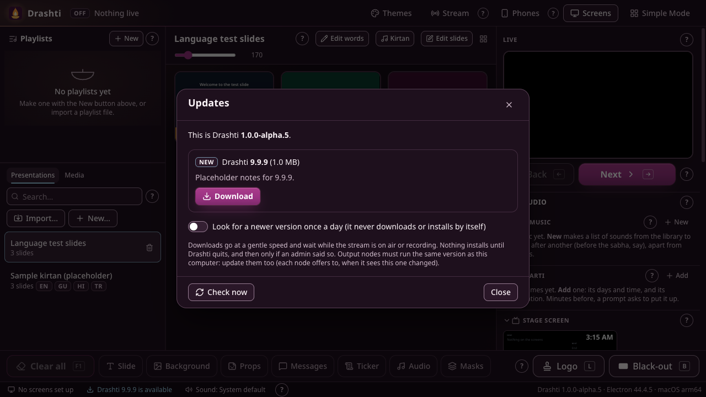

- **On Windows**, the update installs by itself as Drashti quits.
- **On the Mac**, the update is downloaded and checked but cannot install itself (only an app signed with a paid Apple certificate can, and Drashti has none): press **Show the file**, quit Drashti, open the file and drag Drashti into **Applications**.
- **Look for a newer version once a day** makes Drashti check by itself (it only tells you; it never downloads on its own). It is off to begin with.
- **An update waiting to install** is checked again before it installs: if Drashti was updated meanwhile by hand to that version or a newer one, or the downloaded file changed, it is dropped (download it again if it is still wanted). Only a release's own files from GitHub are taken.

**One version on both computers.** After updating Main, update the node too, the same evening. Until they match, the node refuses to follow Main and its screens keep their last picture; Main's **Screens** and the screens dashboard say which node needs updating. On the node, its window offers **Update to Drashti …**: press it, then **Download Drashti …**, then **Quit and install**, and start it again. A node with no internet: install the same version on it by hand.

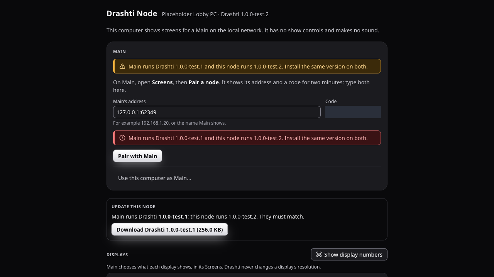

**Never update on the day of a sabha.** Update after a sabha, run the checks in section 12 on both computers, and keep the old installer until the next sabha has gone well. On a Mac, an update can also mean turning Screen Recording on again for **Show a Window…**, and the camera for video inputs and the stream (section 4). After updating Main from alpha.11, reload each phone's and tablet's Drashti page once (section 7); from alpha.12 on, a page left open reloads itself once after an update that needs it.

**The test presentations.** Earlier versions put two placeholder presentations in every new library: "Language test slides" and "Sample kirtan (placeholder)". A new library now starts without them (the example sabha templates and the built-in themes are still there). In a library that has them, the first start of alpha.11 or later removes each one that is still exactly as Drashti made it and that nothing uses (no playlist, template or arti schedule), as a deleted presentation is removed (a backup from before still has it). It looks once in each library, and the log says what it did with each: "Removed the placeholder presentation …: unchanged and in no playlist", or "Kept the placeholder presentation …" and why ("changed", "in a playlist"). To delete one that was kept, or any presentation: open it in the middle of the window, then the **⋯** menu after **Edit slides** (Presentation actions), then **Delete…** (**Delete from the library…** when it was opened from a playlist; Pro Mode, as all deleting from the library is). It asks first, saying that any playlist it is in keeps its card, marked **Removed from the library**, and **Next** goes past it; **Undo** brings it back.

---

## 3. Access by Gmail

**Who may open Drashti.** Since alpha.13, Drashti opens only on a computer let in with a Gmail that the **owner** has approved. The owner is whoever approves access: the access list is a Google Sheet in their own Google account, with a small program behind it that answers every Drashti and sends the emails. Drashti **needs the internet** to ask the list, as it starts and then every 15 seconds while it runs. It tells the list this computer's name, its Drashti's version, how long it has been used and how many shows, streams, recordings and imports it has had: counts only, never words, names of files or pictures. A node needs no Gmail of its own (below).

**Letting a computer in.** On a computer not let in yet, a window opens before anything else: **Let this computer in**. (While the check at start takes more than a second, the same window says "Checking this computer's access…".)

1. **Request Access**: type **Your Gmail** and, if you like, **Your name (optional)**, so the owner knows who asks, then press **Request Access**. The owner gets an email with an **Approve** and a **Reject** link: each opens a page with one button (nothing happens until it is pressed), and works once, for 7 days. The window asks every 30 seconds what came of the request (**Check Again** asks at once).
2. Approved, the person gets an email from the owner's Gmail with a one-time **token**: 28 letters and digits in groups of four (`ABCD-EFGH-…`). Rejected, they are told so, by email and in the window.
3. Under **I Have a Token**, type the Gmail and the **Token**, and press **Let This Computer In**. This computer is let in, and stays in until the owner revokes that Gmail.

**Quit Drashti** is always there. The owner's own Gmail never uses **Request Access** (the list refuses it): the owner's computer is let in from the Sheet, with **Drashti › Let me in (the owner)…**, which emails the owner a token for **I Have a Token** (`docs/access-setup.md`, section 9).

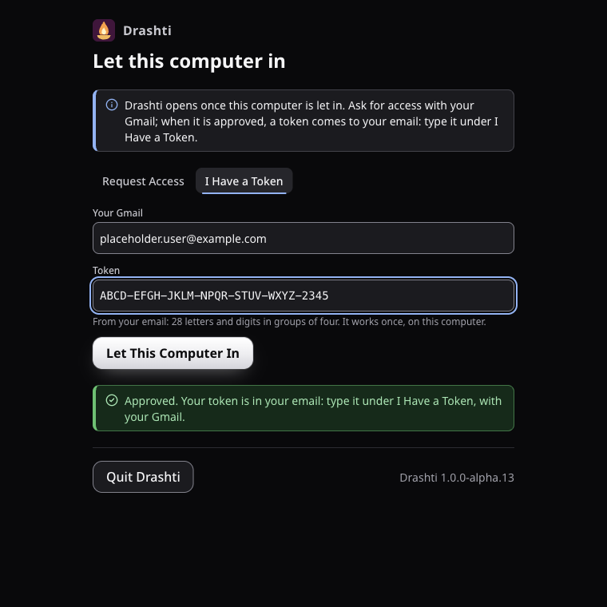

**The token's rules.** A token works once, only with the Gmail it was sent to, and lets in one computer. One not used runs out 3 days after it was sent, and a newer one for the same Gmail stops it (computers already in stay in). Keep a token as private as a password.

**A second computer.** One token lets in one computer. For another computer with the same Gmail (the spare computer, say), or when a token ran out, the owner presses **Give access again** in the Access List (below): a new token comes by email, and the computers already in stay in. **Request Access** from the second computer only says that the Gmail is approved already.

**When access is taken away.** When the owner revokes a Gmail (in the Access List, or in the Sheet), every computer let in with it stops at its next check, for good: in place of the controls, one message, "Your access to Drashti has been removed", and **Quit Drashti**, the one button that works. The screens fade to black over a second; the stream and the recording end; imports, conversions, downloads, the drop folder and the **Drashti for Zoom** window stop; phones and tablets say "Drashti has stopped", what one was playing stops, and a file on its way to or from one is cut off. Once the screens have faded, a screen over the controls is turned off, so the message can be read: switch it on again in **Screens** once access is back. A Gmail rejected, or a computer the list no longer knows, stops the same way. To let a revoked Gmail back in, the owner presses **Give access again** (for a rejected one, **Approve**): a new token comes by email, for **I Have a Token** when Drashti is started again.

**A node** needs no Gmail of its own: it runs while its Main is let in. When its Main stops, the node's screens go black at once; when it has heard nothing from a Main let in for 2 minutes (Main quit, or the network gone), the same, its last picture kept until then. It shows Main's screens again as soon as it hears its Main let in.

**With no internet.** A check with no answer changes nothing at once, and the show goes on: a bar at the top of the operator window counts down to the stop, **2 minutes** after the last answer ("No internet: Drashti stops in 1:45 unless it can check your access"), and an answer in time takes it away. At 0:00 Drashti stops as above, saying "Drashti stopped: no internet": quit, check the connection, and start Drashti again. Time the computer spends asleep is never counted. With no answer as it starts, Drashti does not open: its window says so, with **Try Again** (it also tries again by itself every 15 seconds). So give each Main the surest connection there is: **a wired connection** to the mandir's internet where possible, with **a phone's hotspot** ready as a spare, to join the computer to before the countdown ends.

**Where it is kept.** This computer's way in is kept in Drashti's data folder (on a Mac `~/Library/Application Support/Drashti`, on Windows `%APPDATA%\Drashti`), never in the library, so no backup holds it. The list knows each computer by its own hardware: a data folder copied to another computer does not let that computer in.

**The Access List.** The computer let in with the owner's own Gmail (`docs/access-setup.md`, section 9) has **View › Access List…**, in Pro Mode; no other computer has it. It shows every Gmail on the list, a row each:

- **Gmail and name** (the owner's own row says **Owner**), and **Status**: Requested, Approved, Revoked or Rejected, with a second line where there is more to say (the computer a request came from, a token sent and the day it runs out, **No computer in yet**, the day of a rejection);
- **Requested**, **Approved** and **Revoked**: the days;
- **Computer and version**: each of its computers, with its Drashti's version and its system (one no longer in says **(ended)**);
- **Last seen**, **Time used**, and how many **Shows**, **Streams**, **Recordings** and **Imports**: counts only, never anything shown;
- **Note**: the owner's own, seen only there and in the Sheet.

A click on a column's heading sorts by it, a second the other way (it opens with the requests waiting first). **All**, **Requested**, **Approved**, **Revoked** and **Rejected**, each with how many, show one status at a time, and the search finds a Gmail, a name, a computer or a note (**Cmd+F** / **Ctrl+F**). **Export CSV…** saves the rows shown, in their order, as a file for a spreadsheet. While the window is open, the list is asked again every 5 seconds ("Updated just now", at the top right).

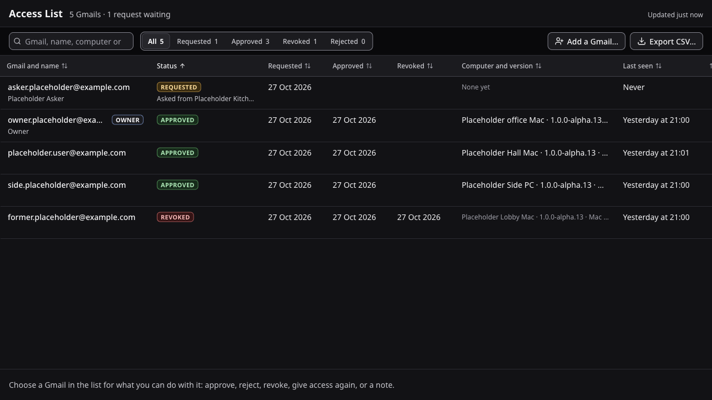

**Changing the list.** Choose a Gmail's row, and the bar under the table offers what can be done with it:

- a request: **Approve** (their token goes to them by email) or **Reject** (they are told);
- an approved Gmail: **Give access again** (a new token, for one more computer) or **Revoke…**, which asks first: "Their Drashti stops at once, screens and stream included.";
- a rejected Gmail: **Approve**; a revoked one: **Give access again**;
- every row: **Edit note…**.

**Add a Gmail…** puts someone on the list before they ask: their Gmail, a name and a note. With **Approve it now: their token goes to them by email** ticked, it is **Add and approve**; without it, the Gmail waits as a request, as if they had asked. The owner's own row is never offered **Revoke…** or **Reject**.

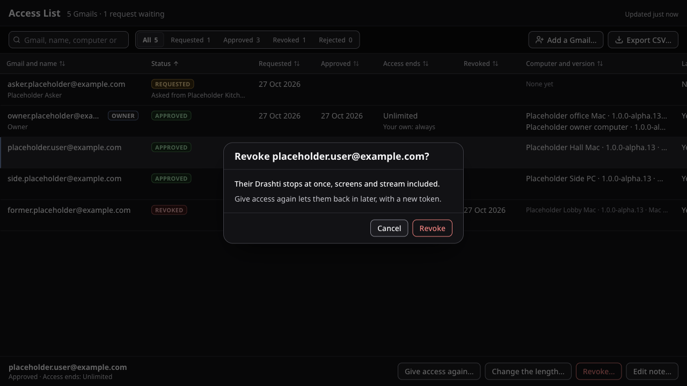

**In the Sheet.** The owner may also set a Gmail's **Status** in the Sheet (a list to choose from). Set to **revoked** (or **rejected**), its computers stop within about 30 seconds, and stay out even if it is set to **approved** again later: **Give access again** lets them back in. Set to **approved** by hand, it sends no token: use the email's Approve link, or the Access List. A status typed there that the list does not know stops its computers too, until it is put right. In the script's settings (**Script Properties**), leave the list's own as they are: `WEB_APP_URL`, the keys, and `REQUESTS_TODAY`, its count of the day's requests (`docs/access-setup.md`, section 10).

**Setting the list up** (once, in the owner's Google account), what to do when something goes wrong there, and **what a free Google account allows** (about 50 new people a day by email, and about 400 Drashtis checking at once) are in `docs/access-setup.md`.

**Everyone let in can do everything.** Since alpha.13 Drashti has no roles and no PINs: on a computer let in, everything in this guide is anyone's, in Pro Mode, except the Access List. The file an earlier Drashti kept its PINs in (`roles.json`) is removed from the data folder at the first start. **Simple Mode** is a way of working, not a lock. To hand Drashti to a volunteer, press **Simple Mode** in the header; to leave it, press **Switch to Pro Mode…** at its top right (or **View**, then **Switch to Pro Mode…**), type the word **pro**, and press **Switch to Pro Mode**. Drashti starts in **Pro Mode** whenever it was quit on purpose, even if a volunteer was using Simple Mode; after an unexpected stop it comes back in the mode it was in, if it is started again within 3 hours (started later, it starts as after a quit on purpose).

---

## 4. Screens, Looks and sound

**Set Up Screens…** opens straight on the displays: each one a click among three (**The audience picture**, **The stage view**, **Not used**), the first display free for the hall already chosen when no screen shows the hall's picture yet, and a kirtan's languages on each if you like, then **Done**, which sets the screens at once. Wherever it offers the display the Drashti controls are on, it says "The controls are on this display" (and so does the list of displays in **Screens**), so that display is not given to the hall by mistake. A screen that **Audience** or **Stage** has switched off, or one that has stopped, counts as in use there, so **Done** never takes it away; and a key and fill pair's displays stay that pair (its role, and what each sends) through **Done**. **More setup…** goes on to the sound, the stream and the default theme, as before (those change nothing until **Finish**). It opens by itself the first time, and later from **View**, then **Set Up Screens…**. Quicker still: whenever no screen shows the hall's picture and a display is connected, the window offers **Show on** it under the top bar (and on the first start's welcome): one click makes it the hall's screen (an "Audience" group in the live Look, every language, the screen named after the display) and puts the test slide up for a few seconds. **Not now** puts the offer away until the displays change. Section 4 of `docs/parallel-run.md` goes through it and through setting screens up by hand in **Screens**.

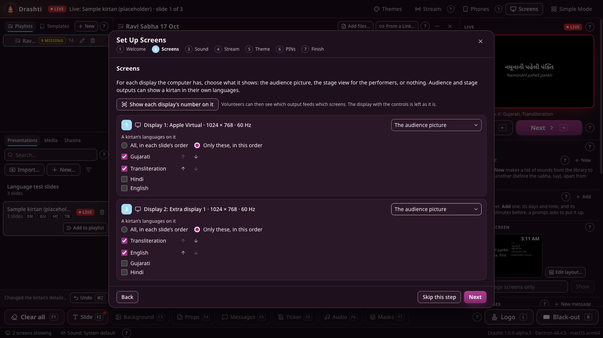

**Keep these screens?** After any change that puts an output on a display (**Done** or **Finish** in **Set Up Screens…**, **Show on**, **Use this display**, **On**, a group's **Shows** or a key and fill screen's **Sends** in **Screens**, a node's display too), Drashti asks "Keep these screens?", counting down 15 seconds in words: **Keep** (or **Enter**) keeps them, **Go back** (or **Esc**) puts the screens back as they were. With nothing pressed, it goes back by itself, and a notice says so: a screen put over the controls by mistake comes off by itself. A dialog opened while it waits goes under it. When the change puts an output on the display the controls are on, that output asks the same, large, in its middle, with its countdown: **Enter** keeps, **Esc** goes back, and **Cmd+Shift+U** / **Ctrl+Shift+U** (Uncover the controls) turns that output off as ever, the question staying on the controls. Going back undoes only what that change changed (the groups and screens it made, removed or changed, and the languages and Look settings it set), each only where it is still as the change left it: anything else changed meanwhile stays, and the sound, the theme and the stream's settings always stay as chosen. Turning an output off asks nothing, and quitting while the question waits goes back. Until it is answered, the change waits on the disk too (`keep-screens.json` in Drashti's data folder): after a crash or a power cut within the 15 seconds, the next start goes back before any screen opens, and a notice says "Drashti stopped before the change to the screens was kept, so they went back to how they were before it."

**The three cards.** Screens opens with three cards: **Projector** (the audience groups), **Stage screen** and **YouTube (the stream)**. Each has a small preview, the Look whose settings it shows, and what it shows; **Change what it shows** goes to the group's own settings below. The displays, the nodes and the groups come after the cards.

**YouTube, the third screen.** Its card holds the stream's settings: what it shows (**Camera and words**: the camera, with the slide's words as a lower third; or **Slides**, as the hall sees them), the camera (or capture card), the sound input (the mixer's line in) and a kirtan's languages. They are the same settings as in the **Stream** panel and the Stream step of **Set Up Screens…**: a change in one shows in the others. Opening Screens starts nothing: the card's preview is a still of what the stream would show, until the stream is on air or recording, or **Find cameras and sound inputs** is pressed (that turns the stream's picture and the camera on while Screens is open; nothing goes on air). The stream key, the profiles, **Go Live** and recording stay in the Stream panel: the card's **Stream panel** button goes there. **Several platforms at once:** in Stream settings, **Also send to another platform** adds Facebook (its Server URL from Live Producer, which must start `rtmps://`) or another platform, up to three places in all, each with its own stream key. Choose the **Several platforms** preset (1080p, 5 Mbps to each), and check the upload it shows against a speed test on the show computer: two platforms need about 14 Mbps, three about 20. While live, ON AIR says how many places are on air (**On air · 2 of 2**), and the Stream panel names any that is reconnecting; the others go on. **The stream key while live:** Drashti keeps it in the computer's own secure storage and never writes it to a log, a backup or a window, but while the stream is live it hands it to FFmpeg, the program that sends the stream, on FFmpeg's command line, where other programs running on this computer can read it. Use the show computer for the show, by one person's account; if it is ever shared, make a new key on YouTube after the sabha. The stream's screen group is there from the first start (a library from before keeps its group and its name), and it cannot be deleted.

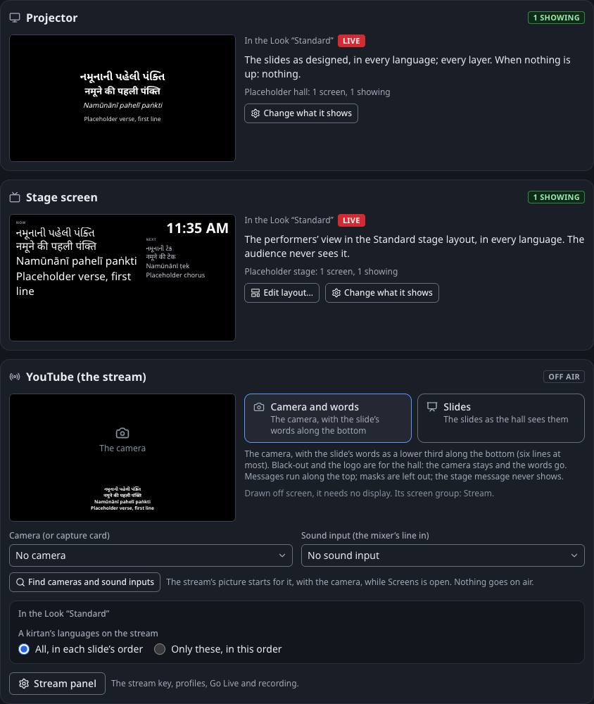

**Screen groups.** Each group is a set of screens that show the same: "Main Hall", "Stage", "Lobby". A group shows **the audience picture** or **the stage view (performers)**, or is **key and fill** for a video switcher. In **Screens**, each display has **Use this display**; each screen has its canvas size and scaling (for an LED wall that is not 1920 × 1080); **Identify screens** puts each screen's name on it.

**Audience and Stage.** Two switches in the top bar, beside **Screens** (Pro Mode), turn this computer's screens off and on again: **Audience** covers every output whose group shows the audience picture, key and fill included; **Stage** covers every output of a stage group. Each says On or Off in words; **View › Audience** and **View › Stage** do the same (with their keys beside them), and so do **Cmd+1** / **Ctrl+1** and **Cmd+2** / **Ctrl+2**. Off closes those output windows, so their displays show the computer's desktop; the show, LIVE, the other switch's screens, the stream, the recording and the nodes carry on. Turning one off asks first while its screens show something, and in the window's first moments, before it knows which are open: "Turn Audience off?", with **Cancel** (which has the keyboard) and **Turn off**; from the **View** menu, a box of the computer's own asks the same, with the same two buttons. When an output covers the controls, that output asks it too, large, in its middle: **Enter** turns them off, **Esc** cancels. Turning one on opens them again on the same displays, asking nothing, even if one of them was turned off and on again in **Screens** meanwhile. A screen that was off as it went off and is turned on meanwhile, or one added or given another display meanwhile (in **Set Up Screens…**, or with **Use this display**), is asked about at that change (**Keep these screens?**), as any other change. While one is off, the status bar says "Audience off" (or "Stage off") with **Turn on**, **Screens** says "Switched off" on its screens, **Set Up Screens…** counts their displays as in use, so **Done** never takes one away, and the screens dashboard says "Audience off", with "This computer's desktop" in place of a picture (never the last one). Both are on again at every start: off is never remembered. Simple Mode can only turn them on, with the status bar's **Turn on**. A node's screens belong to another computer and never change with them; a phone's remote says which are off, and cannot change them.

**Looks.** A Look says what every group shows: which layers, a kirtan's languages and their order, whether slides are drawn as designed or as a lower third, and its **Movement**: **Calm** (as before: slides fade in place) or **Bold** (the words can move, wipe and zoom as slides change; pictures only dissolve, so a darshan picture stays whole). Bold suits a festival or a lobby Look; leave the everyday Look Calm, and try Bold on the hall's projector before a sabha. The stage screen always cuts. As each screen opens it stays black for a moment while it gets every transition ready, unseen, so the first one of a sabha is as smooth as the rest. One Look is live at a time, and the operators switch it under the live picture. In **Screens**, under **Looks**: **New Look**, **Duplicate**, rename, **Up**/**Down**, **Remove**; choose a Look there to see and change each group's settings in it. Drashti starts with the **first** Look in the list after a clean quit, so keep the everyday Look first.

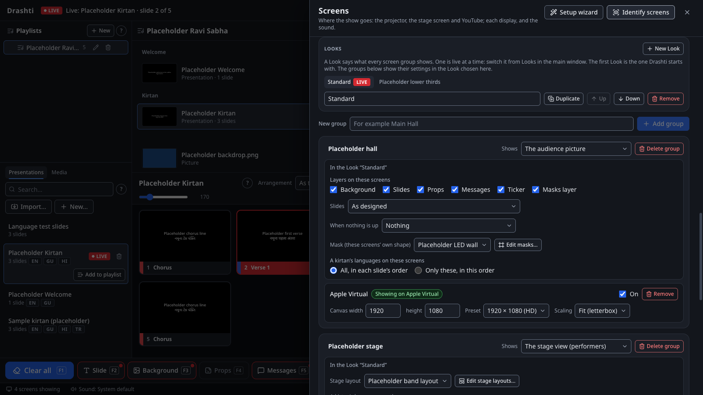

**Stage layouts.** Under a stage group, **Edit stage layouts…**: **Duplicate Standard** (or **Duplicate** a layout of your own), or **New from a Template…** (below); add the boxes the performers need (the slide, the next one, notes, the clock, timers, the stage message, what is next in the playlist, the time left on a video or sound, black-out and logo, fixed words), place them, and **Save**. Then choose it under **Stage layout** for the group in the Looks that should use it. Ask the performers what they want to see.

**Every box** is placed as you like: drag it, or its handles, with the mouse; type its **Across**, **Down**, **Width** and **Height**; or use the keys once the layout has the keyboard (**Tab** chooses the next box): the arrow keys move it a pixel at a time (ten with **Shift**), and with **Alt** (**Option** on a Mac) they make it larger or smaller. Since alpha.13 boxes may overlap: under **In front or behind**, **Bring to the front**, **Bring forward**, **Send backward** and **Send to the back** set which is over which (the list of **Boxes** goes from the back to the front). A box of words has **Words as large as fit** (or a **Text size**), its **Colour**, **Line up** (left, middle or right) and **Up and down** (top, middle or bottom), **Bold**, **A fill behind it** (its **Fill colour**, and how **See-through**), **A line round the letters** (its **Line colour** and **Line width**), **A soft shadow under the words**, and a **Label above it** (empty for none). A timer box has **Which timer**, **Write the time** (as needed, minutes and seconds, or hours, minutes and seconds) and, for a countdown, **Another colour from a time left** (amber from 1:00 to begin with), **Another colour at 0:00 and past it** (red) and **Flash at 0:00** (slowly, a second dim and a second bright, for 10 seconds, every timer flashing together). A clock box has **Hours** (as the computer writes the time, 12 hours or 24) and **Seconds**. Every stage screen draws a layout alike and in step, a node's and a stage tablet's too; a layout saved before alpha.13 looks as it did.

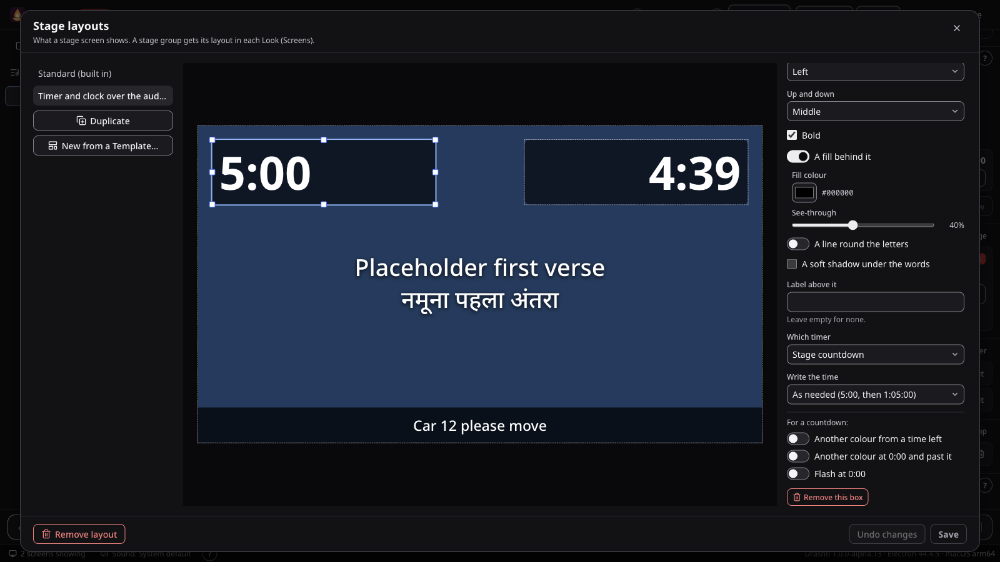

**New from a Template…** (since alpha.13) makes a stage layout ready made, with the timer it shows: **Timer only** (one timer filling the screen); **Countdown to a time** (to 7:30 pm to begin with, large, with **Starting in** above it, or the **Words above the timer** typed); **Countdown** (from 5:00 down to 0:00, amber in the last minute, then on past 0:00 in red); **Count up from 0:00**; or **Timer and clock over the audience** (the audience picture, live, with a timer at the top left and the clock at the top right). Under **The timer it shows**, **A new timer** is made in Timers with the length or the time asked (named "Stage countdown" and the like, in **Its name in Timers**), or **One in Timers** is used (a countdown that stops at 0:00, chosen for the Countdown, can be let run on: **Let it run on past 0:00 (in Timers too)**). **Make the layout** saves it and gives it at once to the stage screens in the live Look (with no stage screens yet, choose it for them in **Screens** later); everything in it can be changed after. The **Stage screen** panel then lists the layout's timers, each with what it counts to and **Start**, **Pause** and **Reset** (a countdown to a time: **Stop**), and so does a phone's remote, under the stage message.

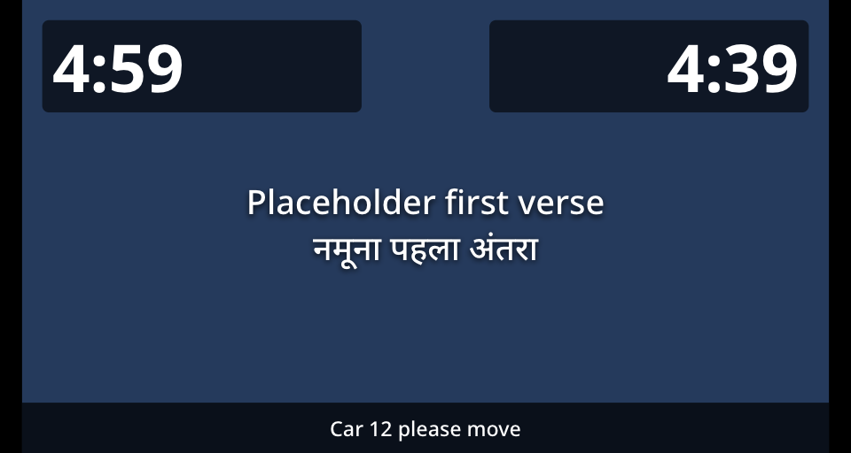

**The audience picture, live** (choose it among the kinds of box, then **Add**) shows the performers exactly what the hall's screens show now, as the first audience group in **Screens** shows it: the background (a video, a video input or a window too), the slide, messages, the ticker, picture in picture, black-out and the logo, at 16:9 with black around it. It has a place, a size and a label, nothing more, and the boxes after it in the list (the stage message, the clock, timers) draw over it. While **Audience** has this computer's hall screens off (above), it keeps the picture they come back to and says **Audience off** in its bottom left corner, clear of a stage message along the top, so the performers are not misled; a box of the audience screens' state says "Audience screens off" then, and the Standard stage screen says it beside **NOW**. On a node's stage screen it shows that node's own audience picture, or, on a node with no audience screen of its own that is on, Main's hall as the live Look sets it (with **Audience off** too while Main's Audience is off). A stage tablet draws it as well, from the same pictures as the phone remote's live picture and under the same rules: pictures and videos as stills (since alpha.13 as sharp as the tablet shows them; nothing plays there), and never a video input or a window, which are on Main's computer: where one is up, the box names it in a line in its bottom left corner (under **Audience off** when that shows too), as the phone remote does ("Video input: Input 1", "A window: Zoom Meeting"), and so does a node's stage screen. With no group in **Screens** showing the audience picture, the box is black and says "No audience screens" in its bottom left corner, wherever it is drawn, and since alpha.12 so does a box of the audience screens' state (the Standard stage screen says nothing of it beside **NOW**). In the audience picture, **Audience off** and "No audience screens" are never smaller than a box's label (30 px) while they fit: since alpha.12 the layout editor makes its box no smaller than 320 × 180 (a sixth of the stage each way), by its handles and by its fields, so they can be read there. A layout saved with the box smaller before keeps it as it was until it is resized (the words come down to fit in it). Since alpha.13 the line naming a video input or a window on a node's or a tablet's stage screen is never smaller than 30 px either, while it fits, and it wraps. No built-in layout has the box: add it to a layout of your own, or start from the template **Timer and clock over the audience**.

**Masks.** A group's **Mask** in a Look is its screens' shape (an LED wall's outline, a projector spilling onto a pillar): **Edit masks…** under the group. The editor shows the hall screen's live picture behind the shapes, as it is now, for as long as it is open, so a mask is drawn to fit what is really there; what it hides is darkened. With no hall screen set up, it shows a test pattern and says so. It stays on: Clear all, F8 and Simple Mode never take it away. The **Masks** panel under the live picture is different: it puts a mask up for a moment, and F8 takes it down.

**Sound.** In **Screens**, under **Sound output**, choose the output that goes to the mixer. If it is not connected when Drashti starts, Drashti plays on the computer's default sound output, and a warning stays in the status bar until it is back.

**The logo.** In **Props** under the live picture, the stamp button beside a prop makes it the logo (**F12** or **L**, and **Logo** in both modes). Until one is chosen, **Logo** says "No logo has been chosen yet", and since alpha.13 so does a phone's.

**Another app's window on the screens (a Zoom meeting): Screen Recording on a Mac.** An operator's **Show a Window…** (in the library's **Media**) shows another app's open window live as the hall's background (the operator's guide, section 5). To see other apps' windows, macOS must let Drashti record the screen. The first time it is pressed on a Mac, Drashti says why and offers **Open System Settings**, which opens **Privacy & Security**, then **Screen Recording**: turn **Drashti** on there, then quit Drashti and open it again (macOS asks for that). Drashti only ever shows the one window an operator chooses, by name with its picture, never a whole screen, and only on this computer's screens and the stream: output nodes and phones never show it, and a stage screen only in a layout's box **The audience picture, live**. **After each update** macOS may ask again, or show Drashti turned off in that list: Drashti is signed ad hoc (it has no paid Apple certificate), so macOS can take an updated Drashti for a new app. Turn it on again, and quit and reopen. On Windows nothing is asked.

**A camera or the video mixer on the screens: video inputs.** **Add a Video Input…** (in the library's **Media**, beside **Show a Window…**; Pro Mode) lists this computer's cameras and capture inputs (a capture card, a video mixer's USB output) by name, each with a small live picture. Choose one, give it a name (it offers "Input 1"; up to 60 characters, and never a name another input has), choose **Fit inside, with black around it** or **Fill the screen**, and press **Add to Media**. Nothing goes up from there: it waits under **Video inputs** at the top of **Media**, with its own small live picture, and one click there puts it up as the live background (with a 1-second dissolve), with the slide, the lower third, messages and the ticker over it. Black-out and the logo cover it; **Clear all** and **F3** take it off. Simple Mode and the phone remote can take it off, and put one up only through a playlist or a slide (an item, or a slide's background: below), never from **Media**.

- **It belongs to this computer, not the library.** The list is kept in Drashti's data folder (`drashti-video-inputs.json`): a backup does not hold it, and another computer needs its own, named there (with the same names: below). (A file Drashti cannot read is set aside with the date in its name, and the list starts empty.) Up to 20. **Change** (its name, its input, Fit or Fill: the screens follow while it is up) and **Delete** (it asks first) are at the end of its row in **Media**; the one on the screens can be deleted only once it is cleared, and one in the picture-in-picture box once the box is taken off.
- **Where it shows.** LIVE, this computer's hall screens, and the stream's **Slides** layout (YouTube sees what the hall sees; **Camera and words** keeps the stream's own camera). Output nodes cannot show it, as it is on this computer: their screens show the rest of the show without it, and the screens dashboard says so. A stage screen says "Video input on the screens" while no slide is up, and shows it in a layout's box **The audience picture, live**.
- **In a playlist, and behind a slide.** Since alpha.11 an input's row in **Media** goes into a playlist as the library's other rows do: its right-click has **Add to** the open playlist, or drag it there (a click on the row still puts it up on the screens). In the slide editor, **Choose** beside the slide's background (under **Behind it and with it**) lists **Video inputs on this computer**. As an item it goes up as the background, coming on over 1 second, and takes the slide off; behind a slide it comes on with the slide, under its words. **Both keep the input's name**, never the input itself: a library travels (a backup put back on another computer, the spare computer taking over), and each computer puts up its own input of that name (capitals do not matter). So **give the spare computer's inputs the same names as Main's** ("Input 1" on both). A computer with no input of that name says so plainly, and nothing goes black for it: the item's card says **Not on this computer** and **Next** goes past it; a slide naming one goes up with the background as it was, and LIVE names the input that is not there (since alpha.12, again after an unexpected stop). Simple Mode and the phone remote play such an item as any other.
- **Renaming it.** Since alpha.12, giving it a new name (**Change**, then **Save**) takes every playlist item and slide on this computer that named it to the new name (a template's too). What is on the screens carries on, and **Next** finds it by the new name. **Undo** does not undo a rename: rename it back, and they follow it back. Another computer still finds its own input by the name, so **give the other computer's input the same new name** (its own **Change**), or there the item and the slide say **Not on this computer**. The **Change** dialog says so too, under **Name** and **Fit**: "The other computer's input needs the same new name." A backup made before the rename still names the old one.
- **The camera permission.** On a Mac, the first time, Drashti says why it needs the camera: press **Continue**, then **Allow** (or **OK**) when macOS asks. If it was refused, Drashti says so, with **Open System Settings**, which opens **Privacy & Security**, then **Camera**: turn **Drashti** on there, then press **Look again** (if it still sees nothing, quit Drashti and open it again). As with Screen Recording, after an update macOS may ask again, or show Drashti turned off there. On Windows nothing is asked, but Windows' camera privacy setting must let desktop apps use the camera: when it does not, Drashti says so plainly, with **Open Settings**; turn on **Camera access** and **Let desktop apps access your camera**, then **Look again**.
- **Only Drashti's own screens open a camera**: this computer's outputs (the hall's, key and fill, and a stage screen's box of the audience picture), the operator window's LIVE and small pictures, and the stream's page. A video input is opened for its picture only, never with a microphone, and on a Mac only once System Settings says Drashti may. The hall's sound comes through the mixer, as now; the stream's sound stays its own sound input (on YouTube's card, above), where a mixer's USB output can be chosen too.
- **Never the mixer showing Drashti.** If the mixer's program is Drashti's own picture, showing the mixer's program in Drashti makes a picture inside itself, over and over. Put it up while the mixer shows a camera.
- **If it stops** (its cable out, or another app using it), the screens keep its last picture and a notice says so, with **Clear the input**; it comes back by itself when the input returns. After an unexpected stop it is put back, as the background or in the picture-in-picture box, while it is still in this computer's list, and the screens then have up to 20 seconds to say whether its camera is there (the note at the top waits for them). One no longer in the list is not put back, and one whose camera the screens do not find comes off (in the box, the box with it); the note names it.

**Picture in picture.** **Picture in Picture…** (in the library's **Media**, beside **Add a Video Input…**; Pro Mode) puts something small in a corner of the hall's screens while the main picture carries on: **The slides** (made small, while the main picture shows the background), **A video input**, **A picture or video** from Media (a video plays without sound, going round between its start and end points: section 10) or **A window** (as **Show a Window…** offers). Choose where it sits (a corner, or drag the box in LIVE), its size (**Small**, **Medium** or **Large**: a quarter, a third or two fifths of the width, at 16:9), **A thin border**, **Rounded corners**, and how it comes on and goes off (**Fade**, **Scale** or **Slide in from its corner**; in a **Swap** the box goes out and comes in again that way, while the main picture dissolves, never a cut and never black), then **Show in the box**. Its place and look are kept in the library (so a backup carries them) for the next time. Under LIVE, a strip names what is in the box, with **Swap** and **Take off**. Simple Mode and the phone remote can take it off, never set one up.

- **A Look can leave it out** for a group: **Picture in picture** among the group's **Layers on these screens** in **Screens**. Looks saved before it came show it until they leave it out. **A key and fill group leaves it out**, in every Look, old and new alike, until a Look ticks it on for that group (the video switcher keys Drashti's graphics over its own picture).
- The stream shows it whenever it shows the hall's picture: in **Slides**, and in **Camera and words** while a picture or a video fills the stream in the camera's place (never over the camera). A stage layout's box of the audience picture shows it too.
- **Output nodes** show a box of the slides, or of a picture or video from Media; a video input or a window in the box shows on this computer's screens only.

---

## 5. Backups

**By hand.** **File**, then **Back Up Library…**: choose a folder on a USB drive or another disk, and keep **Include the media** ticked. Do it after any evening the library changed a lot (an import, a festival's slides).

**By themselves.** **File**, then **Scheduled Backups…**: **Choose…** the drive (never Drashti's own folder), tick the days, set the time (late evening, after the sabha), how many to keep (7 is a good start), keep **With the media** ticked, turn on **Back up by itself**, and **Save**. **Back up now** tries one at once.

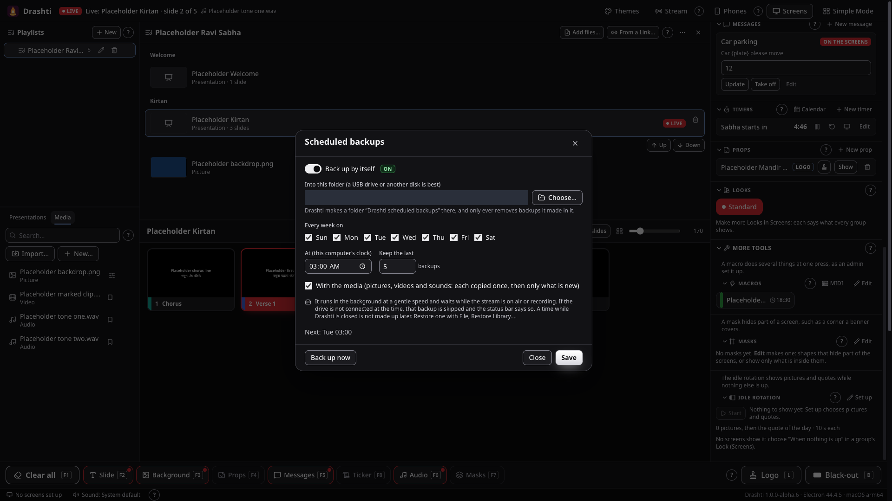

- The first backup copies every picture, video and sound; later ones copy only what is new, so they are quick.
- Drashti removes the oldest backups it made there when there are more than the number to keep, and nothing else on the drive.
- **Leave the drive plugged in.** A backup whose drive is missing is skipped, and a line at the bottom of the window says so until **OK**.
- A backup waits while the stream is on air or recording. One whose time passed while Drashti was closed is not made later.

**Restoring.** **File**, then **Restore Library…**, and choose a backup folder (for a scheduled one, a "Drashti backup …" folder inside "Drashti scheduled backups"). Drashti asks first, keeps the library it has as well (in `Backups/` in its data folder), and restarts: the screens go black for a moment, so **never restore during a sabha**. If the backup turns out to be damaged, Drashti says so after the restart and keeps the library it had.

**When the library cannot be opened.** If Drashti says at start that it cannot open its library (a damaged file, say), it quits, and what to do comes from here: put the last backup back without that library.

1. Open Drashti's data folder (section 3 says where: on a Mac `~/Library/Application Support/Drashti`, on Windows `%APPDATA%\Drashti`).
2. Make a folder there named `Damaged library`, and move into it `drashti.sqlite` and every file whose name starts with `drashti.sqlite-`. Keep them: whoever looks after Drashti may want them.
3. Start Drashti: it opens with an empty library.
4. **File**, then **Restore Library…**, and choose the last backup.
5. Pair the phones and tablets and the node again: a restore keeps who was paired in the library it replaces, and the empty one knew nobody.

**Who may connect stays as it was before the restore:** the phones and tablets paired then, the poster link and the node. A phone or a node removed after the backup stays removed, and nothing paired since needs pairing again. If the library from before cannot be read, every phone and the node are refused, Drashti says so, and they pair again.

**What a backup does not hold:** this computer's access (section 3), the stream keys (in the computer's own secure storage), the events out addresses and their secrets (the same), Main's certificate for the node, this computer's video inputs (section 4), its choice of decks with their animations (section 21), the pictures' sharpened copies (Drashti makes them again after a restore, a moment each), and the files phones are still sending (section 7). After restoring onto a new computer (which needs access of its own first: section 3): set the stream keys again, add the events out addresses again (each gets a new secret: give it to the receiver), pair the node again, in **Screens** choose each screen's display again (the backup remembers the old computer's displays), and name its video inputs with **Add a Video Input…**, with the same names as before: the playlists and slides find them by name (section 4).

---

## 6. The node

Section 8 of `docs/parallel-run.md` has the steps: on the second computer choose **Node** on its first start; on Main, **Screens**, then **Pair a node**, which shows Main's address and a code for two minutes; on the node, type both and press **Pair with Main**. Then, in Main's **Screens**, give each of the node's displays a group with **Use this display**.

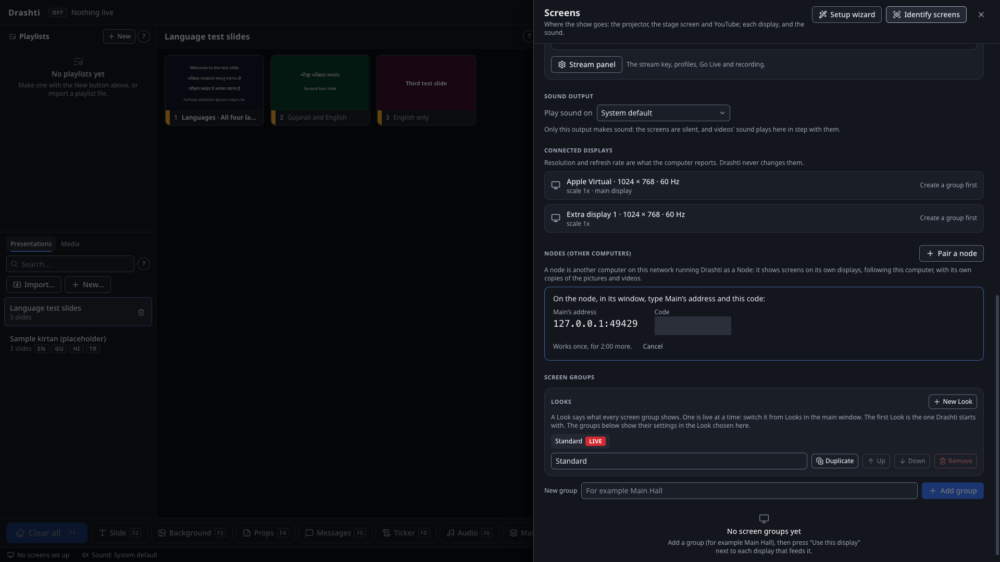

**No Gmail of its own.** Since alpha.13 a node runs while its Main is let in: it goes black when Main stops, or when it has heard nothing from a Main let in for 2 minutes, and shows again once it hears one (section 3).

**Its pictures and videos.** The node keeps its own copies, made over the network ahead of time: what is on the screens and what Next brings, the playlist playing, every playlist made, changed or opened on Main in the last 7 days, the props, the logo and the idle rotation's pictures. Sound is never copied. For a festival with pictures from elsewhere in the library, tick **Get everything ready** for the node in the screens dashboard (it copies every picture and video in the library, not only this week's, until it is unticked). To reuse a playlist from an earlier week, open it on Main before the sabha (a click is enough). A video input, or another app's window, is on Main's computer only: the node's screens show the rest of the show without it, and the screens dashboard says so (section 4). The node plays its copies itself, so an HEVC video (as many phones record) that plays on Main can be black on a node that cannot play HEVC (a Windows PC without Microsoft's HEVC extension): Drashti converts HEVC only where Main cannot play it, so for such a node use H.264 videos.

**Before each sabha**, open the screens dashboard (the screens line at the bottom of Main's window): the node should say **Online**, and its pictures and videos ready ("14 of 14 ready").

**Fonts on the node.** The node draws the words itself. A font that is only installed on Main (a legacy Gujarati font, or an English font a theme names) must be installed on the node too (section 11). Main's screens dashboard says **Font not on this node** on a display whose words name a font the node lacks.

**Removing a node.** **Remove** beside it in Main's Screens or the dashboard: it is cut off at once and its screens go black. On the node, **Use this computer as Main…** turns it back into a Main, with the library it had before, untouched.

**A screen that says Stopped.** If one output keeps failing (more than 5 times in a minute), Drashti stops trying for a moment: that screen is black, the status line at the bottom says "1 stopped", Screens shows **Stopped**, and a red notice at the top of the operator window names the screen (in Simple Mode too; never over the show controls). Drashti tries it again by itself after 2 minutes, then every 10 minutes; **Try again** on the notice, in Screens or on the screens dashboard tries at once (the notice's and the dashboard's work for a volunteer and in Simple Mode: they change nothing but bring the screen back). A node's screen that keeps failing shows the same way on Main: Stopped on the dashboard, named in the notice, and Try again tries it on the node. The other screens are not affected. If it keeps happening, save diagnostics and fall back for that screen.

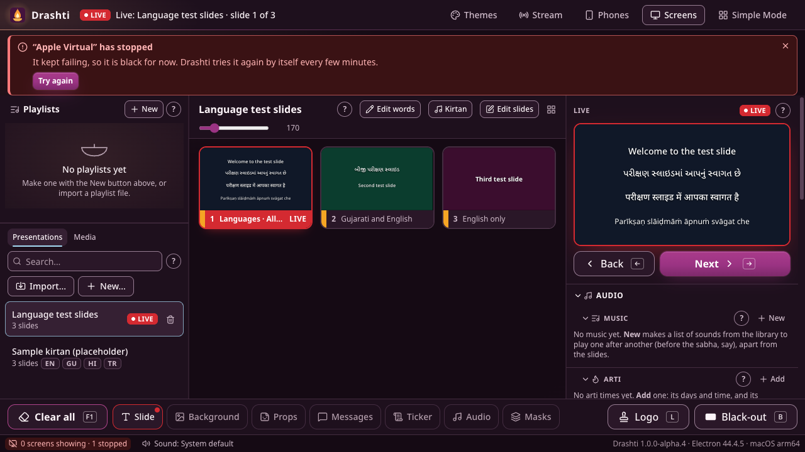

**When a file Drashti keeps cannot be read** (a damaged disk, a file cut short). Drashti never takes it for a missing file and never writes over it: it tries once more, then keeps the file aside in its data folder with the date in its name (for example `identity.unreadable-2026-10-10 05-36.json`), and says what it did:

- **Main's identity for its nodes** (`node-link/identity.json`): every paired node checks it, so Drashti does not make a new one by itself. A note says so when Drashti starts, nothing follows Main, and **Screens** says "The nodes cannot follow this computer". Press **Make a new identity…** there; then pair each node again (on the node, **Unpair…**, then a new code from Main).
- **The role file** (Main or Node): Drashti starts as whichever it last ran as (judged from its other files; with no library at all, a node) without asking, and says what it chose.
- **A node's pairing** (`node.json`): the node starts unpaired and says so. Pair it again.

---

## 7. Phones and tablets

Section 7 of `docs/parallel-run.md` has the steps: **Phones** in the header, **Let paired phones and tablets connect**, then **Pair a Remote / Stage / Announcements device** for each phone or tablet, and **Make a poster link** for announcements from anyone on the Wi-Fi. While they may connect, the header holds more than fits in a window under 1680 pixels wide: **Themes**, **Stream**, **Phones**, **Announcements** and **Simple Mode** then show their icons alone (**Phones** a phone), their tooltips saying what each is, while **Screens**, **Audience** and **Stage** keep their words.

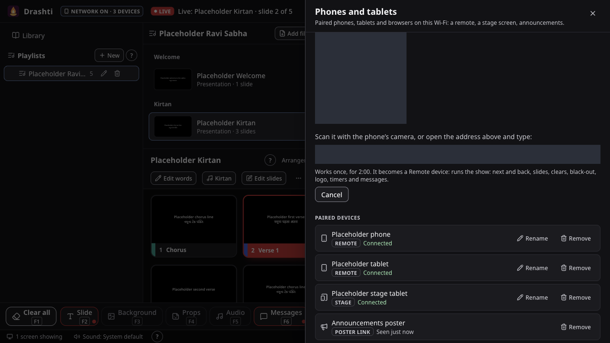

- Name each phone after its owner, so the list says whose it is.
- **Remove** a phone that is lost, or whose owner leaves the seva: it is cut off at once.
- **Make a new one** stops an old poster's link (if a photo of it went somewhere it should not).
- Phones need **Safari 16.4 or later** on an iPhone or iPad, or **Chrome** on Android.
- **Presenters** (a speaker with a phone or an iPad) pair as a Remote, and use `docs/presenter-guide.md`: the library, their notes, and Next, from their own device, at no cost.
- A stage tablet should be set never to lock while it shows the stage.
- Phones and tablets work only while Main is let in (section 3): when it stops, their pages say "Drashti has stopped".
- **When Main restarts** (it stopped unexpectedly, or was quit and started again), phones and tablets left open as a remote or the stage follow it by themselves once it is back, with no reload: the picture, what comes next, **Next** and the stage. (Up to alpha.11 they could keep the last picture, with **Next** doing nothing, until they were reloaded.) **After updating from alpha.11**, though, reload each one once (or close it and open it again): a page left open from alpha.11 cannot follow the newer version. From alpha.12 on, a page left open reloads itself once after an update that needs it, and stays paired (not in a browser that keeps nothing for the page, such as a private window: reload that one by hand, and pair it again if it asks).

**Files from phones** (since alpha.13). **Phones and tablets may add files**, under **Files from phones** in the Phones panel, is off until someone turns it on. On, a phone or tablet paired as a Remote can send a picture, video, sound, PDF, PowerPoint or Keynote file with **Add from this Phone…** in its **Library**: the file comes whole, in pieces, picking up again after the Wi-Fi drops, up to 2 GB a file, and Drashti keeps 2 GB free on its disk whatever comes. Drashti checks what each file really is, then imports it as a file dropped on the library: into Media and the playlist **Added from Phones** (made when the first file comes), marked with the device's name; a PowerPoint or Keynote file comes in as any deck does (section 21), its links to files outside it left out, so it never brings in anything else from this computer. Nothing goes on the screens by itself. While the stream is on air or recording, files come at most 2 MB a second, so the stream keeps the Wi-Fi, and a PDF, PowerPoint or Keynote file waits until it ends. A file still coming waits in the media folder's `.phone-uploads` folder, which backups leave out; turning the switch off stops it.

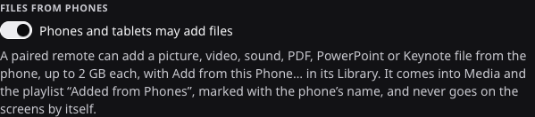

**Sharing a playlist with phones** (since alpha.13). Right-click a playlist (a folder playlist or a smart playlist too), then **Share with Phones and Tablets**, offered while a phone or tablet is paired as a Remote: a mark on its row says it is shared, and **Stop Sharing** ends it. A Remote's **Library** then lists it under **Shared from Drashti**, every file in it to look at and play on the device itself, read-only; a deck in it plays there click by click, each click's motion and then its still. A Stage or Announcements device never sees it.

**Pictures at full quality** (since alpha.13). Phones and tablets show pictures, slides and PDF pages as sharp as their screens show them, up to the original, no longer as small previews. Drashti makes each at the width a device asks for, once, in the background, and keeps them in its data folder's `Network/previews/sized`, up to 400 MB in all (the least used go first); none is made while its disk has less than 2 GB free (the device keeps the one it has).

---

## 8. The network: firewalls and a fixed address

**Firewalls.** Drashti listens for phones (port 8740, while the network is on) and, on Main, for the node (port 8741, while a node is paired). The first time each is turned on:

- **Mac:** "Do you want the application Drashti to accept incoming network connections?" Press **Allow**. If it was refused: **System Settings**, **Network**, **Firewall**, **Options**, and set Drashti to allow incoming connections.
- **Windows:** Windows Security asks about Drashti: tick **Private networks** only, then **Allow**. Check that Windows treats the mandir's network as private: **Settings**, **Network & internet**, the network's properties, **Private network**. If it was refused: Windows Security, **Firewall & network protection**, **Allow an app through firewall**, find Drashti and tick **Private**.

**A fixed address for Main.** Phones remember the address they were paired at, and the node looks for Main at the addresses it last knew. If the router gives Main a new number one day, phones paired at the old number cannot find it, and the node goes offline. So:

- Ask whoever looks after the mandir's network to **reserve Main's address in the router** (often called a DHCP reservation, or a fixed or static IP), for the cable or Wi-Fi that Main uses (each has its own).
- Pair phones at the address that ends in **`.local`** where the Phones panel shows one (it keeps working when the number changes).
- If the number did change: pair the node again (on the node **Unpair…**, then pair with the new address), and the phones at the new address.
- Use the mandir's own network, never a guest Wi-Fi, which keeps devices apart. A cable between Main and the node is better than Wi-Fi.

---

## 9. Shastra texts and calendars

**Shown or hidden.** The operator window starts without the **Shastra** tab, the **Templates** beside the playlists and the library's **kirtan filters** (Category, Kavi, Raag, Occasion): volunteers rarely need them. **View › Show Shastra, Templates and Kirtan Details** (Pro Mode; on Windows press Alt for the menu bar) brings all three back, and turning it off hides them again. It is kept with the library, so a backup keeps it. Hiding them changes nothing else: Shastra texts, templates and kirtan details stay as they were, playlists that hold a passage still run it, the remote's library and the API that name a passage keep working, and search still finds kirtans by their kavi, raag and occasion.

Drashti comes with no scripture text and no calendar: an admin loads files prepared from a source BAPS or the mandir has authorised. The file formats are in `docs/shastra-format.md` and `docs/calendar-format.md`, with made-up examples in `docs/examples/`.

**Shastra texts.** Drag the file onto the library, or (with the Shastra tab shown) in the **Shastra** tab use **Texts…**, then **Load a text…**. Loading a text again (the same abbreviation) updates it, and its passages in playlists keep working. **Texts…** also removes one. Themes has a style for each language of a text, Sanskrit's two scripts included.

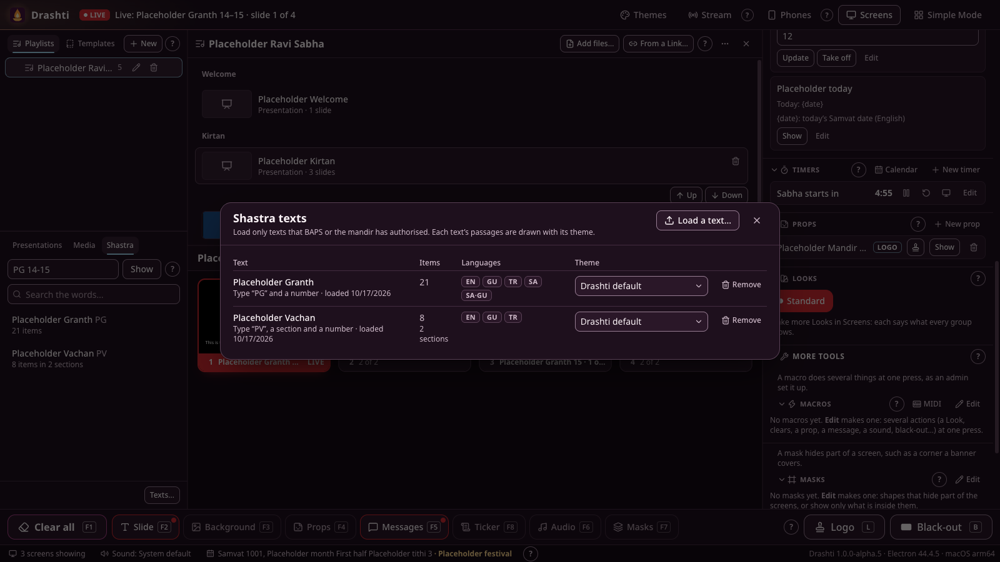

**Calendars.** Drag the file onto the library, or **Calendar** in the Timers panel, then **Load a calendar…**. Loading it again (the same name) updates it. Today's Samvat date and tithi then show along the bottom of the operator window, on stage layouts that have the box for it, and on the hall's screens only in a message that uses it. A date no calendar gives shows nothing.

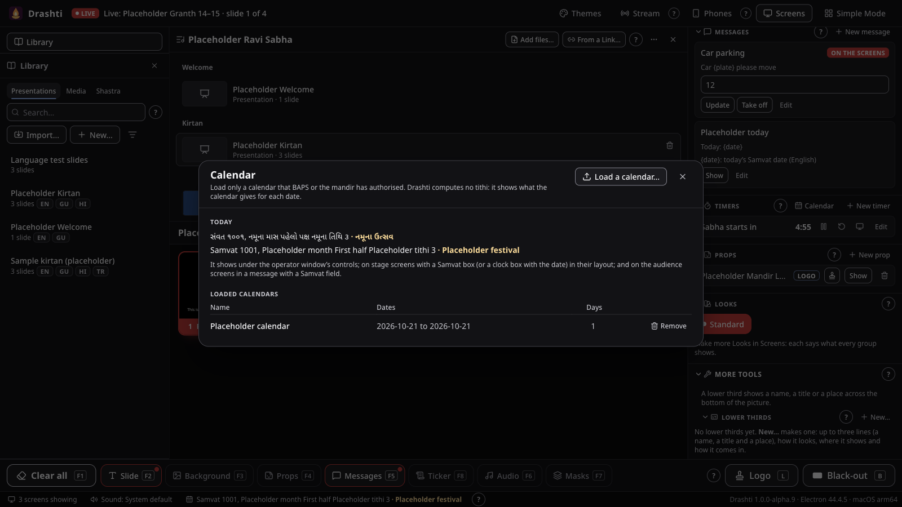

---

## 10. The idle rotation, music and markers

**The idle rotation.** Darshan pictures and quotes for before the sabha, or a lobby screen. **Set up** in the **Idle rotation** panel: tick pictures from the media library, put them in order, set how long each stays up, and type the quotes (from authorised sources) with who said or wrote them. Then, in **Screens**, each group's Look says what it shows **When nothing is up**: **The idle rotation, once started** (the operator presses **Start**; it stops by itself when the first slide goes up), **The idle rotation, always** (a lobby screen), or **Nothing**.

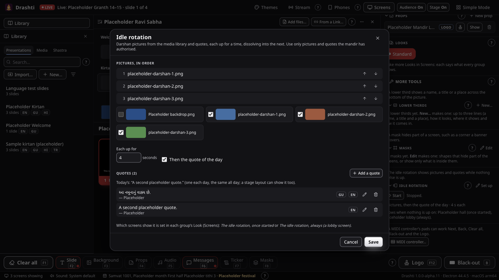

**Music before the sabha.** The **Music** panel, under **Audio**: its **+** makes an audio playlist (**Create playlist**) or brings sounds in (**Import**); sounds dragged onto one from the Finder, Explorer or the library go into it, and **Add sounds…** ticks sounds from the library; put them in order. A folder playlist with sounds (a smart playlist, or a Dropbox folder's) gets one of its own too, named after it with " - Audios": the same sounds, not copies, kept in step with the playlist. The operators press **Play**; Simple Mode has **Play music** and **Pause music** too. A slide's own sound stops the music, with a fade. Since alpha.12, one whose file is missing (not found when the slide was imported, or deleted from **Media**) does not: nothing plays for it, the music or the sound already playing carries on, and LIVE says **File missing: “…”. The sound stays as it was.** (again if Drashti stops unexpectedly). Once the file is found (**Find missing media…** in the import report), imported again or its delete undone, the line goes, and the slide plays it the next time it goes up.

**Markers.** In the library's **Media** tab, a video or a sound has a **Markers** button (a bookmark; its tooltip says "Start, end and markers of …"): set where it starts and ends (**Here** takes the time the preview shows), and named markers to jump to (**Add at the time shown**). Every slide and item that has the file as its background or its sound follows them, and while it plays the markers are buttons under the live picture, and ticks on its time bar (below). Played once, it stops within two frames of its end point on every screen. Since alpha.12 a video on a slide (and its sound), a prop's video and the logo's play between the start and end points too, on every screen: set to loop, they go round between them; played once, they stop at the end point and hold there. A video in the picture-in-picture box goes round between them, in the box and after **Swap**. They have no marker buttons, and **Back 15 s**, **Forward 15 s** and **Last 10 s** do not move them; since alpha.13 the time bar does, for a video on the slide and the box's video (a prop's and the logo's have none). Since alpha.13 too, an import that gives a file start and end points it had none of (the old program's `.pro6` and `.pro` files can hold them) moves whatever is up playing that file at once, as points saved in **Markers** while it plays do: the background, a video on a slide, a prop, the logo or the box, none put up again.

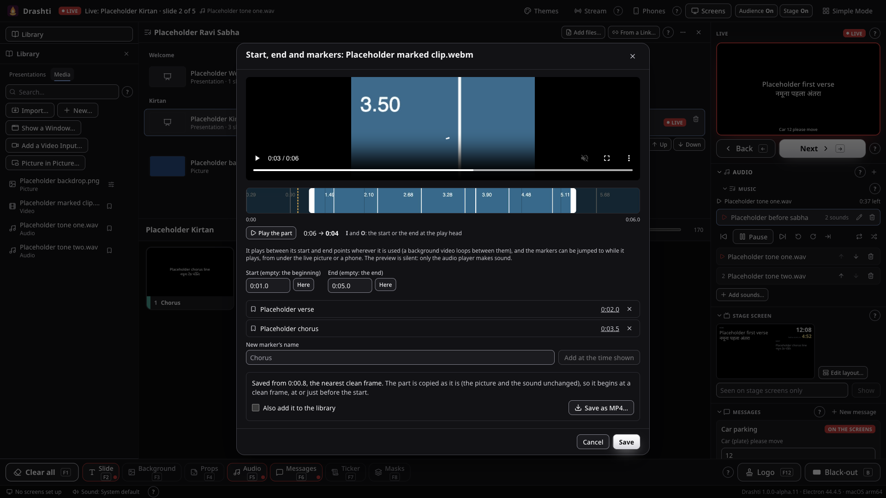

**A video's start and end on a timeline** (Session 26e). For a video the same dialog (from its row in **Media**, **Start, end and markers…** in its playlist card's menu, or under it when its card is chosen) has a **timeline**: stills along it, the part chosen bright and the rest dimmed, a handle at the start and the end to drag (or move with the arrow keys, Shift for whole seconds), the play head, and a click on the stills to move the preview there. **Play the part** plays from the start and stops at the end; **I** and **O** set the start and the end at the play head; its new length is beside the old ("11:02 → 4:00"). Playing follows the start and end as before, and the file is never changed. Markers stay.

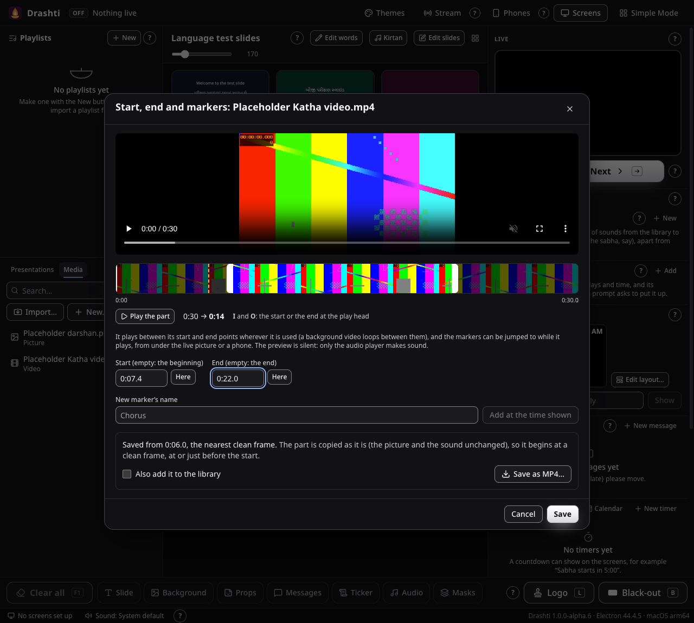

**The time bar** (since alpha.13). Under LIVE, each thing playing has a bar of its own: the background video, a video on the slide up, the picture-in-picture box's video, and a sound or an audio playlist's track (in **Music** too). Each shows the time gone and the time left, its start and end points, and its markers as ticks. In Pro Mode a click or a drag moves it there, once, as the drag ends, on every screen, node, the stream and key and fill together, with **Play** and **Pause** before it; Simple Mode shows the bar and the time left: there nothing moves, skips or pauses what plays, from Drashti or a phone (pausing the music excepted), and **Play** always works, so nothing stays paused. The operator's guide has the rest.

**The play bar on the screens** (since alpha.13). In the slide editor, a video on a slide has **Show the play bar on the screens**, off to begin with. Ticked, the screens show a thin bar along the bottom of that video, with its time since its start point and a play or pause mark, alike on every screen.

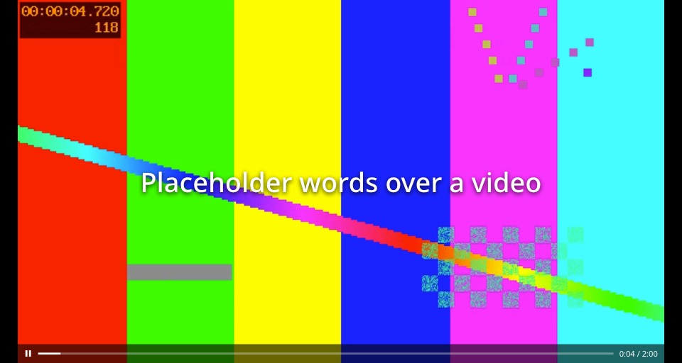

**The Picture editor** (Session 26e), from a picture's row in **Media** (its sliders button), **Picture editor…** in its playlist card's menu or under its card when chosen, or a slide's right-click when the slide has a picture (a PDF or PowerPoint page, say): **Zoom** 100 to 400 % (or scroll over the picture), drag to move it, **Fit**, **Fill** (as big as covers the screen), **Reset**; **Brightness**, **Contrast**, **Colour** and **Sharpness**; and **Auto**, which sets the brightness and contrast from the picture's own darkest and brightest. **Hold for before** shows it as it was taken. **Save** keeps it with the picture (in the library, not the file, which is never changed), so it looks the same wherever it shows: every screen, a node's screens, the stream's picture, key and fill's fill, a phone's picture, and the thumbnails. **As it was taken** puts it back. Videos: not yet. **Sharpness** is made once (Session 26f): after **Save**, Drashti makes a sharpened copy of the picture in the background, which every screen then shows; until it is ready (a moment, longer for a very large photo) the screens show the picture with the rest of its look, unsharpened. A node gets the copy as it gets the picture. Backups leave the copies out: Drashti makes them again after a restore.

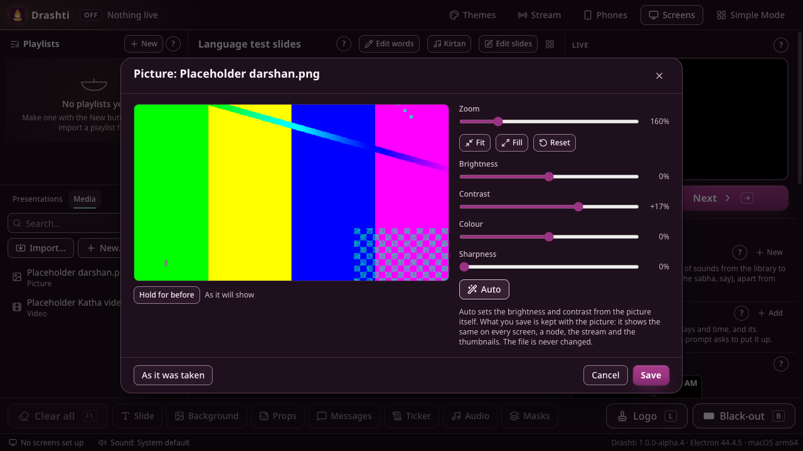

**Save as MP4…** saves the part between the start and the end as a new file where you choose, named to begin with "<name> (4m 00s).mp4", never over a file already there (a free name beside it instead). Nothing is re-encoded: every picture and sound stream is copied as it is, so the quality is exactly the original's; the turn of a phone's video and the file's details are kept, and the file starts playing as it downloads. A copy can only begin at a clean frame (a keyframe), so it begins at the one at or just before the start, and the dialog says which before you save ("Saved from 0:41.2, the nearest clean frame"; the timeline marks it). A video whose picture or sound an MP4 cannot hold (VP8, ProRes, Vorbis…) says so plainly: convert it first. **Also add it to the library** (off to begin with) imports the saved file too. It runs as converting does: in the background, FFmpeg at the lowest priority, waiting while the stream is on air or recording and carrying on afterwards, keeping 2 GB free, shown in the status bar with **Stop**; a stop, a failure or quitting leaves nothing under the real name. It is Pro Mode's, as converting is. A conversion or a save that takes longer than four times the video's length and 5 minutes more is stopped, and says so: FFmpeg may be stuck on a damaged file, so try once more, then try the file in another program.

---

## 11. Fonts

Drashti brings its own fonts for Gujarati, Hindi, English and transliteration, so its own slides look the same on every computer and phone. Two kinds of font come from the computer instead:

- **Legacy Gujarati and Hindi fonts** (Gopika, Terafont, Kruti Dev and others), in which older slides were typed. The import report names them, in presentations and in lyrics imported from a Word document (`.docx`) alike. Those slides only look right where the font is installed: install it on **Main and on the node**. Their words cannot be searched or edited as text yet.
- **A font a theme or a slide names** (an English display font, say): install it on both computers too, or set the theme back to Drashti's own font (leave the font empty).

After installing a font, quit Drashti and start it again. Then look at a few of those slides on every screen, the node's too.

---

## 12. Checks, diagnostics, and when things go wrong

**After installing or updating, on each computer:**

1. **The performance check** (section 11 of `docs/parallel-run.md`): run it twice and keep the second line. It should say `"passed":true`. Since alpha.13 it runs only on a computer let in (section 3): otherwise it says why, and stops.
2. **The watchdog self-test**, on Main and on the node. Start Drashti from Terminal (Mac) or PowerShell (Windows) with diagnostics on, put a slide up, and choose **Diagnostics**, then **Run Watchdog Self-Test**. It takes about a minute (one output is black for about 20 seconds while it checks that a stuck screen is noticed). Every line should say PASS.
   - Mac: `DRASHTI_DIAGNOSTICS=1 /Applications/Drashti.app/Contents/MacOS/Drashti`
   - Windows: `$env:DRASHTI_DIAGNOSTICS=1; & "$env:LOCALAPPDATA\Programs\drashti\Drashti.exe"`

   On the node, start it the same way, with Main running, a slide of words up on Main (no video or timer, which change the picture) and one of the node's displays showing it; then **Diagnostics**, then **Run Watchdog Self-Test** (on Windows, press **Alt** for the menu). It crashes and reloads the node's own window and crashes the output, and checks the screen keeps its picture throughout and comes back showing Main's slide. Don't change slides on Main while it runs (about half a minute).

3. On the Windows PC, the checks in `docs/windows-checks.md`.

**Diagnostics.** After any problem, **Help**, then **Save Diagnostics…** writes one file to the Desktop: the versions, the screens and sound, counts from the library, the watchdog's events and the log. It holds no kirtan words, names or file paths, so it can be sent to whoever helps. The log itself is in Drashti's data folder, under `logs/`. When a part of Drashti has crashed, it keeps a crash file on this computer (never sent anywhere; the newest five), and **Save Diagnostics…** asks first: tick **Include crash files** only when whoever helps asks for them, since a crash file can hold words from slides that were showing. Ticked, the file and the crash files go into one folder on the Desktop. Drashti also keeps a crash journal of the last 20 problems, and the next start says what went wrong while it last ran. When Drashti restarted a window that had frozen, the log and the crash journal also say how long it waited while it saved that window's crash file (a slide change waited that long too). When a window crashed, they say how its process ended, so whoever helps can look it up: on Windows an exit code such as `0xC0000005`, on a Mac a signal such as `signal 11: SIGSEGV` or a number. On the node, **Help**, then **Save Diagnostics…** writes the node's own file to its Desktop (on Windows, press **Alt** for the menu): its link to Main and since when, its clock against Main's, the screens Main gave it, its copies of Main's pictures and videos (counts only), the watchdog's events and the log. It has no library part, and never the node's key to Main. Send both files after a problem that showed on the node's screens.

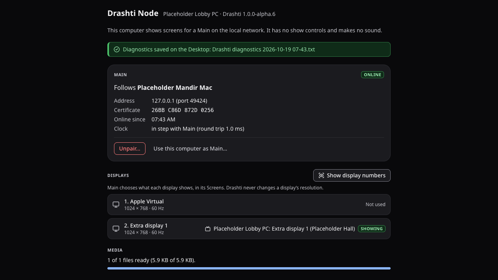

**The Stream panel says "The stream server's certificate could not be checked".** Drashti checks that it is really talking to YouTube before it sends anything, and that check failed. Look first at the computer's date, time and time zone: a wrong date is the usual cause. If they are right, the network may be one that inspects secure connections (a filter, or a hotel or office network): ask whoever runs it, or stream from the other computer. Drashti never turns the check off. (Drashti 1.0.0-alpha.0 on a Mac always failed it; 1.0.0-alpha.1 and later do not.)

**When Drashti stops unexpectedly** (a crash, a power cut, a forced quit). Drashti saves what is on the screens as it changes, and every minute. Started again within **3 hours**, it puts it all back by itself (the slide, the background, black-out, the sound, timers, messages, props, the Look) and a note at the top says what it put back. A video or a sound comes back where it would be by now, between its start and end points as the library has them (since alpha.12 a video on a slide, a prop's, the logo's and the picture-in-picture box's too); the background's video and the sound come back from their last jump (a marker, **Back 15 s**, **Forward 15 s** or **Last 10 s**), with their markers. Started 3 hours or more after the stop, it puts nothing on the screens, and the note says what was live and when. Either way, phones and tablets left open follow it by themselves (section 7). After a quit on purpose, nothing is put back, whatever happened in between, and the stream does not go on air or record again by itself. A conversion, a Save as MP4, a YouTube download or a PowerPoint or Keynote that Drashti had started and that was left running by the stop is stopped as Drashti starts again (the log says so), and a half-saved MP4 is removed; programs you started yourself are never touched, nor a PowerPoint or Keynote that shows a window by then (it is someone's). A conversion that was waiting or going on starts again by itself a little later (section 20), and a change to the screens that **Keep these screens?** was still asking about goes back (section 4).

**Falling back to the old program.** The old presentation program stays installed, untouched, until Drashti has run four weeks of sabhas on that computer without falling back (PLAN.md, section 5.1). Every sabha has a named fallback operator who has practised it (under a minute):

1. Quit Drashti (**Cmd+Q**, or close its window on Windows). It asks first if screens are showing or the stream is on air or recording: confirm.
2. Open the old program. Its screens come back as before.
3. After the sabha, save Drashti's diagnostics and write down what happened and when.

Fall back when Drashti cannot keep the screens right and the fix is not quick; not for a slide that a click puts right.

---

## 13. How much the computers need

Session 15 measured Drashti's heaviest cases on CI's computers, which have no real graphics chip (the Windows one decodes and draws video with its four cores; the Mac is a virtual machine with a virtual one), and again with a handicap (only two cores on Windows; busy programs competing on the Mac). In each, the slides changed every two seconds while a big import ran. The numbers are in the README ("Speed on modest hardware"). What they mean for the mandir:

- **Even the Windows computer with no graphics chip** kept every frame of a 1080p video background at 30 or 60 fps, of 4K, of a video under a mask, and of three screens with the stream, a recording and the music, and slides reached the screens within two frames. With only two cores it still kept 95 to 99% of the frames, except when a new video started every two seconds (then only half).
- **The Mac virtual machine** kept 86 to 100% of a 1080p30 background's frames, and fewer of 60 fps, 4K and dissolving videos. A real Mac decodes and draws video in its graphics chip.
- So each computer needs **a graphics chip that decodes video** (section 1), and the computer that streams, **a graphics encoder** (VideoToolbox on a Mac; NVENC, Quick Sync or AMF on a PC): the Stream panel's "Encoder" line names the one in use. Without one, on a modest PC, streaming takes all the processor there is.
- **Video backgrounds at 1080p and 30 fps.** 4K is four times the decoding for a 1080p screen, for nothing the hall can see.
- **Big imports before or after the sabha.** During one, the import gives way to the show: with the stream on, on a two-core PC, 400 files took more than 12 minutes.
- **After installing or updating, put a video up once before the first sabha:** the first one can hold slide changes up for a moment while the computer prepares its graphics.

The performance check (section 12) on each mandir computer says whether that computer keeps up, and its **video cases** say whether it shows a video background smoothly (`docs/parallel-run.md`, section 11; the setup-day checklist, section 8).

**Ahead of other programs (Windows).** On Windows, Drashti runs ahead of other programs (above normal priority), so the screens' video never keeps a slide change waiting. Session 15's tests seemed to show a price on a PC with no graphics chip when a new video dissolves in every few seconds, but they compared it with below normal, where CI's computer starts programs. Session 17 compared it with normal, where the mandir PC starts Drashti (two cores, no graphics chip, three runs each way): ahead of other programs, Drashti never stopped answering for more than about 30 ms with dissolves (at normal, up to 105 to 186 ms), kept a few more of the video's frames and finished the import sooner; at normal, 9 in 10 slide changes were a little quicker (20 to 29 ms against 34 to 50 ms). With three screens and the music the two were alike, and with the stream encoded on the processor as well both were overloaded (the stream held only 3 to 12 frames a second): the PC that streams needs a graphics encoder either way. Run the video cases on the PC both ways (the checklist says how) and decide: to set it back to normal on that computer, untick **File**, **Run Ahead of Other Programs** (press **Alt** for the menu; Pro Mode; a node has it in its own **File** menu). It changes at once and stays for every start after, on that computer only (restoring a library elsewhere does not bring it). Tick it again to go back. The log says which it runs at (`Main process priority …`).

---

## 14. Import from a Link

**File**, **Import from a Link…** (or, in the library, **Import…**, then **From a Link…**) saves what a link holds in a folder you choose, then imports it through the normal import, with its report. Nothing goes straight into Drashti: the files stay in that folder, where Drashti never moves or deletes them, and the import copies them into the library as every import does. It is Pro Mode's: Simple Mode never shows it.

1. **Which kind of link.** **YouTube**: one video, as MP4 (the video) or MP3 (its sound only). **Dropbox**: a shared link to a file or a folder.
2. **Paste the link.** On YouTube, use **Share**, then **Copy**; in Dropbox, **Share**, then **Copy link**. Drashti takes only `https` links to their own addresses, and says plainly when a link is not one. A YouTube playlist is refused (Drashti downloads one video at a time); a video's link copied while it played in a playlist takes only that video.
3. **What it holds** shows next. For YouTube, the video's title and length (Drashti asks YouTube, through yt-dlp: nothing is downloaded yet). While the stream is on air or recording, this waits, as a download does: the window says "Waiting: the stream is on air or recording. It goes on by itself afterwards." For Dropbox, a file's name and size, or a folder's name (Dropbox sends a folder as one zip, which Drashti unpacks).
4. **For YouTube, choose** **MP4** or **MP3**, and for an MP4 its **quality**: the heights the video offers (720p, 1080p, 1440p, 2160p (4K), 4320p (8K)), each with about how big the file will be. Those above **Highest video quality** (below) are shown, but cannot be picked, and the window says why. An MP3 takes the best sound the video has.
5. **Tick "This video is the mandir's own, or its owner allows us to use it".** Each time: **Download** stays off until it is ticked.
6. **Save in.** The first time, a folder called **Drashti downloads** in **Movies** (Mac) or **Videos** (Windows). **Choose…** picks another; Drashti remembers it.
7. **Download.**

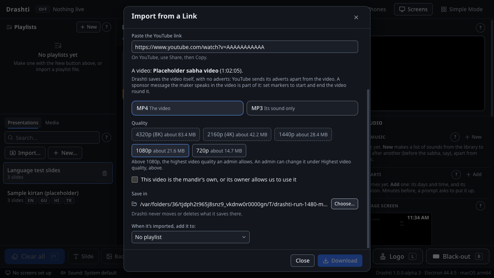

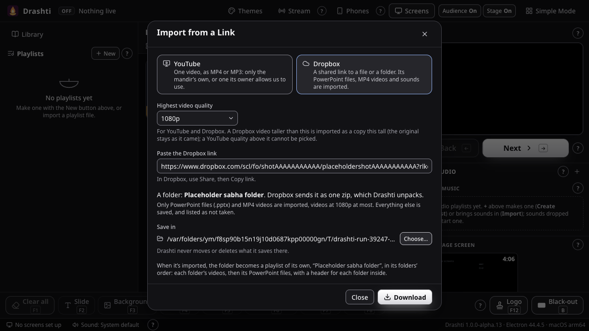

**Highest video quality** (in the same window): a setting for YouTube and Dropbox both, **1080p** to begin with; **1440p**, **2160p (4K)** and **4320p (8K)** can be chosen. It is kept with the library, so a backup keeps it. A YouTube quality above it cannot be picked; a Dropbox video taller than it is imported as a copy that tall (the original stays in the folder as it came). Taller videos make bigger files, and need a stronger computer to play smoothly.

What it does with them:

- **From YouTube, the one file**: the video's title, made safe as a file name (`Placeholder video.mp4`), never over a file already there (`Placeholder video (2).mp4`). It goes to the library as any MP4 or MP3 does.
- **From Dropbox, only PowerPoint files (`.pptx`), MP4 videos and sounds (MP3, M4A, AAC, WAV, AIFF, FLAC, Ogg, Opus) are imported by themselves.** PDFs and pictures (`.pdf`, `.jpg`, `.jpeg`, `.png`, `.webp`, `.heic`) from a folder are saved and listed under **Saved, not added yet**, until **Add the PDFs and pictures** (below). Everything else is saved too, and listed under **Not taken** with the reason.
- **A Dropbox folder becomes one playlist** of its own, named after the folder (" (2)" when a playlist has that name already), at the top of the playlists, opened as its import ends, even with the window closed. Its order is the folder's, **folder by folder**: the top folder's own videos (A to Z, numbers in order: 2 before 10), then its PowerPoint files, then its sounds, then each folder inside it A to Z the same way, and the folders inside those in turn. A **header** before each inside folder's part says its path ("Week 1 › Videos"); the top folder has none, nor does a folder with nothing added. Move any of it about afterwards, as in any playlist. In the window it shows a folder at a time: the folder's own items in the middle, its folders at the bottom left, and the way back up above the items; Next still goes through the whole playlist. Its sounds also show in **Audio**, as "<folder> - Audios". A file that fails does not stop the rest: the import report says which.
- **Add the PDFs and pictures** imports the waiting ones and puts each at the end of its folder's part (a folder that had nothing yet gets its header at the end). Things moved by hand stay where they are.
- **A file link, or a YouTube video**, goes into the playlist chosen under **When it's imported, add it to:** before Download. Since alpha.13 it starts on the playlist a download last went into (else the open one; else a new one, named after what the link holds); another playlist, a new one or **No playlist** can be chosen instead. With no playlist at all, it asks for the new one's name before the download starts (**There are no playlists yet: name one for it**). When the download is in, that playlist opens with the new item chosen; nothing goes up by itself. A playlist's own **From a Link…** (at its top, beside **Add files…**) always adds to that playlist.
- **The same folder order** is used when the import report's **Add to playlist** takes a folder dropped on Drashti or chosen with **Import… › A Folder…** (there, videos, then decks, then other presentations, then pictures, then sounds).
- **Videos no taller than Highest video quality.** A Dropbox video above it goes into the library as a **copy that tall** (1080p to begin with), made by Drashti's own conversion; the original stays in the folder as it came. One that cannot be made that tall is listed under Not taken.
- **Above 1080p, YouTube sends VP9 or AV1, not H.264.** Drashti saves that in the MP4 as it comes, and plays it (checked with 2160p VP9 and AV1 on a Mac). A slower computer may not play 4K smoothly; anything Drashti cannot play is converted by itself as it is imported (section 20).
- **PowerPoint files** come in as a `.pptx` dropped on the library does (section 21).
- **On air or recording, a download waits**, asking nothing of Dropbox or YouTube, and carries on afterwards by itself. A YouTube download already going stops, and starts again afterwards from where it got to. Looking at a YouTube link waits the same way (a look already going stops, and asks again afterwards); looking at a Dropbox link does not need to. **Closing the window never stops it**: the status bar shows how it goes, and a press on that opens the window again. **Stop** stops it and keeps nothing.
- **Drashti keeps 2 GB free** on the disk it saves to: a download that would leave less (by its size, or YouTube's estimate) does not start, and one going stops.
- **A folder's zip is unpacked only if all of it is safe**: if any file in it would land outside its folder, or it holds a link to elsewhere on the computer, nothing in it is unpacked. At most 10,000 files, as Dropbox itself allows. Nothing unpacked is ever run.
- **The import report says where the files were saved**, with **Show in Finder** (**Show in Explorer** on Windows).
- **The log** keeps only the kind of link, the sizes and how it went: never the link, the video, a title or a file name.

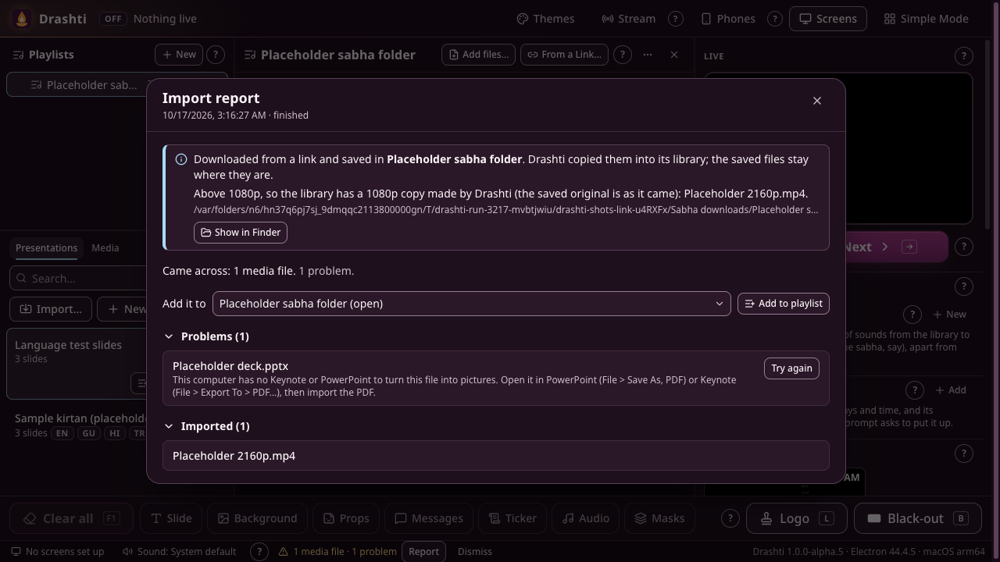

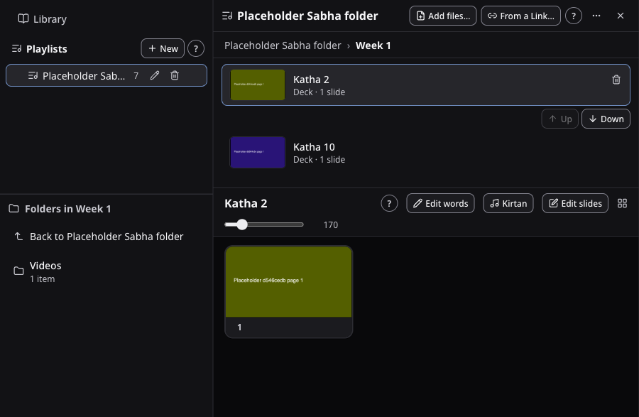

**What may be downloaded.** Only the mandir's own videos and files, or those whose owner allows the mandir to use them: that is what the tick says, each time. Ask before using anyone else's. For YouTube, YouTube's own terms say the rest (youtube.com/t/terms): they forbid downloading, except as YouTube allows or with written permission from YouTube and the rights holders.

**No adverts.** A downloaded video holds only the video: YouTube sends its adverts apart from it, and Drashti takes only the video's own picture and sound. Drashti shows no adverts anywhere, and asks no outside service (such as SponsorBlock) about a video. A sponsor message the maker speaks in the video is part of the video: set its **markers** (start and end) to play the video round it.

**How YouTube works in Drashti.** Drashti holds no YouTube downloading code of its own: it runs **yt-dlp**, a separate program that comes with Drashti, and yt-dlp runs YouTube's own player code in **Deno**, which comes with Drashti too and may not read any file, reach any address or start any program. Neither uses anything of this computer's: no browser, no signed-in account, no cookies, no settings, no proxy. **Drashti never signs in to YouTube.** If YouTube changes how it sends videos (it does, often), downloads may stop working until a newer Drashti brings a newer yt-dlp: **Help › Check for Updates…**. Drashti never updates yt-dlp by itself.

When a video cannot be had, the window says why in plain words, with what to do:

- **It needs signing in** (private, for members, or age-restricted): Drashti never signs in. For the mandir's own, use YouTube Studio (below).
- **YouTube asked to prove the computer is not a robot**: try again later, or use YouTube Studio.
- **Not shown in this country**, or **not on YouTube any more**.
- **A live stream still going** (or not started): download it after it ends.
- **YouTube did not give the video**: if that keeps happening with videos that play on YouTube, a newer Drashti may be needed.

**YouTube Studio, for the mandir's own.** Whoever owns the mandir's channel can always download its uploads in **YouTube Studio** (studio.youtube.com): **Content**, choose the video, its **Menu** (three dots), **Download**. YouTube's help says this gives an MP4 at 720p or 360p, depending on the video, at most five times a day for each video (support.google.com/youtube/answer/56100, read 11 Oct 2026). Then import that file as any other: drag it onto the library.

## 15. Smart playlists

A **smart playlist** follows a folder on this computer (Session 26c): what Drashti imports as media or pictures there (videos, pictures, sounds, and PowerPoint, Keynote and PDF decks), in the folders inside it too, joins the playlist by itself. Words files, the old program's files (`.pro6`, `.pro`) and anything else are left alone, as are hidden files.

- **Making one** is Pro Mode's, as importing is: in **Playlists**, **+ New › Smart Playlist from a Folder…**, then choose the folder. The playlist is named after the folder, goes at the top of the list, opens, and fills itself in the folder's order: folder by folder, each folder's videos, then its decks, then its pictures, then its sounds, A to Z (numbers in order), with a **header** before each inside folder's part ("Week 1 › Videos"). The window shows it a folder at a time, as any folder playlist (the operator's guide has it), and its sounds also show in **Audio** as "<its name> - Audios", kept in step: a sound that joins the folder joins that list at its end, one that leaves goes, and one an operator takes out stays out. Nothing is copied twice.
- **While Drashti runs** it looks at the folder when the computer says something changed there, and every 10 seconds besides. **When it starts**, it catches up on what changed while it was closed.
- **A new file** waits until its size has held still for 3 seconds (a big video still being copied is not taken half-way), is imported as a file dropped on Drashti is, and joins **at the end of its folder's part**: items moved by hand stay where they are. A file that will not import is listed in the import's report, and tried again only when it changes.
- **A file taken out** of the folder is marked **Not in the folder**, not removed: it still plays, as Drashti keeps its own copy. **Remove the missing** (on the line under the playlist's name) takes those items out, with Undo. Put back unchanged, a file is no longer marked.
- **A changed file** (its size or time changed, and its bytes differ) is imported again and **replaces its item in place**: a deck keeps its presentation, now with the new pages; a picture, video or sound item points at the new file. Nothing that changes ever touches what is on the screens: a replaced deck that is up stays up until it is taken down.
- **A folder that is not there** (a USB stick taken out, a network drive gone): the playlist says so, keeps every item, and carries on by itself when the folder is back.
- **At most 2,000 files.** A folder holding more is refused when the playlist is made; one that grows past it is said so, and nothing more is added or marked until some files go.
- **Simple Mode** sees what the folder brings, and can neither make a smart playlist nor remove its missing items. Deleting a smart playlist stops it following its folder; Undo starts it again. The folder itself is never changed: Drashti only reads it.

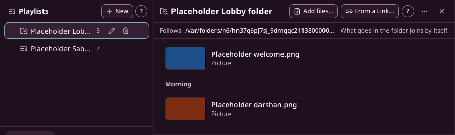

## 16. Themes

**Themes** (in the header) holds how a presentation's words look: a style for each language (font, size, weight, colour and shadow), where the first text box sits, and what is behind the words. Each theme is shown as a preview with a placeholder line in Gujarati, transliteration, Hindi and English.

**The built-in themes** (Session 26): **Midnight**, **Plum and Flame**, **Saffron**, **Maroon and Gold**, **Forest**, **Ocean**, **Ivory** (dark words on cream), **Charcoal**, **High Contrast White on Black** and **High Contrast Black on White**, beside **Drashti default**. Each is a colour behind the words (never a picture), with Drashti's own fonts for every language and a shadow behind light words. Every word, and a Shastra passage's reference line, is at least 7:1 against its background, for a dim hall or a washed-out projector. They are marked **Built in**: change one and press **Save as a copy**, and the change goes into a theme of your own while the built-in one stays as it is. A built-in theme can be deleted; it does not come back.

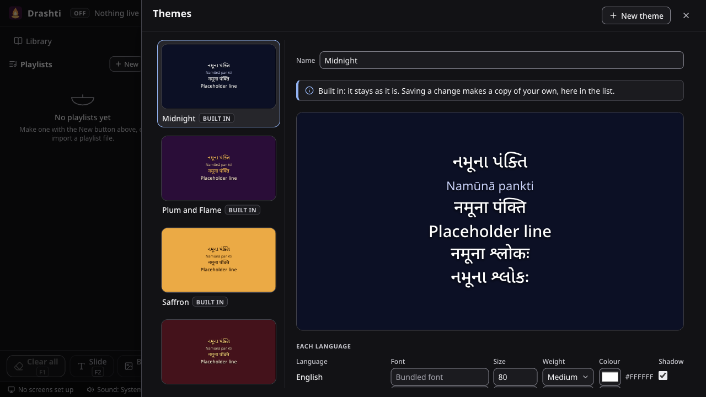

|                                                                                                                  |                                                                                                                  |
| ---------------------------------------------------------------------------------------------------------------- | ---------------------------------------------------------------------------------------------------------------- |
| 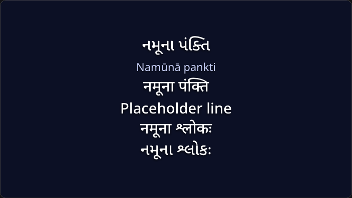 Midnight                                                             | 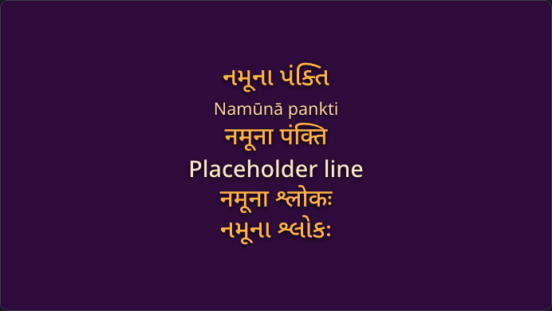 Plum and Flame                                           |
| 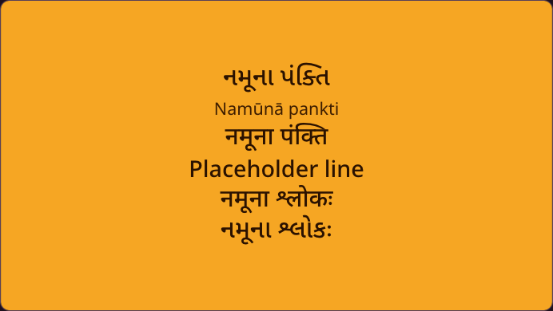 Saffron                                                                | 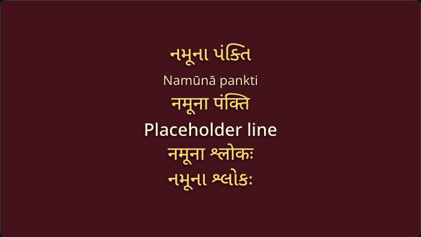 Maroon and Gold                                        |
| 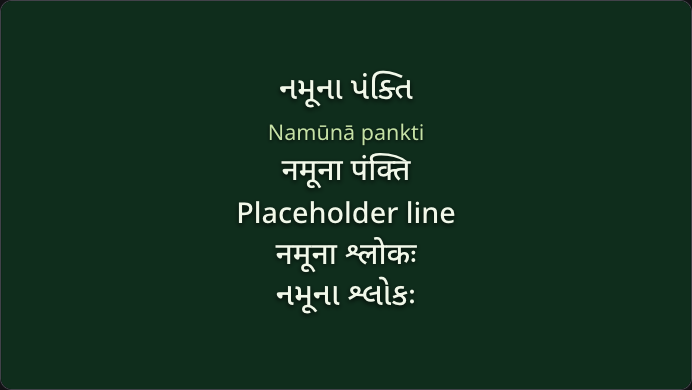 Forest                                                                   | 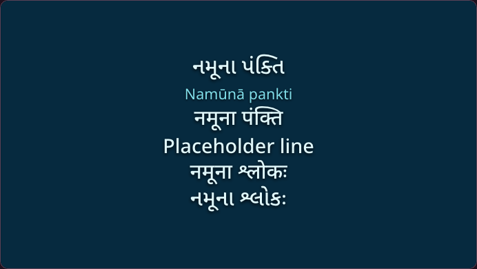 Ocean                                                                      |
| 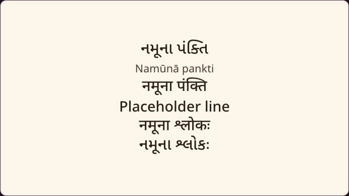 Ivory                                                                      | 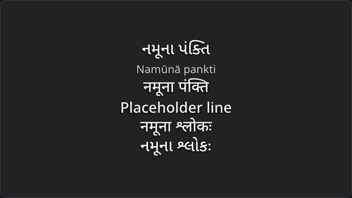 Charcoal                                                             |
| 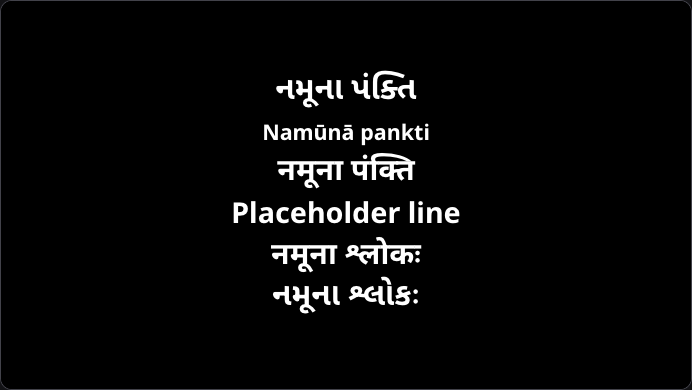 High Contrast White on Black | 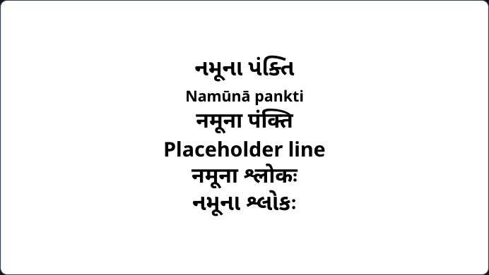 High Contrast Black on White |

**Applying one.** **Apply to N presentations** applies it to the presentations marked in the library (Cmd/Ctrl-click to mark more, Shift-click for a run, Cmd/Ctrl+A for all, or drag a box over them). **Apply to its presentations** applies it to every presentation in the playlist chosen beside it (a deck's pages are pictures, so a deck is left as it is). The words never change, and **Undo** puts the look back. **Make it the default for new presentations** gives it to every presentation made in Drashti from then on, as the Theme step of **Set Up Screens…** does.

## 17. Events out

**Events out** (Session 28) tell another program what happens in the show, as it happens: a slide going up, the playlist moving on, black-out, the stream going on air, a hall screen stopping. The usual receiver is **n8n** (free, run on this computer or another on the mandir's network), which can then dim the lights, post in a group chat, or keep a log. Drashti sends nothing until you set it up.

**Setting it up.** **File › Events Out…** (Pro Mode). Type the receiver's address (in n8n, a **Webhook** node's **production** address, with the workflow active), **Add**, and copy the **secret** it shows into the receiver straight away: Drashti never shows it again. Then tick what that address gets. **Send a test** sends one at once and says what the receiver answered.

- **Ids and kinds only** unless you tick **Include the words** beside a kind: then a slide's lines (up to 200 characters), an announcement's words or a screen's name go too. Keys, tokens, pairing codes, addresses and file paths never go.
- **On this computer or the mandir's network only.** An address on the internet must be allowed (**It is on the internet**), must start `https://`, and only one may be. Drashti looks the name up and checks every address it gives before each request, and sends to the one it checked.
- **Signed.** Each request carries Standard Webhooks' headers (`webhook-id`, `webhook-timestamp`, `webhook-signature`) and `X-Drashti-Signature-256: sha256=…`, an HMAC of the body with the secret, which n8n's **Crypto** node can check (`docs/api.md` says how). **New secret** makes another; the old one still signs too for a day while the receiver changes over.
- **When the receiver is down,** an event is tried again at once, then after 5 seconds, 30 seconds, 2 minutes, 10 minutes and 30 minutes, then given up and counted. Slide changes close together (within a quarter of a second) go as the last one. Events waiting do not survive Drashti quitting: they describe a show that has moved on.
- **A receiver that says the address is gone** (410) is turned off, and the operator is told. Fix it, then **Turn on again**. A 404 (in n8n, a workflow not active, or the test address used) is marked **Set up wrongly?** and tried only twice more.
- **The show never waits for it.** Events go from a low-priority process of their own: a receiver that is slow or never answers holds up neither a slide change nor quitting.
- **Simple Mode** never sees it. The addresses and secrets are kept encrypted by the computer's secure storage, in a file of their own: never in the library, a backup or the log, and a window sees only each address's host.

## 18. The drop folder

**The drop folder** (Session 28) takes pictures, videos and (since alpha.11) sounds into Media by themselves: a folder on this computer where the volunteer who makes the pictures, or a phone's sync, puts them. **File › Drop Folder…** (Pro Mode), **Choose…** the folder, and it is on. Media's **From the drop folder** filter shows what came from it.

- **Pictures, videos and sounds,** every kind Drashti takes (section 20), from the top of the folder (not the folders inside it); what Drashti cannot play is converted by itself, as any import's is. Anything else is listed under **Not taken**, with why ("Only pictures, videos and sounds are taken from the drop folder.").
- **A file is taken once it has held still for 5 seconds** (and, on Windows, once nothing else has it open), so a big video still being copied is never taken half-way. Files a browser or an editor is still writing (`.part`, `.crdownload`, `.tmp`, `~$…`) are passed over.
- **Over 2 GB** a file is listed, with **Import anyway**: check it really is wanted first.
- **While the stream is on air or recording,** what came in waits, and comes in afterwards. Smart playlists wait too.
- **The library only ever gains from it.** Taking a file out of the folder takes nothing out of the library; a file changed is taken again as a new picture, video or sound. Drashti never writes to the folder.
- **In Simple Mode** it carries on, quietly. In Pro Mode one notice says how many came in, and what: "2 pictures and videos from the drop folder are in Media.", "1 sound …", or "3 files …" when they are of both kinds; when nothing came in, only how many were not taken ("1 file from the drop folder was not taken: see File › Drop Folder…."). Files an earlier Drashti listed as not taken for their kind alone (every sound, and the newer video types) come in after the update, once they hold still.
- **Not a cloud folder, if you can help it.** A folder kept by OneDrive, iCloud Drive, Dropbox or Google Drive can show a file before all of it has arrived, or only as a placeholder: Drashti says so, and waits for each to hold still, but a folder on this computer alone is safer.

## 19. Appearance

How Drashti's own windows look (**View**, then **Appearance**, in Pro Mode; the operator's guide has the choices) belongs to **this computer**, not the library: it is kept in Drashti's data folder as `drashti-appearance.json`, beside the role, so a backup restored here, or the library taken to another computer, never changes how a computer looks. Each computer starts on **Follow the computer** (Black or White, as macOS or Windows is set). A node's own window follows its own computer's setting. Anyone in Pro Mode may change it; Simple Mode never shows a switch, and Drashti refuses a change while Simple Mode is on. Appearances people made themselves (**Make a copy of …**) are kept in the same file, up to 20 on one computer, with a second colour chosen for one kept beside them (so an earlier Drashti still reads the file, and simply works that colour out again); only those can be deleted. **Interface motion** (Calm, Lively or Off) is kept there too. To put a computer back as it was when Drashti was installed, quit Drashti and delete `drashti-appearance.json` from its data folder (section 3 says where: on a Mac `~/Library/Application Support/Drashti`, on Windows `%APPDATA%\Drashti`); a file Drashti cannot read is set aside with the date in its name, and the computer follows its own setting until something is chosen again.

## 20. Video and sound files

**What Drashti takes.** Wherever it takes media (**Import…**, a drop on the library, **Import** in the **Music** panel, a folder playlist or a smart playlist, and the drop folder), Drashti takes these videos: `.mp4`, `.m4v`, `.mov`, `.qt`, `.avi`, `.wmv`, `.mkv`, `.mpg`, `.mpeg`, `.webm`, `.mts` and `.m2ts`, and since alpha.11 `.3gp`, `.3g2`, `.flv`, `.f4v`, `.ogv`, `.ts`, `.m2t`, `.vob`, `.mxf`, `.dv`, `.asf`, `.divx`, `.rm` and `.rmvb`. And these sounds: `.mp3`, `.wav`, `.aif`, `.aiff`, `.m4a`, `.aac`, `.flac`, `.ogg`, `.oga`, `.opus` and `.wma`, and since alpha.11 `.mka`, `.ac3`, `.eac3`, `.dts`, `.caf`, `.amr`, `.ape`, `.wv`, `.mp2`, `.au`, `.aifc`, `.m4b`, `.weba`, `.m4r`, `.mpa` and `.ra`. (Import from a Link keeps its own list: section 14.)

**Read as it comes in.** Since alpha.11 each video and sound is read with Drashti's own FFmpeg as it is imported: what it is packed in (its container), its picture and its sound. Then:

- **What plays as it is goes straight in, and is never converted**: MP4, MOV, M4A, 3GP and F4V files, MKV and WebM, Ogg, MP3, WAV, FLAC and AAC, whose picture is H.264 (the usual 8-bit kind), VP8, VP9 or AV1, and whose sound is AAC, MP3, Opus, Vorbis, FLAC or uncompressed (PCM). A FLAC, or an MP4 with H.264 and AAC, plays as it is.
- **Anything else is converted by itself**, with the same conversion as **Convert**: an MKV whose sound is AC-3, DTS or E-AC-3 (which would play silent), an AVI, a WMA or an AIFF, for example. A video becomes an MP4 (H.264 with AAC sound; a picture that plays already is copied as it is, so an MKV with AC-3 sound has only its sound made again), a sound an M4A. One file at a time, a moment after the import ends, in the background at the lowest priority. The original stays as it is; once its copy is made, everything that used it (slides, playlist items, audio playlists, props, themes, kirtan recordings) uses the copy, and so does anything it is added to afterwards: added again to a playlist, a slide or an audio playlist, the original goes in as its copy, and the same file imported again is already in the library (the report names the copy). Once the copy is deleted from the library, the original stands for itself again: **Convert** is offered beside it once more, and converting makes a copy again. Uses an earlier version left on such an original move to its copy once, the first time this version starts off air; and a file deleted from the library while it waits is not converted.
- **Until then** the file says "Converting…" (in **Media**, on its playlist item and in **Audio**) and cannot go live. The import report says how many it is converting, then which it converted.
- **On air or recording, it waits**, and carries on afterwards by itself. None starts with less than 2 GB free on the disk.
- **Quitting never loses one.** A conversion waiting or going on when Drashti quits (or stops unexpectedly) starts again by itself at the next start: the file says "Converting…" at once, and the conversions start 10 seconds after the window has opened, one at a time, never while the stream is on air or recording. One cancelled in **Media**, or one that failed, does not start again.
- **Room on the disk.** The original is kept beside its copy, so each converted file takes room twice over: leave room for that before a big import of such files (section 1).
- **HEVC** (H.265, as many phones record) plays as it is where the computer decodes it (most Macs do, and a Windows PC with Microsoft's HEVC extension), and since alpha.11 is converted by itself at import where it cannot (a Windows PC without that extension, say). Drashti finds out which once its window has opened; an import in the first moments after Drashti starts (a smart playlist's or the drop folder's first look, say) waits for that, 15 seconds at most.

## 21. Decks with their animations

**Two ways in.** A PowerPoint or Keynote deck (`.pptx`, `.ppt` or `.key`) comes in one of two ways, as **File › Decks With Their Animations on This Computer** says on each computer (a tick, in Pro Mode; on Windows press **Alt** for the menu bar):

- **Ticked** (on a Mac, to begin with): where PowerPoint or Keynote is on the computer, the deck comes in with its animations. The deck's own app makes a movie of it, which Drashti cuts into a clip and a still for each click (about 20 seconds for a deck of six slides on a recent Mac). In the show, **Next** steps through the clicks as the deck's own slideshow does, then on to the next slide, and **Back** goes back one click, on every screen at once; each slide's own transition plays as it comes in. Its videos and sounds come in as real media, played as the deck plays them (with the slide or at a click, their trims, loop, volume and fades), with their time bar under LIVE (section 10); a sound set to play across slides plays on across them, and a video shows only between its entrance and its exit. The first time, macOS asks whether Drashti may control PowerPoint or Keynote: **Allow** (refused, the import report says how to allow it in **System Settings**, **Privacy & Security**, **Automation**). The report says which app made the deck's movie, how long it took, and anything it could not keep.
- **Not ticked** (on Windows, to begin with): the deck comes in as pictures, as before (PowerPoint or Keynote saves them), with its videos as real videos where its slides have them and a sound that starts with its slide as that slide's sound. On Windows, PowerPoint's own video export makes the movie, and it has not been tried yet on the mandir's PC: on the setup day, tick it there to try a deck (`docs/setup-day.md` has the list), and leave it ticked only if that goes well.

The tick belongs to this computer, not the library: it is kept in Drashti's data folder (`deck-animations.json`), so a backup does not hold it, and each computer has its own. A computer with neither PowerPoint nor Keynote can make neither the pictures nor the animations: the deck's videos and sounds still come in, into **Media**, and the import report says plainly what needs PowerPoint or Keynote (import the deck on a computer with one, or save it as PDF there and import the PDF). A deck a phone adds comes in the same way (section 7).

**Imported again.** A deck that came in as pictures, imported again where its animations can be made, is asked about first, in the import report: it can now come in with its animations, so should it replace the old one (whatever was changed in that since is lost), or should both be kept? **Replace** puts it in the old one's place, **Keep both** keeps the old one beside it, and **Skip** leaves it. If its animations cannot be made after all, the old one stays exactly as it was, and the report says why: import it again once that is put right.

**While its animations are made.** Never while the stream is on air or recording: going on air stops it, and the deck comes in as pictures (import it again afterwards). It needs room on the disk for the movie and its clips, beyond the 2 GB Drashti keeps free: without it, the deck comes in as pictures and the report says how much more is needed. Drashti gives up on an app that has made no progress for a minute, or no movie at all within 2 minutes, and the deck comes in as pictures. It decides slide by slide: a slide whose clicks could not be cut exactly comes in as its picture, the others with their animations. A PowerPoint or Keynote that Drashti started runs out of sight and is quit afterwards; one showing someone's own work is never quit or stopped.

**In the show.** A slide unticked, deleted or moved in Drashti never shows inside the next slide's own transition: the next slide then comes in with Drashti's own transition instead. In the slide editor, a deck's slide can have one of Drashti's own transitions, for the slide and for each click, **Over the deck's own** or **Instead of the deck's own** (the operator's guide has it).

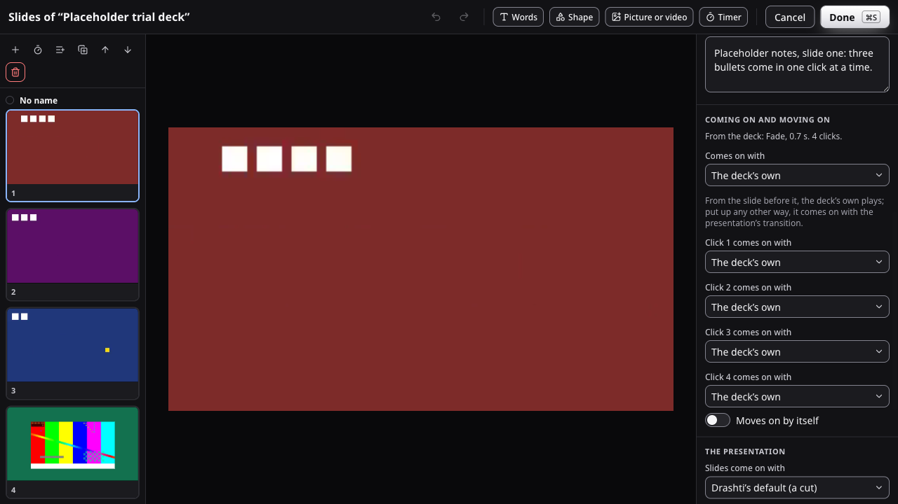

## 22. The keys

**The keys that moved.** Since alpha.11 the keys follow what the operators already press: **F5** clears the sound, **F6** the messages, **F7** the ticker and **F8** the Masks layer (up to alpha.10, F5 and F6 were the other way round, and so were F7 and F8), **F12** shows the logo (as **L** does), and **Cmd+1** / **Ctrl+1** and **Cmd+2** / **Ctrl+2** turn this computer's audience and stage screens off and on again (section 4). The other keys are as they were. The buttons along the bottom of the operator window go in the keys' order, left to right, each showing its key: **Clear all** (F1), **Slide** (F2), **Background** (F3), **Props** (F4), **Audio** (F5), **Messages** (F6), **Ticker** (F7) and **Masks** (F8), then **Logo** (F12) and **Black-out** (B). The key card at the end of `docs/parallel-run.md` ("Keys at a glance") has them all, to print for the operators' desk; **Help**, then **Keyboard Shortcuts…** lists them as each computer writes them. On a Mac laptop the F keys may need **Fn**, unless **Use F1, F2, etc. keys as standard function keys** is on in System Settings (under **Keyboard**); a Windows laptop may need its Fn Lock.

**Single-letter keys.** **B** and **.** (Black-out), **L** (the logo) and **?** (the list of keys) act anywhere in the operator window while no field has the keyboard. For someone who works the computer by speaking to it or with a switch, turn them off, so that a word said never blacks out the hall: **Help**, then **Keyboard Shortcuts…**, and the switch **Single-letter keys (B, ., L and ?)** at the top. It is Pro Mode's; Simple Mode cannot change it. Off, those four keys do nothing in either mode, the list says **Off** beside them, and **Black-out** and **Logo** work from their buttons (Black-out's then shows no key), a MIDI pad and the phone remote as before (and the logo from **F12**). It is kept with the library, so a backup carries it.
