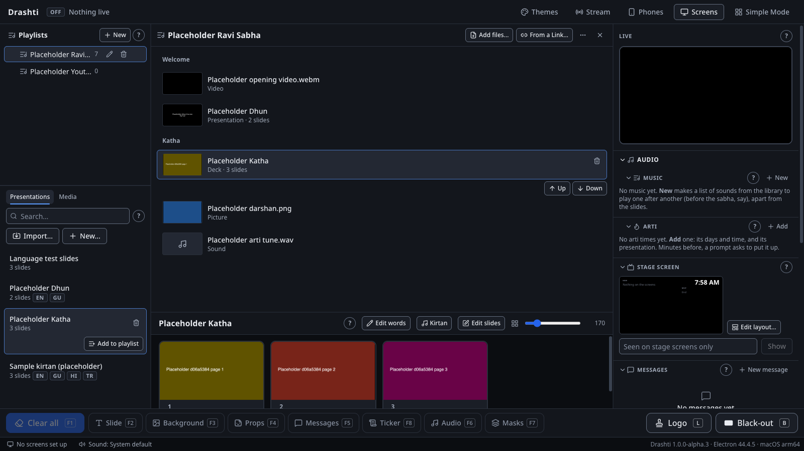

# Drashti design rules

These are the rules for Drashti's operator UI. Its look is an **appearance**, chosen in the app (View › Appearance…, Sessions 39–40): Follow the computer (Black or White, as the computer is set), Black, White, and the colourful ones (section 42). Later sessions follow these rules, and change this file when a rule changes. The tokens are in `src/renderer/src/styles/app.css` (Black's values) and every appearance's in `src/shared/appearance/`, the shared components in `src/renderer/src/ui/`, and the **component gallery** shows each one in every state: **Diagnostics > Component Gallery** (start Drashti with `DRASHTI_DIAGNOSTICS=1`), or `/gallery.html` under `pnpm dev`. Any new shared component goes into the gallery too. `tests/e2e/design.spec.ts` runs the accessibility checks on the gallery.

Write our own code. Design ideas may come from outside the workspace (Priyansh's All Skills collection, read as data, only where the skills review found a licence), but nothing is copied into `app/` from there, from 21st.dev or from anywhere else. Brand matters (the mark, the voice) were decided in the skills review's identity work and the design lab; the appearances were asked for by Priyansh on 19 Oct 2026 (PLAN.md §7, "Appearance").

## 1. What the UI is for

Volunteers run a sabha with it in a dim hall, often under pressure. So:

- **In the appearance the computer has.** Follow the computer is the default: Black in a dark hall when the computer is set dark, White when it is set light. Black and White are plain surfaces with no decoration but the mark beside the name; every other appearance carries its colours in a few places that only mark and decorate too (a header, a band under it, the chosen tab and row, headings: section 42), never where a state is read. Nothing bright is on screen unless it means something or is that decoration.
- **What is on the screens is never in doubt.** "Live" always looks the same, in every appearance (section 3).
- **Calm.** One primary colour on the one next thing to do, a few sizes. Movement only where something arrives or leaves (a dialog, a notice, a playlist row moving), each with its token, never on a show control (§3, "Motion"; Lively and Off, section 43). Reduced motion turns it all off.
- **Familiar to operators coming from ProPresenter.** The library, playlists and media are on the left, the slides in the middle, and what's live and what's next on the right, with the layer clears along the bottom. The name "ProPresenter" never appears in the UI.

## 2. Colour

Colours are named for their **job**, never their hue (`bg-panel`, `text-muted`, `border-live`), so an appearance changes them all by redefining the tokens. Don't use Tailwind's own palette (`red-500`, `amber-900` and so on) in new code, and never a colour of its own in the interface: a component that needs one names a token, so it is right in every appearance.

| Token                                                 | Job                                                                                      |
| ----------------------------------------------------- | ---------------------------------------------------------------------------------------- |
| `ink`                                                 | The window, behind and between panels                                                    |
| `panel`, `panel-2`, `panel-3`                         | Panels; raised things (fields, cards, rows on hover); pressed and selected               |
| `line`, `line-strong`                                 | Dividers; dividers that must be seen                                                     |
| `field`                                               | The edge of a control (text box, select, secondary button)                               |
| `fg`, `muted`, `faint`                                | Text; secondary text; the quietest text allowed                                          |
| `accent`                                              | The focus ring, selection, links                                                         |
| `primary-hi`, `primary`, `primary-lo`, `on-primary`   | The primary, lit from above (one per screen), and its words                              |
| `primary-edge`                                        | A strong secondary's edge (Clear all in a show)                                          |
| `live`                                                | On the screens now: always with a label                                                  |
| `warning`, `warning-bg`, `warning-fg`                 | Missing, can't play, needs a look                                                        |
| `success`, `success-bg`, `success-fg`                 | Connected, showing                                                                       |
| `danger`, `danger-strong`, `danger-bg`, `danger-fg`   | Removing and deleting; something failed                                                  |
| `onair`, `rec`                                        | The stream is public now; it is recording                                                |
| `guide`, `selection`                                  | The slide editor's snapping guides and what is chosen (never text)                       |
| `--depth-*`                                           | The shadows' tints, which follow the appearance (§5)                                     |
| `header-2`, `strip`, `strip-2`, `layer`, `layer-edge` | Session 44's decoration: the header's far end, the title strips, the layer buttons (§42) |
| `--zone-*`                                            | Each zone's surfaces, dividers and controls' edges (§42)                                 |
| `--dur-*`, `--delay-*`, `--stagger-*`, `--ease-*`     | Motion: every duration, delay and easing (§3, "Motion")                                  |

**One primary per screen, for the next thing to do** (Session 26g): in a show, **Next** under LIVE; on the first start, **Show on** the display free for the hall (Session 44), or **Set Up Screens…** when there is none; with nothing chosen, step 1's **Import…** (step 3's **Show on** is a secondary there); in a notice, its next step (**Back up now**, a stopped screen's **Try again**, the display offer's **Show on**); in a dialog, its own (Save, Finish; **Save changes** when typed work would be lost). Everything else in the window is a secondary (Clear all a strong one), and a primary that can't be pressed gives up its light. Next stays lit from the moment something is shown until nothing is, the last slide included, so a show never redraws it. `tests/e2e/next-thing.spec.ts` counts them.

**An appearance is a complete set of these tokens** (Sessions 39–40, `src/shared/appearance/appearances.ts`), switched at run time over the same names: the preload sets the chosen one's colours and its shadows' tints on each of Drashti's own windows' `<html>` before the page draws (`src/preload/index.ts`), so no component changes for an appearance. The states keep their meaning in every one (LIVE red with its label, ON AIR violet, REC a red dot, a warning amber, success green, danger red, the editor's guide and selection the same on any slide), and each appearance tunes their shades to meet the rules on its own surfaces (light appearances have darker ones). **The audience screens never take an appearance:** `body.output` (the outputs, the stream's picture, the stage display in a browser) sets every colour of its own, the ones Drashti had before Session 26g, and `tests/e2e/audience-pixels.spec.ts` (with `scripts/audience-pixels.mjs <commit>`) compares them picture for picture with an earlier build, as `tests/e2e/appearance.spec.ts` does across every appearance. **The phone and tablet pages are Black, fixed** (`body.web`, Session 41; §16): they are not this computer's windows, so they never take its appearance.

**Contrast** (WCAG 2.2 AA, measured on **every** appearance by `src/main/contrast.test.ts` with the rules in `src/shared/appearance/rules.ts`, ratios compared unrounded): every text colour (`fg`, `muted`, `faint`, `accent`, `danger`, the three state words and `rec`) at 4.5:1 or more on every surface, and Drashti's own aims on top: `fg` 15:1 on panels (Black 17.2, White 17.6) and `muted` 7:1 on panels and cards (Black 11.2, White 8.9). Every fill with its words: white on `live` 5.0:1, `on-primary` on the primary's three shades, white on ON AIR, the notices' words on their fills, and the window's colour on `accent` (the setup wizard's step numbers). Edges of controls at 3:1 or more where controls sit (`ink`, `panel`, `panel-2`): `field` (a secondary button's edge, solid), `danger` (a danger button's), `warning` (Put it back's, solid since Sessions 39–40, so it holds on light surfaces too) and `primary-edge` (a strong secondary's); the focus ring at 3:1 on every surface. **Colours that must never be confused:** the primary's three shades and `primary-edge` are at least 10 apart (CIEDE2000) from `live`, ON AIR and `warning`, and the primary at least 7 from `success` and `danger`, in usual colour vision and in simulated protanopia, deuteranopia and tritanopia (Machado 2009). The test fails below any rule, prints every appearance's tables, and checks a named mutation (Black's secondary words dimmed below 4.5:1) would fail it. **The decoration** (Session 42, §42) has rules of its own: the header's words (`on-header`, `on-header-muted`) at 4.5:1 on `header`, its focus ring (`header-ring`) and controls' edges (`header-field`) at 3:1 there and a warning button by its edge or its fill; headings (`heading`) at 4.5:1 on every surface; the second colour (`second`) at 3:1 wherever it marks, as drawn (the chosen row's edge at 70% on `panel-3`); and the second colour kept 10 from LIVE and a warning and 7 from success and danger, headings 10 from LIVE, ON AIR and a warning and 7 from danger, in every colour vision (ON AIR is read only from its own filled, worded badge, so the second colour is not measured against it: White's, its focus ring's blue as before, is 0.6 from it for a person without working green cones). **Session 44:** every rule is measured again on each zone's own surfaces (§42); the header's at every point of its gradient; the title strips as a place where words and controls sit (every text colour and the headings at 4.5:1, the focus ring, controls' edges and the chosen tab's underline at 3:1, at every point of their gradient); a lit layer button's words at 4.5:1 on its fill and LIVE's dot at 3:1 there; and a lit layer button's fill kept 10 from LIVE, ON AIR and a warning, an unlit one's edge 10 from LIVE, in every colour vision. Text is never quieter than `faint`. Never put text on a surface with an opacity modifier (`text-fg/60`), because axe measures the mix. Run the accessibility checks after any colour change.

Group colours (Verse, Chorus…) come from the presentation, so they are shown as a swatch beside the group's name, never behind text. **The defaults** (`shared/group-colors.ts`, Session 26g): teal for Chorus, indigo for Verse, then orange, purple, amber and cyan; **no red**, because red sits too close to LIVE: every default is at least 10 (CIEDE2000) from `live` in usual and simulated colour vision (the closest, orange, 10.7 for a tritanope). A new group takes its name's colour, else the first default no other group has; groups already made, and colours a presentation brings from ProPresenter, keep their own.

## 3. "Live" is one colour plus a label

Anything on the screens now uses the `live` colour **and** says so in words: the `LiveBadge` ("LIVE"), "BLACK-OUT", "ON THE SCREENS", "Logo is on". Colour alone never carries the meaning (WCAG 1.4.1, and colour-blind volunteers):

- a live slide thumbnail has a `live` border **and** a LIVE label in its caption;
- a live row in a list (presentation, playlist item) has a `LiveBadge`;
- a layer clear is lit when its layer has something up: `live` edge and a dot, and the words "On screen" read out (`aria-label`);
- a button that is "on" (black-out, a prop shown) uses the `live` variant **and** changes its words ("Black-out is on", "Hide"). It says its state once: words that change, with no `aria-pressed` besides; or, where the words cannot change (the remote's half-width buttons), fixed words with `aria-pressed` and the state in words beside it (the preview's badge).

Nothing else uses `live`: errors use `danger` and warnings `warning`.

**Show controls change at once** (Session 25). Next, Back, Black-out, Logo, Clear all, Put it back, the layer clears, the Looks and masks buttons, the live thumbnail's border and caption, and Simple Mode's playlist rows take their new state in the same frame as the screens: no colour fade (`Button`'s `instant`), and the live slide is scrolled into view at once, never smoothly. Hover and focus on other controls may keep their short colour change. One name, **Black-out**, with its hyphen everywhere (a unit test checks), and one glyph, a filled screen (`BlackOut` in `ui/icons.ts`), in Pro Mode, Simple Mode and on the phones; Clear all is the eraser everywhere. **One name for each action** (Sessions 31–36, DOC-2): the screens' setup is **Set Up Screens…** in the menu, on its buttons and in the guides (its own title "Set Up Screens"); the Screens panel is **Screens**, and so is the dashboard's button to it; what is up is "On the screens", never "On screens"; apostrophes are typographic (’), never `&apos;` and never a straight one in words people read. `src/main/strings.test.ts` checks each, the guides too.

### Motion (Session 26g, "Rising")

Things arrive and leave; the show never waits for them. **Every duration, delay and easing is a token** in `app.css` (`--dur-*`, `--delay-*`, `--stagger-*`, `--ease-*`, the design lab's table), and nothing uses a number of its own (`src/main/motion.test.ts`); Tailwind's own `transition-colors` and the like take `--dur-hover` and `--ease-out`.

- **What moves:** a dialog rises 8 px (`--dur-dialog`, 220 ms) while the dim behind it only fades (`--dur-scrim`); a side sheet slides 16 px from its edge (`--dur-panel`); menus and "What is this?" pop from where they open (`--dur-menu`); a notice rises 6 px (`--dur-notice`); an empty place settles 14 px with one wisp of smoke from its lamp; a playlist row moving Up or Down slides to its place (`--dur-move`, 180 ms). Each says how it arrives with `data-motion` (`app.css`), and a dialog, menu or notice leaves in `--dur-exit` (about 70% of its entrance) as an inert copy that can't be focused, read out, clicked or found (`ui/motion.ts`), so the show's keys work the moment it closes.
- **What never moves:** Next, Back, Clear all, the clears, Black-out, Logo, Put it back, the Looks and masks, Simple Mode's buttons and rows, the thumbnails and the live picture, with their borders, badges and red glow (`data-show-control`, which no transition or animation reaches). Nothing bounces, springs or scales from nothing.
- **The window opens settled:** whatever is there when the window opens is simply there, with no arrival (an empty place shows its unlit lamp with no smoke); only what arrives afterwards moves (`useArrival` in `ui/motion.ts`). Opening lasts until the page and the window's first data have loaded (`holdOpening`: the library and the playlists, so an empty list that comes with them is simply there too) and the page is then first idle, or until the first key or click (`tests/e2e/motion.spec.ts`). Opening is when a computer without a graphics chip can least spare frames: Drashti starting, or starting again after a stop in a show while the screens are put back. The first start's welcome is the one arrival on opening.
- **Reduced motion:** with the computer set to reduce motion, nothing in the window moves at all, and no leaving copy is drawn (`tests/e2e/motion.spec.ts`). The audience screens' motion is the show's own, and this rule never touches it (section 40).
- **Calm, Lively or Off** (Session 40): this is Calm, the first choice; the Appearance window can make it **Lively** (more moves, never on a show control) or **Off** (nothing moves, as with reduced motion). Section 43 has them.

## 4. Type

- **The fonts are bundled Noto Sans, Noto Sans Gujarati and Noto Sans Devanagari** (`--font-sans`), so names in English, Gujarati and Hindi all look right offline. The weights are **400, 500 and 700**; use `font-normal`, `font-medium` and `font-bold`. `font-semibold` (600) is not bundled and renders as 700.
- Body text is 14 px (`text-sm`); small text 12 px (`text-xs`); the smallest is 11 px (`text-2xs`, for badges and panel titles only). Dialog titles are `text-lg`, page titles `text-2xl`. Simple Mode uses `text-xl` to `text-3xl`.
- Line height is at least 1.45 (the body default), even in one-line rows: Gujarati and Devanagari marks sit above and below the line, and a tight line cuts them off.
- Panel titles and section titles are 11 px bold capitals with wide tracking (`SectionTitle`, `Panel`). Nothing else is in capitals, and never a name someone typed (a playlist's header, a library's name): capitals do nothing to Gujarati or Hindi, and spaced letters break Devanagari's joining line, so typed names are shown as typed, 12 px bold at least (Session 25).
- Numbers that change (timers, counts) use `tabular-nums`.

## 5. Space, size and corners

- Spacing follows Tailwind's 4 px steps. Use 1, 1.5, 2, 3, 4, 5, 6 and 8 (4 to 32 px). Gaps inside a control are 1 to 2, between controls 2 to 3, and between sections 4 to 6.
- **Control heights:** `sm` 28 px (panels), `md` 32 px (the default), `lg` 40 px (dialogs, live controls), `xl` 64 px and `xxl` 96 px (Simple Mode). Nothing clickable is smaller than 24 × 24 px (WCAG 2.5.8), and nothing on a phone's page smaller than 44 × 44 (§8).
- **Corners** (6/8/12/18, Session 26g): `rounded-xs` (4 px) for key hints, `rounded-sm` (6 px) for badges, `rounded-md` (8 px) for controls and rows, `rounded-lg` (12 px) for cards and panels, `rounded-xl` (18 px) for dialogs and Simple Mode's buttons.
- **Depth, from light above:** cards (the live picture, the Screens cards) sit on `shadow-card`, and the slides' thumbnails (and a toggle's knob) on a crisp edge with no blur; overlays (menus, dialogs, tooltips, notices) float on `shadow-overlay`, a dark ring and a soft shadow. Every soft shadow is a blurred rectangle beneath its box: its spread takes in the box's corner (18 px for cards and overlays, the button's own for the primary's glow, `--glow-spread`), so the light falls from above and the graphics chip draws every one in the same way. Their shapes are the same in every appearance; only their tints follow it (`--depth-*`: black beneath on dark appearances, a soft grey on light ones), so changing the appearance asks for no new way of drawing. The live picture and the live slide glow red beneath, and that switches at once with the live border: the picture with `shadow-live`, and the live thumbnail, the media card and the practice show's live slide with a small `shadow-live-thumb`. The primary has a glow of its own colour (`shadow-primary`). Nothing else has a shadow.
- **The look costs a show nothing** (Session 26g, from the Performance check on CI's Mac, a virtual graphics chip, traced; kept in every appearance, Sessions 39–40): the graphics chip works out a way of drawing (a pipeline) the first time each kind of drawing appears, and on a computer without a real one each costs 100–600 ms while every screen waits; the window's first drawing in a show needed 38 of them in Session 26g's look against 14 before it. So every appearance keeps to a few: every soft shadow is a blurred rectangle (above); the only gradients are the primary's (lit from above), the lamp lit on the first start, and since Session 44 the decoration's two, the header's and the title strips' (each two flat colours over a rectangle, one more way of drawing, never moving, never under a show control or the live picture, never filling words; none in Black and White) (the mark beside a name is filled flat, each part in its gradient's middle colour, since the header is drawn again at every slide change); there is no light on surfaces (nor on the phone pages, since Session 41); the thumbnails' edges are crisp; Next stays lit throughout a show (at the end it does what → does there: nothing more); and the window opens settled (§3, "Motion"), so its first data does not arrive with motion as a show begins. The decoration (Session 42) is flat colour otherwise: the band five flat blocks (0 px in Black and White), the states' panel in the header a flat rounded box, the zones (Session 44) flat surfaces, with no blur or layer. Nor does any appearance add a layer of its own (`will-change`): each is put together again at every frame. `tests/e2e/appearance-drawing.spec.ts` finds any blur round a rounded corner, any other gradient (a decoration's that moves or lies under a show control or the live picture too), any words filled with one, any shape filled with a gradient and any layer of its own in the window, Simple Mode, the Appearance window and the component gallery, in every appearance. Check any new kind of drawing in a place a show shows with the Performance workflow, paired against the commit before.

## 6. Components

Use these; don't restyle native elements in a panel. Each is in the gallery.

| Component                                                                         | Use it for                                                                                                                                                                                                                                                                                                                                                                                                                                                                                                                                                                                  |
| --------------------------------------------------------------------------------- | ------------------------------------------------------------------------------------------------------------------------------------------------------------------------------------------------------------------------------------------------------------------------------------------------------------------------------------------------------------------------------------------------------------------------------------------------------------------------------------------------------------------------------------------------------------------------------------------- |
| `Button`                                                                          | Any action. `variant`: primary (the one main action of an area), secondary (the default), ghost (toolbars, quiet actions), danger (remove, delete), live (something on the screens is on), warning. `size` sm to xxl. `icon`, `iconEnd`, `kbd`.                                                                                                                                                                                                                                                                                                                                             |
| `IconButton`                                                                      | An action with only an icon. It must have a `label`, which is read out and shown as its tooltip (with `kbd`).                                                                                                                                                                                                                                                                                                                                                                                                                                                                               |
| `Toggle`, `Checkbox`                                                              | On/off settings (a switch with its label); a tick box in a form.                                                                                                                                                                                                                                                                                                                                                                                                                                                                                                                            |
| `Tabs`, `TabPanel`                                                                | Switching views in one place. The arrow keys move between tabs.                                                                                                                                                                                                                                                                                                                                                                                                                                                                                                                             |
| `Panel`, `SectionTitle`                                                           | A panel with a header: title (which names the region), icon and actions. It can be collapsible (and remember it).                                                                                                                                                                                                                                                                                                                                                                                                                                                                           |
| `ListRow`, `rowClass`                                                             | Rows in lists: selected (the one shown), marked (one of several), drop target, draggable. Put badges in `trailing`.                                                                                                                                                                                                                                                                                                                                                                                                                                                                         |
| `Dialog`, `ConfirmDialog`                                                         | Anything modal. Centred, or a sheet on the right for settings. The keyboard stays inside, Esc closes, and focus goes back afterwards. A confirmation has Cancel focused.                                                                                                                                                                                                                                                                                                                                                                                                                    |
| `KeepChangesDialog`                                                               | The one question before typed changes are lost (close, Esc or Cancel): Save changes the focused primary (Session 26g), but Keep editing focused when saving would change what the screens show now (Session 26h), Esc keeps editing, Keep editing at the left, Throw them away (danger) never the default. It says how much would be lost, and when saving changes the screens at once.                                                                                                                                                                                                     |
| `Menu`, `MenuButton`, `menuPlace`                                                 | Menus under a button, or at the pointer on right-click (and from the keyboard: the Menu key or Shift+F10).                                                                                                                                                                                                                                                                                                                                                                                                                                                                                  |
| `Notice`                                                                          | A message in the page: info, success, warning (announced), danger (announced), with actions and Dismiss.                                                                                                                                                                                                                                                                                                                                                                                                                                                                                    |
| `Field`, `TextInput`, `NumberInput`, `Select`, `ColorInput`, `Slider`, `Textarea` | Forms. `Field` gives the label, hint and error, tied to the control.                                                                                                                                                                                                                                                                                                                                                                                                                                                                                                                        |
| `Tooltip`                                                                         | More about a control, on hover and focus; Esc hides it. Not for anything a volunteer must read to use the control.                                                                                                                                                                                                                                                                                                                                                                                                                                                                          |
| `Kbd`                                                                             | A key hint ("F1", "⌘⇧S"). It takes the text colour around it.                                                                                                                                                                                                                                                                                                                                                                                                                                                                                                                               |
| `Badge`, `LiveBadge`, `MissingBadge`, `UnplayableBadge`                           | A state in words on a row or heading.                                                                                                                                                                                                                                                                                                                                                                                                                                                                                                                                                       |
| `EmptyState`, `Loading`, `ErrorState`                                             | What a place is for when empty and how to fill it; waiting; what failed and a way on.                                                                                                                                                                                                                                                                                                                                                                                                                                                                                                       |
| `Truncate`                                                                        | A name that may not fit: cut off with "…" and shown in full on hover.                                                                                                                                                                                                                                                                                                                                                                                                                                                                                                                       |
| `Progress`                                                                        | A long task's progress.                                                                                                                                                                                                                                                                                                                                                                                                                                                                                                                                                                     |
| `useBoxSelect`, `BoxOverlay`, `ChosenBar` (`ui/select-many.tsx`)                  | Choosing many in a list one can delete from (Session 44): a box dragged from an empty place (the list scrolls by itself near its top and bottom), Shift-click a run, Cmd/Ctrl-click one more, Cmd/Ctrl-A all. The bar says how many, with **Delete** for them all (one question where one is asked, one Undo) and **Clear**; Delete and Backspace do the same. A status line says how many are chosen (no `aria-multiselectable`: these are lists of buttons, not listboxes, whose arrows would take the show's), and each row says `aria-pressed`. Show controls are never in such a list. |
| `Splitter`                                                                        | The handle between panels: drag it, or use the arrow keys (Shift for bigger steps), Home and End, and Enter for the default.                                                                                                                                                                                                                                                                                                                                                                                                                                                                |

**Icons** are Lucide (ISC, `LICENSES/icons/`). Import them only from `ui/icons.ts`, and add a new one there (`BlackOut` is Lucide's rectangle, filled). Use 14 px in small controls, 16 px by default, and larger in Simple Mode. An icon is decoration (`aria-hidden`) unless it is the whole button, and then the button has a label.

**What sits over what** (z-index): the splitter 10, notices and the recovery banner 30, dialogs and the slide editor 40, menus 50, tooltips 60.

**Menus** show the focus ring on the choice that has the focus, give the focus back to what opened them when they close (unless a choice put it somewhere else, such as a name to type), and keep Esc to themselves: over a dialog or the slide editor, Esc closes only the menu. While one is open, the keyboard is in it (the menu itself when nothing in it can be chosen), and its keys (the arrows, Home, End, Page Up and Down, Space and Enter) never reach the show: Space chooses, as Enter does (Session 25).

## 7. Every place has its states

Every list, panel and dialog shows:

- **empty**: what goes here and how to add it (`EmptyState`);
- **loading**: when it waits for the main process (`Loading`), said only after half a second (`LOADING_AFTER_MS`, Sessions 31–36: a quick answer never flashes it), or at once with `immediate` where the wait is known to be long (starting the stream's picture, asking for an update); its `role="status"` box is there from the start, its words hidden until then. A phone's waits are a `role="status"` line too, and its empty places say where they are filled ("There are no playlists yet: they are made in Drashti on the computer, in Pro Mode.");
- **error**: what failed and what to do (`ErrorState` or a `Notice`), in plain words a volunteer understands, never a code, the system's own text or "Something went wrong" alone, and never "(s)" (`plural`). A file problem is said by `fileProblem` (`src/main/plain-errors.ts`: "The drive is full: free some space, or choose another drive."), and a phone is told "Drashti could not do that. Try again; if it happens again, tell the operator." The raw error goes to the log only; `src/main/messages.test.ts` scans the source for each of these (Session 25), and since Sessions 31–36 also for an error's own text in a template over several lines, "something went wrong" in any case, a system's status words (Windows' signature status, FFmpeg's output, an exit code), zod's own words (every form or file a window, phone or file gives is read by `parsePlain` in `src/shared/plain-parse.ts`, which keeps a schema's own words and gives Drashti's for the rest: "It should be a number."), and a message of one sentence that says only what failed ("The PDF could not be read."), which says what to do after a colon or in a sentence of its own. A library that will not open says why and what to do (`src/main/library-problem.ts`: "The library file is damaged: ask the admin to put back the last backup", the admin's guide, section 5, having the steps);
- **a read the window needs as it opens** (Session 39): the playlists, the open playlist's items, the presentation the slide grid opens and the show's state each say, in the flow and announced (a `danger` `Notice` or `ErrorState`), what could not be read, with **Try again** (a primary, the next thing to do): never "No playlists" or "This playlist is empty" when the read failed, and never "Opening the presentation…" for good. Simple Mode's Next says why it has nothing to start. The show's state is asked for again by itself after 1, 2 and 5 s before it is said (then every 30 s; a page that shows no words, every 5 s), and Next, Back and the clears wait for it. When a read works the message goes and the window is as it would have been; the main process's log names each failure once (`src/main/ipc/startup-reads.ts`, `tests/e2e/startup-reads.spec.ts`);
- **a window that fails as it draws** (Session 23): the operator's and a node's window show `ErrorState` with one primary button that reloads that window alone ("Reload the operator window"), and say the screens keep their picture (`WindowBoundary`). A screen (an output, the stream's picture) never shows words: it draws plain black (`SceneBoundary`) and tries again with the next change;
- **long names**: cut off neatly (`Truncate`) and shown in full on hover.

## 8. Keyboard and screen readers

- Everything works from the keyboard. The focus ring (`accent`, 2 px) is drawn by the base styles on every `:focus-visible` element; don't remove it. A component may add its own sign beside it (the Splitter's line thickens), never instead of it.
- **Dragging is never the only way** (Session 25). The chosen library row (a presentation, media file or Shastra passage) has **Add to playlist** on a line under it while a playlist is open, and every library row's menu has Add to "…": it goes after the playlist's chosen item, or at the end (in a folder playlist shown a folder at a time, at the end of the folder shown: Session 44). The chosen playlist item has **Up** and **Down** on a line under it, and Alt+↑ ↓ on it; the keyboard stays on the moved item and the move is said ("Moved “…” up"). Each add and move, dragged or not, is one Undo step. The buttons go on their own line so the name keeps its room, and they hide while a drag is under way (a row that changes under the pointer as a drag starts makes Chromium cancel it).
- **"What is this?"** (Session 25): a small ? on each operator panel's heading (and on Playlists, the library, the slides and the live picture; since Sessions 31–36 also the open playlist, Next and Back, the show controls, the header's Stream, Phones and Announcements (a smaller ?, tucked against each button, as the header is short of room), the status bar, and the Audio and More tools groups) opens two or three plain sentences in the window's flow, never over the show controls: what it is for and the one thing to do first, with **Read more** (Help › Guides at the passage they follow, marked) and Got it (Esc too) giving the keyboard back to the ?. The words are in `src/shared/panel-help.ts`, each naming its guide and the words of its passage; `src/main/panel-help.test.ts` fails on a panel with no words, or words found in no passage or in more than one of the shipped guide. Pro Mode only.
- **The keys sheet** (Session 25): Help › Keyboard Shortcuts…, or **?** when no field has the focus, in Pro Mode (Simple Mode keeps its key line). It is built from `KEYMAP`, grouped by what the operator is doing (`KEY_GROUPS`, every action once: a unit test checks), with each key as the computer writes it (`keyText`), and ends "These keys follow what the operators already press." (Session 50; until then it said they might change after the setup day). The menu item has no accelerator: ? is the page's key, so the guards for fields and dialogs hold. At its top is the switch **Single-letter keys (B, ., L and ?)** (Session 37, WCAG 2.1.4): an admin's, on to begin with, kept with the library (`app:set-single-keys`, locked in Simple Mode and to an operator). Off, the window answers `withoutSingleKeys(KEYMAP)` (`operator/single-keys-store.ts`), so B, ., L and ? do nothing in either mode and the sheet's own ? no longer closes it. An action keeps its other keys, so the Logo keeps F12 (Session 50) and only Black-out is left with none: the sheet says Off beside it, its line under the switch adds "and the Logo from F12", and no button, key line, first step or practice list names a key taken away (Simple Mode's key line then says "Logo F12" and "Black-out: its button"). The window shows nothing until it knows the setting (with the mode), so no key is heard before then; both always come (Session 38): a setting that cannot be read is answered on, the default, with a line in the log, and a request that fails leaves the window to take the default itself (the keys on, and Simple Mode, the safe side), so it never stays blank. No menu item has a single-letter accelerator, and the phone remote has no keys.
- **The show's keys are the ones the operators already press** (Session 50; `src/shared/keymap.ts` sets every key, and nothing else in the app sets one): F1 Clear all, F2 Clear slide, F3 Clear background and F4 Clear props as before; F5 Clear audio and F6 Clear messages, F7 Clear ticker and F8 Clear masks (each pair changed places); **F12** or L the Logo; ⌘1 and ⌘2 (Ctrl+1 and Ctrl+2) the Audience and Stage screens off and on (§46). The layer bar keeps its buttons in the order they always had (Slide, Background, Props, Messages, Ticker, Audio, Masks), each showing its own key from the keymap (F2, F3, F4, F6, F7, F5, F8 from left to right); the keys sheet lists the clears by key, F1 to F8, and Audience and Stage under "Screens, and this list".
- The show's keys (`src/shared/keymap.ts`) are ignored while a field has the focus or a dialog is open (`aria-modal`), and for any key a control has used itself (`defaultPrevented`): a control that handles a key calls `preventDefault()`, so the arrows between tabs, through a menu or on a splitter never also move the slide on the screens (Session 15).
- Lists you move through with the arrows use roving focus (Tabs, menus, radio groups through `ui/radio.ts`); long lists are virtual, so only the rows in view exist. A plain list of buttons (the playlists) is a list, not an ARIA tree: a tree takes the arrows, which belong to the show. Choosing many in one (Session 44, §6's `ChosenBar`) keeps it a list: each row says `aria-pressed`, and a status line says how many are chosen.
- A row with a right-click menu opens it from the keyboard too: Shift+F10 or the Menu key, handled by the row itself on every system (`isMenuKey` in `ui/Menu.tsx`; Chromium does it by itself only on Windows).
- **Landmarks.** The operator window is regions in the order it is laid out, and Tab goes through them in that order: the header, Playlists (and the Library, a region of its own while its sheet is open over them: Session 44), the slides, Live, Show controls (the layer bar) and the status bar. New panels go inside one of them. Only the splitters sit between regions.
- Every control has a name: its text, its `Field` label, or an `aria-label`. Icon buttons have their label as a tooltip too.
- Things that change on their own (what's live, import progress, notices) are in `aria-live` regions or have the status/alert role.
- **Larger text.** At 200% zoom (View, or the system's text size) every control can still be reached: below 960 × 540 CSS pixels the window scrolls rather than cutting columns off.
- **Reduced motion.** With the computer set to reduce motion, the interface's transitions and animations stop (`app.css`). The screens' own dissolves and the ticker are the show, not the interface, and keep moving: reduced motion on the show computer never touches the audience screens (section 40).
- **Phones.** Every control on the phone and tablet pages is at least 44 × 44 CSS pixels, whatever its size class (a rule in `app.css` for `body.web`), and the pages never zoom on a double tap or reload on a pull (`touch-action`, `overscroll-behavior`, the stage display too). `tests/e2e/phone-targets.spec.ts` measures them at 390 × 844 in WebKit; a real iPhone and iPad are still owed. Elsewhere, 24 × 24 is the least (WCAG 2.5.8).
- `tests/e2e` runs axe-core (`tests/e2e/a11y.ts`) on the operator window, Simple Mode, each panel and the gallery, and fails on any serious or critical finding, and on a moderate one not accepted, with why, in `tests/e2e/a11y-moderate.json` (Sessions 31–36). `a11y-keyboard.spec.ts` runs a sabha by keyboard alone in both modes and checks the Tab order and focus ring, that no notice covers the focused control, and that focus never lands in a part hidden from screen readers; `a11y-display.spec.ts` checks 200% zoom, reduced motion, and the phone pages at 375 × 812 (every tab of the remote, the Library's too, its targets 24 px or more); `a11y-gaps.spec.ts` checks Shift+Tab inside a dialog, a window with a tooltip open, forced colours (Windows' contrast themes, where the chosen tab keeps an underline, as its bar is a background) and the audience screens under reduced motion. Where Drashti stands on each WCAG 2.2 A and AA criterion is `docs/accessibility-ledger.md`.

## 9. Layout of the operator window

There are three columns between a header and a footer:

- **Left (Session 26a; Session 44):** the **playlists** have the whole column (never replaced by the open one): the **Library** button at its top, then a heading, a labelled **+ New**, and rows that show **Rename** and **Delete** at their end on the chosen row and the row under the mouse (they keep their room, so no row changes size). With a folder playlist open, its folders are below them, past a splitter (the main folder's own items are in the middle, a subfolder's when it is chosen, with "Main › Sub" to go back). The **library** opens over the playlists and folders as a sheet (Presentations and Media, the search box, then Import…, New… and, when shown, the filters): not modal, so a row dragged from it goes into a playlist, the sheet standing aside while the drag goes on; Esc or × shuts it. The Undo bar stays at the column's foot, and nothing in the column ever draws over the layer bar.
- **Middle (Session 26a):** the **open playlist** above, the chosen item's **slides** below, with a remembered splitter between (`CentreColumn`). The playlist's header has its name (double-click renames), **Add files…**, **From a Link…**, its **⋯** menu and **×** (close). Its items are **cards** in a column, in order: an 80 × 45 picture (a presentation's first slide, a picture's or video's still, or the kind's icon on `panel-3`), the name, then a muted line with what it is and its length or slide count; a header is a plain bold label. The chosen card has Up and Down on a line under it; its trash keeps its place at the end of the card. With no playlist open, the slides have the whole middle. The slides are thumbnails in one grid, in play order, flowing on from one group to the next. Each thumbnail has its group's colour as a strip beside its number, and the first slide each time a group comes up carries the group's name. The thumbnail size (120 to 400 px, 170 at first) is remembered: at 170 three slides fit a row at 1280 × 720 and six at 1920 × 1080.
- **Right (Session 26a's order):** **LIVE** (the preview, headed so; no Next preview), with **Back** and **Next** under it (Session 26g: Next the one primary in a show, with its key; Back beside it, a third of the row; each does what its key does, at once), marker jumps under them, then **Audio** (a `PanelGroup` holding Music, with **+** for Create playlist and Import, and sounds dropped onto an audio playlist going into it; the Arti left in Session 44), the **Stage screen** (with Edit layout…), **Messages**, **Timers** (one compact row each: name, time, then icon buttons for Start or Pause, Reset and Show on the screens, and Edit; running timers first), **Props**, **Looks**, and **More tools** (a `PanelGroup` folded away to begin with: Lower Thirds (in Macros' place, Session 44), Masks, the Idle rotation and the MIDI controller, each after a `PanelNote` saying in one line what it is).
- **Along the bottom:** Clear all (a strong secondary since Session 26g, in its old place with F1; Put it back takes that place in the warning colour), the layer clears, Logo and black-out. Under them is the status bar: screens connected, the sound output, import progress and notices.

The columns are resized with `Splitter`s and the sizes are remembered on the computer (`ui/persist.ts`). Everything fits at 1280 × 720 with nothing cut off or overlapping, every control inside its column. Simple Mode is one screen with big buttons, and fits at 1280 × 720 too.

## 10. Simple Mode

Simple Mode (`src/renderer/src/simple/`) is for a volunteer who has never used Drashti:

- **One screen, nothing to find.** The playlist sits on the left with its headers. In the middle are what's live and what's next. The big buttons run along the bottom: Back, Next (the biggest, `primary`: the appearance's primary, lit from above, the clearest thing on the screen), Black-out, Logo, and Clear all. The header carries the mark beside the name, as in Pro Mode, in the appearance's header colour with its band under it and the states on a panel of their own, and the window is in the appearance chosen in Pro Mode (Simple Mode has no switch). After Clear all, that button turns into **Put it back** (`warning`).
- **Big targets.** The buttons are `xl` and `xxl` (64 and 96 px high), playlist rows are at least 56 px, and text is at least 16 px except the key hints.
- **States in words.** Black-out and Logo use the `live` variant when on, and their words change ("Black-out is on", "Logo is on"), read out once (no `aria-pressed` besides). The live playlist row has a LiveBadge.
- **Nothing that changes anything.** No editing, removing, importing, themes, screens, sound or backups. Don't add a control here that changes the library or the setup. The main process refuses those requests in Simple Mode anyway (`src/main/simple-mode.ts`).
- **Undo comes first.** Back undoes the last Next exactly, and Put it back undoes Clear all. Every new action in Simple Mode needs a way to undo it, in one press.
- **The way out is small, at the top, and asks first** (Session 20). **Switch to Pro Mode…** (`secondary`, `md`) sits at the right end of the header, far from the big buttons, and opens the same question as View > Switch to Pro Mode…: the word **pro**, or a PIN with roles on, so nobody leaves by accident. Windows hides the menu bar, so Simple Mode shows its own way out. Don't make it bigger or move it near the big buttons.
- **Which mode Drashti starts in** (Session 20, `startingMode` in `src/shared/mode.ts`): after an unexpected stop less than 3 hours before the start, the mode it was in; otherwise (a quit on purpose, or a stop 3 hours or more before, Session 21), Pro Mode, with roles on too (Session 46: as the operator, admin locked, with no PIN asked; Simple Mode until then). Roles held locked (the PIN file could not be read) start in Simple Mode. It is the same answer restart recovery uses (`recentStop` from `startupRecovery`): did the last run stop unexpectedly, within `RECOVERY_MAX_AGE_MS`?
- It fits 1280 × 720 with nothing scrolling, its way out at the top (`tests/e2e/simple-mode.spec.ts`).

## 11. The slide editor

The slide editor (`src/renderer/src/editor/`) covers the operator window, as Edit words does, so nothing behind it can be pressed by mistake. Along the top: its name, Undo and Redo, what can be added (Words, Shape, Picture or video), then Cancel and Save (the primary button; **Done** when nothing has changed). Below: the slides on the left, the slide in the middle, the inspector on the right.

- **The slide is drawn by the slide renderer**, scaled to fit, so what is seen is what the screens show. Selection is the `accent` colour: an outline round each selected element, square white handles to resize one and a round one above it to turn it, all a constant size on screen. Snapping guides are `guide` (a pink that shows on any slide), across the whole slide.
- **The keyboard.** The slide is one focus stop (`role="application"`, with its keys in its label): Tab chooses the next element and, after the last, moves on to the inspector, so keyboard users are never trapped. A polite live region says what is selected, where and how big. Esc steps back one stage at a time: typing, then the selection, then the editor (asking first when there are changes).
- **The inspector** groups its fields in titled sections (Selected, Place and size, Words, Shape, Picture/Video). Numbers change as they are typed; colours use the system picker. It says whether text styles go to the whole box or to the selected words.
- **Typing in place** shows a dashed `accent` outline round the box; the words keep their look while typed.
- **Words the hall can read** (Sessions 31–36, SLD-1). Every text box is measured where it is drawn, on the screens, in the editor and on thumbnails: one whose words run past it (shrunk as far as shrink-to-fit goes, if on) is marked `data-overset`; a thumbnail with such a box shows a small `warning` mark in its picture's top right corner (and its name says "words run past a box"), and the inspector says "Words run past the box" and what to do. Size floors are the editor's only, at a 1080-line reference: the size the smallest words are drawn at (their size, times shrink-to-fit's fit, times 1080 over the slide's height) gets a `warning` below 36 px and a quiet note below 48 px (`src/shared/readable.ts`). The screens never refuse a slide, and their shrink-to-fit floor (`MIN_FIT`, a tenth) is unchanged. The import report counts the slides that may run over or sit below 36 px, by an estimate (it has no window to measure in).
- **Darkening behind the words** (Sessions 31–36, SLD-3). A slide's own settings, and a theme's, have **Darken behind the words**: **None** (every slide to begin with, and every slide made before it: it is never turned on by itself), **A band behind the words** (each box's lines on a black band, its spread drawn round them so the words lie exactly where they did) or **The whole picture** (black over everything before the slide's first words: its picture, its colour and the background's picture or video under it), **40, 60 or 80%** dark. It has no motion of its own: it comes and goes with its slide. Undo covers it; applying a theme sets it on every slide (None takes it off). The inspector reads the selected words' contrast against what is behind them, darkening included: a `warning` below 4.5:1, a quiet note below 7:1 ("reads best"), and over a picture or video, which cannot be measured, a word that darkening keeps them readable; the theme editor reads its words' lowest contrast the same way, and the theme contract counts it. Drawn alike on the screens, the thumbnails, the phones and in the editor (`SlideView`'s `data-darken`); a slide with none draws exactly as before.
- **Safe areas** (Sessions 31–36, SLD-2): **View › Show Safe Areas** (off to begin with, kept with the library) draws over the slide, never on the screens: action-safe at 93% (`guide`, dashed) and title-safe at 90% (`accent`, dashed, "Words inside here"), the HD standard; the ticker's band along the bottom (7.5%, a `warning` tint and line) and a message's band above it (dashed); and a `danger` line, "Cut on “group”", wherever a screen group's canvas or its Fill cuts the slide off. Words in the ticker's band on a group whose Look shows the ticker get a `warning` in the inspector, whether or not the safe areas are shown. No Look option keeps slides above the ticker: it would move the slide whenever an announcement came or went.
- **Several selected** keep their own outlines and get one dashed `accent` box round them all, with the same square handles and round handle, which act on them together (snapping as one); "2 elements selected" is read out. Copy, Cut and Paste are the Edit menu's (and their keys); "Copied 1 element." shows in the editor's note line.
- Questions use the usual alert dialogs: "Keep your changes to the slides of “…”?" (`KeepChangesDialog`: Save changes has the focus and Esc keeps editing; it says when the presentation is on the screens, because saving then changes them at once, and Keep editing has the focus then, so Enter never changes the screens by accident) and "Save over the other change?".
- It fits at 1280 × 720 with nothing cut off, and axe finds nothing serious, also while typing (`tests/e2e/editor.spec.ts`).

## 12. Kirtans and their languages

- **Missing is a state, not a blank.** In Edit words, By language, a slide with nothing in a language shows that field with a dashed `warning` border, a `warning` tint and a **Missing** badge by the language's name (the field's own label says "(missing)" for screen readers). An empty field is never shown as if it were a line with no words.
- **A kirtan's languages are named, never flagged by colour alone.** Track names are the words Gujarati, Hindi, English and Transliteration (`LANG_NAMES`); short tags (GU, HI, EN, TR) appear only as badges on library rows.
- **Choosing a screen's languages** (`screens/LanguagePicker.tsx`): two radio buttons, "All, in each slide's order" and "Only these, in this order"; then one row per language with a tick box and, when ticked, Up and Down arrows (icon buttons with those words as labels). The last language ticked cannot be unticked. The same picker goes in Screens and the setup wizard.
- **Previews say whose languages they show.** The live and next previews draw a kirtan's slide in the first audience group's languages, and under the live picture a line says so ("As “Hall” shows it: Gujarati, Transliteration"); thumbnails always show every language.
- Both the Kirtan dialog and Edit words, By language, fit at 1280 × 720, with each field at least 180 px wide when all four languages are side by side (`tests/e2e/kirtans.spec.ts`).

## 13. Templates and the setup wizard

- **Templates live apart.** The playlist column has two tabs, Playlists and Templates. A template opened shows an `info` notice saying it never goes on the screens, with **New playlist from this**; its items are never put in the slide grid.
- **Slots are dashed, quiet rows**: a dashed `line-strong` border, the slot's name, and "A slot · its category · choose what goes here". An import's placeholder keeps the dashed `warning` look: one is a place to fill, the other a problem. **Edit slot…** (its menu) is a small dialog with the name and "Search in", the same fields as Add a slot.
- **An item's timer cues say what they do, under its name**: a small clock and "starts “Pravachan”, shows “Sabha starts in”". They are set in **Timers when it goes up…** (its menu): one row per cue, two selects in words ("Start it from the beginning", the timer) and Remove; up to four.
- **The wizard is a dialog of steps**: the step names with numbers along the top (the current one bold, `aria-current="step"`), one step at a time, **Back** on the left, **Skip this step** and **Next** (primary) on the right, **Finish** on the last step after a summary in words. Anything it would change is said before Finish, and nothing changes until then. Since Session 44 it opens on its Screens step, each display a choice among three in one click (the first free one already the hall's when there is none), whose own buttons are **More setup…** (on to the rest) and **Done** (primary), which sets the screens at once.
- **The display offer** (Session 44, `screens/ShowOn.tsx`): while no screen shows the hall's picture and a display other than the controls' is connected, an `info` notice in the window's flow under the header (never over the show controls) says so, with **Show on** and the display's name (its next step, primary) and **Not now** (ghost), which puts it away until the displays change. One click makes it the hall's screen with the setup's own defaults (an "Audience" group in the live Look, every language, the screen named after the display) and puts the test slide up for a few seconds, as **Done** would. `tests/e2e/show-on.spec.ts` checks the one click from the offer and from the welcome, and **Done** straight on the displays.
- **Outputs are numbered the same everywhere**: the wizard's rows, and the big number Identify puts across each display. The display the controls are on carries a `warning` badge, and choosing an output there says Finish will ask first.
- Both fit at 1280 × 720 (`tests/e2e/templates.spec.ts`, `tests/e2e/setup.spec.ts`).
- **The first start** (Session 26g): once per library (`welcome` in the library's settings), before anything was set up, in Pro Mode only and never for a volunteer (roles on, the admin PIN not typed; nor, since Session 46, does the setup wizard open by itself for one), the lamp lights once over `--dur-light` (1.4 s; with reduced motion it is simply lit), then the welcome's words and choices arrive one after another, with Lively's longer, bigger moves (the only place they are used). **Show on** the display free for the hall (Session 44: the primary, with the keyboard, when there is one; one click makes it the hall's screen) and **Set Up Screens…** (the primary when there is none) opens the wizard at its Screens step; **Try a practice show first** puts five placeholder slides on the operator's screen only, with a banner saying nothing is on the screens and nothing is saved, and **Leave the practice show** comes back to the welcome; **Skip for now** leaves nothing chosen, so the middle's empty place leads: the unlit lamp and three steps (Import…, New playlist, Set Up Screens…, with Show on beside it as a secondary when a display is free), step 1's **Import…** the one primary. Esc is Skip for now. View › Set Up Screens… still opens the wizard, ending a practice show.
- **The practice show never leaves the window** (`practice/practice-store.ts`, `shared/practice.ts`): its state is the window's own, LIVE and the show controls draw it, and the keys, the MIDI pads and the show buttons work it while it is on; no output, node, stream, recording, phone or the API ever hears of it (`tests/e2e/first-start.spec.ts` checks the engine, the output's paints and picture, and the library are unchanged).

## 14. The stream

- **ON AIR and REC are not LIVE.** LIVE (`live`, red) means "on the hall's screens". The stream has its own marks in the header, beside the name, and in Simple Mode: **ON AIR** on `onair` (violet, white text 5.7:1), and **REC** as a `rec` dot beside the word on a panel. Both always say so in words, and while reconnecting ON AIR says "On air · reconnecting". The window's own title says it too ("Drashti — ON AIR · REC").
- **No sound** (Session 31) sits beside them when nothing has reached the stream for 20 s (or 3 s after its microphone was unplugged): the `warning` tone (amber field, `warning-fg` words) with a crossed-out speaker and the words, never red, which is LIVE's. One `Notice` (warning) under the header says why and what to check, in the window's flow like a stopped screen's, so it never covers a show control; it goes when sound is back.
- **The stream's picture has stopped** (Session 31): when the stream's own page crashed a sixth time in a minute, a `danger` `Notice` in the same place (Pro and Simple Mode) with **Try again** as its one primary; no close button, as the stream is showing its last picture until it is back.
- **The Stream panel is a sheet on the right**, like Screens: the Program's preview (marked `data-a11y-picture`) with the sound level under it, then the layout as two large choices (`role="radio"`), the inputs with their state in words, and the controls. **Stream settings** is a centred dialog over it.
- **The level meter** reads -60 to 0 dB (`role="meter"`), green, then `warning` above -12 dB and `danger` above -3 dB, holding a peak and falling back at 20 dB a second like a mixer's; above 0 dB it says "Too loud". It shows the mix as it comes, before the encoder's limiter (Session 31), which keeps what is streamed and recorded under -1 dBFS.
- **A key is never shown.** Once saved, the settings say "A key is saved for this profile" with **Replace key** and **Remove key**; the field is a password field and empties as soon as it is sent.
- Both fit at 1280 × 720 (`tests/e2e/stream-program.spec.ts`).

## 15. Converting media

- **Names come first.** The media list's column is narrow, so a row keeps its name whole and says everything else on its second line: "Video · can't play as it is" in `warning-fg` (what the file is in the tooltip) with a small **Convert** button (the `Wand2` icon) at the end; **"Converting…"** from the moment it waits until it is converted (Session 50; it said "Waiting to convert" while it waited its turn or for the stream to go off air, and why it waits is still in the tooltip), and once FFmpeg says how far, a thin bar and "Converting… 42%" (the words carry it for screen readers; the bar is only seen), with an **×** at the end to cancel it, waiting or converting; after a failure, why, in `danger-fg`, and the button says **Try again**; once converted, "Converted to .mp4" (the tooltip names the copy everything now uses). In the media list only a missing file keeps a badge.
- **One bar above the list** when there is something to convert: how many files Drashti cannot play, with **Convert all**; while converting, "Converting N files, one at a time" and, for more than one, **Cancel all**. The bar's text is `aria-live="polite"`, so a screen reader hears it change.
- **Converted by itself at import** (Session 50, `library/converting.ts`): a video or sound the import finds Drashti's player cannot play (read with the bundled FFmpeg: an MKV with AC-3 or DTS sound, an AVI, a WMA, an AIFF) is converted with nothing pressed, one file at a time, a moment after the import and never while the stream is on air or recording; a file that plays (a FLAC, an MP4 with H.264 and AAC) never is, nor is HEVC at import (its **Convert** stays where the computer cannot play it). Until it is converted it cannot go live, and it says **Converting…** wherever it shows: its row in Media (above); a playlist's item, a media item open in the middle and a slide whose background it is, as an `info` badge with the `Wand2` icon in place of **Can't play** (its tooltip: "Drashti is converting it to a file it plays: it can go live once that is done."); its track in Audio, in words where its length goes; and its line in the import report. What the import report adds to a playlist is the copy, once it is converted.
- **The import report** says the same in an `info` notice, with **Convert all**, and each file's row has its own **Convert**, then "Converting…" (with how far, once FFmpeg says), then "Converted: <copy>" in `success-fg` text. What Drashti converts by itself it sums up in an `info` notice of its own (Session 50): "Converting 4 files Drashti cannot play as they are, one at a time: each is used everywhere once it is done, and the originals stay as they are.", then, once they are done, "Converted 4 files Drashti could not play as they were: …" with their names (up to five, then "and 2 more").
- **The copy is an ordinary row of its own**, next to the original (the same name, another extension). Undo goes on the one Undo stack, "Converted <file>".
- It fits at 1280 × 720 (`tests/e2e/convert.spec.ts`), and the screenshots are `docs/screenshots/convert-*.png`.

## 16. Phones and tablets

- **The network says it is on, always.** While it is on, the header (and Simple Mode) carries "Network on · N devices" in a quiet badge of its own (an outlined accent, never the live red or the on-air violet), with a warning look when it is not listening.
- **The Phones panel is a sheet on the right**, like Screens and Stream: a large switch, the addresses in a monospace font a volunteer can read out, pairing, the devices, the poster. Pairing shows a QR code (black on white with a quiet border, so every camera reads it, in a dark room too) beside the six-digit code in large monospace type, grouped "123 456", and the time it has left.
- **Removing a device asks first**, and says it is cut off at once.
- **Pages on phones are phone-first**: the design system's dark look, 16 px or larger type, touch targets at least 44 px, everything in one column, and nothing that needs a hover. Two kinds of text are smaller until Priyansh decides (proposed in Session 25): a tab bar's word under its icon (12 px, `data-small-label`) and the state badges (11 px bold capitals, as everywhere).
- **The remote is one screen**: a header with the device's name and its connection chip (Connected in green, Connecting…, or Not connected with when it tries again, always in words), a middle that scrolls, and Back and Next below it (xl buttons, Next primary), so nothing ever scrolls under them. On a phone the middle is four tabs (Show, Playlist, Library, and More: the Looks when there are two or more, timers and messages) with a tab bar under Back and Next; from 768 px wide the playlist or the library (a two-way switch above them) sits beside the show and there are no tabs.
- **The presenter's remote** (Session 18): **Notes** sit under the live picture, the live slide's in body size (`text-lg`) and the next slide's below a rule in muted text, behind a small **Show notes / Hide notes** button (aria-expanded, remembered on the device, open the first time). The **Library** is a search field (`type="search"`) over the presentations by name, 100 at a time with **Show more**; each row is the name with its library, category and slide count (or, when searched, where it was found) in muted text, and the live one has the live border and badge. A presentation opened from it shows its slides with "Not on the screens. Tap a slide to put it up." and **On the screens** to go back to what is live; a slide a search found has the accent border and is scrolled into view. **Held sideways** (from 1000 px wide in landscape: an iPad, a laptop's browser) the page is two columns: the live picture, the notes, what comes next and the clears on the left (40%, at least 20rem); on the right a tab row (Slides, Playlist, Library, More) over its own scrolling panel; Back and Next stay along the bottom, full width.
- **On the remote, LIVE is the live red, as everywhere**: the live slide's thumbnail and the live playlist item have a live border and the LIVE badge; Black-out and Logo turn the live colour while on and say so in words ("Black-out is on", "Logo is on", Session 26g, as Pro Mode and Simple Mode do), with no `aria-pressed` besides; Put it back turns warning when it can.
- **The phones are Black, fixed** (Session 41; plum with the lamp's light from Session 26g until then): every phone and tablet page (`body.web`) takes Black's colours and its shadows' tints, the same on every phone, never Main's appearance; plain surfaces with no light anywhere, and `theme-color` Black's window colour (`#09090b`), so the phone's own bar matches. The mark beside "Drashti" on the pairing page, the remote's header and the announcements page, and the Home Screen icon, stay the logo's own. On the remote, Next is the white primary, the one primary on a phone's Show tab. The stage display is a screen and keeps the look it had (`body.output`). Every phone page passes axe in Black on a phone (375 × 812) and on a tablet (810 × 1080, and held sideways at 1080 × 810) in Safari's engine and Chrome's, with every target 44 px or more, while Main shows another appearance (`tests/e2e/phone-pages.spec.ts`); `src/main/contrast.test.ts` keeps `body.web` Black's.
- **Thumbnails on a phone** draw the slide with the outputs' renderer; pictures and video are previews, grey until they load.
- **The stage display is the stage screen**, on black, with nothing else but a quiet Full screen button (until it is full screen) and, while the connection is down, one small warning line in a corner over the last picture.
- **The announcements page is one short form**: the words (a large text box with how many characters are left), who it is from, how long to show it, and one large Send. Below it, "What you sent" lists the phone's own announcements with what became of each, in words and colour: Waiting for the operator (warning), On the screens until 5:12 pm (live), Shown or Not shown (neutral).
- **The Announcements queue is a sheet on the right**, like Phones, opened from a header button that appears while the network is on and turns warning with how many are waiting ("Announcements (2)"). Each waiting announcement is a card: its words large, who sent it, from which device, when and for how long, then the choice of how it goes up (In the ticker or As a message, and the template), Approve (primary), Edit and Reject (danger). On the screens, a card says On the screens (live) or Cleared from the screens (warning), when it comes off, and Take off. Earlier ones are one line each.
- **The ticker is a band along the bottom of the audience screens**: 7.5 % of the canvas high, near-black at 80 % with a thin light line along its top, white words at the messages' size and weight, moving from right to left at about 130 px a second on a 1080-line screen. Messages sit just above it while it shows. It is in the layer bar as "Ticker" (F7 since Session 50; F8 before), lit while it is on.
- The panel fits at 1280 × 720, the pairing page at 375 × 812, and the remote passes the accessibility checks on a phone and on a tablet (`tests/e2e/network-pairing.spec.ts`, `tests/e2e/remote.spec.ts`). The announcements page passes them at 375 × 812, on a phone and on a tablet, and the queue fits at 1280 × 720 (`tests/e2e/announcements.spec.ts`).

## 17. Looks

- **Switching is a show action, so it sits with the live controls.** The Looks panel under Next is one button per Look, in the list's order. The live Look's button is `live` (red, white text) with a white dot and `aria-pressed="true"`; the others are plain. A Look is never switched by a key alone: it takes a click (or a phone's tap, or the API).
- **Changing a Look is setup, so it lives in Screens.** At the top of Screen groups, the Looks are tabs (`Tabs`, `sm`), the live one with a **Live** badge. Below the tabs: the chosen Look's name (a field, saved on Enter or leaving it), **Duplicate**, **Up** and **Down** (the first is the one Drashti starts with), and **Remove** (`danger`, asking first, and saying whether the screens will change). Each group card then shows "In the Look “…”" with that group's settings: layers as tick boxes, how slides are drawn, and the languages picker. Stage groups show only their languages; the stream group only its languages, on YouTube's card.
- **Movement** (Session 27): a select in each group's settings in the Look (every group but the stage's, the stream's too), **Calm** (the default) or **Bold**, with one line under it saying what it does. Admin only, in Screens, so never in Simple Mode.
- **Simple Mode never shows either.** It keeps the live Look.

## 18. Stage layouts

- **Standard stays as it was.** It is built in, shown first in the editor's list as "Standard (built in)", drawn by the same StageView, and cannot be changed: an `info` notice says so and offers Duplicate.
- **The editor is a large dialog** (`size="full"`): the layouts on the left, the layout in the middle drawn by the same renderer as the stage screens (with what is live now), the chosen box's settings on the right. Boxes are dashed outlines; the chosen one is an `accent` outline with square white handles; snapping guides are `guide`, as in the slide editor (`boxes/BoxCanvas.tsx` serves both editors). The canvas is one focus stop: Tab chooses the next box and the arrows move it; place and size are also number fields, so nothing needs a mouse. Changes are kept until **Save**; leaving with changes asks first.
- **Boxes say what they show in words**, in the list of boxes and the canvas's spoken status ("Clock chosen, at 962, 186, 710 by 130").

## 19. Masks

- **Two kinds, said plainly.** In Screens a group's mask is "Mask (these screens' own shape)"; in the right column the **Masks** panel puts a mask up for a moment. The panel's buttons are like the Looks panel's: the mask that is up is `live` (red) with `aria-pressed="true"`, and pressing it again takes it down (as F8 does since Session 50; F7 before).
- **On the screens a mask is a cover**: its picture (black where it hides) laid over the layers it masks, never a CSS mask on them, so a video under it is not drawn through the mask on every frame (Session 15). The pixels are the same, a key output's too.
- **The mask editor is the stage layout editor's twin** (`size="full"`, the same `BoxCanvas`): the masks on the left, the mask in the middle over the hall screen's live picture (Session 44: the first audience group's first screen as it is now, drawn by the outputs' own `Scene` without its Look's masks, for as long as the editor is open; what the mask hides darkened), or over a blue test grid with a line saying why when no hall screen is set up, the chosen shape's settings on the right, Save at the bottom. "Hide what is inside them" and "Show only what is inside them" are two radio buttons, in words.

## 20. Key and fill

- **A group role like the others**, "Key and fill (for a video switcher)", with a short line under it saying what the two displays are and how to set the switcher. Each screen in the group says what it sends ("The fill (the picture)", "The key (white where the fill has something)") in a select beside it.
- **The key is not a picture to look at**: it is only on its output. The operator's previews never show it.

## 21. MIDI (and Macros, until Session 44)

- **Macros are gone** (Session 44, Lower Thirds in their place, §44): no panel, editor, times, MIDI mapping, remote buttons or network routes. A library's macros, their times, a slide's macro cue and a pad mapped to a macro are kept as they were and never run.
- **MIDI is in More tools** (**MIDI controller…**, Session 44; it was the Macros panel's).
- **MIDI says what it heard.** The MIDI dialog shows the device and whether it is connected (in words), every action with what it is mapped to ("Note 36, channel 1") and Learn, and a live line with the last note or controller the controller sent, so an operator can see the pad is reaching Drashti.

## 22. Shastra

- **A tab of the library, not a mode.** The Shastra tab sits beside Presentations and Media in the library's sheet (in the left column until Session 44): the reference box first (with **Show**), then search, then the texts to browse, and **Texts…** at the foot. A reference that names nothing says why in a `warning-fg` line under the box (`role="status"`), never a dialog; the box keeps what was typed, to fix.
- **A passage is shown like a presentation.** It fills the slide grid with a group per item, named by its reference ("Placeholder Granth 14"), and a line in the header says it is a Shastra passage. Edit words, Kirtan and Edit slides are not offered: its slides are made from the text. Rows in the Shastra tab, search results and browsed items alike, can be dragged onto a playlist.
- **Texts… is setup** (Pro Mode): a table of the loaded texts with their abbreviation ("Type “PG” and a number", or "Type “PV”, a section and a number"), items, languages as badges, a theme select, and **Remove** (`ghost`, asking first in an `alertdialog`). The subtitle says that only authorised texts are loaded.
- **Sanskrit's two scripts are named in full** everywhere a language is chosen: "Sanskrit (Devanagari)" and "Sanskrit (Gujarati script)"; badges are `SA` and `SA·GU`.

## 23. The arti at its time (until Session 44)

- **Gone** (Session 44): no Arti panel, prompt or dialog, in Pro Mode or Simple Mode. A library's arti times are kept as they were and never prompt.

## 24. Samvat and tithi

- **Today's line is information, not a control.** Along the bottom of the operator window (and Simple Mode), with a calendar icon, in muted text; the festival after a dot in `warning-fg` bold, so a festival day is seen. In Pro Mode it opens the Calendar dialog; in Simple Mode it does nothing.
- **Nothing for a date the calendars do not give.** No placeholder text, no "unknown": the line, the stage box and the message field are simply empty. The Calendar dialog says it in words ("No loaded calendar gives today's date").
- **Two languages, each written its own way.** Gujarati with Gujarati digits for the year ("સંવત ૨૦૮૨"), English with Latin digits ("Samvat 2082"); a stage box or message field chooses one. The names are the calendar's own, never translated by Drashti.
- **The Calendar dialog is setup** (Pro Mode, from the Timers panel): today in both languages at the top, then the loaded calendars as a table (name, dates, days, **Remove** asking first), and **Load a calendar…** in its header. Its subtitle says only authorised calendars are loaded.

## 25. The idle rotation

- **Start is the panel's one primary button**, and turns into **Stop** (`live`, with the words) while it runs, with a line saying it stops by itself when a slide or picture goes up. Where it shows is said in words from the live Look ("Hall (once started), Lobby (always)"), or how to make it show.
- **The pictures are shown whole** on black (never cropped: a darshan picture is not trimmed), and dissolve into the next over a second and a half. A quote is centred, each language in its own font, the attribution under it in muted grey after a dash.
- **Set up is setup** (Pro Mode): the chosen pictures in order with Up and Down as labelled icon buttons, the library's pictures as ticks with thumbnails, the seconds, the quote of the day, and the quotes (each with its languages as badges, Edit and Remove asking first). Its subtitle says only authorised pictures and quotes are used.

## 26. Output nodes and the screens dashboard

- **The dashboard is about the screens as they are, so it opens from the status bar.** The screens line at the bottom left ("3 screens showing") opens it in both modes; Screens (the header button, Pro Mode) stays the place to set screens up, and the dashboard's **Screens** button goes there. It is a sheet on the right (`size="xl"`), like Screens.
- **One card per display, grouped by computer**: "This computer (Main)" first, then each node in a bordered section with its facts. A card is the picture of what the display really shows (16:9, on black, `object-fit: contain`, with the display's number in a corner), then the screen's name, its state as a badge in words (Showing in `success`, Node offline and Display not connected in `warning`, Off neutral), the display's size and refresh, and late frames in a muted line ("No late frames in the last minute"). A display with no screen says "Not used" in place of a picture.
- **A node's facts are a definition list**, in words with their units: Online since 19:02, Latency "1.2 ms round trip", Clock "4000 ms off Main’s, corrected", Media "14 of 14 ready (220 MB of 220 MB)", Version, Address. Online and Offline are badges (`success`, `warning`); a node refused for its version says so in a `danger` notice.
- **What needs a look is said twice**: a `warning` notice at the top of the dashboard listing each problem in a sentence, and the status bar's warning chip (`warning-bg`, with the first problem and "and N more"), which opens the dashboard. The chip shows in Simple Mode too: a volunteer must notice a dark screen.
- **Actions are small and labelled**: Identify on every card and "Identify all" per computer (both modes); Pro Mode adds Reload, Remove (`danger`, asking first) and renaming in place (a borderless field that shows its border on hover and focus), and the "Get everything ready" tick per node. A stopped screen, this computer's or a node's (Sessions 31–36), has **Try again** as its card's one primary, in Simple Mode too: it changes nothing but brings a screen back. Simple Mode shows no button it would refuse.
- **Pairing a node shows the address and the code together**, both in monospace, the code large and grouped "482 913", with the time it has left and Cancel: a person reads both out to whoever is at the node. Screens lists each node as a card with its displays (the same rows as this computer's, with Use this display).
- **The node's window is one calm column** (`max-w-3xl`): what it is ("Drashti Node", the computer's name and version), the Main it follows with the link as a badge (Online `success`, Connecting… neutral, Offline `warning`, Refused `danger`) and, when it is not online, why in a notice in plain words; the certificate's fingerprint in monospace groups of four; its displays as rows with what each shows; its media as a progress bar and a sentence. Unpair (`danger`) and Use this computer as Main ask first. Before pairing, the same column holds the two fields (Main's address, Code) and one primary button.
- The dashboard and the node's window pass the accessibility checks at 1280 × 720 (`tests/e2e/nodes-dashboard.spec.ts`).
- **What the node did** (Session 17): a notice under the node window's opening line for 20 seconds, as Main's live controls say it: "Diagnostics saved on the Desktop: …" as `success`, a failure as `warning` (role `status` or `alert` from the tone).

## 27. Roles and PINs

- **Who is at the controls shows in the header**, only once roles are on: **Operator** (`ghost`, a lock icon) opens the admin PIN prompt; **Admin · Lock** (`warning`, an open lock; Session 44: where the time left counted down, as admin now stays unlocked until Lock, Simple Mode or quitting) locks at once when pressed. Nothing else changes in the window: an admin control stays where it is and asks for the PIN when used, so operators learn one layout.
- **A PIN field is a password field for digits**: `inputMode="numeric"`, never autofilled, monospace and wide-spaced, cleared after every try, right or wrong. Wrong PINs say so in words under the field; the wait after too many counts down there too ("Try again in 0:45"), and the button that would try waits with it.
- **The admin PIN prompt says what it is for** ("To back up the library, type the admin PIN") and how long admin then stays unlocked (until Lock, Simple Mode or quitting). Cancel leaves everything as it was.
- **Roles and PINs** (File menu) is one dialog in two states: off, two new PINs, each typed twice, with what each role does; on, a change for each PIN and Turn roles off (`danger`, asking first). The setup wizard's PINs step is the same fields.
- The dialogs pass the accessibility checks at 1280 × 720 (`tests/e2e/roles.spec.ts`).

## 28. Scheduled backups

- **One dialog from the File menu** (`size="md"`): the switch, the folder (a read-only field with **Choose…**, since only a folder dialog can pick a drive), the days, the time, how many to keep and the media tick, then how they stand: running with a progress bar, waiting with why in an `info` notice, the last one (muted when it went well, `warning-fg` with the triangle when it was skipped or stopped) and the next. **Back up now** sits on the left of the footer, as an action, not a setting.
- **A skipped or stopped backup shows in the status bar** in both modes (`warning-bg`, the triangle, the reason in words, and **OK** to put it away), because a volunteer may be the one who can plug the drive back in. It goes by itself after the next backup that works.
- **An import with problems shows in `warning-fg` with the triangle** (Session 16): "1 problem" in the ordinary text colour was missed when a deck was refused. **Report** is beside it as before.
- **Files dropped anywhere on the operator window are imported** in Pro Mode (Session 16), as on the presentation list, which keeps its own drop overlay. An operator drags a deck onto Drashti wherever it lands; before, a file dropped outside the list did nothing at all. Simple Mode still ignores dropped files.
- The dialog passes the accessibility checks at 1280 × 720 (`tests/e2e/scheduled-backups.spec.ts`).

## 29. Macros at set times (until Session 44)

- Gone with Macros (§21). A library's macro times are kept as they were and never run; scheduled backups (§28) are the one schedule left.

## 30. Updates

- **One dialog from the Help menu** (Pro Mode only): which version this is, **Check now** on the left of the footer, and for a newer release a card with its version, size and notes, then one next step at a time: **Download** (`primary`), a progress bar with what it is doing (or why it waits) and **Stop**, then **Install it when Drashti quits** as a switch, saying that Drashti does not start again by itself. On an unsigned Mac the switch is an `info` notice saying how to install by hand, with **Show the file**. **Look once a day** is a switch whose label says it never downloads or installs by itself.
- **The status bar says it in a word, in Pro Mode only** (`accent`, a download icon): "Drashti 1.0.1 is available", "… is downloaded", "… installs when Drashti quits"; a click opens the dialog. Simple Mode shows nothing about updates.
- **A node's window offers to match Main** under its Main section, in the same calm column: what Main runs and what it runs, then **Update to Drashti x.y.z**, **Download**, **Quit and install**, one at a time.
- The dialog and the node's offer pass the accessibility checks at 1280 × 720 (`tests/e2e/updates.spec.ts`).

## 31. Music (audio playlists)

- **A panel in the live column**, under **Audio**, whose **+** has exactly **Create playlist** and **Import** (Session 44): the audio playlists as rows (Session 44, in place of a select; Rename and Delete at the end of the chosen one's row, its sounds below; many chosen and deleted together with one Undo), sounds dropped from the Finder, Explorer or the library's sheet going into the playlist dropped on, and a folder playlist's sounds in one of their own, "<folder> - Audios", kept in step with it; then the transport in one row (previous, **Play** or **Pause** as the one `primary` button, next), then loop and shuffle as small toggles whose state is `aria-pressed` and an accent colour with words in their labels, never colour alone. What plays is a status line above, with its time left ("Paused: …" while paused).
- **Tracks are compact rows**: the number (or a play mark in `live` for the one playing), the name, its length, and Up, Down and take-out buttons. A track that cannot play says so in words where its length goes ("Cannot play", or "Converting…" while Drashti converts it, Session 50) and cannot be clicked. **Add sounds…** opens a dialog of the library's sounds to tick.
- **Simple Mode gets one strip**, between the previews and the key hints: the list's name and what plays, and one large button, **Play music** or **Pause music**. Nothing else about music shows there, and it still fits 1280 × 720 with nothing scrolling.
- The panel, the add dialog and Simple Mode's strip pass the accessibility checks at 1280 × 720 (`tests/e2e/music.spec.ts`).

## 32. Playback markers

- **A dialog from the media list's bookmark button**, titled with the file's name: a silent preview with its own controls at the top, then **Start** and **End** as time fields ("1:02.5") each with a small **Here** button, then the markers as compact rows (the name as a button that shows it in the preview, its time in tabular figures, and a remove button), then a name field and **Add at the time shown**. One problem line in `danger`, in words, above **Save** and **Cancel**.
- **Jumps sit under the live picture**, one row per layer ("Background:", "Sound:"), small buttons with a bookmark icon and the marker's name; nothing shows when what plays has no markers. The remote's More tab has them as large buttons under **Jump to a marker**.
- The dialog passes the accessibility checks at 1280 × 720 (`tests/e2e/markers.spec.ts`).

## 33. The logo and the app icon

- **The logo is the lamp's flame** (Session 19): a diya's flame with its bright core, over the lamp, on a deep plum tile (`build/icon.svg`). Drashti means sight: the flame is the light we see by, and the arti's light. Its colours (plum `#5e1b52` to `#2a0b27`, flame `#ff7a2f` to `#ffc23d`, core `#fff3c4`, lamp `#ffd36b` to `#ef9b33`) are the logo's own: they are not UI tokens. Since Session 26g the window uses them in three places only, all drawn by `ui/Mark.tsx` from the icon's own paths and colours (`src/main/mark.test.ts` keeps them the same): **the mark** beside the name in the header, Simple Mode and the phone pages (small, so each part is filled flat in its gradient's middle colour, `middle` in `ui/Mark.tsx`); **the lamp lighting** once on the first start (on a tile in the appearance's colours since Sessions 39–40, its flame and bowl the lamp's own); and **the unlit lamp** (an outline in `faint`, with one wisp of smoke as it arrives) in an empty place. No light falls from it anywhere: Drashti's own windows lost the lamp's light in Sessions 39–40, and the phone pages in Session 41, when they became Black.
- **One source, drawn on Apple's grid:** a 1024 px canvas with the tile (`id="tile"`) at 100 to 924 and 185 px corners. The Mac's icons keep that margin; Windows' icons are filled 94% by the tile; the Home Screen icon for an iPhone or iPad is the tile edge to edge with square corners, because iOS rounds them itself. `pnpm icons` draws every size from the one source, with no separate drawing for small sizes, so the shapes must stay apart at 16 px: one flame, one core, one lamp, and a gap in the tile's colour between the flame and the lamp.
- **It reads at 16 px on a dark and a light Dock or taskbar.** Look at any change at 16, 32 and 128 px on both before committing it.
- **Never** the BAPS logo, a murti or a real picture, and nothing like ProPresenter's icon. Where it came from: `LICENSES/logo/`.

## 34. Import from a Link

- **One dialog, one question at a time, top to bottom** (Session 25b): which kind of link (two cards in a radio group, as the stream's layout is chosen), then the link box, then what it holds, then **Save in**, with **Download** (`primary`) at the right of the footer. Nothing below a step shows until the step above is done: the link box appears once a kind is chosen; what it holds and **Save in** once the link has been looked at.
- **A choice not offered is shown, not hidden**: a dashed edge and muted words, it cannot be chosen (Tab and the arrows skip it), and words beside it say why and what to do instead. Both kinds are offered since Session 25c; the rule now shows YouTube's qualities above the mandir's setting.
- **Highest video quality** (Session 25c) sits under the kinds as a select with its hint (an admin's, for YouTube and Dropbox; what it does to each): Drashti has no Settings window, and the setting belongs where downloads are made, as the Updates dialog keeps its daily look. It cannot change while a download goes.
- **YouTube's choices** (Session 25c), once the video is looked at ("A video: **title** (1:05)", with the line on adverts and markers): **MP4** or **MP3** as two cards (a radio group, as the kinds are); for MP4 the qualities as chips in one row, tallest first, each with about how big the file will be, the tallest the setting allows chosen to begin with; those above the setting dashed and unchosen, with one line under them naming the setting and where an admin changes it ("An admin can change it under Highest video quality, above"); for MP3 one line, "The best sound the video has". Then the **permission tick** ("This video is the mandir's own, or its owner allows us to use it"), a plain checkbox, unticked each time a video is looked at and after each download starts; **Download** stays off until it is ticked.
- **The link is checked as it is typed**, and said only once the typing or the paste stops (about half a second): a refusal in the field's error line, in words with what to do ("In Dropbox, use Share, then Copy link…"); a link that passes is looked at by itself, with "Looking at the link…" meanwhile. No **Check** button. A YouTube look waits while the stream is on air or recording (since 1.0.0-alpha.3): the same line then says why, in a download's words ("Waiting: the stream is on air or recording. It goes on by itself afterwards."), and changes back by itself; nothing else in the dialog changes, and the status bar says nothing of a look.
- **Where files are saved is a path, cut off to one line** (its tooltip has all of it), with **Choose…** and the promise under it: "Drashti never moves or deletes what it saves there."
- **While it goes**: a thin bar when the size is known, the words (bytes of bytes; or why it waits, in full, and that it goes on by itself), **Stop**, and a line saying the dialog can be closed. Closing never stops it; the status bar's word for it (`accent`, the download icon; `warning-fg` once one failed) opens the dialog again, in Pro Mode only.
- **When it is done**: "Saved N files in **folder**", the full path cut off below, the files as a short list, then **Made 1080p** (the setting's height) and **Not taken** (each file with its reason) when there are any, then **Show in Finder** (**Show in Explorer** on Windows) and **See the import report**, which closes this dialog first: the report never opens over it (with the dialog closed, the report comes up by itself, as an import's does); **Another link** at the left of the footer. The import report of a link's files opens with an `info` notice saying where they were saved, naming the videos it has as smaller copies, with the same button.
- **A refusal says its help once**: the help line under the link box hides while the field's error (which carries the same help) shows.
- It passes the accessibility checks at 1280 × 720 (`tests/e2e/import-link.spec.ts`, and with YouTube's choices `tests/e2e/import-youtube.spec.ts`), and the screenshots are `docs/screenshots/import-link-*.png`.

## 35. Repeat Slides and the transitions

- **A Repeat Slides playlist** (Session 26d) is a playlist of its own kind, its icon `Repeat2`. Under its name in the middle, one line: **Seconds each**, **Transition** and **Taking** (the transition's length, shortened to fit when it would be more than half the seconds each), then **Start** (`primary`, the play icon) or, while it goes round, **Stop (Esc)**. Its row in the tree has ▶ (or ■ while it goes) always shown, before Rename and Delete.
- **While it goes round**, LIVE has one line under its heading: the icon, **Repeating** · its name, and **Stop (Esc)**. The card whose slide is up is LIVE, and the slide grid shows all its steps, a group for each picture or presentation; a click on one starts it from there (`repeat-note` says so where an arrangement picker would be).
- **Stopping never takes the slide down.** Esc stops it only when no dialog, menu, editor or field has the keyboard (they keep Esc for themselves).
- **The transitions are the slide layer's** (`src/renderer/src/render/transition-frame.ts`), for any slide or presentation: **Fade** (the dissolve: the new slide added light for light over the old, so nothing dips), **Fade through black** (black over the old slide, whole half-way, then going from over the new one: the background layer is covered too, so it is truly through black), **Slide** (in from the right as the old one goes out to the left, easing in and out, kept inside the screen) and **Slow zoom** (a fade, then the slide growing about its middle to 108% over its time up, or 20 s, run by the browser's compositor), and since Session 27 the design lab's (section 40): **Wipe**, **Push** and **Zoom** (Bold screens only; a note under the slide editor's choice says so), **Line by line** and **Word by word** (a note says a kirtan's slides fade instead). Each is a pure function of how far it is, timed from the engine's `shownAt`, so every screen, node, the stream's picture and key and fill draw the same frame at the same moment (`tests/e2e/transition-pixels.spec.ts` holds two screens at the same moments and compares them). The stage screen always cuts.

## 36. The three screens in Screens

- **Screens opens with three cards** (Session 26), one under the other, before the displays, nodes and groups: **Projector** (the audience groups, `Monitor`), **Stage screen** (`Tv`) and **YouTube (the stream)** (`Radio`). Each is a `panel-2` card: its icon and name (`h3`) with its state as a badge in words ("2 showing", "Not showing"; "On air", "Recording" or "Off air"), then a small 16:9 preview on the left (`data-a11y-picture`) and on the right the Look whose settings it shows ("In the Look “…”", **Live** badge), what it shows in a sentence, and **Change what it shows**, which goes to the group's own settings below. A role with no group yet says so, with **Set Up Screens…**.
- **YouTube's card is the stream's settings**, the same ones the Stream panel and the setup wizard's Stream step show: the layout as the Stream panel's two large choices, what that layout shows under Session 9's rules in a sentence, the camera and sound input, the languages picker, and **Stream panel** (the key, profiles, Go Live, recording). The Stream panel gained the languages under its layout.
- **Opening Screens starts nothing.** YouTube's preview is a still drawn in the operator window from the engine's state (the camera's place marked "The camera") until the stream is on air or recording, or **Find cameras and sound inputs** is pressed; only then does it watch the stream's own picture, which turns the camera on.
- They fit at 1280 × 720 (`tests/e2e/youtube-screen.spec.ts`).

## 37. Themes

- **Each theme is a preview** (Session 26): the Themes window's list shows every theme drawn, a placeholder line in Gujarati, transliteration, Hindi and English under it (`aria-hidden`: its name says it), with its name, **Default** (`info`) and **Built in** (`neutral`) badges. The chosen one has the accent edge (`aria-current`).
- **A built-in theme says so** above its preview (an `info` notice), and its Save button says **Save as a copy**: the copy is chosen in the list after saving. Apply, delete and the default work on it as on any other.
- **Applying is three choices**, in the editor's last rows: **Apply to N presentations** (those marked in the library), a playlist select with **Apply to its presentations**, and **Make it the default for new presentations** (in its place, once it is: "New presentations start with this theme.").
- **Built-in themes keep 7:1.** Words in any language, and the reference line, are at least 7:1 against the theme's background, a shadow only behind light words (`src/shared/builtin-themes.test.ts`).

- **The theme contract** (Sessions 31–36, SLD-4; `src/shared/theme-contract.ts`). What a theme must give the hall, so its words read from the back: every language's words and a passage's reference line at least **36 px** on a 1080-line slide; their colour at least **4.5:1** against the theme's background (black where it leaves the slide's own or puts a picture there, as its preview shows it), with Drashti's own themes at 7:1; no thinner than weight **400**; lines at least **1.15** apart, so Gujarati and Hindi marks never touch the line above; and the words' box inside **title-safe** (90% of the slide, centred). Drashti default and the ten built-in themes keep it (a unit test). The theme editor lists what a theme misses as it is changed (a `warning` notice, "This theme misses Drashti’s theme contract") and saving says so too, but never refuses: a mandir may know its own hall.

## 38. The Picture editor and sharpness

- **The preview is the screens' picture** (Session 26e): zoom, move, brightness, contrast, colour and sharpness show in it as they will on the screens. The editor's preview draws sharpness at once with a filter; the screens draw the picture's sharpened copy (Session 26f), made once in the background after **Save**, and the picture unsharpened until it is ready, never blank. **The copy is made at the size the screens draw the picture** (Session 26g): the picture fitted whole into the largest audience screen's picture (its canvas as drawn in its window, in pixels; since Session 26h a node's audience screens count too, each at the size of the node's display it is given to, as the node last reported it: `src/main/media/copy-screen.ts`), at its kept zoom, never bigger than the picture itself (`copySize` in `shared/picture-look.ts`); with no audience screen, its own size. So the hall sees the sharpening the editor shows, where a copy made at a large photo's own size would be sharpened and then shrunk by the screen, and look softer. It is made again when the screens change size, a node's displays or screens too. The copy's pixels match the preview's at the screen's size (`tests/e2e/picture-looks.spec.ts`).

## 39. Word lyrics in the import report

- **A Word document of lyrics** (`.docx`, Session 26f) imports as a text file's lyrics do, and its report line says what it left out in plain words: its formatting (info: "the slides take their theme’s look"), pictures, tables "and the words in them", hidden words (warnings where words or pictures were lost). A legacy font is named as for any presentation. An old Word document (`.doc`) is listed under **Not imported** with what to do: save it as a Word Document (`.docx`). A damaged or password-protected file is a **Problem** saying what to do in Word.

## 40. Audience screens' motion

- **One rule: every frame is a pure function of the engine's state and the engine's time** (Session 27; the design lab's engine-time rule). What the hall's screens, the output nodes, key and fill, the stream's picture and the stage display draw at any moment comes only from the show as the engine has it (a slide's `shownAt`, a background's `startedAt`, the ticker's `startedAt`, a prop's `shownAt`, the live zoom's `at`) and from `engineNow()` (`render/clock.ts`, the engine's clock as this page knows it; on a node or a phone, the computer's clock plus how far Main's is from it). So every screen draws the same frame at the same moment, a screen that joins or reloads part-way draws what the others do, and a test can hold the clock at one moment and compare screens pixel for pixel.
- **What that rules out, enforced by ESLint** (`eslint.config.mjs`, for `render/`, `output/`, `program/`, `web/stage/` and the shared helpers they draw with, `shared/idle.ts` and `shared/picture-look.ts`; `src/main/engine-time-lint.test.ts` plants each one in `Scene.tsx`): the computer's own clock (`Date.now`, `performance.now`, `performance.timeOrigin`, a `new Date()` given no time), chance (`Math.random`), and CSS motion (a `transition` or `animation` in a style). A Web Animation is allowed only when it is seeked from the engine's time (the ticker, the slow zoom), and a timer only when it never decides a frame: each such line is allowed on its own, with its reason beside it (the paint log, the frame reporter, Identify's card and the setup wizard's test card, which are never the show, a video's own seek measurements, capture plumbing). The one line that did decide a frame from the computer's clock, the 3 s a dissolve waits for a slow picture, now counts its 3 s from the slide's `shownAt`.
- **Drawn frame by frame from the engine's time:** transitions and dissolves run in an animation-frame loop that sets each layer's opacity and transform from `engineNow()`, never CSS; the operator's LIVE picture is the same component and so never runs a transition or animation of its own (`tests/e2e/motion.spec.ts`).
- **Words apart while a Bold move runs** (the lab's decision 16, as Priyansh answered it): pushes and zooms move only the words. While a Bold move runs, each slide is drawn twice: its pictures, shapes and colour with its words laid out but not drawn (`SlideView` `text="hidden"`), dissolving on the Movement's curve (the new one added light for light), and its words alone (`text="only"`) in one layer above both slides' pictures (`data-words-apart`), the new words added light for light over the old so an unchanged word never dips. Every picture, on the slide or behind it, and the slide's colour only dissolve, so a darshan picture stays whole; a slide of pictures alone (a deck's page) simply dissolves. Once the move is over the slide is drawn exactly as designed again, in the same elements (nothing loads again, a video plays on). Cuts, Calm dissolves, the fade through black, the slide and the slow zoom draw whole slides as before. Bold's dissolve is the first such move: the new words settle from 103% as they come in.
- **Lower thirds move** (the lab's decision 13): a Look's lower third and the stream's Camera lower third come in as their slide goes up (Calm fading in place in 250 ms; Bold opening its box from the middle as its lines rise in), keep their box while the words change to the next slide's (Calm crossing in 400 ms; Bold's old lines rising away, the new ones rising in), and leave with a short fade when the slide is taken off on its own (Calm 180 ms, Bold 310 ms, its box closing to the middle), by the engine's clock from the slide's `shownAt` or `slideOff.at` (`render/LowerThird.tsx`, `lower-third-motion.ts`). Clear all, Black-out, the Logo and whole slides stay immediate. A screen that joins part-way draws the lower third as it is now, still.
- **Messages and the ticker's band come in** (the lab's): Calm fading in place in 250 ms, Bold rising in from their edge over 300 ms (a banner along the bottom from below, one along the top settling from above, the band from below), by the engine's clock from when they went up: a message's `shownAt`, stamped by the engine on show and kept on update, and the band's own `shownAt`, kept while the words start again with each announcement (`render/entrance.ts`). Changing a message's words, another message joining or another announcement never plays the entrance again; a message put back after a restart comes back still. They go at once, as before, and a new announcement still starts the words again from the right. The ticker's words are timed from the engine's time at the frame being drawn (`engineFrameNow`), the same on Main and a node (`tests/e2e/nodes-show.spec.ts`).
- **The idle rotation dissolves light for light, and props play in step** (Session 27, the skills review's MOT-8 and MOT-6): the item up goes out as the next one comes in, on smoothstep by the engine's clock, drawn frame by frame (before, a tenth of a second at a time, the item up staying whole under the next), the two added light for light in a group of their own over black, so the picture neither dips nor pops when the old item is taken away (`render/IdleRotation.tsx`; it draws frames only while it dissolves). A prop's and the logo's `shownAt`, stamped by the engine as they go up and kept while they stay up (and through a restart), time their videos, so a screen that opens later plays them where the others are (`tests/e2e/prop-videos.spec.ts`); before, each window played them from when it drew them.
- **The dissolve is eased** (Session 27, the design lab's): Calm on smoothstep, Bold on its own ease in and out (`cubic-bezier(0.65, 0, 0.35, 1)`, `render/easing.ts`), the background on the same curve as the slide; either way the new slide's opacity and the old one's add up to 1 at every point, so plus-lighter never dips or clips (`transition-frame.test.ts`: 101 points). The first and last frames are as before, so every settled picture is unchanged; a cut stays a cut, and a transition's length is the slide's whatever the Movement.
- **Measured on the screens' own frames** (`tests/e2e/flash-pixels.spec.ts`, the design lab's flash check in `src/shared/flash.ts`): every transition at its shortest (0.1 s), an output held at moments 60 times a second (a test switch that reaches Main's outputs, a node's and the stream's picture; the ticker and the slow zoom stop where the held time puts them): at most 3 swings of light a second over the frame and in each quarter, and of saturated red; never a dip over the frame or where both slides are the same (fade through black excepted, and the slide, which moves whole slides); the key exactly the fill's light; a screen reloaded part-way shows the new slide whole; a node and the stream draw what Main's screen does at the same moment. Each check fails under a named mutation (a strobing dissolve, no plus-lighter, a key that skips the fade, a joiner that fades). Two colours of the same light (saturated red and a grey) mix a little darker part-way, as every screen blends colours: no flash.
- **Warming the GPU, unseen** (Session 27, `render/WarmUp.tsx`). A GPU makes each new kind of drawing (a pipeline) the first time it is asked for one, and every window waits meanwhile: on CI's Mac 100 to 600 ms each, so the first Bold push of a show would stutter in the hall. Before an output, the stream's page or the operator's LIVE picture first draws the show, it draws every transition kind in both Movements part-way (0.4 of a ten-second transition), a Look's lower third coming, changing and going, a library's lower third (Session 44) coming in each kind of move, a message and the ticker's band coming in, a prop, a picture with a look, the background and the idle rotation dissolving, with placeholder words and pictures made in the page (a JPEG, as darshan pictures are, and a PNG with see-through parts) through the same `Scene` the show uses, each transition scene again under a notched clip-path (a GPU that multisamples the parts of the screen with a curve or a slant draws everything there through other pipelines too: CI's Mac does), and a strip of small pictures drawn every way a picture is (a JPEG and a PNG; filling, fitting or covering their boxes; at a whole and at half a pixel; whole and part see-through; plain and in a rounded box; and the strip again notched), with the page's clock paused (`pauseClock` in `render/clock.ts`; a test's hold comes first) so the GPU draws it all once instead of at every frame, and a 2 px speck moving at each frame so every frame waits for the one before to be drawn. It draws until its frames come on time (six in a row, each within 50 ms of the one before, or within twice the middle wait once there are ten), then again once every picture in it is decoded where the screen draws it (the compositor decodes a big picture on its own after its first frames, drawing nothing of it until then: measured), then again 50 ms on (what a show's next frame draws again in part), then lets go; 1 s on this Mac and on CI's, 3 s there when the stream's page warms up at the same time. A page not seen (`visibilityState` hidden) does not warm up, and 8 s is the longest by the computer's clock (a window under another draws no frames: CI's key and fill pair). The Performance check's cold start goes live only once the LIVE picture has warmed up, as before a show (a slide up first stops it at once); the GPU keeps what it made for every window after. Each scene is added light for light over the one before, so none hides another from the GPU. All of it is under one `brightness(0)` filter over black, so what the audience sees is black throughout. Measured first on this Mac with a page drawing a Bold-like slide after each way of warming up (the pipelines it then still made, of 15): drawing it at opacity 0, 16 (with the page's own capture), or at 0.001, 15 (skipped as unseen); in a window not shown yet, 16 (nothing is composited until it shows); scaled to 1 %, 4; in black, 0; under `brightness(0)`, 0. A screen is ready (`data-fonts="ready"`) once its fonts are in and its warm-up is done; the LIVE picture stops warming up at once when something goes up (or was put back after a restart). Proven by `tests/e2e/warm-up.spec.ts` (every kind in both Movements part-way on an output, the LIVE picture and the stream's page, and every frame black from the output's first, under a test switch that keeps it drawn; red without the filter: 255) and by the Performance check's `bold-transitions` scenario with a trace: the GPU made no new pipeline during the first Bold transition (without the warm-up, 5, among them the JPEG pictures' own).
- **Reduced motion on the show computer never touches the audience screens:** their motion is the show's own, chosen per Look, and the operator window's own setting changes nothing they draw (`tests/e2e/a11y-display.spec.ts`). The operator window still stops all of its own motion (section 3).
- **Always:** stage screens cut; Next, Back, Clear all, Black-out and Logo change at once; nothing flashes more than three times a second; no dip through black, white or a colour (Repeat Slides' fade through black excepted, by choice).

## 41. Several platforms, events out and the drop folder

- **Several platforms live in Stream settings** (Session 28): under the address and its key, **Other places** lists up to two more, each an address with a key field of its own (the same shown-once, never-read-back field as the first). The preset's select says the upload each preset needs for that many places, worked out, never measured. The go-live question names the places ("Go live on YouTube and Facebook?"). ON AIR keeps its colour while any place is on air, with "n of m" in the badge's own words, and the Stream panel lists each place with its state, the one reconnecting named.
- **Events out is one dialog from the File menu** (`size="lg"`, an admin's): each address a card with its host only (never its path), a badge for On, Off or Nothing ticked, how it stands in muted lines (`warning-fg` for a failure, a setup problem, events given up or a receiver's clock that is off), then what it gets as a list of ticks in words ("A slide goes up"), with **Include the words** beside a kind that can carry words, shown only once that kind is ticked. **Send a test**, **New secret** and **Turn on again** sit together; **Remove** (`danger`) stands apart on the right. A new or rotated secret is shown once, in an `info` notice with **Copy**, saying it will not be shown again. Adding an address is the form at the bottom, its hint giving a local example and the https rule.
- **The drop folder is one dialog from the File menu** (`size="md"`, an admin's): the folder as one cut-off line with **Choose…**, the switch, a `warning` notice when the folder is kept by a cloud service, how it stands as a status line (watching, waiting while on air with how many, the folder gone), the last batch in muted words, and **Not taken** as a list of names with why, **Import anyway** beside a file over 2 GB.
- **Media's "From the drop folder" filter** is a `ghost` toggle above the list (`aria-pressed`, `accent` while on, with the count), shown only once something came from the folder: a filter that can only ever be empty is not offered.
- Both dialogs pass the accessibility checks (`tests/e2e/events-out.spec.ts`, `tests/e2e/drop-folder.spec.ts`).

## 42. Appearance

Drashti's own windows take the **appearance** chosen on this computer (Sessions 39–40, PLAN.md §7 "Appearance"); the audience screens, the stream's picture, the stage display and the phone pages never do.

- **Which there are:** **Follow the computer**, the default on a new computer and after the update that brought appearances: Black when macOS or Windows is set dark, White when it is set light, changing at once when the computer changes (macOS's Auto included). Then twenty-six of Drashti's own (`src/shared/appearance/appearances.ts`), in the menu's order: Black and White, plain, then Dhaja and Tiranga (after White since Session 43) and twenty-two more colourful ones (the last twelve Session 44's), each with one clear colour for the next thing to do (the primary), surfaces that carry its hue, a decoration of its own (below), and states tuned so they never clash with it:

  | Appearance    | Base  | Window, panel        | Header, its name     | Band                                              | Next, its words      | Marks, headings      | States tuned                                                  |
  | ------------- | ----- | -------------------- | -------------------- | ------------------------------------------------- | -------------------- | -------------------- | ------------------------------------------------------------- |
  | Black         | dark  | `#09090b`, `#121215` | its panel            | none                                              | `#ededf0`, `#0b0b0e` | `#8ab4f8`, `#c8c8cf` | Drashti's dark ones                                           |
  | White         | light | `#e9eaee`, `#f8f8fa` | its panel            | none                                              | `#1c1d22`, `#ffffff` | `#1d4ed8`, `#43464e` | the light ones                                                |
  | Dhaja         | dark  | `#1e0305`, `#250a0b` | `#8c1a22`, `#fff6ee` | `#d0202b` `#ffffff` `#f2b630` `#ffffff` `#d0202b` | `#fdf4ec`, `#2a0a0e` | `#ffe6a8`, `#ffd4a8` | Drashti's dark ones                                           |
  | Tiranga       | light | `#e2efdd`, `#f0f5fa` | `#000080`, `#ffffff` | `#ff9933` `#ffffff` `#138808`                     | `#ff9933`, `#1d0e02` | `#1a2a8c`, `#13306e` | warning `#c26a00`                                             |
  | Saffron       | dark  | `#1a0801`, `#200f05` | `#93360a`, `#fff4e6` | `#d8431c` `#f7923a` `#ffd166` `#f7923a` `#d8431c` | `#ee8228`, `#1d0e02` | `#fff3e4`, `#f48b30` | warning `#ffe45c`; danger `#ff8fb8`                           |
  | Peacock       | dark  | `#001113`, `#00181b` | `#0b4a63`, `#effcff` | `#1f4fbf` `#16b3ac` `#3fa34d` `#e0b13a`           | `#16b3ac`, `#02191a` | `#6fd3ff`, `#8fe0d8` | success `#a5d64c`; rec `#ff6b6b`                              |
  | Midnight Blue | dark  | `#050a24`, `#0a122a` | `#1b2a6e`, `#f1f4ff` | `#2a3f99` `#5aa2ff` `#c9d6ff` `#ffd27a`           | `#5aa2ff`, `#04102a` | `#b8c6ff`, `#a9c1ff` | Drashti's dark ones                                           |
  | Sandalwood    | light | `#f8e3c6`, `#fff2e2` | `#efc27e`, `#2b1a08` | `#c81d25` `#f1dcb4` `#e8a317` `#f1dcb4` `#c81d25` | `#0b5c7a`, `#ffffff` | `#0b4f6c`, `#0f5f63` | danger `#a51616`                                              |
  | Lotus         | light | `#ffdbea`, `#fff0f6` | `#8e2050`, `#fff4f8` | `#e86a9a` `#f8c8d8` `#3c9a5f` `#f2d16b`           | `#a52a5e`, `#ffffff` | `#24527a`, `#8e2050` | warning `#946200`                                             |
  | Marble        | light | `#dde8f3`, `#eef5fe` | `#26344f`, `#f6f7f9` | `#c9a227` `#ffffff` `#1b3566` `#ffffff` `#c9a227` | `#1b3566`, `#ffffff` | `#24507f`, `#2c4a7a` | the light ones                                                |
  | Tulsi         | dark  | `#001204`, `#05190a` | `#1d4a2b`, `#f6f1dc` | `#2e7d4f` `#7a4fb0` `#f6efd6` `#7a4fb0` `#2e7d4f` | `#f6efd6`, `#11160f` | `#c5a8f0`, `#c9b5f2` | Drashti's dark ones                                           |
  | Diwali        | dark  | `#1b011a`, `#220820` | `#4a1446`, `#ffd98a` | `#ff8f1f` `#ffc23d` `#e83e8c` `#ffc23d` `#ff8f1f` | `#ff8c26`, `#1e0c00` | `#d9c4ff`, `#e2cfff` | warning `#fff176`; danger `#ff8fb8`                           |
  | Holi          | light | `#c8eff1`, `#e0fbfc` | `#0b5f73`, `#f2fdff` | `#e0218a` `#ffd23f` `#2fb344` `#12b5c6` `#ff7a1a` | `#a1136f`, `#ffffff` | `#1b46a3`, `#a1136f` | the light ones                                                |
  | Aarti         | light | `#f7e4bd`, `#fff3db` | `#7a4f08`, `#fff3d1` | `#b3122e` `#e0a526` `#f26b1d` `#e0a526` `#b3122e` | `#7a1238`, `#ffffff` | `#6a1035`, `#7a1238` | the light ones                                                |
  | Monsoon       | dark  | `#010d16`, `#04151e` | `#23306b`, `#f4f7ff` | `#4a6fa5` `#2fb3a6` `#5fbf5f` `#ffe66d`           | `#c4dcff`, `#080e16` | `#5fd6c8`, `#a8e8e0` | Drashti's dark ones                                           |
  | Sandhya       | dark  | `#0f051d`, `#160c25` | `#7a1f4f`, `#fff3f8` | `#3b2a8f` `#7a3fb8` `#e05a8a` `#ff8a5c` `#ffc04d` | `#d6c2ff`, `#0e0b15` | `#9fd0ff`, `#ffd0e0` | Drashti's dark ones                                           |
  | Forest        | dark  | `#080e01`, `#0f1504` | `#4a2f17`, `#fff5ed` | `#2e6b4f` `#8db348` `#8a5a32` `#d9874a`           | `#c8e6a0`, `#0b0f06` | `#9fd0ff`, `#cfe8b0` | Drashti's dark ones                                           |
  | Navratri      | dark  | `#160510`, `#1e0b18` | `#910080`, `#fef3fb` | `#e0218a` `#ff8a1f` `#ffd23f` `#2fb344` `#2a5bd7` | `#3fd6e8`, `#031012` | `#ffd0e8`, `#fff0a8` | success `#a5d64c`; success-bg `#1d2b0b`; success-fg `#d6f2a6` |
  | Neel          | dark  | `#060820`, `#0d1028` | `#4a1a14`, `#fff4f2` | `#2e3a9a` `#f3ead2` `#b8432f` `#d9a62e` `#2e3a9a` | `#ffe8c8`, `#120c04` | `#7fd6d0`, `#c3c8ff` | Drashti's dark ones                                           |
  | Ratna         | dark  | `#0e0718`, `#150f20` | `#0f4a35`, `#eefaf4` | `#1f8a5a` `#2a4fb8` `#b8143a` `#e8b84a` `#f4efe6` | `#a8f0e0`, `#04100d` | `#ffd0e8`, `#9ff0c8` | Drashti's dark ones                                           |
  | Prabhat       | light | `#f7e0df`, `#fff2f2` | `#8d453b`, `#fff4f2` | `#e8708a` `#ffb38a` `#ffd166` `#7fc4f0`           | `#0e5a7a`, `#ffffff` | `#1f4f8a`, `#0f5f7a` | the light ones                                                |
  | Mehndi        | light | `#e4ead0`, `#f4f8e6` | `#3f4a12`, `#f5f8ed` | `#6b7a2a` `#9a4a2a` `#f3e7c9` `#c0613a`           | `#0e5a7a`, `#ffffff` | `#1f4f8a`, `#0f5f7a` | the light ones                                                |
  | Haldi         | light | `#eee7c9`, `#fbf6e1` | `#f5cf45`, `#1f1a09` | `#f2c230` `#ff9a1f` `#3a8f3a` `#ffffff`           | `#5a1a6e`, `#ffffff` | `#1f4f8a`, `#0f5f7a` | warning `#9a4a00`; warning-fg `#5c3000`                       |
  | Himalaya      | light | `#d6eaf4`, `#ebf8ff` | `#99d5ed`, `#091e25` | `#8fd0ec` `#ffffff` `#2f6b52` `#5a6b80`           | `#0e5a7a`, `#ffffff` | `#005873`, `#1f4a6a` | the light ones                                                |
  | Uttarayan     | light | `#dae9f2`, `#edf8fe` | `#0f4f8a`, `#f1f8ff` | `#e8402a` `#ffd23f` `#2fb344` `#d6238a` `#2a6fd6` | `#ffd23f`, `#100d04` | `#035974`, `#0f5f7a` | the light ones                                                |
  | Mogra         | light | `#deeade`, `#f0f8f0` | `#1f5a32`, `#f0faf2` | `#3a8f4a` `#ffffff` `#f3ecd0` `#d6457a`           | `#6a1a4a`, `#ffffff` | `#1f4f8a`, `#0f5f7a` | the light ones                                                |

  Sessions 39–40 made Saffron to Tulsi (Lotus, Marble and Tulsi chosen to suit a mandir); Session 42 (Priyansh, 20 Oct 2026: "very static … just one colour") gave them more colour and added five: **Dhaja**, the mandir flag's colours (red and white stripes and the logo's gold, colours only: never the flag's shape, its disc or the logo, and named for the flag, not an organisation; red stays in the header and the band, so Next is white), **Tiranga**, India's (saffron `#FF9933`, white, India green `#138808` and the wheel's navy `#000080`, the commonly published shades; no Ashoka Chakra, no flag shape; saffron Next with a navy edge and a deep amber-brown warning apart from it; green stays in the band, apart from success), and three made with the licensed design skills' ideas and 21st.dev's free themes as colour ideas only: **Diwali**, **Holi** and **Aarti**. Every pair is clearly different: two of window, header and Next at least 10 apart (CIEDE2000; `contrast.test.ts`). Session 44 (Priyansh: still "mostly one or two colours") gave every colourful one real colour, four hues at least across its places (below), and added twelve, each a clearly different combination, made the same way (the design skills, the palettes of `colors.csv` and 21st.dev's free themes, colours only; never the palette the skills review said to avoid): **Monsoon**, **Sandhya**, **Forest**, **Navratri**, **Neel** and **Ratna**, dark, and **Prabhat**, **Mehndi**, **Haldi**, **Himalaya**, **Uttarayan** and **Mogra**, light. Two of a base also differ in the hue of three of their places at least.

- **The decoration** (Session 42), more places for colour, each a `--color-*` token set with the appearance (`vars.ts`) so components take it with no code per appearance; they never reach the audience screens or the phone pages (`body.output` and `body.web` never draw them):
  - **The header** (`header`, its name in `on-header`, its buttons' words in `on-header-muted`, their edges in `header-field`, the focus ring in `header-ring`) in Pro Mode and Simple Mode. LIVE, ON AIR and the network sit on a panel of their own in it (`HeaderStates`, `ui/Decoration.tsx`), so a state is always read on the appearance's surfaces, never on its header colour.
  - **The band**: 2 to 5 flat colours side by side in a 6 px strip under the header (`Band`), the appearance's sign. Decoration only: no words on it, hidden from screen readers, gone in forced colours.
  - **The second colour** (`second`), for what marks without acting: the chosen tab's underline and the chosen row's edge; and **headings** (`heading`), panels' and sections' small headings (not the live picture's, which reads LIVE).
  - **Surfaces with real colour**: each colourful appearance's window carries its hue (OKLCH chroma 0.018 at least) and a dark one's panels too (0.03).
  - **Real colour** (Session 44): every colourful appearance draws its places in colours of their own kind, with **four hues at least** among them, 30° or more apart in OKLCH (`hueCount` in `rules.ts`): the header, the left column, the middle, the right column, the layer bar, the panels' title strips, the band and the layer buttons.
    - **The header** is a static gradient, left to right, from `header` to `header-2` (`--header-image`; flat when they are the same, as in Black and White); every header rule is measured at every point of it.
    - **The zones** (`src/shared/appearance/zones.ts`): the left column, the middle, the right column and the layer bar each set the window's surfaces, dividers and controls' edges over its own (`[data-zone]` in app.css), so whatever is drawn there takes the zone's colour with no change to any part. A zone's surfaces are the appearance's own in another hue at the same luminance (a light one's a little darker, a dark one's a little lighter, by a factor, so near-white surfaces can carry pink or blue), and every rule of §2 is measured again on each zone. They are written out in the appearance, worked out once from the tints beside them (`ZONE_TINTS`; `contrast.test.ts` checks they still are), so no window works them out as it opens. Dialogs, menus and notices are outside every zone, in the window's own colours.
    - **The panels' title strips** (`data-strip`: a panel's or a group's heading row, the playlists', the library sheet's, the folders', the open playlist's and the slides' header rows) are a static gradient from `strip` to `strip-2` (`--strip-image`), measured as a place where words and controls sit; none in Black and White. A panel set in under a group's has none.
    - **The layer buttons**: a lit one's fill is `layer`, with LIVE's red edge and dot; an unlit one's edge is `layer-edge`, kept 10 from LIVE so it is never taken for a lit one.
    - Each colourful appearance's colours there (for the middle, its window and its panel):

    | Appearance    | Header                | Left column | Middle               | Right column | Layer bar | Title strips          | Layer buttons: lit, unlit edge |
    | ------------- | --------------------- | ----------- | -------------------- | ------------ | --------- | --------------------- | ------------------------------ |
    | Dhaja         | `#8c1a22` → `#7a1238` | `#29060a`   | `#1e0112`, `#260719` | `#1b1100`    | `#230c02` | `#4b1d1e` → `#471e33` | `#3f162d`, `#c1a057`           |
    | Tiranga       | `#000080` → `#1a1a6e` | `#feebdb`   | `#e0f0dd`, `#e9f9e6` | `#e8eefc`    | `#f4efd4` | `#ffdec2` → `#ede4b7` | `#cde7c7`, `#2a498e`           |
    | Saffron       | `#93360a` → `#8f4c08` | `#230d00`   | `#220203`, `#2a0608` | `#1a1200`    | `#111501` | `#4b1e00` → `#3a2900` | `#3c1d00`, `#c1a04c`           |
    | Peacock       | `#0b4a63` → `#0a5550` | `#001c1d`   | `#040c28`, `#081330` | `#031908`    | `#190d32` | `#003838` → `#153153` | `#04244a`, `#cba553`           |
    | Midnight Blue | `#1b2a6e` → `#2a1b6e` | `#031329`   | `#0e052a`, `#140c32` | `#00171f`    | `#230728` | `#112c4e` → `#2b264e` | `#201f4b`, `#d5b36a`           |
    | Sandalwood    | `#efc27e` → `#f5c2a2` | `#feecdb`   | `#ede7c9`, `#fbf5d6` | `#e3f3e0`    | `#daf2f6` | `#f6d8bc` → `#e9dfb2` | `#c0e6eb`, `#2a7f88`           |
    | Lotus         | `#8e2050` → `#7a1d6a` | `#ffeaf1`   | `#eee0f4`, `#faf1ff` | `#e1f5e4`    | `#dff2fd` | `#fad1e0` → `#ebd5f5` | `#c8e8cd`, `#1f6a96`           |
    | Marble        | `#26344f` → `#2c3e6b` | `#e2f0fe`   | `#e6e5f8`, `#f4f4ff` | `#f7efd9`    | `#dff2f5` | `#cbe1f8` → `#dcdbf8` | `#ebddb9`, `#486491`           |
    | Tulsi         | `#1d4a2b` → `#1a4a42` | `#031909`   | `#0d0f00`, `#141602` | `#001a17`    | `#1e0b30` | `#073316` → `#2a2e04` | `#301a46`, `#b2a0d6`           |
    | Diwali        | `#4a1446` → `#2e1650` | `#240523`   | `#0d0428`, `#130c30` | `#2b0212`    | `#220c00` | `#441d41` → `#4d1a2b` | `#3b1c04`, `#deb95c`           |
    | Holi          | `#0b5f73` → `#174f86` | `#d7fdff`   | `#f3dae5`, `#ffe9f2` | `#fdf7d0`    | `#e5fce4` | `#e8e0aa` → `#c6e9c6` | `#f4d4e2`, `#9e366f`           |
    | Aarti         | `#7a4f08` → `#7a3a10` | `#fff3db`   | `#f3ddd0`, `#ffebe0` | `#ffe9e9`    | `#f2f7dc` | `#f0dcb1` → `#fbd5c1` | `#f0dcb1`, `#43629c`           |
    | Monsoon       | `#23306b` → `#0f4d5c` | `#031424`   | `#000f11`, `#00181a` | `#001709`    | `#100f2e` | `#0d2e48` → `#003234` | `#002a2c`, `#ddcc6b`           |
    | Sandhya       | `#7a1f4f` → `#8a3d14` | `#0e0b30`   | `#150121`, `#1c072a` | `#26031a`    | `#001126` | `#3a204b` → `#481a37` | `#032645`, `#e9c67d`           |
    | Forest        | `#4a2f17` → `#173f2a` | `#021707`   | `#00100e`, `#001816` | `#200e02`    | `#101401` | `#10321a` → `#282f08` | `#371f0a`, `#7cced2`           |
    | Navratri      | `#910080` → `#1d2a8a` | `#27031b`   | `#010728`, `#040e31` | `#011506`    | `#230a00` | `#4c1738` → `#362154` | `#11224b`, `#e3ca69`           |
    | Neel          | `#4a1a14` → `#1f2470` | `#0c0c36`   | `#1f0101`, `#290504` | `#191100`    | `#001718` | `#22275a` → `#0a2d4d` | `#1b1f51`, `#d7bb70`           |
    | Ratna         | `#0f4a35` → `#13306e` | `#040f32`   | `#000d04`, `#001608` | `#2b0210`    | `#1f0d00` | `#4d1929` → `#38224e` | `#032b16`, `#e9c67d`           |
    | Prabhat       | `#8d453b` → `#8f4a12` | `#ffeee4`   | `#f2dcde`, `#ffedef` | `#e1f4ff`    | `#fff5d8` | `#fbd5c1` → `#edddb1` | `#c5e3f5`, `#136b94`           |
    | Mehndi        | `#3f4a12` → `#6e2f14` | `#f7f9da`   | `#f6dfd4`, `#ffefe7` | `#defdf1`    | `#fff5e3` | `#e0e2b5` → `#f3dab2` | `#f6d6c9`, `#006789`           |
    | Haldi         | `#f5cf45` → `#f7c25c` | `#e7fce2`   | `#ede8c2`, `#fdf7d0` | `#ffeeef`    | `#ffefe2` | `#eae0a2` → `#fdd7ac` | `#cde7c7`, `#006789`           |
    | Himalaya      | `#99d5ed` → `#b4e0d8` | `#e1f5ff`   | `#dfe3f1`, `#eef2ff` | `#e2fded`    | `#dbfdfc` | `#c4e4f4` → `#c0e7e6` | `#c0e7e6`, `#386189`           |
    | Uttarayan     | `#0f4f8a` → `#0f6b7a` | `#e4f5ff`   | `#f1e7c1`, `#fff7d6` | `#ffeef3`    | `#e5fde5` | `#c5e3f5` → `#b8e9eb` | `#eadeb2`, `#884783`           |
    | Mogra         | `#1f5a32` → `#1a5a55` | `#e7fce7`   | `#efe7c9`, `#fef7d8` | `#ffedf3`    | `#dcfdf5` | `#cae7ca` → `#bbe9df` | `#efd6df`, `#006789`           |

  - **Black and White** are exactly as before: their panel for a header, the focus ring's colour to mark, secondary words for headings, no band, no gradient, every zone their own surfaces and the layer buttons as before (`plainDecoration`, `plainZones`; `tests/e2e/appearance-decoration.spec.ts` compares what they draw with 9ed5d00's).

- **Where it is chosen:** View › Appearance, as radio items (the menu ticks the one chosen), or **Appearance…** there: a sheet on the right that draws each appearance as a small picture of the operator window (the header, the playlists, the slides with the live one's red border, LIVE and Next), in its own colours whatever the window's are now; Follow the computer shows Black and White side by side and says which it is now. It is a radio group: one Tab stop, the arrows move the choice, and choosing applies at once. Anyone may choose in Pro Mode; Simple Mode shows the appearance chosen, with no switch, and the main process refuses a change while it is on.
- **Where it is kept:** this computer's data folder (`drashti-appearance.json`, beside the role), never the library, so restoring a backup never changes a computer's look. It is read as Drashti starts, before any window is made; a file that cannot be read is set aside and the computer follows its own setting.
- **No flash of another colour:** each of Drashti's own windows (the operator window with Simple Mode, the practice show and every dialog; the component gallery; a node's own window, which follows its computer) is made on its appearance's window colour, and its page draws in it from its first frame: the preload asks for the appearance synchronously and sets it on `<html>` the moment the page's parser makes it (`src/preload/index.ts`), before any script of the page runs.
- **Native parts follow:** menus, dialogs, title bars, scroll bars and pickers take the appearance's base through Electron's `nativeTheme` (`system` for Follow the computer) and the page's `color-scheme`.
- **One's own** (Session 40, `src/shared/appearance/derive.ts`): **Make a copy of …** in the Appearance window takes what is shown, with a name, a base (Dark or Light, a radio pair) and the next thing to do's colour (the system's colour picker). The rest is worked out from that colour in OKLCH: the surfaces and words at set lightnesses with a trace of its hue, the focus ring a tint of it, the primary the colour itself, made lighter or darker only as far as its words need, and the states as every appearance of that base has them. Every rule of §2 is measured as the colour is chosen, with a small picture of the window in it: a colour too close to LIVE, ON AIR, a warning, success or danger (for anyone, simulated colour vision too) is refused in plain words in a `warning` notice, with **Use the nearest colour that works**, and **Save and use it** waits until every rule is met; the main process measures again before keeping it. About half of all colours pass as they are (the mid-light yellows and greens a person without working red cones sees as LIVE's red, and violet-blues seen as ON AIR's, are what is refused). Session 42: its decoration is worked out from the same colour (a deep header of its hue with light words, a band of the primary, a light tint and a neighbouring hue, and marks and headings in the hue nearest it that stands apart from every state), so the decoration always passes; and **Choose the second colour myself** sets the second colour too, kept in its hue and moved in lightness as far as its rules need, refused in words with the nearest that works when it could be taken for a state. It is kept beside the list (`seconds` in `drashti-appearance.json`), so a Drashti from before Session 42 still reads the file. One's own keeps Session 40's surfaces, so one kept since then looks as it did, with its new header and band. Up to 20 per computer; one's own is listed under **Your own**, where **Delete…** asks first (a `ConfirmDialog`), and if it was in use the computer follows its own setting again. A built-in appearance can't be deleted.
- **Interface motion** is chosen there too (§43).

## 43. Interface motion

How Drashti's own windows move (Session 40), chosen in the Appearance window and kept with the appearance on this computer: **Calm** (Rising, §3), **Lively** or **Off**. The audience screens' motion is the show's own (§40) and never changes with it.

- **Lively**, from the licensed motion skills' tables (moving on MD3's standard curve, `--ease-glide`; arrivals 30 ms apart; a press at 97%): the chosen tab's underline and the playlists' chosen row's highlight glide to their new place (`--dur-glide`, 240 ms, `glideFrom` and `glideHighlight` in `ui/motion.ts`); a playlist's cards, just opened, arrive one after another (`--dur-arrive` 220 ms, `--stagger-arrive` 30 ms, at most eight apart); a folded panel's insides arrive as it opens (`--dur-open`); a button answers a press (`--press-scale`); dialogs, sheets, menus and notices move further (`--rise` 12 px, sheets 24 px, a dialog from 96%) and take `--lively-time` longer; and one appearance fades into the next (a view transition, `--dur-crossfade` 200 ms), its band sweeping in from the left once, a block every `--stagger-sweep` (40 ms) over `--dur-sweep` (320 ms), all of it under 500 ms (Session 42; `data-band-sweep`, a and b in turn, set by the preload as it fades).
- **Off** moves nothing in Drashti's windows, as the computer's setting to reduce motion does; that setting over Lively moves nothing either.
- **What holds whichever is chosen:** Next, Back, Clear all, the clears, Black-out, Logo, Put it back, the Looks and masks, the thumbnails and the live picture never move and change at once (`data-show-control`, and no press scale on them); the window opens settled; only opacity and transform move, with no blur and no layer of its own; and nothing starts while the show is changing: Lively starts nothing within 0.8 s of an engine change (`livelyNow`), and a cross-fade under way ends at once when one comes. Every duration and easing is a token (`src/main/motion.test.ts`, which also names the only places Lively's arrivals may be); `tests/e2e/motion.spec.ts` checks Lively's moves, the show controls still in Lively, nothing starting as Next changes the slide, opening settled in Lively, and nothing moving with Off or reduced motion.

## 44. Lower Thirds

Lower Thirds (Session 44, in Macros' place; `shared/lower-thirds.ts`, `shared/lower-third-animations.ts`, `render/LowerThirdView.tsx`, `lower-thirds/`) put a name, a title or a place across the bottom of the picture, apart from a Look's slides-as-a-lower-third (Calm and Bold, §40), which stay as they were.

- **The panel** is the first of More tools: each lower third a row with its first line, where it shows and its other lines in muted words, then **Show** (a show control, `instant`: it changes the screens at once; while up it reads **Hide** in LIVE's colour, `variant="live"`), **Edit** and **Delete**. Several can be chosen together as in every list (§6, Session 44's choosing many) and deleted at once, with one Undo; one deleted is kept until Drashti next starts (`deleted_at`, migration 45).
- **The editor** is a dialog (`size="xl"`): three lines (a name, a title and a place, at least one with words); **Where it shows** (the hall's screens, the stream with a key and fill pair, or both) and **Across the picture** (left, centre, right) as radio groups; the words' and the band's colours, how solid the band is, one of Drashti's own fonts and its weight, its size (2 to 12% of the picture's height; the second and third lines 70% of it) and its distance from the bottom (0 to 40%). Closing with changes asks first (`KeepChangesDialog`).
- **The animations**: 279 in all, made from a few moves (fade; slide, bounce, spring and drift from each side; wipe and fade-and-wipe each way; opening from the middle; pop, zoom, grow, grow from a side and stretch; flip on each edge; turn, spin and swing; and lines, words or letters fading, rising, dropping, popping, sliding, wiping or typing, on a band that fades, slides or wipes in), each quick, steady or slow. Each has a plain name that says what it does ("Fade in", "Slide in from left", "Wipe up", "Type letter by letter", "Pop in", "Bounce up"); the out is the in played backwards, a little quicker. **Find an animation** matches the start of each word asked for against the names and a few other words for each move ("typewriter", "reveal", "scale"); choosing one plays it in a 320 × 180 picture drawn by the screens' own component.
- **Drawing cost on the hall's screens**: only opacity, transform and clip-path move (no blur, no filter, no layer of its own); every frame is a pure function of the time since it went up or was hidden, by the engine's clock, so every screen, key and fill and the stream draw the same frame; the GPU warm-up draws one of each kind of move before a screen first shows the show. **Clear all** takes it off at once (no out), **Put it back** brings it back still, and **Black-out** and the **Logo** cover it as they cover the slide. Restart recovery puts one that was up back, still.
- **In the engine**: a layer of its own (`layers.lowerThird`, the library's lower third as shown with its `shownAt`; `lowerThirdOff` while one goes out), `showLowerThird` and `hideLowerThird` commands; engine state version 11.
- `tests/e2e/lower-thirds-panel.spec.ts` makes, shows and hides one on a placeholder hall screen, searches, checks Clear all, Put it back, Black-out and where it shows, runs axe on the panel and the editor, and draws every animation on a hall screen at its first, middle and last frame, in and out, with the screen's clock held there; `src/shared/lower-third-animations.test.ts` checks every one's poses.

## 45. Zoom, both ways

Session 48: Drashti and Zoom, in both directions, with nothing paid (no Zoom SDK, Zoom app or account of Drashti's own, no paid Zoom feature, no virtual camera, which a Mac signs only with a paid Developer ID).

- **The window for Zoom** (`src/main/stream/zoom-window.ts`, `src/renderer/src/zoom/`): **Window for Zoom…** in the Stream panel's header beside Stream settings, and in View (Pro Mode; an operator's, no PIN). A normal window titled "Drashti for Zoom", black, with the stream's picture fitted in at 16:9 and nothing else: no buttons, no words, no cursor over it (`body.output`). It never goes full screen, stays on top or maximises (it is not fullscreenable or maximisable), so it can never cover a display; it opens at 1280 × 720 in the middle of the controls' display, keeps 16:9 as it is dragged, and opens where it was last (`zoom-window.json`, this computer's only), while that place is on a display. It is never opened again by itself after a restart, and closing it changes nothing else. Its picture is the Program's own page, captured as the stream's page captures itself, so it is exactly what the stream encodes; it holds the Program open while it is open, live or not. No sound.
- **Show a Window…** (`src/main/live-window/`, `src/renderer/src/live-window/`, `render/LiveWindowView.tsx`): a secondary button in the library's tools row while its Media tab is open, beside Import… and New…: the background's own media. The picker is a dialog (`size="lg"`): the other apps' open windows as radio cards in three columns, each a small picture (16:9, black around it, taken again every 2 s while it is open) over its name, then Cancel and the primary **Show on the screens**, which is disabled until one is chosen. Nothing goes up before it is pressed. A line under the cards says Drashti sends no sound from it. On a Mac without Screen Recording, an info notice says why first, with **Open System Settings** (primary) and **Look again**; with no other window open, an empty state says to open the meeting first.
- **On the screens**: a background of its own kind, fitted inside (`object-fit: contain`) with black around it, silent, under everything else; black-out and the logo cover it, Clear all and the background's clear take it off. Every page captures it once, however many pictures it draws (the operator window's at 960 × 540, 15 a second; the hall's at up to 1920 × 1080, 30). Its picture is kept about once a second, so a window that closes leaves its last picture, never black.
- **The notice**: a warning notice in the window's flow under the header (Pro Mode and Simple Mode, as the stream page's), "The window “…” is closed or hidden", with **Clear the window** as its one primary. It goes by itself when the window is open again or off the screens.
- **Elsewhere**: stage screens say "Window on the screens", as "Video on the screens"; a phone's remote names it on a line under its picture ("A window: …") with **Clear**; the screens dashboard says it shows on this computer's screens only; the recovery notice names it as not put back.
- **In the engine**: a background of kind `window` (its capture id, name and `startedAt`), put up only by `ShowEngine.showWindow` from the main process; engine state version 12.
