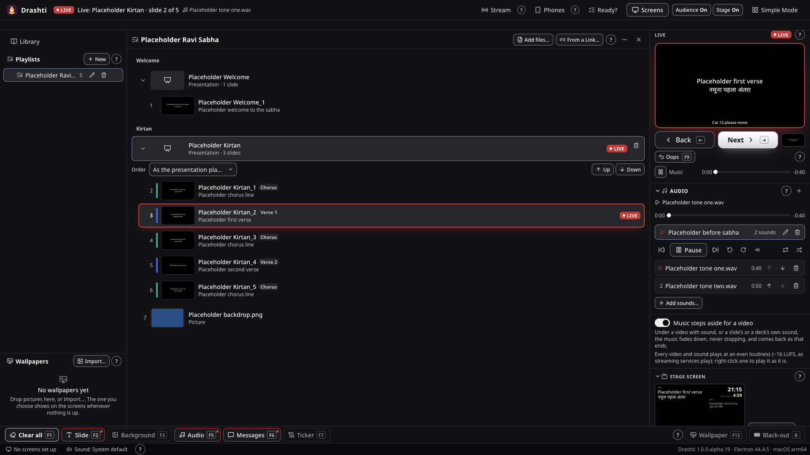
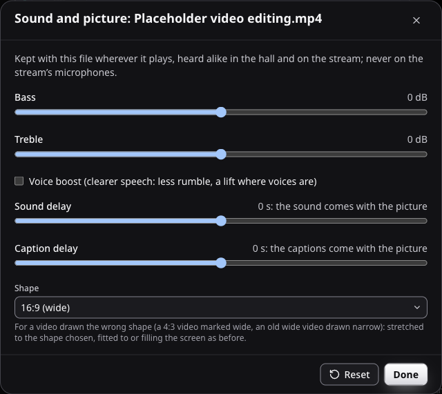
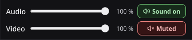
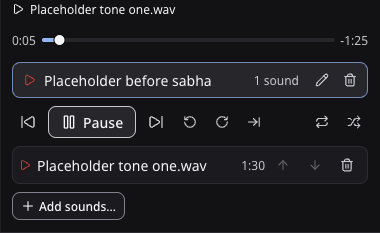
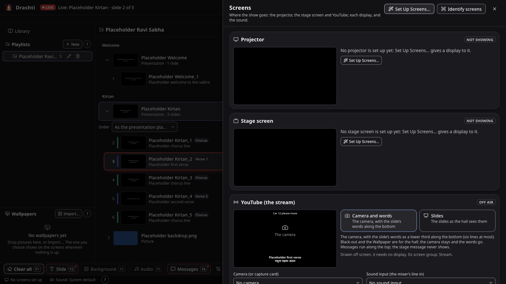

# Audio and the levels

Under the live picture are two levels, **Audio** and **Video**, and under them **Audio**, the audio playlists. Every sound Drashti plays goes to the mixer through the sound output chosen in **Screens**.

## Audio playlists

**What it is.** Lists of sounds that play one after another, with short fades, whatever goes on the screens.

The new timing, Find and M3U controls are in Pro Mode.

**When you would use it.** For music before the sabha, or between its parts.

**How:**

1. In **Audio**, press **+**, then **Create playlist**, or **Import** to bring sounds in.
2. Drag sounds onto a list to add them.
3. Press **Play** to start a list; **Pause** stops it where it is. A list stopped part-way plays on from that track.
4. Click a track to play from it.
5. **Clear audio** along the bottom, or **F5**, stops any sound.

**Shuffle** plays the tracks in a drawn order from the next Play. **Repeat** goes round again at the end. While an audio playlist plays, **Ends at** follows its remaining tracks and their start and end points; **Goes round** appears with Repeat on. An end time waits while paused or while a length is not yet known.

Press **Find in audio playlist** above its tracks to find a name or original file name. **Enter** moves to the next match, **Shift+Enter** the one before, and **Esc** closes Find. The tracks stay in place. Find never chooses a track or plays a sound.

Audio’s **+ › Import** accepts an M3U file as well as sounds. An M3U makes a new audio playlist, named after the file, with its sounds in file order. Web addresses are listed as not taken and never fetched. Right-click an audio playlist for **Import a Playlist File (M3U)…** or **Export as M3U…**; the export is a UTF-8 `.m3u8` naming the files in Drashti’s library. The same 2,000-entry and 1 MB limits apply.

## Sound and picture…

**What it is.** A small window for one video or sound: its own **Bass** and **Treble**, **Voice boost**, how much later its sound or its captions come than its picture, and a video's **Shape**.

**When you would use it.** For a talk that sounds muddy or thin, a video whose sound or captions are out of step with the speaker, or a video drawn too wide or too narrow.

**How:**

1. Right-click the video or sound (in **Media**, a playlist or **Audio**), then choose **Sound and picture…**.
2. Move **Bass** or **Treble**, or tick **Voice boost**; it is heard at once, in the hall and on the stream.
3. Move **Sound delay** or **Caption delay** until they match the picture; **Reset** puts everything back.
4. For a video drawn the wrong shape, choose its **Shape**: **16:9 (wide)**, **4:3**, **1:1 (square)** or **21:9 (cinema)**. **As the file says** restores its original shape.
5. Changes are kept at once. Press **Done** when finished.

The whole picture is stretched to the chosen shape, then fitted to or filling its place as before. A video stretched to its place keeps that place's shape. The choice follows the file on every screen, node, **LIVE**, the picture-in-picture box and the stream, without starting it again.

This does not crop a new copy. For framing and blurred fill saved for the next showing, see **Library › Edit Video**.

## How loud: Audio and Video

**What it is.** Two lines just above **Audio** that set how loud the hall hears Drashti: **Audio** for the audio playlists and every sound, **Video** for the sound of the videos. Each goes from 0 to 100 %, heard at once and smoothly, without stopping what plays.

**When you would use it.** When the music is too loud under the speaker, or a video is too quiet.

**How:**

1. Drag the **Audio** or **Video** line.
2. Or put the keyboard on it and use the arrow keys, Home and End.
3. The stream hears the same levels as the hall.
4. Drashti keeps the levels for its next start.

## Muting

**What it is.** The switch beside each level. Green **Sound on** plays; red **Muted** silences it at once. The status bar says **Audio muted** or **Video muted** while it is.

**When you would use it.** When a video's own sound should not reach the hall, or the music must stop for a moment without losing its place.

**How:**

1. Press the switch beside **Audio** or **Video**: it turns red, **Muted**.
2. Press it again to have the sound back at its level.
3. With the keyboard on it, press **Enter** (**Space** stays **Next** on this switch, even after **Tab**).
4. Drashti always starts with the sound on.

## Music steps aside for a video

**What it is.** A switch under the audio playlists, on to begin with. Under a video with sound, or a slide's own sound, the music fades down and comes back up after it.

**When you would use it.** Keep it on, so a video is always heard over the music.

**How:**

1. Leave **Music steps aside for a video** on in **Audio**.
2. Turn it off to keep the music as loud under a video.

## Even loudness

**What it is.** Every video and sound plays at an even loudness, in the hall and on the stream, so one file is never much louder than the next. The file itself never changes.

**When you would use it.** Always; turn it off only for a file that must play exactly as recorded.

**How:**

1. Right-click the video or sound.
2. Untick **Even loudness** to play it as it is.
3. Tick it again to have it even.

## Where the sound goes

**What it is.** The sound output that goes to the mixer, chosen in **Screens**. If it is not connected, Drashti plays on the computer's own speakers and the status bar warns you.

**When you would use it.** When setting up, or when the hall hears nothing.

**How:**

1. Press **Screens** in the top bar.
2. Under **Sound output**, choose the output that goes to the mixer.
3. Play a sound and check the mixer hears it.
4. Read the status bar: it always says where the sound goes.

