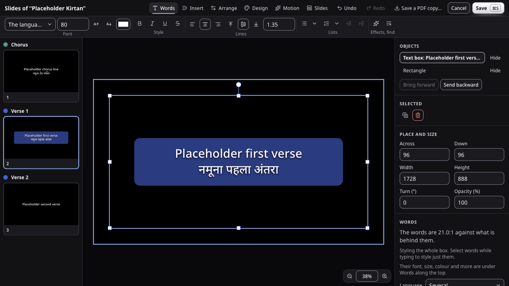
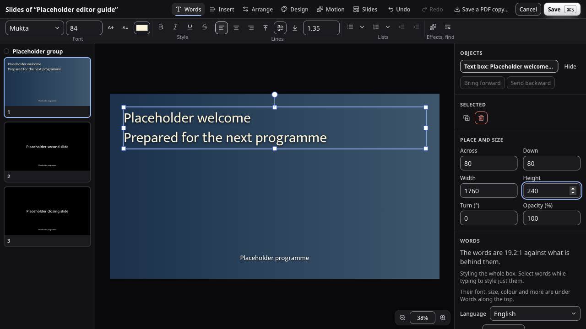
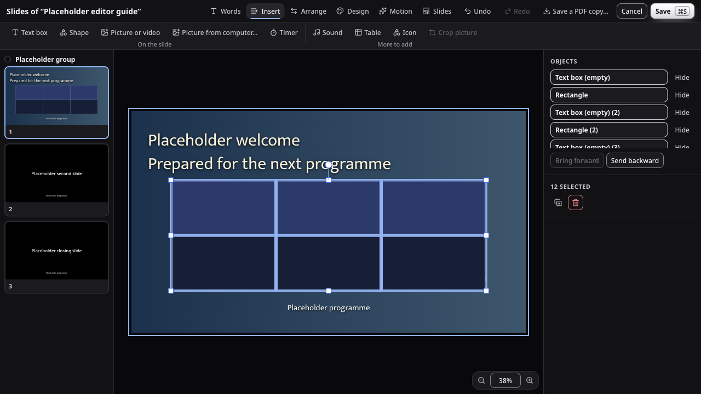
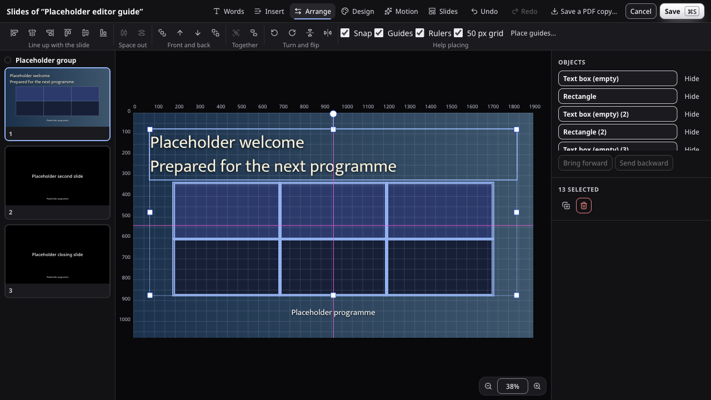
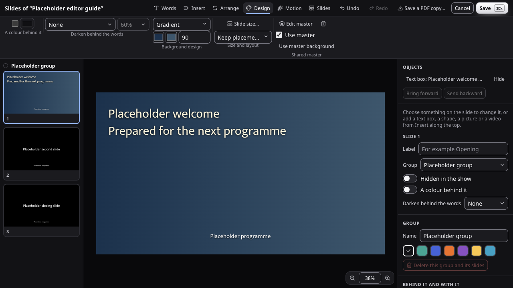
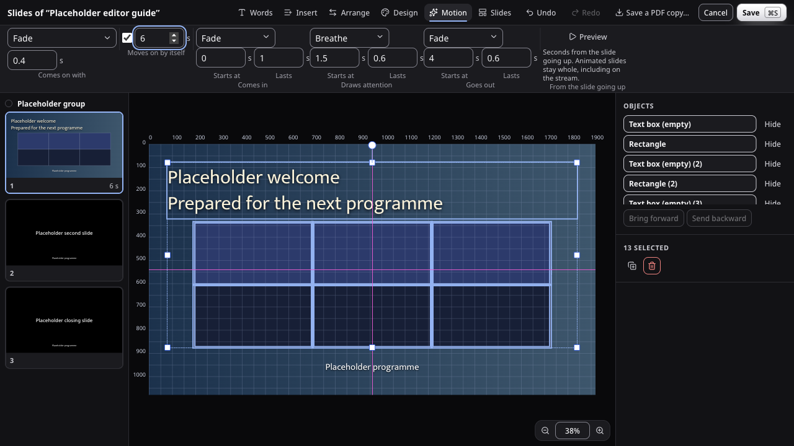
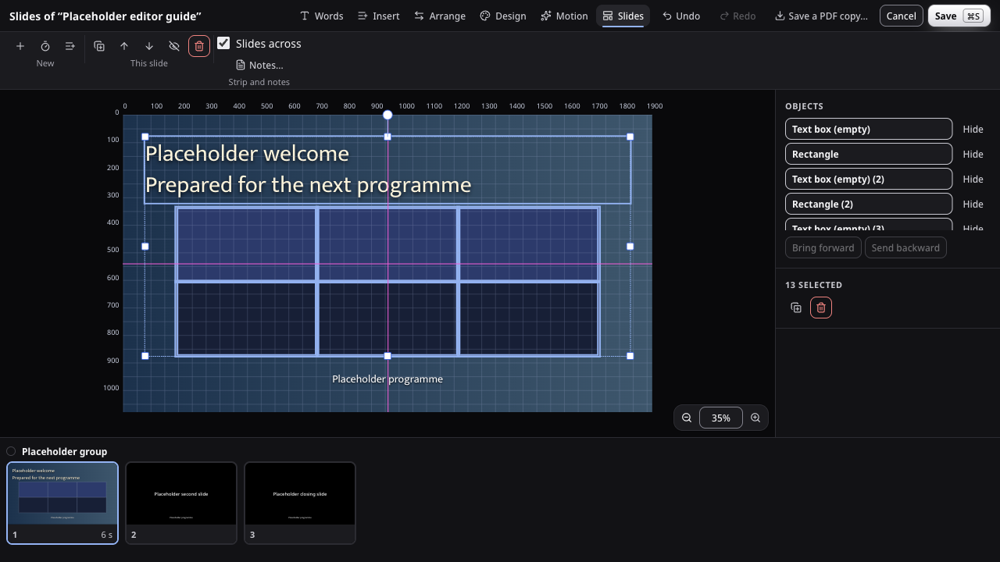
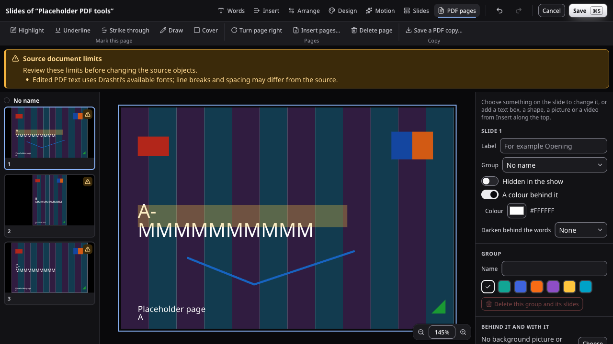
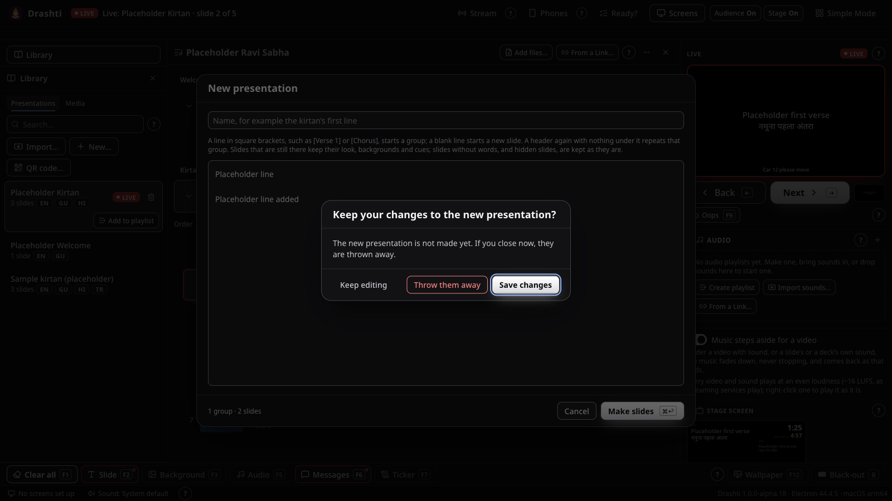

# Editing slides

**Edit slides…** opens a presentation in a window of its own, the slide editor, while the operator window keeps the show controls. It has six groups along the top: **Words**, **Insert**, **Arrange**, **Design**, **Motion** and **Slides**.

## Edit slides…

**What it is.** The slide editor's own window. Choose a slide on the left, then click a box on it to change it. **Objects**, on the right, lists everything on the slide.

**When you would use it.** To fix a word, add a slide, or make a new look.

**How:**

1. Right-click a presentation or one of its slides and choose **Edit slides…**.
2. Choose a slide on the left, then click the box to change.
3. Double-click a text box to type in it.
4. Press **Save**. It is one **Undo** in the operator window.

## Prepared translations

**What it is.** **Translate…** in the slide editor, in Pro Mode: saved Gujarati, Hindi or English words below their original, checked by a named reader. Once the admin has imported the translation model pack, **Prepare translations** fills the empty translations with drafts from the offline engine; **No engine installed** means you write the words by hand.

**When you would use it.** Before the sabha, when a reader can compare the meaning, names and numbers in both languages and check each screen's fit.

**How:**

1. Open **Edit slides…**, then **Translate…**.
2. Choose **Source language** and a different **Target language**. Keep one source language in each text box.
3. Press **Prepare translations** for drafts of the empty ones (**Stop** ends the run; one **Undo** takes the run back), or write **Translation words** beside the original. A draft is only a start: read it against its source and correct it. Reserve clear space below the source using **Reserved translation area**. Rearrange the source in the editor first if it fills the slide.
4. Have the reader check the exact pair and its fit, enter **Reader name**, then press **Mark checked**. Changing either set of words requires a new check.
5. Open **Where checked translations show**. Choose the presentation language and any screen or group choices; **Off** on a screen takes precedence.
6. Preview the checked words, press **Done**, then **Save**. Missing or unchecked words and translations that cannot fit stay hidden; the original stays in place.

Simple Mode has **Translation status…** to read the saved checks. It cannot write, check or choose translations. Imported pages, pictures and movies remain whole; use separately authored text boxes on ordinary slides. Normal Save, Undo, backups and kirtan bundles carry the saved words and their review.

## Words

**What it is.** The font, size, colour, bold, italic, alignment, spacing, lists, shadow, outline and glow of the chosen words, and **Find and replace**.

**When you would use it.** To make words easier to read, or to fix a spelling everywhere at once.

**How:**

1. Choose a whole text box, or select some words while typing.
2. Open **Words** and change what you need.
3. Use **Find and replace** to change a word on every slide.

## Insert

**What it is.** New things for the slide: a text box, a shape, a table, an icon, a picture or video from the library, a picture from the computer, a sound for the slide, or a live timer.

**When you would use it.** To add a picture beside the words, or a timer to a slide.

**How:**

1. Open **Insert**.
2. Choose what to add, such as a text box or **Picture from computer…**.
3. Drag it into place, and drag its corners to size it.

## Arrange

**What it is.** Lining things up, spacing them evenly, grouping them, turning and flipping them, and moving them in front or behind. Guides, rulers and a grid help, in the editor only.

**When you would use it.** To tidy a slide with several boxes.

**How:**

1. Shift-click the things to arrange, or drag a box round them.
2. Open **Arrange** and choose how to line them up or space them.
3. Press **Group** to keep them together.
4. Hold Alt while dragging to place freely, without snapping.

## Design

**What it is.** The slide's background (a colour, a gradient or a library picture), its layout, the presentation's slide size, and one shared master behind every slide.

**When you would use it.** To give a presentation one look throughout.

**How:**

1. Open **Design** and choose the background.
2. Press **Give every slide this slide’s look** to carry it to the whole presentation.
3. Choose **Slide size** for a screen that is not 16:9.
4. **Edit master** puts words or a picture on every slide.

## Motion

**What it is.** How a chosen box comes in, draws attention and goes out, and how the slide itself comes on. Every screen plays it at the same moment.

**When you would use it.** For a title that should come in gently.

**How:**

1. Choose a box, then open **Motion**.
2. Choose **Comes in**, **Draws attention** or **Goes out**, with its start and length in seconds.
3. Choose the slide's **Comes on with** transition.
4. Press **Preview** to see it.

## Slides and notes

**What it is.** New, duplicate, delete and hide slides, their order, and notes for the stage and the presenter's phone (never the hall).

**When you would use it.** To add a slide, change the order, or write notes for the speaker.

**How:**

1. Open **Slides** for new, duplicate, delete and hide.
2. Drag a slide in the list (or **Slides across**) to change the order.
3. Press **Notes…**, type the notes, then **Keep notes**.

## PDF pages

**What it is.** A PDF's pages marked and changed: **Highlight**, **Underline**, **Strike through**, **Draw** and **Cover**, a page turned or deleted, another PDF's pages brought in, and a new PDF saved. The original PDF stays as it was.

**When you would use it.** To highlight a line of a PDF before showing it.

**How:**

1. Choose the page on the left, then open **PDF pages**.
2. Choose a mark, then drag over the part wanted.
3. Use **Turn page right** or **Delete page**, or drag the page to move it.
4. Press **Save** to keep it in the library.

## Saving your changes

**What it is.** **Save** keeps the presentation. Closing with changes asks first: **Save changes**, **Keep editing** or **Throw them away**. When the slide is on the screens, saving changes the screens at once.

**When you would use it.** Every time you finish editing.

**How:**

1. Press **Save** (Cmd+S, or Ctrl+S on Windows).
2. Closing with changes asks **Keep your changes?**: choose what you mean.
3. Press **Cmd+Z** (Ctrl+Z) in the operator window to undo a saved change.

