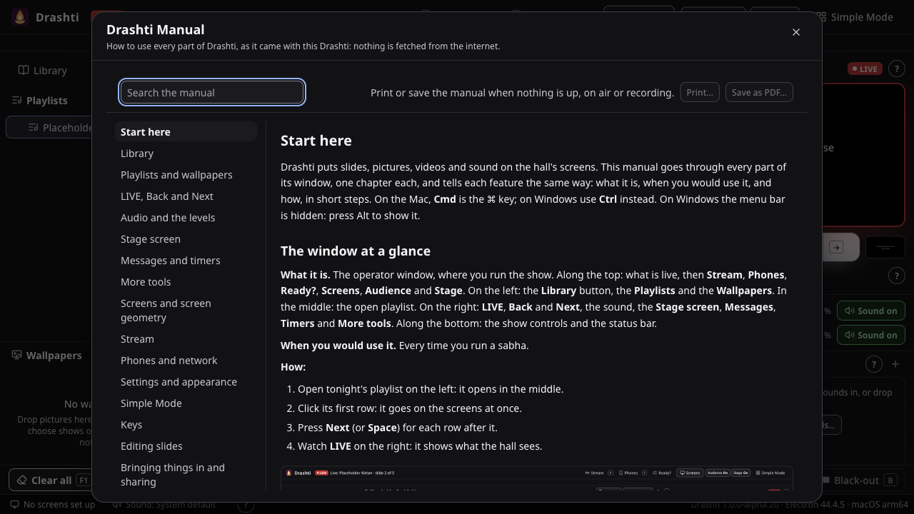
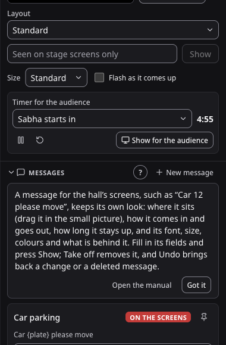
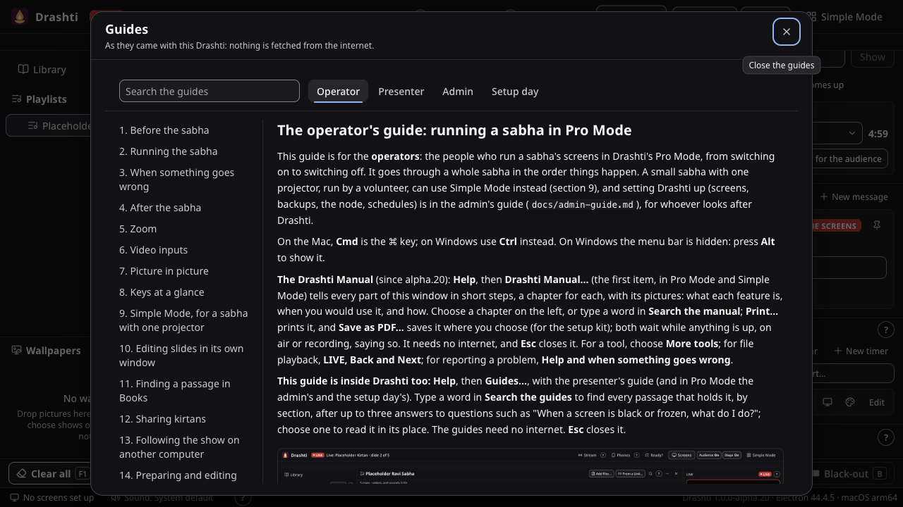
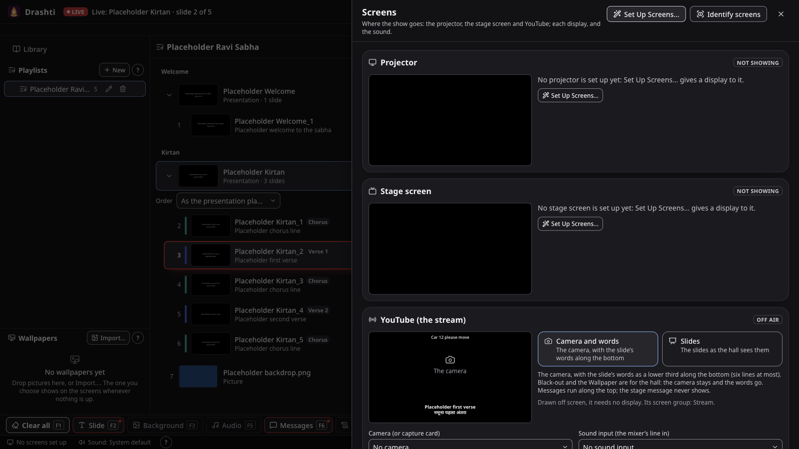
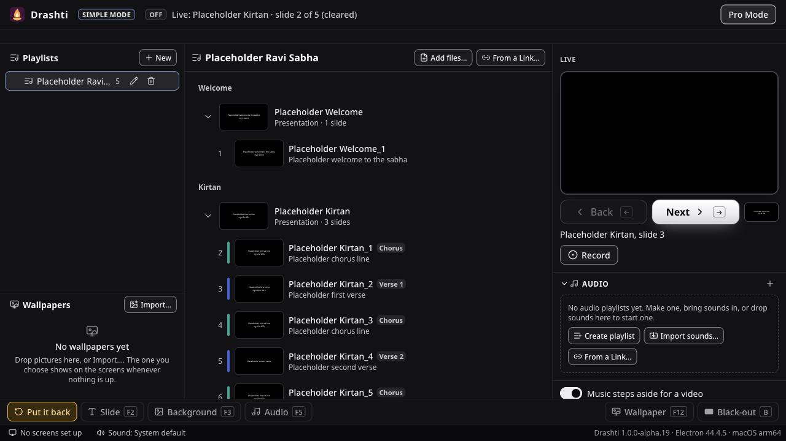
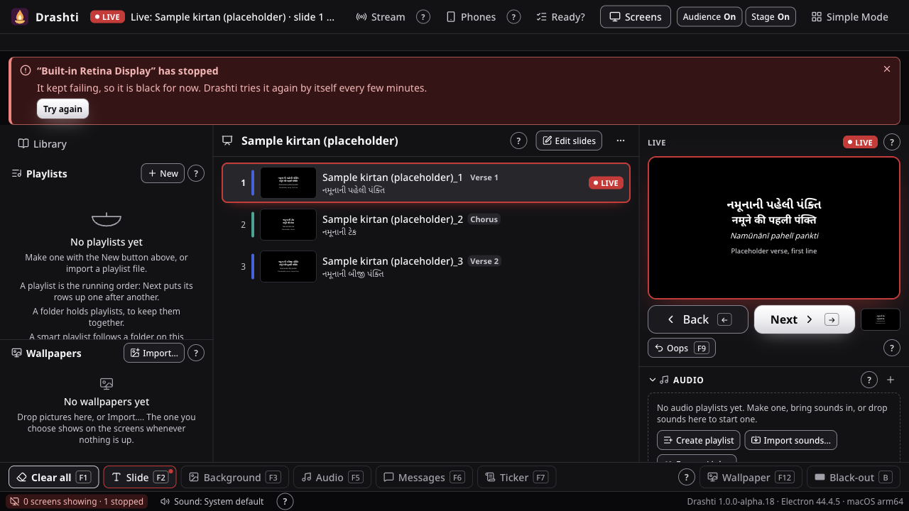
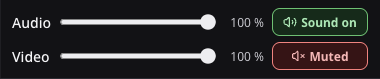
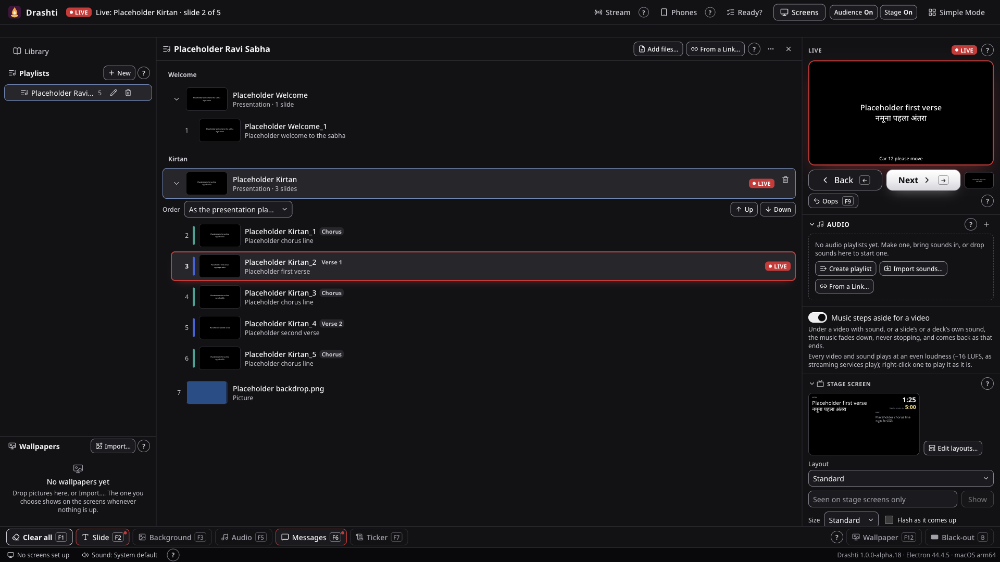

# Help and when something goes wrong

**Help**, in the menu bar, has this manual, the guides, the keys, diagnostics and updates. Below them, what to do when something goes wrong during a sabha: stay calm, the hall's screens keep their picture.

## The Help menu

**What it is.** **Drashti Manual…** (this manual), **Guides…** (the operator's, the presenter's, the admin's and the setup day's guides), **Keyboard Shortcuts…**, **Save Diagnostics…** and **Check for Updates…**.

**When you would use it.** Whenever you need help, or after a problem.

**How:**

1. Choose **Help** in the menu bar (on Windows, press Alt first to show the menu bar).
2. Choose what you need.
3. Press **Esc** to close a window opened from it.

## What is this?

**What it is.** The small **?** on a panel's heading (and beside **Next** and **Back**, the show controls, **Stream**, **Phones** and the status bar). It says in two or three sentences what the panel is for, in the panel's own space. **Open the manual** opens this manual at that panel's chapter.

**When you would use it.** When you are not sure what a panel does.

**How:**

1. Press the **?** on the panel's heading.
2. Read its sentences under the heading.
3. Press **Open the manual** to read more, or **Got it** to close them.

## The guides

**What it is.** **Help › Guides…**: the longer guides that came with Drashti, searchable. Simple Mode has the operator's and the presenter's.

**When you would use it.** For the details behind a chapter of this manual, or to set Drashti up.

**How:**

1. Choose **Help**, then **Guides…**.
2. Choose a guide's tab, or type in **Search the guides**.
3. Answers to questions such as "When a screen is black or frozen, what do I do?" come first.

## Save Diagnostics…

**What it is.** One file on the Desktop for whoever looks after Drashti, after a problem. It holds no kirtan words, names or file paths.

**When you would use it.** After anything went wrong, once the sabha is over.

**How:**

1. Choose **Help**, then **Save Diagnostics…**. A file appears on the Desktop.
2. Leave **Include crash files** unticked unless you are asked for them.
3. Send the file with the time and what you saw.

## Check for Updates…

**What it is.** A newer Drashti offered, with what changed in it. It downloads in the background and installs only when Drashti quits, after the sabha.

**When you would use it.** After a sabha, never during one. Update Main and the node the same evening.

**How:**

1. Choose **Help**, then **Check for Updates…**.
2. Read what changed, then press **Download**.
3. Turn on **Install it when Drashti quits**.
4. On a Mac, press **Show the file**, quit Drashti, and drag the new Drashti into **Applications**.

## When the controls are covered

**What it is.** A screen's picture on top of these controls. **Cmd+Shift+U** (Ctrl+Shift+U on Windows) turns every output over the controls off, even when Drashti is not the active app.

**When you would use it.** When the operator window can't be seen for a screen's picture.

**How:**

1. Press **Cmd+Shift+U** (Ctrl+Shift+U on Windows).
2. If **Keep these screens?** asks in the middle, press **Esc** to go back.
3. Then give that display the right job in **Screens**.

## A mistake on the screens

**What it is.** Three quick ways back: click the right row, press **←** for the slide before, or **F9** (**Oops**) for what was up before the last change. After **Clear all** by mistake, **Put it back**.

**When you would use it.** Right after a wrong click or key.

**How:**

1. Press **F9** (Oops) to put back what was up before.
2. Or click the right row in the playlist.
3. After **Clear all** by mistake, press **Put it back** at once.

## A screen is black or frozen

**What it is.** Drashti restarts a screen that stops drawing by itself, within about 10 seconds. A red notice at the top says if a screen kept failing.

**When you would use it.** When a hall screen shows nothing, or stops moving.

**How:**

1. Open the screens dashboard (click the screens' line in the status bar).
2. Press **Reload** on that screen.
3. Or press **Try again** on the red notice.
4. If the status bar says **Audience off**, press **Turn on**.

## No sound in the hall

**What it is.** The sound going somewhere else, muted, or the mixer's channel down.

**When you would use it.** When the hall hears nothing from Drashti.

**How:**

1. Read the status bar: it says where the sound goes, and **Audio muted** or **Video muted** if one is.
2. Press the red **Muted** switch above **Audio** to have the sound back.
3. In **Screens**, check **Sound output** is the mixer's.
4. Check the mixer's channel for this computer.

## Drashti closed by itself

**What it is.** Drashti started again puts back what was on the screens (the slide, the background, the sound, timers, messages and lower thirds) and says so at the top. A stream on air less than 5 minutes ago goes live again by itself.

**When you would use it.** If Drashti ever closes during a sabha.

**How:**

1. Start Drashti again.
2. Read the note at the top: what it put back.
3. Check **LIVE**, then carry on.
4. After the sabha, **Save Diagnostics…** for whoever looks after Drashti.

