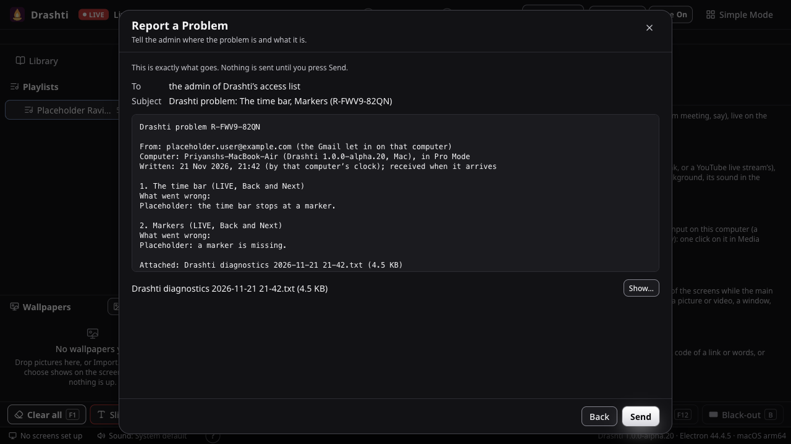
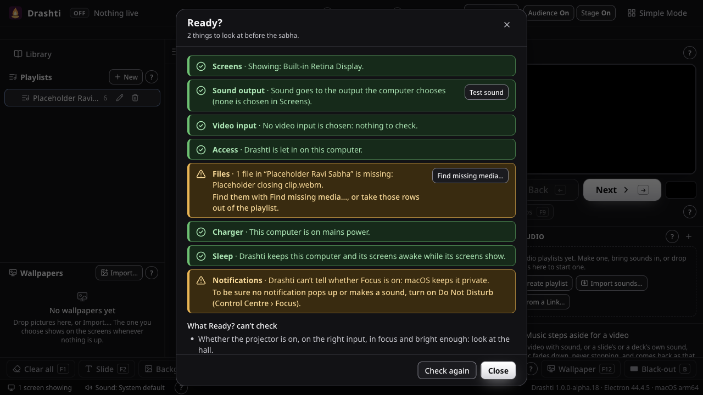
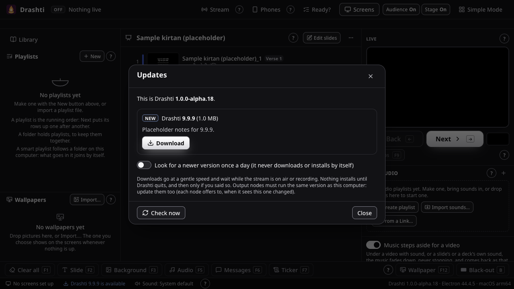

# Help and when something goes wrong

**Help**, in the menu bar, has this manual, the guides, the keys, Report a Problem…, diagnostics and updates. Below them, what to do when something goes wrong during a sabha: stay calm, the hall's screens keep their picture.

## The Help menu

**What it is.** **Drashti Manual…** (this manual), **Guides…** (the operator's, the presenter's, the admin's and the setup day's guides), **Show Help** (the status bar's **Help**, below, ticked while it is on), **Keyboard Shortcuts…**, **Report a Problem…**, on the access-list owner's computer **Automatic Error Reports…** (the admin's guide, section 30), **Save Diagnostics** (the log of today, yesterday, the last 7 days or one day), **Caption and Translation Models…** (the admin's offline models for captions and translation, Pro Mode) and **Check for Updates…**.

**When you would use it.** Whenever you need help, or after a problem.

**How:**

1. Choose **Help** in the menu bar (on Windows, tap **Alt** first to show the menu bar: held, it shows the buttons' keys instead).
2. Choose what you need.
3. Press **Esc** to close a window opened from it.

## What is this?

**What it is.** **Help**, in the status bar along the bottom, shows the small **?** on each panel's heading (and beside **Next** and **Back**, the show controls, **Stream**, **Phones** and the status bar) and the keys on the buttons. Drashti starts with it off, so the window is calm, and remembers it on this computer. A **?** says in two or three sentences what the panel is for, in the panel's own space; **Open the manual** opens this manual at that panel's chapter. Without Help, hold **Alt** (**Option ⌥** on a Mac) to see the keys while you hold it; let go of it, then press the key (a key pressed with it still held does nothing).

**When you would use it.** When you are not sure what a panel does, or which key a button has.

**How:**

1. Press **Help** in the status bar (in a narrow window, its round **?**), or choose **Help**, then **Show Help** in the menu bar. It stays pressed, and **Show Help** ticked, while it is on.
2. Press the **?** on the panel's heading, and read its sentences under the heading.
3. Press **Open the manual** to read more, or **Got it** to close them.
4. Press **Help** again (or choose **Show Help** again) to put every **?** and key away.

## The guides

**What it is.** **Help › Guides…**: the longer guides that came with Drashti, searchable. Simple Mode has the operator's and the presenter's.

**When you would use it.** For the details behind a chapter of this manual, or to set Drashti up.

**How:**

1. Choose **Help**, then **Guides…**.
2. Choose a guide's tab, or type in **Search the guides**.
3. Answers to questions such as "When a screen is black or frozen, what do I do?" come first.

## Report a Problem…

**What it is.** **Help › Report a Problem…** tells the admin where a problem is and what it is. You tick the features it is in (from this manual's chapters, or found by a search), say what went wrong with each, and send it: it goes to the admin's email through the access list, and a short email tells you it arrived. The diagnostics, the crash files and a picture of this window go with it only when you tick them, and **Review…** shows exactly what goes before **Send**.

**When you would use it.** When something in Drashti does not work as it should, or a notice says something went wrong: the notice's **Report this…** fills in its words and its feature.

**How:**

1. Choose **Help**, then **Report a Problem…**.
2. Tick the feature the problem is in, in its chapter or by typing its name in **Find a feature**. You can tick up to eight.
3. Say what went wrong with each, and what you expected if you like.
4. Tick **Diagnostics**, **Crash files** or **A picture of this window** if they would help. Crash files and a picture may contain what was on the screens: check before sending. The picture greys out the chat and every QR code.
5. Press **Review…**, read what goes, then **Send**. Without the internet, or while the stream or a recording is on, it waits on this computer and goes by itself later.

It works in both modes and on a node. A node hands its report to the Main it is paired with, which sends it. **Your reports** says whether a report is waiting or sent; **Save a Copy…** lets you send it another way. If reports keep waiting for the access list to be updated, its owner follows **Putting in a change later** in `docs/access-setup.md`.

## Save Diagnostics

**What it is.** One file on the Desktop for whoever looks after Drashti, after a problem. It holds the versions, screens, sound and the log of the day or days you choose. Its first lines say which computer made it, its place on the access list, its role, this install's own id and the version, so whoever helps knows whose it is among many. On Main, **Graphics** also lists each graphics chip, its driver, how the computer draws and the video decoding it offers. The file holds no kirtan words, names, file paths or Gmail addresses; optional crash files can hold slide words.

**When you would use it.** When whoever helps asks for the file, or when you need to send it another way. **Report a Problem…** above can include diagnostics too.

**How:**

1. Choose **Help**, then **Save Diagnostics**, then the day the problem was: **Today…**, **Yesterday…**, **The Last 7 Days…**, or **One Day** and the day (Drashti keeps each day's log for 30 days). A file appears on the Desktop.
2. Leave **Include crash files** unticked unless you are asked for them.
3. Send the file with the time and what you saw. For a problem on a node's screens, save its diagnostics there too, and send both files.

## Check for Updates…

**What it is.** A newer Drashti offered, with what changed in it. It downloads in the background and installs only when Drashti quits, after the sabha.

**When you would use it.** After a sabha, never during one. Update Main and the node the same evening.

**How:**

1. Choose **Help**, then **Check for Updates…**.
2. Read what changed, then press **Download**.
3. Turn on **Install it when Drashti quits**.
4. On a Mac, press **Show the file**, quit Drashti, and drag the new Drashti into **Applications**.

## When the controls are covered

**What it is.** A screen's picture on top of these controls. **Cmd+Shift+U** (Ctrl+Shift+U on Windows) turns every output over the controls off, even when Drashti is not the active app.

**When you would use it.** When the operator window can't be seen for a screen's picture.

**How:**

1. Press **Cmd+Shift+U** (Ctrl+Shift+U on Windows).
2. If **Keep these screens?** asks in the middle, press **Esc** to go back.
3. Then give that display the right job in **Screens**.

## A mistake on the screens

**What it is.** Three quick ways back: click the right row, press **←** for the slide before, or **F9** (**Oops**) for what was up before the last change. After **Clear all** by mistake, **Put it back**.

**When you would use it.** Right after a wrong click or key.

**How:**

1. Press **F9** (Oops) to put back what was up before.
2. Or click the right row in the playlist.
3. After **Clear all** by mistake, press **Put it back** at once.

## A screen is black or frozen

**What it is.** Drashti restarts a screen that stops drawing by itself, within about 10 seconds. A red notice at the top says if a screen kept failing.

**When you would use it.** When a hall screen shows nothing, or stops moving.

**How:**

1. Open the screens dashboard (click the screens' line in the status bar).
2. Press **Reload** on that screen.
3. Or press **Try again** on the red notice. Drashti also tries a stopped screen after 2 minutes, then every 10 minutes.
4. If the status bar says **Audience off**, press **Turn on**.

A picture that repeatedly fails to draw stops that screen the same way; it comes back as soon as it draws again. If a notice names a video taken off after repeated failures, see **LIVE, Back and Next › When a video cannot play**.

Two screens with one name (two TVs of one model take their display's name) are told apart: the notices, LIVE and **Screens** call the second "… (2)". Each one is restarted or stopped on its own.

## No sound in the hall

**What it is.** The sound going somewhere else, muted, or the mixer's channel down.

**When you would use it.** When the hall hears nothing from Drashti.

**How:**

1. Read the status bar: it says where the sound goes, and **Audio muted** or **Video muted** if one is.
2. Press the red **Muted** switch above **Audio** to have the sound back.
3. In **Screens**, check **Sound output** is the mixer's.
4. Check the mixer's channel for this computer.
5. If a red notice says **Drashti’s sound has stopped**, press **Try again**. Drashti also tries after 2 minutes, then every 10. If it stops again, report the problem after the sabha.

## Drashti closed by itself

**What it is.** Drashti started again puts back what was on the screens (the slide, the background, the sound, timers, messages and lower thirds) and says so at the top. A stream on air less than 5 minutes ago goes live again by itself.

**When you would use it.** If Drashti ever closes during a sabha.

**How:**

1. Start Drashti again.
2. Read the note at the top: what it put back.
3. Check **LIVE**, then carry on.
4. After the sabha, **Help › Report a Problem…** to tell whoever looks after Drashti (or **Save Diagnostics** when it can't be sent).

