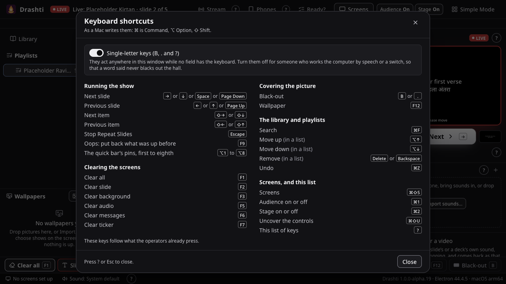

# Keys

Every show action has a key, so the show can be run from the keyboard alone. The keys follow what operators already press. On a Mac, **Cmd** is the ⌘ key; on Windows use **Ctrl** instead.

## The keys sheet

**What it is.** **Help › Keyboard Shortcuts…** lists the keys that work in this mode, as your computer writes them. Simple Mode has its own sheet. **Seeing the keys** names the key to hold: **Alt** (**⌥** on a Mac). With **Help** off, hold it to see the buttons’ keys; let go of it, then press the key. With **Help** on in the status bar, the keys stay in sight.

**When you would use it.** When you forget a key, or to learn them.

**How:**

1. Press **?** when no field has the keyboard.
2. Or choose **Help**, then **Keyboard Shortcuts…**.
3. Press **Esc** to close it.

## Keys for the show

**What it is.** The keys for running a sabha, written as your computer writes them: a column for Windows, one for a Mac with Apple silicon and one for a Mac with Intel. They work while no field has the keyboard (click an empty part of the window first).

**When you would use it.** All through the sabha.

**How:**

1. Click an empty part of the window, so no field has the keyboard.
2. Find what you want in the list below, and press the key in your computer's column.
3. Watch **LIVE** to see it happen.

**Reading the columns.** On a Mac, ⌘ is Command, ⌥ Option (the key Windows calls Alt), ⇧ Shift, ⌃ Control and ↩ Return. A Mac with Apple silicon and a Mac with Intel take the same keys, and either kind may have a Touch Bar. Keys every computer writes the same way are in one column. **(fn or Touch Bar)**: a Mac's own keyboard, on a laptop or a desktop, uses its top row for the brightness and the sound, so hold **fn** (the globe key on newer keyboards) and press the F-key, unless **Use F1, F2, etc. keys as standard function keys** is on (F-keys on a laptop, below). A MacBook Pro with a Touch Bar has no F-keys at all: hold **fn** and the Touch Bar shows F1 to F12, or list Drashti under **Function Keys** so it always shows them in Drashti. Most of the Intel MacBook Pros of 2016 to 2020 have a Touch Bar, and so do the 13-inch ones with Apple M1 (2020) or M2 (2022). On a Windows laptop, an F-key may need Fn held, or Fn Lock on.

### The operator window, in Pro Mode and Simple Mode

**Space on a button.** Space presses a button reached with **Tab**, as **Enter** does. On the show’s own controls (slide rows, Next, Back, Black-out and the clears), the sound levels’ mute switches and the Simple/Pro switch, Space stays **Next**. Space stays **Next** on a button clicked with the mouse too. A menu or dialog keeps its own keys.

Simple Mode has no keys for Screens, Search, the quick bar, Remove or Move; there **Ctrl+1** and **Ctrl+2** (**⌘1** and **⌘2** on a Mac) only turn the screens on, and Undo puts back what Clear all took down.

| What it does                       | Every computer                           |
| ---------------------------------- | ---------------------------------------- |
| The next slide                     | **Space**, **→**, **↓** or **Page Down** |
| The slide before                   | **←**, **↑** or **Page Up**              |
| Black-out                          | **B** or **.**                           |
| Stop Repeat Slides                 | **Esc**                                  |
| Remove the chosen rows (in a list) | **Delete** or **Backspace**              |
| The list of keys                   | **?**                                    |

| What it does                                                                                   | Windows                                           | Mac with Apple silicon                        | Mac with Intel                                |
| ---------------------------------------------------------------------------------------------- | ------------------------------------------------- | --------------------------------------------- | --------------------------------------------- |
| The start of the next item                                                                     | **Shift+→** or **Shift+↓**                        | **⇧→** or **⇧↓**                              | **⇧→** or **⇧↓**                              |
| The start of the item before                                                                   | **Shift+←** or **Shift+↑**                        | **⇧←** or **⇧↑**                              | **⇧←** or **⇧↑**                              |
| Clear all                                                                                      | **F1**                                            | **F1** (fn or Touch Bar)                      | **F1** (fn or Touch Bar)                      |
| Clear the slide's words (the background stays)                                                 | **F2**                                            | **F2** (fn or Touch Bar)                      | **F2** (fn or Touch Bar)                      |
| Clear the background                                                                           | **F3**                                            | **F3** (fn or Touch Bar)                      | **F3** (fn or Touch Bar)                      |
| Clear the sound                                                                                | **F5**                                            | **F5** (fn or Touch Bar)                      | **F5** (fn or Touch Bar)                      |
| Clear the messages                                                                             | **F6**                                            | **F6** (fn or Touch Bar)                      | **F6** (fn or Touch Bar)                      |
| Clear the ticker                                                                               | **F7**                                            | **F7** (fn or Touch Bar)                      | **F7** (fn or Touch Bar)                      |
| The Wallpaper                                                                                  | **F12**                                           | **F12** (fn or Touch Bar)                     | **F12** (fn or Touch Bar)                     |
| Oops: what was up before the last change                                                       | **F9**                                            | **F9** (fn or Touch Bar)                      | **F9** (fn or Touch Bar)                      |
| Audience on or off                                                                             | **Ctrl+1**                                        | **⌘1**                                        | **⌘1**                                        |
| Stage on or off                                                                                | **Ctrl+2**                                        | **⌘2**                                        | **⌘2**                                        |
| Screens                                                                                        | **Ctrl+Shift+S**                                  | **⇧⌘S**                                       | **⇧⌘S**                                       |
| Uncover the controls (even when Drashti is not the active app)                                 | **Ctrl+Shift+U**                                  | **⇧⌘U**                                       | **⇧⌘U**                                       |
| Move the chosen row up or down (in a list)                                                     | **Alt+↑** or **Alt+↓**                            | **⌥↑** or **⌥↓**                              | **⌥↑** or **⌥↓**                              |
| Search the library                                                                             | **Ctrl+F**                                        | **⌘F**                                        | **⌘F**                                        |
| Undo                                                                                           | **Ctrl+Z**                                        | **⌘Z**                                        | **⌘Z**                                        |
| The quick bar's first to eighth pin (Pro Mode)                                                 | **Alt+1** to **Alt+8**                            | **⌥1** to **⌥8**                              | **⌥1** to **⌥8**                              |
| Put up a row by its number: type it, then Enter (Esc forgets it, Backspace takes a digit back) | **0** to **9**, **Enter**, **Esc**, **Backspace** | **0** to **9**, **↩**, **Esc**, **Backspace** | **0** to **9**, **↩**, **Esc**, **Backspace** |
| Switch to Simple Mode or Pro Mode, with the keyboard on the switch: Enter twice                | **Enter**                                         | **↩**                                         | **↩**                                         |
| See the buttons’ keys while you hold it, with Help off; let go of it, then press the key       | **Alt**                                           | **⌥**                                         | **⌥**                                         |

## Single-letter keys

**What it is.** A switch at the top of Pro Mode’s keys sheet that turns **B**, **.** and **?** off. **Black-out** still works from its button, a MIDI pad and the phone remote.

**When you would use it.** For someone who works the computer by speaking to it or with a switch, so that a word said never blacks out the hall.

**How:**

1. In Pro Mode, choose **Help**, then **Keyboard Shortcuts…**.
2. Turn off **Single-letter keys** at its top.
3. The list says **Off** beside those three keys. **F12** still puts the wallpaper up.

## F-keys on a laptop

**What it is.** On many laptops, and on a Mac's own keyboard, the top row changes the brightness or the sound unless Fn is held, and a MacBook Pro with a Touch Bar has no F-keys at all. Drashti's F-keys need the plain F-keys: on Windows, and on a Mac with Apple silicon or with Intel. The foot of the keys sheet says what your computer needs, and Simple Mode's first steps say it once on a Mac.

**When you would use it.** When **F1** or **F12** does nothing.

**How:**

1. On a Mac: **System Settings**, **Keyboard**, **Keyboard Shortcuts…**, **Function Keys**, then turn on **Use F1, F2, etc. keys as standard function keys**.
2. On a Mac with a Touch Bar: hold **fn** and the Touch Bar shows F1 to F12. Or, in that same **Function Keys**, add Drashti, so its Touch Bar always shows them in Drashti.
3. On a Windows laptop, turn on Fn Lock (often Fn and Esc together), or the laptop maker's own setting for the F-keys.
4. Or hold Fn while pressing the F-key.

## Every other window’s keys

**What it is.** The keys of every other part of Drashti, window by window, written as your computer writes them, in the same columns as the keys for the show: lists, dialogs and menus, LIVE's time bar, Chat, the slide editor, the words editor, Trim, Edit Video…, the picture editor, Stage layouts, Adjust the picture, the Sabha flow, Picture in Picture…, the Access List, the Lower Thirds studio, the screens' own questions, the menu bar and a phone's or tablet's keyboard.

**When you would use it.** When you work in one of them with the keyboard, or teach someone to.

**How:**

1. Find the window or part below.
2. Look in your computer's column: **Windows**, **Mac with Apple silicon** or **Mac with Intel** (Reading the columns, above).
3. A key works while that window, list or box has the keyboard.

### Lists: the library, playlists, Media, audio and lower thirds

With the mouse, **Shift**-click chooses a run of rows and **Ctrl**-click (**⌘**-click on a Mac) one more; on a Mac, a Control-click is a right-click. A Mac has no Menu key.

| What it does                                                   | Every computer                  |
| -------------------------------------------------------------- | ------------------------------- |
| A video’s frames in Media: one back or on, the first, the last | **←**, **→**, **Home**, **End** |

| What it does                                                                         | Windows                             | Mac with Apple silicon     | Mac with Intel             |
| ------------------------------------------------------------------------------------ | ----------------------------------- | -------------------------- | -------------------------- |
| Choose every row                                                                     | **Ctrl+A**                          | **⌘A**                     | **⌘A**                     |
| Put the row up, or fold a presentation’s slides                                      | **Enter**                           | **↩**                      | **↩**                      |
| The row’s right-click menu                                                           | **Shift+F10** or **Menu**           | **⇧F10** (fn or Touch Bar) | **⇧F10** (fn or Touch Bar) |
| Renaming: keep the new name, or leave it as it was                                   | **Enter**, **Esc**                  | **↩**, **Esc**             | **↩**, **Esc**             |
| The library’s search: open the first found, or empty the box; then close the library | **Enter**, **Esc**                  | **↩**, **Esc**             | **↩**, **Esc**             |
| Find in a playlist or in the audio: the next found, the one before, close it         | **Enter**, **Shift+Enter**, **Esc** | **↩**, **⇧↩**, **Esc**     | **↩**, **⇧↩**, **Esc**     |

### Moving round any window: dialogs, menus, tabs and dividers

| What it does                                                            | Every computer                                |
| ----------------------------------------------------------------------- | --------------------------------------------- |
| Close a dialog, a menu or a tooltip                                     | **Esc**                                       |
| Tabs, and choices of one: the next, the one before, the first, the last | **←**, **→**, **↑**, **↓**, **Home**, **End** |

| What it does                                                                                    | Windows                                                             | Mac with Apple silicon                                      | Mac with Intel                                              |
| ----------------------------------------------------------------------------------------------- | ------------------------------------------------------------------- | ----------------------------------------------------------- | ----------------------------------------------------------- |
| Move through the window, part by part, and back                                                 | **Tab**, **Shift+Tab**                                              | **Tab**, **⇧Tab**                                           | **Tab**, **⇧Tab**                                           |
| Press the button or switch the keyboard is on                                                   | **Enter**                                                           | **↩**                                                       | **↩**                                                       |
| In an open menu: up and down, the first, the last, and choose                                   | **↑**, **↓**, **Home**, **End**, **Enter**, **Space**               | **↑**, **↓**, **Home**, **End**, **↩**, **Space**           | **↑**, **↓**, **Home**, **End**, **↩**, **Space**           |
| A divider between panels: move it (four times as far with Shift), to its ends, back to its size | **←**, **→**, **↑**, **↓**, **Shift**, **Home**, **End**, **Enter** | **←**, **→**, **↑**, **↓**, **⇧**, **Home**, **End**, **↩** | **←**, **→**, **↑**, **↓**, **⇧**, **Home**, **End**, **↩** |

### LIVE’s time bar, and the audio’s

| What it does                     | Every computer             |
| -------------------------------- | -------------------------- |
| Back 5 seconds                   | **←**, **↓**               |
| On 5 seconds                     | **→**, **↑**               |
| Back or on 30 seconds            | **Page Down**, **Page Up** |
| To the start or the end          | **Home**, **End**          |
| Let go of a drag, moving nothing | **Esc**                    |

| What it does                                | Windows              | Mac with Apple silicon | Mac with Intel |
| ------------------------------------------- | -------------------- | ---------------------- | -------------- |
| One frame back or on (a video, in Pro Mode) | **Alt+←**, **Alt+→** | **⌥←**, **⌥→**         | **⌥←**, **⌥→** |

### Chat, Messages and the stage timers

| What it does        | Every computer |
| ------------------- | -------------- |
| Chat: leave the box | **Esc**        |

| What it does                                  | Windows            | Mac with Apple silicon | Mac with Intel |
| --------------------------------------------- | ------------------ | ---------------------- | -------------- |
| Chat: send                                    | **Enter**          | **↩**                  | **↩**          |
| Chat: a new line                              | **Shift+Enter**    | **⇧↩**                 | **⇧↩**         |
| Messages: show the message typed              | **Enter**          | **↩**                  | **↩**          |
| A stage timer’s time: keep it, or put it back | **Enter**, **Esc** | **↩**, **Esc**         | **↩**, **Esc** |

### The slide editor

| What it does                                                                                  | Every computer              |
| --------------------------------------------------------------------------------------------- | --------------------------- |
| A step back: fold what is over the slide, close Find, stop typing, choose nothing, then close | **Esc**                     |
| Delete what is chosen                                                                         | **Delete** or **Backspace** |

| What it does                                                                                  | Windows                                             | Mac with Apple silicon                                                | Mac with Intel                                                        |
| --------------------------------------------------------------------------------------------- | --------------------------------------------------- | --------------------------------------------------------------------- | --------------------------------------------------------------------- |
| The show’s F-keys: Clear all to Clear ticker, Oops and the Wallpaper act on the screens       | **F1** to **F3**, **F5** to **F7**, **F9**, **F12** | **F1** to **F3**, **F5** to **F7**, **F9**, **F12** (fn or Touch Bar) | **F1** to **F3**, **F5** to **F7**, **F9**, **F12** (fn or Touch Bar) |
| Save                                                                                          | **Ctrl+S** or **Ctrl+Enter**                        | **⌘S** or **⌘↩**                                                      | **⌘S** or **⌘↩**                                                      |
| Find (in Find: the next found, the one before)                                                | **Ctrl+F**, **Enter**, **Shift+Enter**              | **⌘F**, **↩**, **⇧↩**                                                 | **⌘F**, **↩**, **⇧↩**                                                 |
| Zoom in, zoom out, the whole slide                                                            | **Ctrl+=**, **Ctrl+-**, **Ctrl+0**                  | **⌘=**, **⌘-**, **⌘0**                                                | **⌘=**, **⌘-**, **⌘0**                                                |
| Undo                                                                                          | **Ctrl+Z**                                          | **⌘Z**                                                                | **⌘Z**                                                                |
| Redo                                                                                          | **Ctrl+Y** or **Ctrl+Shift+Z**                      | **⇧⌘Z**                                                               | **⇧⌘Z**                                                               |
| Close the editor (it asks first when something is not saved)                                  | **Ctrl+W**                                          | **⌘W**                                                                | **⌘W**                                                                |
| Move the chosen thing a pixel; with Shift, ten                                                | **←**, **→**, **↑**, **↓**, **Shift**               | **←**, **→**, **↑**, **↓**, **⇧**                                     | **←**, **→**, **↑**, **↓**, **⇧**                                     |
| Choose the next thing, or the one before                                                      | **Tab**, **Shift+Tab**                              | **Tab**, **⇧Tab**                                                     | **Tab**, **⇧Tab**                                                     |
| Type in the chosen text box                                                                   | **Enter**                                           | **↩**                                                                 | **↩**                                                                 |
| Choose everything                                                                             | **Ctrl+A**                                          | **⌘A**                                                                | **⌘A**                                                                |
| Bold, italic, underline                                                                       | **Ctrl+B**, **Ctrl+I**, **Ctrl+U**                  | **⌘B**, **⌘I**, **⌘U**                                                | **⌘B**, **⌘I**, **⌘U**                                                |
| Duplicate                                                                                     | **Ctrl+D**                                          | **⌘D**                                                                | **⌘D**                                                                |
| Cut, copy, paste                                                                              | **Ctrl+X**, **Ctrl+C**, **Ctrl+V**                  | **⌘X**, **⌘C**, **⌘V**                                                | **⌘X**, **⌘C**, **⌘V**                                                |
| Paste in the same place                                                                       | **Ctrl+Shift+V**                                    | **⇧⌘V**                                                               | **⇧⌘V**                                                               |
| The chosen thing’s right-click menu                                                           | **Shift+F10** or **Menu**                           | **⇧F10** (fn or Touch Bar)                                            | **⇧F10** (fn or Touch Bar)                                            |
| While dragging: place freely, without snapping                                                | **Alt**                                             | **⌥**                                                                 | **⌥**                                                                 |
| While dragging a corner or the turn handle: keep the proportions; turn in steps of 15 degrees | **Shift**                                           | **⇧**                                                                 | **⇧**                                                                 |

### Typing a slide’s words

| What it does                          | Windows                                  | Mac with Apple silicon  | Mac with Intel          |
| ------------------------------------- | ---------------------------------------- | ----------------------- | ----------------------- |
| Undo or redo the typing               | **Ctrl+Z**, **Ctrl+Shift+Z**, **Ctrl+Y** | **⌘Z**, **⇧⌘Z**, **⌘Y** | **⌘Z**, **⇧⌘Z**, **⌘Y** |
| A new line                            | **Enter**, **Shift+Enter**               | **↩**, **⇧↩**           | **↩**, **⇧↩**           |
| A list’s line further in, or back out | **Tab**, **Shift+Tab**                   | **Tab**, **⇧Tab**       | **Tab**, **⇧Tab**       |
| Bold, italic, underline               | **Ctrl+B**, **Ctrl+I**, **Ctrl+U**       | **⌘B**, **⌘I**, **⌘U**  | **⌘B**, **⌘I**, **⌘U**  |

### The words editor: New… and Words of …

| What it does             | Every computer |
| ------------------------ | -------------- |
| Close it (it asks first) | **Esc**        |

| What it does   | Windows        | Mac with Apple silicon | Mac with Intel |
| -------------- | -------------- | ---------------------- | -------------- |
| Save the words | **Ctrl+Enter** | **⌘↩**                 | **⌘↩**         |

### Start, end and markers, and Trim

| What it does                                   | Every computer    |
| ---------------------------------------------- | ----------------- |
| The start, or the end, here (at the play head) | **I**, **O**      |
| The chosen handle to the start or the end      | **Home**, **End** |

| What it does                                                           | Windows                               | Mac with Apple silicon            | Mac with Intel                    |
| ---------------------------------------------------------------------- | ------------------------------------- | --------------------------------- | --------------------------------- |
| The chosen handle a tenth of a second back or on; with Shift, a second | **←**, **→**, **↑**, **↓**, **Shift** | **←**, **→**, **↑**, **↓**, **⇧** | **←**, **→**, **↑**, **↓**, **⇧** |

### Edit Video…

| What it does | Every computer |
| ------------ | -------------- |
| Close it     | **Esc**        |

| What it does         | Windows   | Mac with Apple silicon | Mac with Intel |
| -------------------- | --------- | ---------------------- | -------------- |
| Go to the time typed | **Enter** | **↩**                  | **↩**          |

### The picture editor and cropping

| What it does                                                | Windows                               | Mac with Apple silicon            | Mac with Intel                    |
| ----------------------------------------------------------- | ------------------------------------- | --------------------------------- | --------------------------------- |
| Hold for before: the picture as it was, while held          | **Space** or **Enter**                | **Space** or **↩**                | **Space** or **↩**                |
| Move the crop box; with Shift, its right side or its bottom | **←**, **→**, **↑**, **↓**, **Shift** | **←**, **→**, **↑**, **↓**, **⇧** | **←**, **→**, **↑**, **↓**, **⇧** |

### Stage layouts

| What it does          | Every computer              |
| --------------------- | --------------------------- |
| Choose no box         | **Esc**                     |
| Delete the chosen box | **Delete** or **Backspace** |

| What it does                                      | Windows                                    | Mac with Apple silicon            | Mac with Intel                    |
| ------------------------------------------------- | ------------------------------------------ | --------------------------------- | --------------------------------- |
| Move the chosen box a pixel; with Shift, ten      | **←**, **→**, **↑**, **↓**, **Shift**      | **←**, **→**, **↑**, **↓**, **⇧** | **←**, **→**, **↑**, **↓**, **⇧** |
| Make the chosen box larger or smaller             | **Alt+←**, **Alt+→**, **Alt+↑**, **Alt+↓** | **⌥←**, **⌥→**, **⌥↑**, **⌥↓**    | **⌥←**, **⌥→**, **⌥↑**, **⌥↓**    |
| Choose the next box, or the one before            | **Tab**, **Shift+Tab**                     | **Tab**, **⇧Tab**                 | **Tab**, **⇧Tab**                 |
| Undo                                              | **Ctrl+Z**                                 | **⌘Z**                            | **⌘Z**                            |
| While dragging: no snapping; keep the proportions | **Alt**, **Shift**                         | **⌥**, **⇧**                      | **⌥**, **⇧**                      |

### Adjust the picture

| What it does                                    | Windows                               | Mac with Apple silicon            | Mac with Intel                    |
| ----------------------------------------------- | ------------------------------------- | --------------------------------- | --------------------------------- |
| Move the chosen corner a pixel; with Shift, ten | **←**, **→**, **↑**, **↓**, **Shift** | **←**, **→**, **↑**, **↓**, **⇧** | **←**, **→**, **↑**, **↓**, **⇧** |
| Keep the number typed                           | **Enter**                             | **↩**                             | **↩**                             |
| Undo, redo                                      | **Ctrl+Z**, **Ctrl+Shift+Z**          | **⌘Z**, **⇧⌘Z**                   | **⌘Z**, **⇧⌘Z**                   |

### The Sabha flow and Picture in Picture…

To zoom the Sabha flow with the mouse, hold **Ctrl** (**⌘** on a Mac) and turn the wheel, or pinch.

| What it does                                                | Every computer                      |
| ----------------------------------------------------------- | ----------------------------------- |
| Picture in Picture…: the choices, with the arrows; close it | **←**, **→**, **↑**, **↓**, **Esc** |

| What it does                                               | Windows            | Mac with Apple silicon | Mac with Intel |
| ---------------------------------------------------------- | ------------------ | ---------------------- | -------------- |
| The Sabha flow’s zoom: keep the size typed, or put it back | **Enter**, **Esc** | **↩**, **Esc**         | **↩**, **Esc** |

### The Access List and the Lower Thirds studio

| What it does                                                         | Every computer                                              |
| -------------------------------------------------------------------- | ----------------------------------------------------------- |
| The Access List’s rows: up, down, ten at a time, the first, the last | **↑**, **↓**, **Page Up**, **Page Down**, **Home**, **End** |
| The studio’s search: empty the box, or go down into what it found    | **Esc**, **↓**                                              |

| What it does               | Windows                                  | Mac with Apple silicon | Mac with Intel  |
| -------------------------- | ---------------------------------------- | ---------------------- | --------------- |
| Undo or redo the typing    | **Ctrl+Z**, **Ctrl+Shift+Z**, **Ctrl+Y** | **⌘Z**, **⇧⌘Z**        | **⌘Z**, **⇧⌘Z** |
| Close the window           | **Ctrl+W**                               | **⌘W**                 | **⌘W**          |
| The Access List: search it | **Ctrl+F**                               | **⌘F**                 | **⌘F**          |

### The screens’ own questions

| What it does                             | Every computer |
| ---------------------------------------- | -------------- |
| Say no: go back, or leave that screen on | **Esc**        |

| What it does                                         | Windows   | Mac with Apple silicon | Mac with Intel |
| ---------------------------------------------------- | --------- | ---------------------- | -------------- |
| Say yes: keep these screens, or turn that screen off | **Enter** | **↩**                  | **↩**          |

### The menu bar

| What it does                                                            | Windows                            | Mac with Apple silicon | Mac with Intel         |
| ----------------------------------------------------------------------- | ---------------------------------- | ---------------------- | ---------------------- |
| Edit › Undo                                                             | **Ctrl+Z**                         | **⌘Z**                 | **⌘Z**                 |
| Edit › Redo                                                             | **Ctrl+Y**                         | **⇧⌘Z**                | **⇧⌘Z**                |
| Edit › Cut, Copy, Paste                                                 | **Ctrl+X**, **Ctrl+C**, **Ctrl+V** | **⌘X**, **⌘C**, **⌘V** | **⌘X**, **⌘C**, **⌘V** |
| Edit › Paste and Match Style                                            | No key                             | **⌥⇧⌘V**               | **⌥⇧⌘V**               |
| Edit › Select All                                                       | **Ctrl+A**                         | **⌘A**                 | **⌘A**                 |
| View › Audience, View › Stage                                           | **Ctrl+1**, **Ctrl+2**             | **⌘1**, **⌘2**         | **⌘1**, **⌘2**         |
| View › Reload Operator Window                                           | **Ctrl+R**                         | **⌘R**                 | **⌘R**                 |
| View › Full screen                                                      | **F11**                            | **⌃⌘F**                | **⌃⌘F**                |
| Window › Minimize                                                       | **Ctrl+M**                         | **⌘M**                 | **⌘M**                 |
| Window › Uncover the Controls (even when Drashti is not the active app) | **Ctrl+Shift+U**                   | **⇧⌘U**                | **⇧⌘U**                |
| Window › Close                                                          | **Ctrl+W**                         | No key                 | No key                 |
| Drashti › Hide Drashti, Hide Others                                     | No key                             | **⌘H**, **⌥⌘H**        | **⌘H**, **⌥⌘H**        |
| Quit Drashti (it asks first)                                            | **Alt+F4**                         | **⌘Q**                 | **⌘Q**                 |
| Show the menu bar                                                       | **Alt**                            | No key                 | No key                 |

### A keyboard on a phone or tablet

The phone remote's time bar takes the keys of LIVE's time bar, above.

| What it does                                                             | Every computer      |
| ------------------------------------------------------------------------ | ------------------- |
| Look closer: zoom in, zoom out, the whole picture                        | **=**, **-**, **0** |
| Look closer: the page before or after (zoomed in, the arrows move round) | **←**, **→**        |
| Look closer: close it                                                    | **Esc**             |

