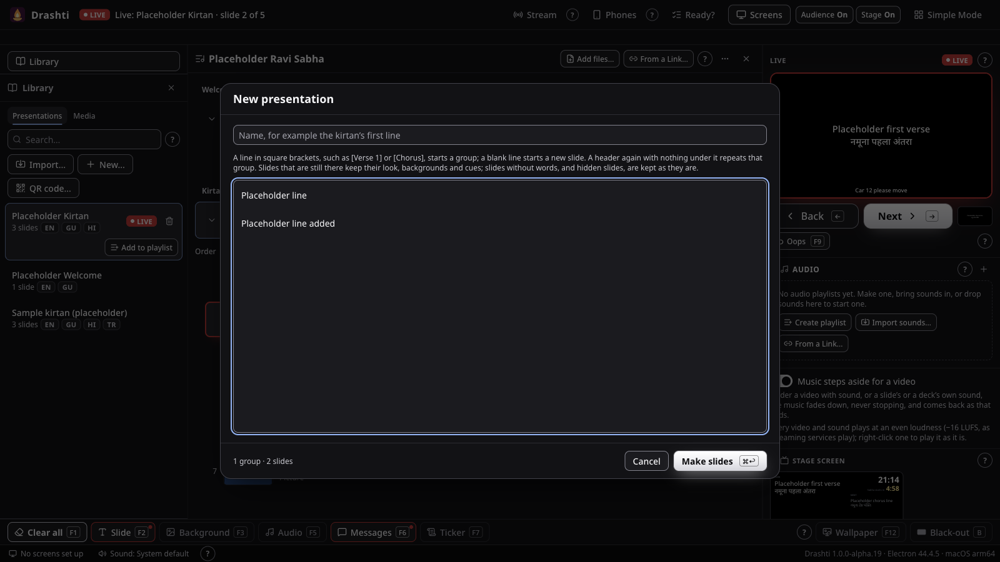
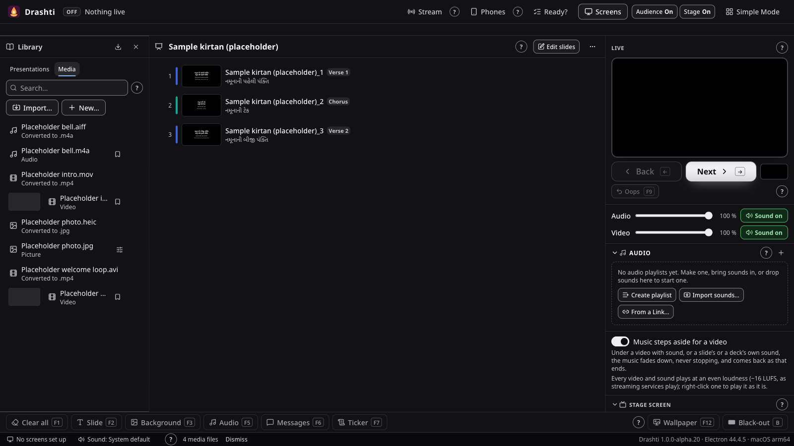
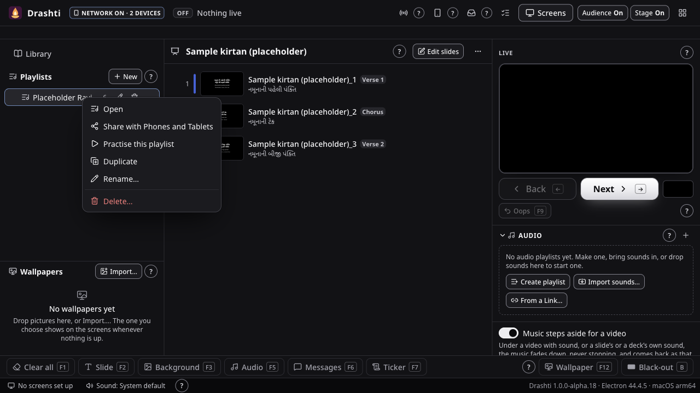
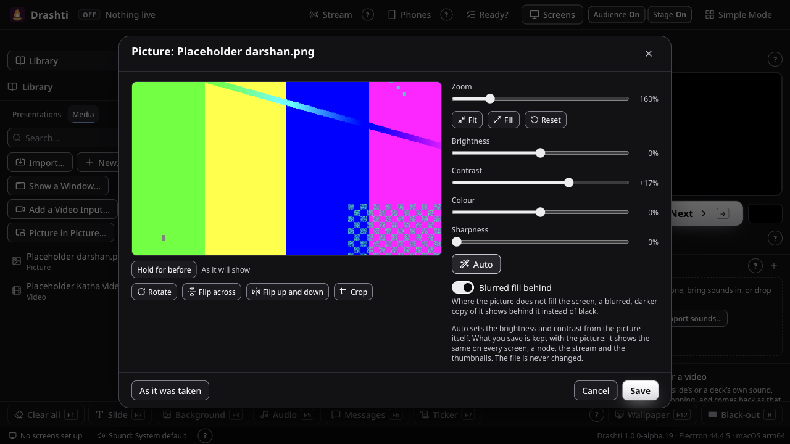
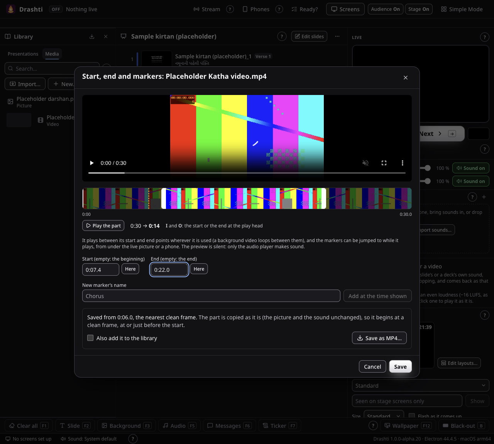

# Library

The library holds everything on this computer that can go on the screens: presentations, pictures, videos and sounds. It opens over the playlists, from the **Library** button at the top of the left column.

## The library

**What it is.** A sheet over the left column with two tabs: **Presentations** (slides, PDFs and decks) and **Media** (pictures, videos, sounds and video inputs). Under its search box are **Import…** and **New…**.

**When you would use it.** To find something for tonight's playlist, or to bring new files in.

**How:**

1. Press **Library** at the top of the left column.
2. Choose **Presentations** or **Media**.
3. Choose a row, then press **Add to playlist** to put it after the playlist's chosen row.
4. Or drag the row onto the open playlist.
5. Press **Close** (or **Esc**) to shut the library.

## Finding something

**What it is.** The library's search box. It finds a presentation by a few letters of its title or its words, in English, Gujarati, Hindi or transliteration, however they are spelt.

**When you would use it.** When a speaker asks for a kirtan you were not expecting.

**How:**

1. Press **Cmd+F** (Ctrl+F on Windows): the library opens at its search box.
2. Type a few letters of the title or the words.
3. Press Enter, or click the row you want.
4. Press **Add to playlist**, or click a slide to put it up at once.

## Importing files

**What it is.** **Import…** brings files and folders into the library: presentations, PDFs, PowerPoint and Keynote decks, pictures, videos and sounds. A file the screens can't play as it is says **Converting…** until Drashti has made a copy that plays.

**When you would use it.** Before the sabha, for anything new you will show.

**How:**

1. Open the **Library** and press **Import…**.
2. Choose **Files…**, **A Folder…** or **From a Link…**.
3. Choose what to bring in. It comes into the library only, never on the screens by itself.
4. Or drop files and folders anywhere on the open library.

## New… from words

**What it is.** A presentation made from words you paste or type. A blank line starts a new slide.

**When you would use it.** For a notice or a few lines that are not in the library yet.

**How:**

1. Open the **Library** and press **New…**.
2. Give it a **Name**, then paste or type the words.
3. Leave a blank line wherever a new slide should start.
4. Press **Make slides**. It comes into **Presentations**.

## Books

**What it is.** A passage from a book, found by its reference or by its words, shown as slides. The **Books** tab shows while **View › Show Books, Templates and Kirtan Details** is ticked.

**When you would use it.** When a speaker quotes a passage and the hall should read it.

**How:**

1. Tick **View › Show Books, Templates and Kirtan Details**, if **Books** is hidden.
2. Open the **Library**, then **Books**.
3. Type the reference in **Reference** and press **Show**, or search its words.
4. Click a slide to put it up, or press **Add to playlist**.

## Media

**What it is.** The **Media** tab: every picture, video and sound you imported, each with its length and a small picture. Above them, **Video inputs** lists this computer's cameras once one is named.

**When you would use it.** To put a picture, video or camera straight up, or to change a file's settings.

**How:**

1. Open the **Library**, then **Media**.
2. Click a picture, video or video input to put it up at once.
3. Right-click a row for its menu: **Rename…**, **Start, end and markers…**, **Picture editor…** and more.
4. Press **Delete** to remove the chosen rows; **Undo** brings them back.

## The right-click menu

**What it is.** Every row, file, video, sound and picture has one menu, wherever it shows. **Delete…** is always last, with **Undo**.

**When you would use it.** To rename, trim, check or remove something.

**How:**

1. Right-click the row. With the keyboard, press **Shift+F10**; on a touch screen, hold a finger on it.
2. Choose what you need, such as **Rename…** or **Show in Finder** (**Show in Explorer** on Windows).
3. **Delete…** asks first only when the file is on the screens or used.
4. Press **Cmd+Z** (Ctrl+Z) to undo it.

## Media information

**What it is.** A small window that says what a video or a sound file holds: its container, length and size, its picture's codec, profile, bit depth, size and frame rate, each sound track with its language, and how Drashti plays it.

**When you would use it.** When a file does not play as you expect, or someone asks what kind of file it is.

**How:**

1. Right-click the video or sound, in **Media**, a playlist or **Audio**.
2. Choose **Media information…**.
3. Press **Copy** to put its words in a message or a problem report.
4. Press **Esc** to close it.

## The Picture editor

**What it is.** A picture's own editor: **Rotate**, **Flip across**, **Flip up and down**, **Crop**, and the blurred fill behind a photo that does not fill the screen. The picture file itself never changes.

**When you would use it.** For a phone's upright photo, or a picture taken the wrong way up.

**How:**

1. Right-click the picture, then choose **Picture editor…**.
2. Turn, flip or crop it as needed.
3. Untick **Blurred fill behind** if you want black bars instead.
4. Press **Save**. **As it was taken** puts it all back.

## Start, end and markers

**What it is.** A video's or sound's timeline: where it starts and ends wherever it is used, and markers to jump to during the sabha.

**When you would use it.** For a video with a long silent start, or a talk you will jump through.

**How:**

1. In **Media**, right-click the video or sound and choose **Start, end and markers…**.
2. Set its start and end on the timeline, or while it plays.
3. To add a marker, play to the moment, type a name, then press **Add at the time shown**.
4. Press **Save**.

