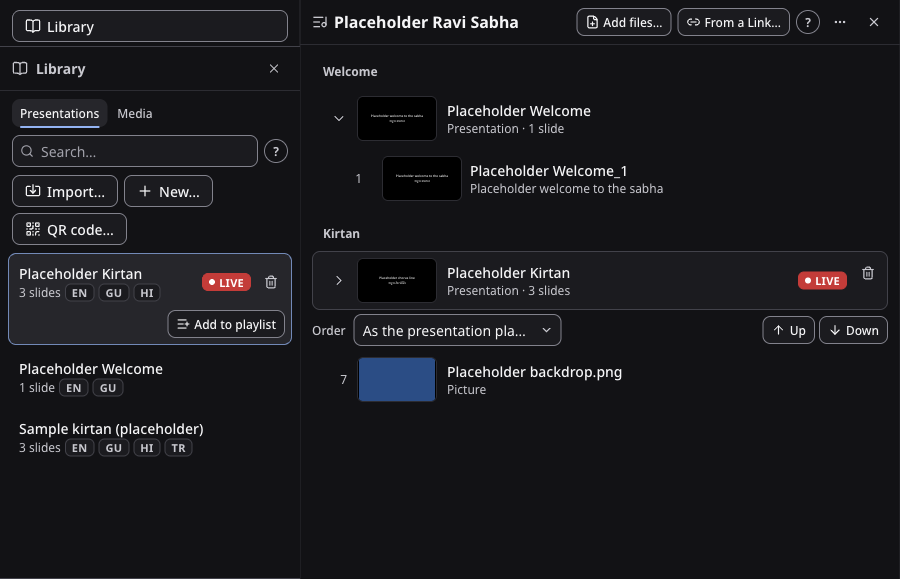
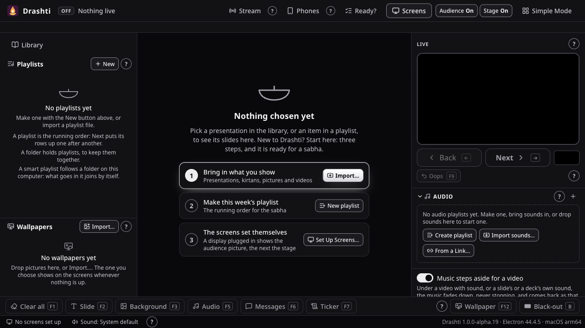
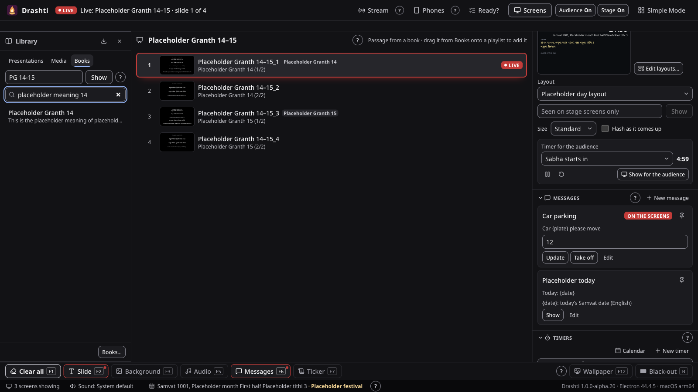
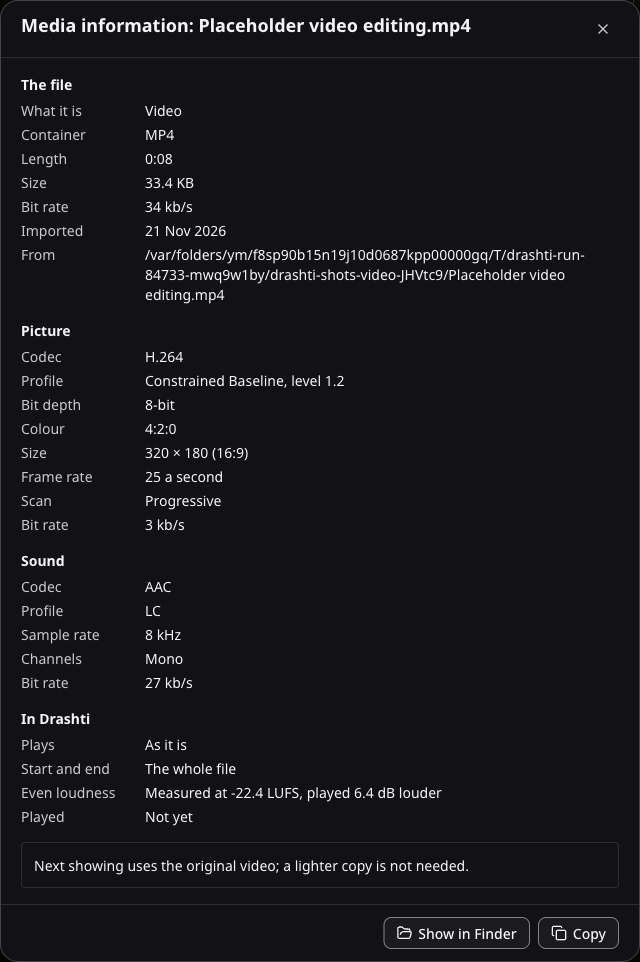
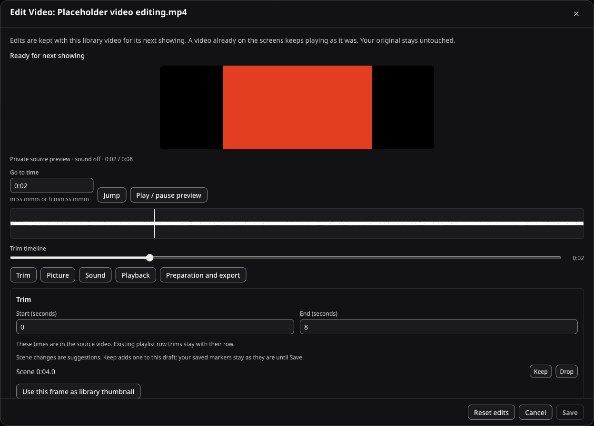
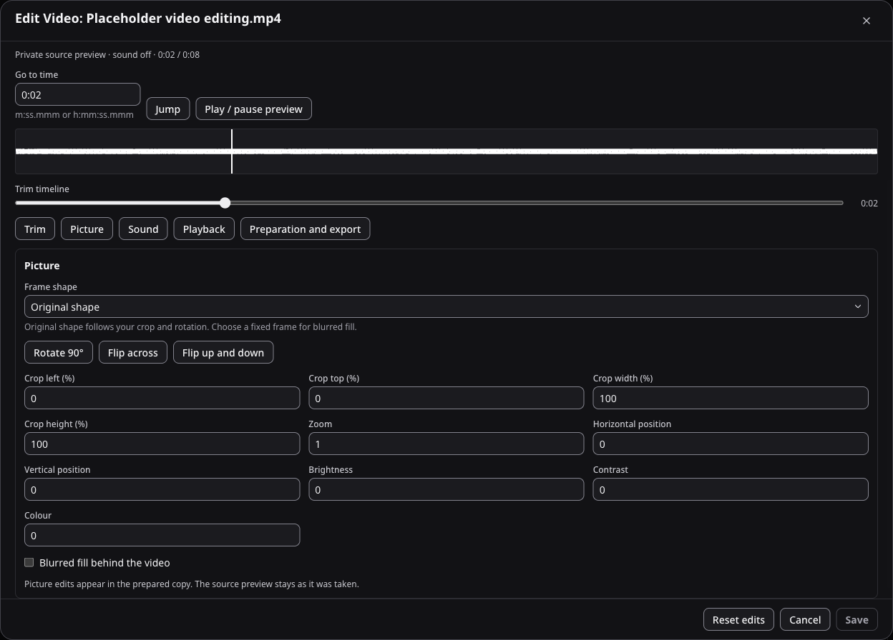
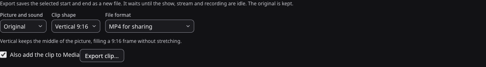

# Library

The library holds everything on this computer that can go on the screens: presentations, pictures, videos and sounds. It opens over the playlists, from the **Library** button at the top of the left column.

## The library

**What it is.** A sheet over the left column with two tabs: **Presentations** (slides, PDFs and decks) and **Media** (pictures, videos, sounds and video inputs). Under its search box are **Import…** and **New…**.

**When you would use it.** To find something for tonight's playlist, or to bring new files in.

**How:**

1. Press **Library** at the top of the left column.
2. Choose **Presentations** or **Media**.
3. Choose a row, then press **Add to playlist** to put it after the playlist's chosen row.
4. Or drag the row onto the open playlist.
5. Press **Close** (or **Esc**) to shut the library.

## Finding something

**What it is.** The library's search box. It finds a presentation by a few letters of its title or its words, in English, Gujarati, Hindi or transliteration, however they are spelt.

**When you would use it.** When a speaker asks for a kirtan you were not expecting.

**How:**

1. Press **Cmd+F** (Ctrl+F on Windows): the library opens at its search box.
2. Type a few letters of the title or the words.
3. Press Enter, or click the row you want.
4. Press **Add to playlist**, or click a slide to put it up at once.

## Importing files

**What it is.** **Import…** brings files and folders into the library: presentations, PDFs, PowerPoint and Keynote decks, pictures, videos and sounds. A file the screens can't play as it is says **Converting…** until Drashti has made a copy that plays: see **Bringing things in and sharing › Files Drashti converts**.

**When you would use it.** Before the sabha, for anything new you will show.

**How:**

1. Open the **Library** and press **Import…**.
2. Choose **Files…**, **A Folder…** or **From a Link…**.
3. Choose what to bring in. It comes into the library only, never on the screens by itself.
4. Or drop files and folders anywhere on the open library.

## New… from words

**What it is.** A presentation made from words you paste or type. A blank line starts a new slide.

**When you would use it.** For a notice or a few lines that are not in the library yet.

**How:**

1. Open the **Library** and press **New…**.
2. Give it a **Name**, then paste or type the words.
3. Leave a blank line wherever a new slide should start.
4. Press **Make slides**. It comes into **Presentations**.

## Read words from a scanned page

**What it is.** In **New…**, **Read Words from a Page…** reads the Gujarati words of a scanned page, a picture or a PDF's pages, into the words box. Drashti reads them itself, with no internet.

**When you would use it.** For a kirtan that is in a printed book or a scanned PDF, not typed anywhere yet.

**How:**

1. Open the **Library**, press **New…**, then **Read Words from a Page…**.
2. Choose the page's picture (PNG, JPEG, TIFF, WebP, GIF or BMP), several pictures, or a PDF. Pictures are read at once, in the order of their names.
3. For a PDF, type the pages to read, **from page** and **to page** (20 at most), and press **Read These Pages**.
4. Wait for the bar to fill: a few seconds a page. **Stop Reading** stops it and adds nothing.
5. Read the words over against the page and put them right: a vowel sign or a mark from the page's border can come out wrong. Add [Verse 1] lines and blank lines where slides should start.
6. Give it a **Name** and press **Make slides**.

It is for preparing slides: read pages before the sabha, not while slides are changing on the screens.

## Books

**What it is.** A passage from a book, found by its reference or by its words, shown as slides. The **Books** tab shows while **View › Show Books, Templates and Kirtan Details** is ticked.

**When you would use it.** When a speaker quotes a passage and the hall should read it.

**How:**

1. Tick **View › Show Books, Templates and Kirtan Details**, if **Books** is hidden.
2. Open the **Library**, then **Books**.
3. Type the reference in **Reference** and press **Show**, or search its words.
4. Click a slide to put it up, or press **Add to playlist**.

## Media

**What it is.** The **Media** tab: every picture, video and sound you imported, each with its length and a small picture, and the day a video or sound last played. Above them, **Video inputs** lists this computer's cameras once one is named.

**When you would use it.** To put a picture, video or camera straight up, or to change a file's settings.

**How:**

1. Open the **Library**, then **Media**.
2. Click a picture, video or video input to put it up at once.
3. Right-click a row for its menu: **Rename…**, **Start, end and markers…**, **Picture editor…** and more.
4. Press **Delete** to remove the chosen rows; **Undo** brings them back.

## The right-click menu

**What it is.** Every row, file, video, sound and picture has one menu, wherever it shows. **Delete…** is always last, with **Undo**.

**When you would use it.** To rename, trim, check or remove something, or to set a video's or sound's own **Sound and picture…** (Bass, Treble, its delays, a video's shape).

**How:**

1. Right-click the row. With the keyboard, press **Shift+F10**; on a touch screen, hold a finger on it.
2. Choose what you need, such as **Rename…** or **Show in Finder** (**Show in Explorer** on Windows).
3. **Delete…** asks first only when the file is on the screens or used.
4. Press **Cmd+Z** (Ctrl+Z) to undo it.

## Media information

**What it is.** A small window that says what a video or a sound file holds: its container, length and size, its picture's codec, profile, bit depth, size and frame rate, each sound track with its language, how Drashti plays it, and how often it has played.

**When you would use it.** When a file does not play as you expect, or someone asks what kind of file it is.

**How:**

1. Right-click the video or sound, in **Media**, a playlist or **Audio**.
2. Choose **Media information…**.
3. Press **Copy** to put its words in a message or a problem report.
4. Press **Esc** to close it.

A video also shows its **Lighter playing copy** status; see **Lighter playing copies** below. For the button that offers a long file's saved place, see **LIVE, Back and Next › Resume where it stopped**. For the time bar's repeat, frame steps and Snapshot, see that chapter too.

## Edit Video

**What it is.** A ready local video's own editing window, in Pro Mode, with a private preview and **Trim**, **Picture**, **Sound**, **Playback** and **Preparation and export** sections. Saved changes apply to its next showing. A video already on the screens keeps playing as it was.

**When you would use it.** Before the sabha, to prepare a video's picture, sound or timing, or choose its library thumbnail.

**How:**

1. In **Media** or a playlist, right-click the video and choose **Edit Video…**.
2. Type a time in the original video, such as **0:03.500**, in **Go to time** and press **Jump**, or move the **Trim timeline**. The source preview is private and silent.
3. In **Trim**, set **Start (seconds)** and **End (seconds)**. **Use this frame as library thumbnail** keeps the chosen frame when you Save.
4. In **Picture**, crop, turn, flip, zoom or move the picture, adjust **Brightness**, **Contrast** or **Colour**, and choose **Frame shape** and **Blurred fill behind the video**.
5. In **Sound**, choose **Audio track** or **Reduce steady background noise in a talk**. In **Playback**, choose **Speed** and the picture and sound fades.
6. Press **Save**. **Preparing** waits while anything is up, streaming or recording. Once clear and idle, let preparation finish until **Ready for next showing** appears.
7. Choose **Preview saved edits** to check the saved copy privately. **Source preview** returns to the original. If the saved copy cannot play, **Prepare again** rebuilds it.

**Original shape** follows the crop and rotation; **16:9**, **4:3**, **Square (1:1)** and **Vertical (9:16)** make a fixed frame. The source preview stays as it was taken: check picture changes with **Preview saved edits** after Save. For a file marked with the wrong shape, see **Audio and the levels › Sound and picture…**; its **Shape** changes the drawing at once.

**Reset edits** changes only the draft until Save. **Cancel**, or closing the window, lets you discard unsaved changes or keep editing. A failed save keeps the draft; read its reason and try Save again. If another editor saved first, reopen the video before saving again. The original, its usual thumbnail, playlist row trims and existing markers stay; tone and delays stay in **Sound and picture…**.

For the waveform and scene suggestions, see **Waveforms and suggested scene markers** below. For lighter copies and clips, choose **Preparation and export** and follow the features below.

## The Picture editor

**What it is.** A picture's own editor: **Rotate**, **Flip across**, **Flip up and down**, **Crop**, and the blurred fill behind a photo that does not fill the screen. The picture file itself never changes.

**When you would use it.** For a phone's upright photo, or a picture taken the wrong way up.

**How:**

1. Right-click the picture, then choose **Picture editor…**.
2. Turn, flip or crop it as needed.
3. Untick **Blurred fill behind** if you want black bars instead.
4. Press **Save**. **As it was taken** puts it all back.

## Start, end and markers

**What it is.** A video's or sound's timeline: where it starts and ends wherever it is used, and markers to jump to during the sabha.

**When you would use it.** For a video with a long silent start, or a talk you will jump through.

**How:**

1. In **Media**, right-click the video or sound and choose **Start, end and markers…**.
2. Set its start and end on the timeline, or while it plays.
3. To add a marker, play to the moment, type a name, then press **Add at the time shown**.
4. Press **Save**.

## Browsing a video's frames

**What it is.** In **Media**, a video's small preview browses a strip of frames prepared once while Drashti is idle. It is silent and does not move the video on the screens. Its times are approximate.

**When you would use it.** To recognise a video before adding it to a playlist.

**How:**

1. Point at a video in **Media**. Its preview waits while the show, stream or recording is on.
2. Move across the small preview to browse its frames.
3. With the keyboard, Tab to **Browse frames of …**, then use the arrow keys, Home or End.
4. If it says **Retry preview**, check the video is available and that the disk has space, then press it while idle.

## Waveforms and suggested scene markers

**What it is.** **Edit Video…** shows the chosen sound track's waveform along the trim timeline, and offers scene changes as suggested markers. The waveform and suggestions use the original video's time. They prepare while the show, stream and recording are idle; starting any of these stops preparation and removes its partial copy. It starts again from the beginning once idle.

**When you would use it.** To find a quiet gap for a trim, or mark a change of scene without replacing your own named points.

**How:**

1. Open **Edit Video…** and wait for its waveform and scene suggestions. The time fields still work while they prepare.
2. A video without sound says **No audio track**. Choosing another track prepares its own waveform.
3. Press **Keep** beside a scene to add it to the current draft, or **Drop** to dismiss that suggestion from this view.
4. Press **Save** to keep the draft. Cancel leaves saved markers and each playlist row's trim points as they were. A new analysis never replaces those points.
5. If preparation fails, check the original video and free space, then press **Retry analysis**.

## Lighter playing copies

**What it is.** On a slow computer, a large video gets a smaller playing copy while Drashti is idle. The original is kept for editing and export. A current showing keeps its file; the next showing uses its prepared copy.

**When you would use it.** To play a large video more smoothly on a computer with few processor cores or software video drawing.

**How:**

1. Open the video's **Media information…** to read its lighter copy's status.
2. Finish the show and stop streaming and recording so waiting preparation can run.
3. In **Edit Video…**, choose **Preparation and export**. **Stop lighter copy** stops preparation. If it failed or was stopped, check the original video and free space, then use **Retry lighter copy**.
4. Wait for the status to say the next showing uses the lighter copy. It retains the picture's proportions and transparency.

## Exporting a clip, including vertical video

**What it is.** A new video file containing the start and end chosen in Edit Video, with saved edits or the original picture. Vertical 9:16 keeps the middle of the picture without stretching. The original stays unchanged.

**When you would use it.** To share a short part of a video or make a portrait clip for a phone.

**How:**

1. Open **Edit Video…** in Pro Mode and choose the start and end in **Trim**.
2. Choose **Preparation and export**. Under **Picture and sound**, choose **Saved edits** or **Original**. Under **Clip shape**, choose **As the video** or **Vertical 9:16**. Save edits and wait for them to be ready before exporting Saved edits.
3. Choose MP4, or WebM to keep transparency. Tick **Also add the clip to Media** if wanted.
4. Press **Export clip…** and choose a new file with Save as…. The original is never replaced, even when you choose its name.
5. The export waits while a show, stream or recording is on. You may close the editor; it keeps the accepted request across a restart too.
6. Open the editor again for progress, **Stop export**, or **Show the file** when done. If it failed, check the source, chosen folder and free space, then export again.

