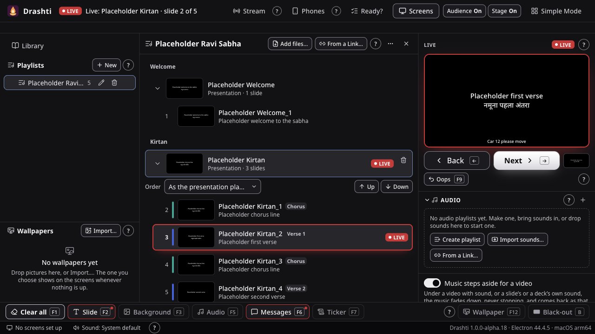
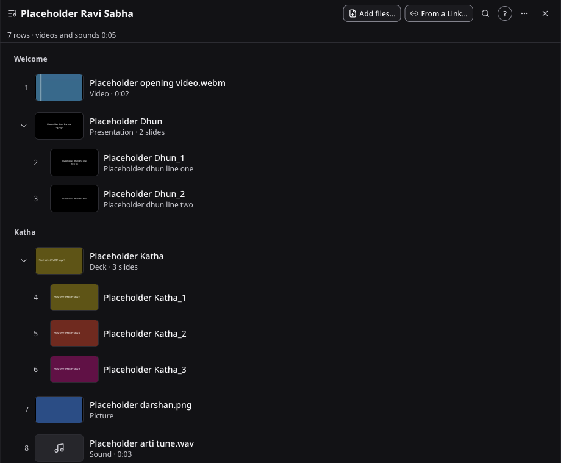
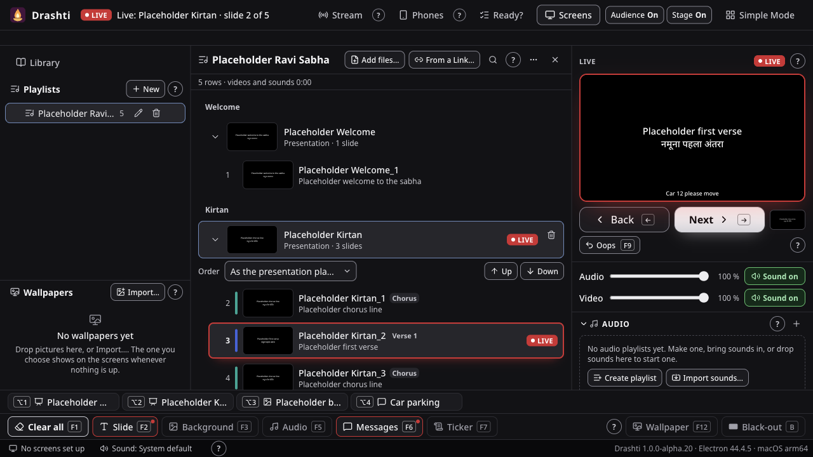
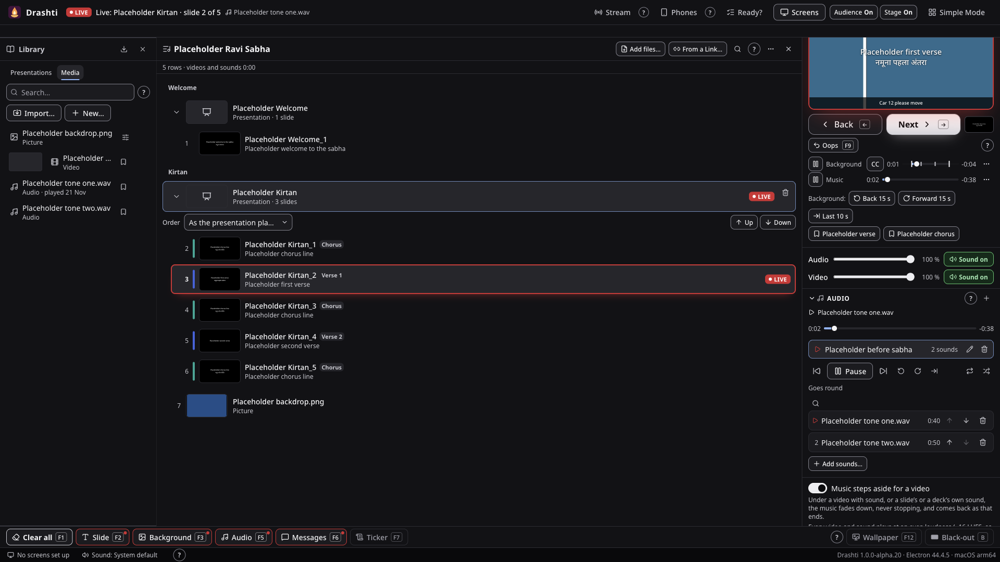
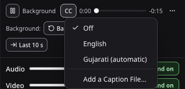

# LIVE, Back and Next

The right column starts with **LIVE**: what the hall sees this moment. Under it are **Back** and **Next**, and along the bottom of the window the show controls that cover and clear the screens.

## LIVE

**What it is.** A small copy of the hall's picture, headed **LIVE**, in red. Under it, a time bar for whatever plays, and a line for a picture in picture or a video input.

**When you would use it.** All the time: glance at it after every change.

**How:**

1. Look at **LIVE** after you put something up: it shows what the hall sees.
2. Read the line above it: what is live, and which slide ("slide 2 of 5").
3. A notice under it (such as **File missing**) says what to tell whoever looks after Drashti afterwards.

## Next and Back

**What it is.** **Next** puts up what comes next in the open playlist; **Back** goes to the slide before. The small picture beside **Next** shows what it will put up. **Oops**, under **Back**, puts back what was up before the last change.

**When you would use it.** For every slide of the sabha.

**How:**

1. Press **Next**, or **Space**, **→**, **↓** or **Page Down**.
2. Press **Back**, or **←**, **↑** or **Page Up**.
3. **Shift+→** jumps to the start of the next item; **Shift+←** to the item before.
4. A presentation's name clicked with nothing up: **Next** starts it from its first slide.

## Jump to a row by its number

**What it is.** Every row that goes up has a number at its left. Type the number and press Enter to put that row up.

**When you would use it.** When the speaker jumps ahead, or a long playlist needs a row far down.

**How:**

1. Make sure no field has the keyboard (click an empty part of the window).
2. Type the row's number, such as 12. "Row 12 · Enter puts it up · Esc cancels" shows.
3. Press Enter to put it up, or **Esc** to put the number away.

## Black-out and the Wallpaper

**What it is.** **Black-out** (**B**) makes the hall's screens black. **Wallpaper** (**F12**) puts the chosen wallpaper over the picture. Each takes the other off, and a slide or picture under them comes back as it was. The stage screens keep their words.

**When you would use it.** Between items, or at once when something should not be seen.

**How:**

1. Press **Black-out** along the bottom, or **B**.
2. Press it again to bring the picture back.
3. Press **Wallpaper**, or **F12**, for the wallpaper instead.
4. Putting anything up takes either one off, so it is seen.

## Clear all and the clear buttons

**What it is.** **Clear all** (**F1**) takes everything off the hall's screens. The clear buttons take one layer off each: **Slide** (**F2**), **Background** (**F3**), **Audio** (**F5**), **Messages** (**F6**) and **Ticker** (**F7**). A button with nothing of its own up is dimmed.

**When you would use it.** At the end of an item, or the end of the sabha.

**How:**

1. Press **Clear all**, or **F1**, to clear everything.
2. Straight after it, **Put it back** brings it all back.
3. Press one clear button to take only its layer off, such as **F2** for the words.

## Oops

**What it is.** **Oops** (**F9**) puts back what was on the screens before the last change: the slide, the background, the sound and every layer, one step a press, up to the last 20.

**When you would use it.** Right after a wrong click.

**How:**

1. Press **Oops** under **Back**, or **F9**.
2. Press it again to go back one more step.
3. It is dimmed when there is nothing to put back.

## The time bar

**What it is.** While a video or a sound plays, a bar under **Back** and **Next** shows the time played and the time left, with **Play** or **Pause**. In a video's last 10 seconds its times turn amber.

**When you would use it.** To pause a video, or to move to a part of it.

**How:**

1. Press **Pause**, then **Play**, at the start of its row.
2. Click or drag along the bar to move there on every screen at once.
3. **Back 15 s**, **Forward 15 s** and **Last 10 s** jump the background video or a sound.
4. With the keyboard on the bar, the arrow keys move 5 seconds, Home and End to its start and end.

## Markers

**What it is.** Buttons under the live picture, one for each marker set on a video or sound. A press jumps every screen and the sound there together.

**When you would use it.** For a talk or a video you jump through in parts.

**How:**

1. Set the markers first, in **Media** (**Start, end and markers…**, in the Library chapter).
2. Put the video or sound up.
3. Press a marker's button under the live picture to jump there.

## Zooming a picture

**What it is.** A picture on the screens zoomed and moved from **LIVE**. Every screen follows smoothly, together.

**When you would use it.** To show one part of a picture or a PDF page larger.

**How:**

1. Put a picture up.
2. Scroll or pinch over **LIVE** to zoom; drag to move it. Or use **+** and **−** under it.
3. Double-click it (or press **Reset**) to go back.
4. **Keep this zoom** saves it with the picture for next time.

## A video's captions

**What it is.** A video's own captions (an SRT or WebVTT file), shown on the audience screens and the stream, never on the stage. Captions start **Off** for each video.

**When you would use it.** For a video in another language, or for those who can't hear it well.

**How:**

1. Put the caption file beside the video before importing it, such as `Placeholder.en.srt` beside `Placeholder.mp4`.
2. Or right-click the video and choose **Captions… › Add a Caption File…**.
3. While the video is up, press **CC** beside its time bar and choose a language.
4. Choose **Off** to take them off again.

## The quick bar

**What it is.** Up to 8 things one press away, just above the clear buttons: a slide's row, a playlist's row, a picture, video or sound, or a message.

**When you would use it.** For what you put up again and again, such as the welcome slide.

**How:**

1. Right-click a row and choose **Pin to the quick bar**.
2. Click a pin, or press **Alt+1** to **Alt+8**, to put it up.
3. Right-click a pin for **Move left**, **Move right** and **Unpin from the quick bar**.

