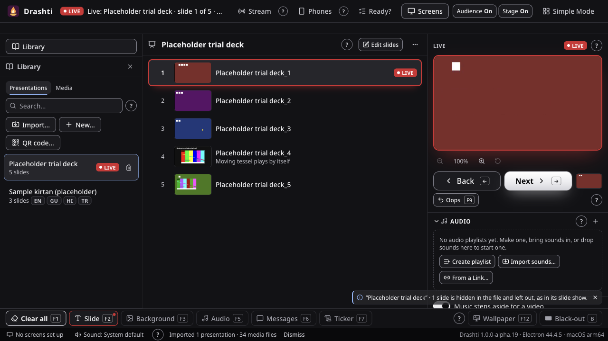
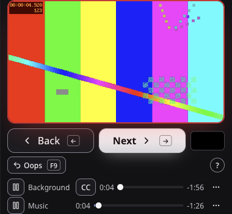
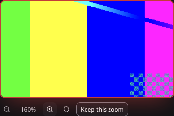

# LIVE, Back and Next

The right column starts with **LIVE**: what the hall sees this moment. Under it are **Back** and **Next**, and along the bottom of the window the show controls that cover and clear the screens.

## LIVE

**What it is.** A small copy of the hall's picture, headed **LIVE**, framed in red while something is up. The word **LIVE** in red is in the top bar whenever anything is on the hall's screens, the stream or the hall's sound, beside what is live (with no slide up, it names what is: **Live: Picture · …**, **Live: Video input · …**, **Live: Lower third · …**, **Live: Message · …**, **Live: Audio**, **Live: Captions**); with everything cleared it says **Off** and what was cleared (**Cleared: … · slide 3 of 5**); in the playlist, the row on the screens has a red edge and a small red dot. Under it, a time bar for whatever plays, and a line for a picture in picture or a video input.

**When you would use it.** All the time: glance at it after every change.

**How:**

1. Look at **LIVE** after you put something up: it shows what the hall sees.
2. Read the line above it: what is live, and which slide ("slide 2 of 5").
3. A notice under it (such as **File missing**) says what to tell whoever looks after Drashti afterwards.

## Next and Back

**What it is.** **Next** puts up what comes next in the open playlist; **Back** goes to the slide before. The small picture beside **Next** shows what it will put up. **Oops**, under **Back**, puts back what was up before the last change.

**When you would use it.** For every slide of the sabha.

**How:**

1. Press **Next**, or **Space**, **→**, **↓** or **Page Down**.
2. Press **Back**, or **←**, **↑** or **Page Up**.
3. **Shift+→** jumps to the start of the next item; **Shift+←** to the item before.
4. A presentation's name clicked with nothing up: **Next** starts it from its first slide.

## Jump to a row by its number

**What it is.** Every row that goes up has a number at its left. Type the number and press Enter to put that row up.

**When you would use it.** When the speaker jumps ahead, or a long playlist needs a row far down.

**How:**

1. Make sure no field has the keyboard (click an empty part of the window).
2. Type the row's number, such as 12. "Row 12 · Enter puts it up · Esc cancels" shows.
3. Press Enter to put it up, or **Esc** to put the number away.

## Black-out and the Wallpaper

**What it is.** **Black-out** (**B**) makes the hall's screens black. **Wallpaper** (**F12**) puts the chosen wallpaper over the picture. Each takes the other off, and a slide or picture under them comes back as it was. The stage screens keep their words.

**When you would use it.** Between items, or at once when something should not be seen.

**How:**

1. Press **Black-out** along the bottom, or **B**.
2. Press it again to bring the picture back.
3. Press **Wallpaper**, or **F12**, for the wallpaper instead.
4. Putting anything up takes either one off, so it is seen. **Oops** after a click by mistake puts it back on, with what was under it, and **Put it back** after **Clear all** leaves on one that is still on.

## Clear all and the clear buttons

**What it is.** **Clear all** (**F1**) takes everything off the hall's screens. The clear buttons take one layer off each: **Slide** (**F2**), **Background** (**F3**), **Audio** (**F5**), **Messages** (**F6**) and **Ticker** (**F7**). A clear button with nothing of its own up shows its icon alone, in the same place, and is dimmed: rest the mouse on it to see its name and key. So the clears' words along the bottom are what is on the screens.

**When you would use it.** At the end of an item, or the end of the sabha.

**How:**

1. Press **Clear all**, or **F1**, to clear everything.
2. Straight after it, **Put it back** brings it all back (under **Black-out** or the **Wallpaper** if one is still on).
3. Press one clear button to take only its layer off, such as **F2** for the words.

## Oops

**What it is.** **Oops** (**F9**) puts back what was on the screens before the last change: the slide, the background, the sound, every layer and **Black-out** or the **Wallpaper**, one step a press, up to the last 20.

**When you would use it.** Right after a wrong click.

**How:**

1. Press **Oops** under **Back**, or **F9**.
2. Press it again to go back one more step.
3. It is dimmed when there is nothing to put back.

## The time bar

**What it is.** While a video or a sound plays, a bar under **Back** and **Next** shows the time played and the time left, with **Play** or **Pause**. In a video's last 10 seconds its times turn amber.

**When you would use it.** To pause a video, or to move to a part of it.

**How:**

1. Press **Pause**, then **Play**, at the start of its row.
2. Click or drag along the bar to move there on every screen at once.
3. **Back 15 s** and **Forward 15 s** jump the background video or a sound.
4. With the keyboard on the bar, the arrow keys move 5 seconds, Home and End to its start and end.

## Markers

**What it is.** Buttons under the live picture, one for each marker set on a video or sound. A press jumps every screen and the sound there together.

**When you would use it.** For a talk or a video you jump through in parts.

**How:**

1. Set the markers first, in **Media**: see **Library › Start, end and markers**.
2. Put the video or sound up.
3. Press a marker's button under the live picture to jump there.

## Resume where it stopped

**What it is.** A button, **Resume at 6:00**, under the time bars when a background video or sound of 10 minutes or more goes up again after it was taken off part-way. A video set to loop, or a file taken off in its last 30 seconds, has no offer.

**When you would use it.** For a long talk or katha stopped part-way, to carry on from there next time.

**How:**

1. Put the video or sound up again. It starts at its start, as always.
2. Within 30 seconds, press **Resume at …** to go where it was taken off, on every screen and the sound together.
3. Leave it, and the button goes after 30 seconds.

This is offered in Simple Mode too. For an audio playlist that carries on from its track, see **Audio and the levels › Audio playlists**. **Library › Media information** says how often a file has played and when it last did.

## A-B repeat

**What it is.** In Pro Mode, a part of the background video or the sound going round, from A to B, on every screen and in the hall together.

**When you would use it.** For a verse to play again and again while people learn it, or a short loop behind a talk.

**How:**

1. Play it to where the part starts, then press **⋯** at the end of its time bar, and **Repeat from here (A)**.
2. Play it on to where the part ends, then **⋯**, **…to here (B)**.
3. **⋯**, **Stop repeating A-B** plays on from where it is.

## One frame back and on, and Snapshot

**What it is.** In Pro Mode, while a video is paused: the frame before or after it on every screen, and **Snapshot**, which keeps that frame as a picture in **Media**.

**When you would use it.** To stop on exactly the right picture, or to keep it for a slide later.

**How:**

1. Pause the video with its time bar's **Pause**.
2. Press **⋯** at the end of its bar, then **One frame back** or **One frame on**, or press **Alt** (Option on a Mac) with **←** or **→** on the bar.
3. **⋯**, **Snapshot** puts that frame in **Media**; **Undo** takes it away.

## Zooming a picture

**What it is.** A picture on the screens zoomed and moved from **LIVE**. Every screen follows smoothly, together.

**When you would use it.** To show one part of a picture or a PDF page larger.

**How:**

1. Put a picture up.
2. Scroll or pinch over **LIVE** to zoom; drag to move it. Or use **+** and **−** under **Back** and **Next**.
3. Double-click it (or press **Reset**) to go back.
4. **Keep this zoom** saves it with the picture for next time.

## A video's captions

**What it is.** A video's own captions (an SRT or WebVTT file), shown on the audience screens and the stream, never on the stage. Captions start **Off** for each video.

**When you would use it.** For a video in another language, or for those who can't hear it well.

**How:**

1. Put the caption file beside the video before importing it, such as `Placeholder.en.srt` beside `Placeholder.mp4`.
2. Or right-click the video and choose **Captions… › Add a Caption File…**.
3. While the video is up, press **CC** beside its time bar and choose a language.
4. Choose **Off** to take them off again.

## When a video cannot play

**What it is.** The picture before a video, or the Wallpaper or cover, stays until the video is ready to show, under the picture-in-picture box too. If a video fails, a notice names the file and where it could not play. A background video comes off with its sound; a video on a slide pauses there with its sound stopped; a video in the picture-in-picture box closes the box.

**When you would use it.** When a video has sound but no picture, stops, or has a notice naming it.

**How:**

1. Read the notice: it names the file and where it could not play.
2. Put up the next suitable row, or choose another file.
3. If it names a paired computer, check that computer's screen: it keeps its earlier picture while the video plays on elsewhere.
4. After the sabha, use **Help › Report a Problem…**. See **Help and when something goes wrong › Report a Problem…** for the optional files and review.

A video on a slide or in the picture-in-picture box that is paused, waiting for its click or at its end does not come off when a screen cannot play it. The notice names the file and the screen, and a line under the LIVE picture says **Not on the screen “…”**: LIVE shows it, that screen does not. If it is played anyway, Drashti stops it again at once with the notice; put something else up. A screen only too slow to start it says **Not on the screen “…” yet** while it is still loading; the line goes once that screen shows it. While a screen waits for a video's first picture, the line **Starting on the screen “…”…** shows from 2 seconds after it went up until that screen shows it.

A video making no progress for 10 seconds comes off; one still loading gets up to 30 seconds. If it still has no picture then, the notice says it **could not start in time**. That does not mean the file is damaged: try it again when less is playing.

If the same video brings a screen, **LIVE** or the sound player down twice within a minute, Drashti takes it off and brings that screen, the controls or the sound back without it. A slide video is paused first; if it still causes failures, its slide comes off as **Clear slide** takes it. Music repeatedly bringing the sound player down comes off as **Clear audio** takes it. **Back** or **Oops** can bring that slide or music back; use another file if it fails again.

A video this computer cannot show is converted once the show is quiet: see **Bringing things in and sharing › Files Drashti converts**. A damaged file may need replacing. When a video ends or comes off, its picture stays until the chosen Wallpaper is ready, rather than showing black between them.

## The quick bar

**What it is.** Up to 8 things one press away, just above the clear buttons: a slide's row, a playlist's row, a picture, video or sound, or a message.

**When you would use it.** For what you put up again and again, such as the welcome slide.

**How:**

1. Right-click a row and choose **Pin to the quick bar**.
2. Click a pin, or press **Alt+1** to **Alt+8** (**⌥1** to **⌥8** on a Mac), to put it up.
3. Right-click a pin for **Move left**, **Move right** and **Unpin from the quick bar**.

