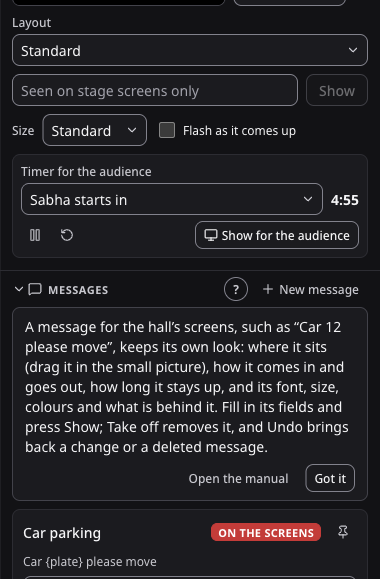
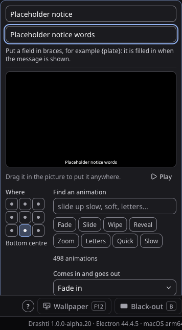
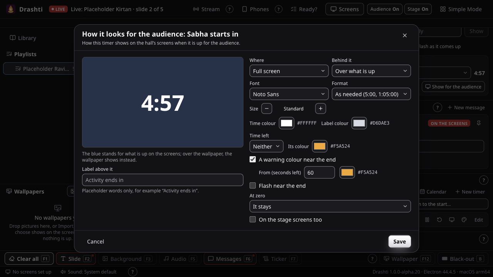
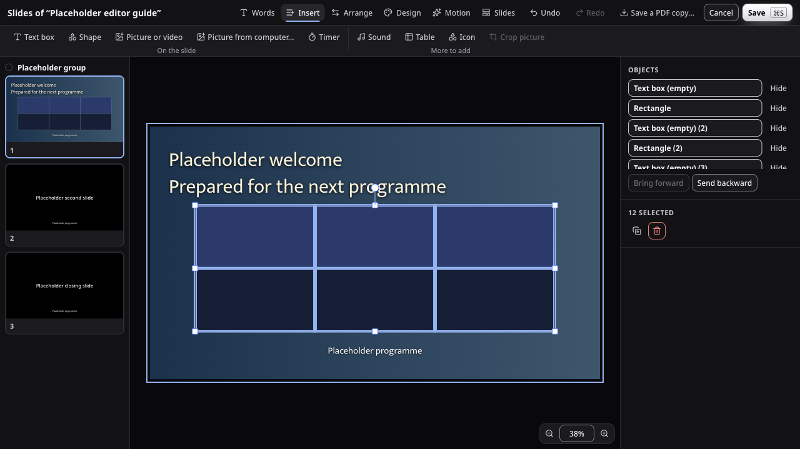

# Messages and timers

**Messages** puts a line on the hall's screens, such as "Car 12 please move". **Timers** runs countdowns and clocks, for the stage or for everyone to see. Both panels are under the live picture.

## Messages

**What it is.** Messages kept ready, each with fields to fill in (the car's number in "Car {plate} please move"). It goes across the bottom of the hall's screens unless its look says otherwise.

**When you would use it.** For a car to move, a lost item, or any short notice during the sabha.

**How:**

1. Press **Messages** under LIVE to open it, then fill in the message's fields.
2. Press **Show** (or Enter in the field).
3. Change the words and press **Update** to put them up.
4. Press **Take off** to remove it; **F6** removes every message.

## A message's look

**What it is.** Each message's own look: where it sits, how it comes in and goes out, how long it stays up, its font, size and colours, and what is behind the words.

**When you would use it.** When a message should sit at the top, or go by itself after a time.

**How:**

1. Press **Edit** beside the message.
2. Drag it in the small picture, or choose where it sits.
3. Choose **Comes in and goes out**, **How long**, the font and the colours.
4. Press **Play** in the small picture to see it come in, then save it.

## Timers

**What it is.** Countdowns, count ups and clocks, one line each: start or pause, reset, show for the audience, and Edit. The stage screens show every running timer by themselves.

**When you would use it.** To keep a talk to time, or count down to an activity's end.

**How:**

1. Press **Timers** under LIVE to open it, then **Start** on a timer. **Pause** stops it; **Reset** starts it over.
2. Press **Edit** to change its kind, length or name.
3. The stage screens show it while it runs.

## A timer for the audience

**What it is.** A timer on the hall's screens, in its own look: full screen or a corner, over the wallpaper or over what is up, with a label, a ring or a bar, and a warning colour near the end.

**When you would use it.** For a break, or an activity the whole hall times together.

**How:**

1. Press **How it looks for the audience…** to set its look.
2. Press **Start**, then **Show for the audience**.
3. Press **Hide** to take it off. **Clear all** takes it off too.

## A countdown to the start

**What it is.** The time left to the sabha's start, over the wallpaper on the hall's screens and on the stage. It goes by itself at zero.

**When you would use it.** While people come in before the sabha.

**How:**

1. In **Timers**, press **Countdown to the start…**.
2. Set **The sabha’s time**.
3. Press **Show the countdown**.
4. **Hide the countdown** takes it off sooner.

## A timer on a slide

**What it is.** A live timer as part of a slide, made in the slide editor: **Timer** under **Insert**, or **New Timer Slide…** for a whole slide.

**When you would use it.** For a "Starting in 4:59" slide before the sabha.

**How:**

1. Right-click a slide's row and choose **New Timer Slide…**.
2. Choose **Timer only** or **Timer with words**.
3. Press **Add the slide**. **Undo** takes it back.
4. Put the slide up: only the digits that change move, once a second.

