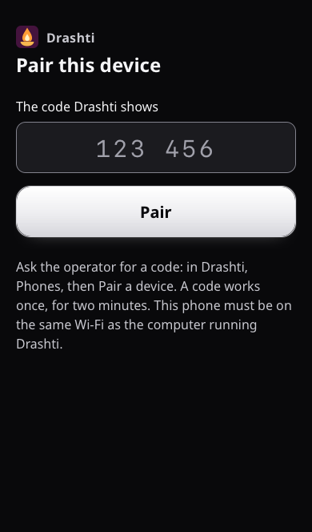
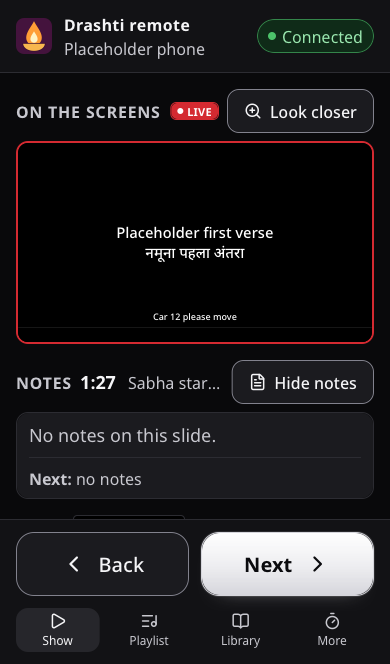
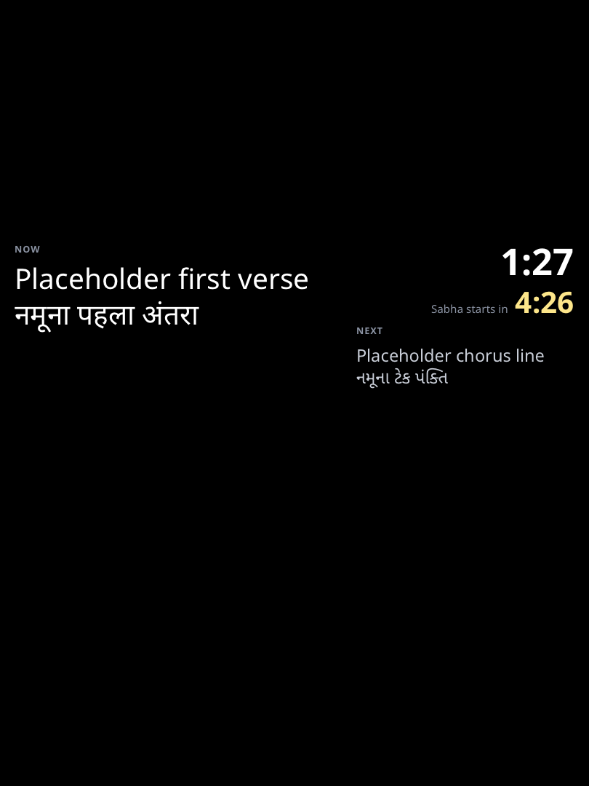
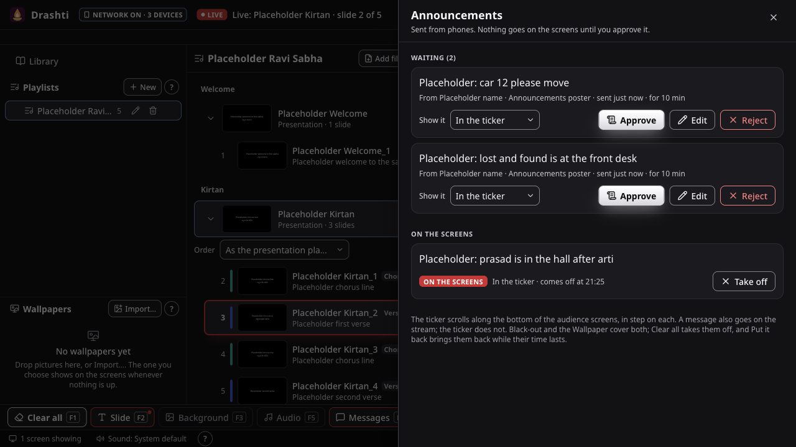
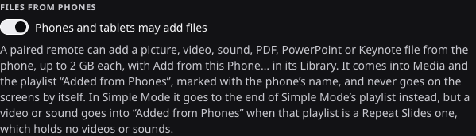
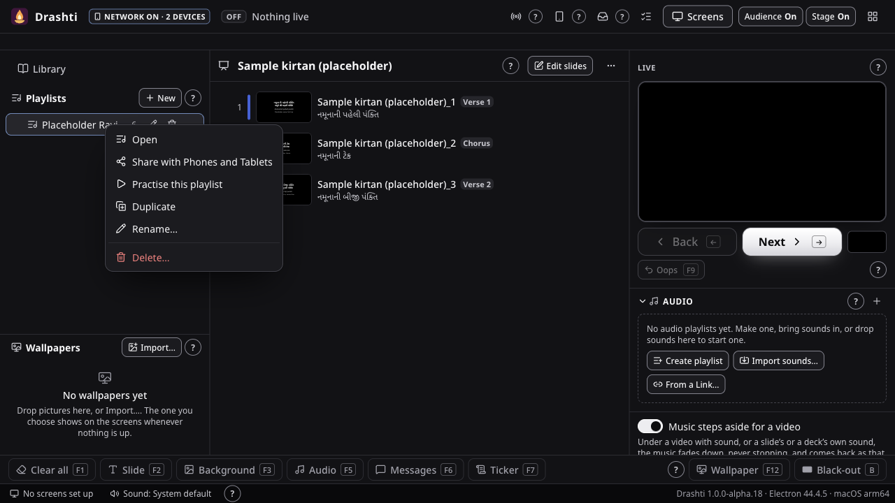

# Phones and network

**Phones**, in the top bar, lets phones and tablets on the mandir's Wi-Fi work with Drashti: as a remote, as a stage display, to send announcements, or to chat. It needs no internet and costs nothing. Pair them in Pro Mode.

## Phones and tablets

**What it is.** The Phones panel: **Let paired phones and tablets connect**, the paired devices (each **Connected** or when it was last seen), **Pair a device**, **Show the Chat QR code** and **Files from phones**.

**When you would use it.** Before a sabha where a phone remote, a stage tablet, announcements or the chat are used.

**How:**

1. Press **Phones** in the top bar.
2. Turn on **Let paired phones and tablets connect**.
3. Check each device in the list says **Connected**.
4. Press **Remove** beside a phone that is lost: it is cut off at once.

## Pairing a phone or tablet

**What it is.** A phone or tablet joined to Drashti once, by its QR code, as a **Remote**, a **Stage** display or an **Announcements** device.

**When you would use it.** The first time a phone or tablet is used.

**How:**

1. In **Phones**, type a **Name (optional)**, such as "Placeholder tablet".
2. Press **Pair a Remote device**, **Pair a Stage device** or **Pair an Announcements device**.
3. Scan the QR code with the phone's camera, and open the page it offers.
4. Use Safari 16.4 or later on an iPhone or iPad, or Chrome on Android.

## The phone remote

**What it is.** A paired phone or tablet that shows the sabha: LIVE's picture, the **Sabha flow** and the **Chat**, in both modes. In Simple Mode that is all, with no controls. In Pro Mode it also puts up a PowerPoint or a PDF from a playlist and moves through it. A PowerPoint goes as it was made: its own videos, sounds and slide timings play just as they do from this computer, and at its end the playlist goes on, or not, as you set it here. Since alpha.23 a phone never plays or changes any other video, picture or sound, or the timers or messages.

**When you would use it.** For a presenter who moves their own PowerPoint or PDF, or follows the sabha from the front.

**How:**

1. Pair the phone as a **Remote**.
2. In Pro Mode, tap a PowerPoint's or a PDF's slide in the phone's **Playlist** to put it up. Other items stay on this computer.
3. Tap **Next** or **Back** to move inside it. **Next** stops at its last slide.
4. Tap **Look closer** to see the screens' picture full screen, on the phone alone.
5. Companion and a Stream Deck use **OSC** instead (see **Tools**).

## A stage display on a tablet

**What it is.** A paired tablet showing the stage screen, as a stage display does: the layout, its timers and the stage message.

**When you would use it.** When the speaker has no stage screen but a tablet on the lectern.

**How:**

1. Pair the tablet as a **Stage** device.
2. Set the tablet never to lock while it shows the stage.
3. It follows the **Layout** chosen in the **Stage screen** panel.

## Announcements from phones

**What it is.** Announcements sent from paired phones (or from a poster's link on the Wi-Fi), waiting for you. Nothing goes up until you approve it.

**When you would use it.** When volunteers send notices during the sabha.

**How:**

1. **Announcements** in the top bar says how many are waiting: open it.
2. Read each one. Fix a typo with **Edit**.
3. Press **Approve** to put it in the ticker or up as a message, or **Reject**.
4. **Make a poster link**, in **Phones**, lets anyone on the Wi-Fi send one.

## The chat

New messages from others appear silently for about 10 seconds in a centred popup above the bottom show controls, in Pro and Simple Mode; click it to open Chat, or × to dismiss it, without taking the keyboard from the show, and it never appears on the hall, stage, phones’ show or stream.

**What it is.** One group chat for this computer and the phones paired with it, as a WhatsApp group: each message with its sender's name and time. Phone remotes and Announcements devices are in it, and the phones that scan the **Chat QR code**. It goes over the mandir's Wi-Fi only, is kept for today only, and never shows on the screens or the stream.

**When you would use it.** When volunteers with phones need to tell each other, or the operator, something during the sabha.

**How:**

1. Open **Chat** under LIVE, below **Messages**.
2. Type in the box and press **Send** (or Enter). You write as **Operator**.
3. For more people, press **Show the Chat QR code** in **Phones**, and let each phone scan it within 10 minutes.
4. Folded, its heading shows how many new messages came in.
5. **Clear chat** empties it for everyone. **Remove…** under **People in the chat** cuts a phone off at once.

## Files from phones

**What it is.** **Phones and tablets may add files**, under **Files from phones** in **Phones**. Phones no longer send or receive files (since alpha.23): Drashti refuses every file a phone sends, whether the switch is on or off. The switch stays for now.

**When you would use it.** Not any more. Bring a volunteer's files in on this computer.

**How:**

1. Leave **Phones and tablets may add files** as it is: it changes nothing for phones.
2. Copy the files to this computer, then press **Add files…** above the playlist, or drop them on it.

## Sharing a playlist with phones

**What it is.** **Share with Phones and Tablets**, in a playlist's right-click menu, and its mark on the playlist's row. Since alpha.23 phones no longer see shared playlists. The menu and the mark stay for now.

**When you would use it.** Not any more. A presenter reads the night's PowerPoint and PDF items in the phone's **Playlist**, in Pro Mode.

**How:**

1. To take the mark off, right-click the playlist on the left.
2. Choose **Stop Sharing**.

## The network

**What it is.** The mandir's own network, which the phones, a node and OSC use. The first time each is turned on, the computer's firewall asks once.

**When you would use it.** When setting up, or when a phone cannot find Drashti.

**How:**

1. When the Mac asks to accept incoming connections, press **Allow**. On Windows, tick **Private networks** only, then **Allow**.
2. Use the mandir's own Wi-Fi, never a guest one.
3. Ask for this computer's address to be reserved in the router, so phones always find it.

