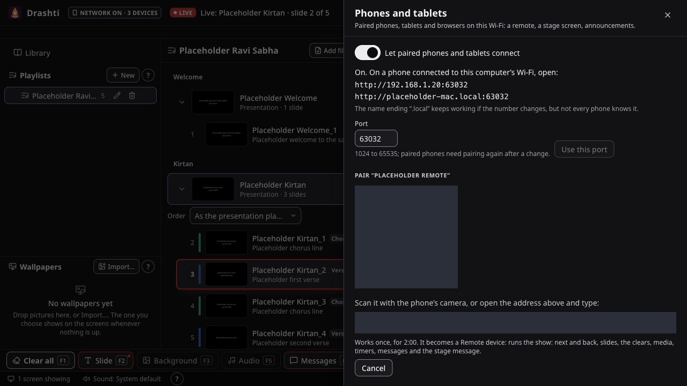

# Phones and network

**Phones**, in the top bar, lets phones and tablets on the mandir's Wi-Fi work with Drashti: as a remote, as a stage display, to send announcements, or to chat. It needs no internet and costs nothing. Pair them in Pro Mode.

## Phones and tablets

**What it is.** The Phones panel: **Let paired phones and tablets connect**, the paired devices (each **Connected** or when it was last seen), **Pair a device**, **Show the Chat QR code** and **Files from phones**.

**When you would use it.** Before a sabha where a phone remote, a stage tablet or announcements are used.

**How:**

1. Press **Phones** in the top bar.
2. Turn on **Let paired phones and tablets connect**.
3. Check each device in the list says **Connected**.
4. Press **Remove** beside a phone that is lost: it is cut off at once.

## Pairing a phone or tablet

**What it is.** A phone or tablet joined to Drashti once, by its QR code, as a **Remote**, a **Stage** display or an **Announcements** device.

**When you would use it.** The first time a phone or tablet is used.

**How:**

1. In **Phones**, type a **Name (optional)**, such as "Placeholder tablet".
2. Press **Pair a Remote device**, **Pair a Stage device** or **Pair an Announcements device**.
3. Scan the QR code with the phone's camera, and open the page it offers.
4. Use Safari 16.4 or later on an iPhone or iPad, or Chrome on Android.

## The phone remote

**What it is.** A paired phone or tablet with much of this window: LIVE's picture, **Next** and **Back**, the clears, the playlist's rows, the library, the music, the stage message and timers.

**When you would use it.** For a presenter who moves their own slides, or an operator away from the desk.

**How:**

1. Pair the phone as a **Remote**.
2. Tap a row of the **Playlist** to put it up; tap **Next** or **Back**, or swipe left and right on the picture.
3. Tap **Look closer** to see the screens' picture full screen.
4. Its **More** has the clears, the wallpapers and this computer's screens.

## A stage display on a tablet

**What it is.** A paired tablet showing the stage screen, as a stage display does: the layout, its timers and the stage message.

**When you would use it.** When the speaker has no stage screen but a tablet on the lectern.

**How:**

1. Pair the tablet as a **Stage** device.
2. Set the tablet never to lock while it shows the stage.
3. It follows the **Layout** chosen in the **Stage screen** panel.

## Announcements from phones

**What it is.** Announcements sent from paired phones (or from a poster's link on the Wi-Fi), waiting for you. Nothing goes up until you approve it.

**When you would use it.** When volunteers send notices during the sabha.

**How:**

1. **Announcements** in the top bar says how many are waiting: open it.
2. Read each one. Fix a typo with **Edit**.
3. Press **Approve** to put it in the ticker or up as a message, or **Reject**.
4. **Make a poster link**, in **Phones**, lets anyone on the Wi-Fi send one.

## The chat

**What it is.** One group chat for this computer and the phones paired with it, as a WhatsApp group: each message with its sender's name and time. Phone remotes and Announcements devices are in it, and the phones that scan the **Chat QR code**. It goes over the mandir's Wi-Fi only, is kept for today only, and never shows on the screens or the stream.

**When you would use it.** When volunteers with phones need to tell each other, or the operator, something during the sabha.

**How:**

1. Open **Chat** under LIVE, below **Messages**.
2. Type in the box and press **Send** (or Enter). You write as **Operator**.
3. For more people, press **Show the Chat QR code** in **Phones**, and let each phone scan it within 10 minutes.
4. Folded, its heading shows how many new messages came in.
5. **Clear chat** empties it for everyone. **Remove…** under **People in the chat** cuts a phone off at once.

## Files from phones

**What it is.** **Phones and tablets may add files**: a paired remote can send a picture, video, sound, PDF or deck into Drashti. Off until someone turns it on. Nothing a phone sends goes on the screens by itself.

**When you would use it.** When a volunteer has tonight's photos on their phone.

**How:**

1. In **Phones**, under **Files from phones**, turn on **Phones and tablets may add files**.
2. On the phone, open **Library**, then **Media**, then **Add from this Phone…** (or **Add photos**).
3. **Add from this Phone…** puts files into **Media** and **Added from Phones**, marked with the phone's name. **Add photos** instead fills the ordinary playlist open in Pro Mode.

In Simple Mode, files go to the end of the playlist open on the computer; a video or sound goes into **Added from Phones** when it is a Repeat Slides playlist. With no playlist open, files go into **Added from Phones**. See **Simple Mode › A phone in Simple Mode** and the presenter's guide for the phone's limits.

## Sharing a playlist with phones

**What it is.** A playlist's files shown on a paired remote, to look at and play on the phone only.

**When you would use it.** So a presenter can look through the night's files on their own phone.

**How:**

1. Right-click the playlist on the left.
2. Choose **Share with Phones and Tablets**. A mark shows on its row.
3. On the phone, **Library** then lists it under **Shared from Drashti**.
4. **Stop Sharing**, in the same menu, ends it.

## The network

**What it is.** The mandir's own network, which the phones, a node and OSC use. The first time each is turned on, the computer's firewall asks once.

**When you would use it.** When setting up, or when a phone cannot find Drashti.

**How:**

1. When the Mac asks to accept incoming connections, press **Allow**. On Windows, tick **Private networks** only, then **Allow**.
2. Use the mandir's own Wi-Fi, never a guest one.
3. Ask for this computer's address to be reserved in the router, so phones always find it.

