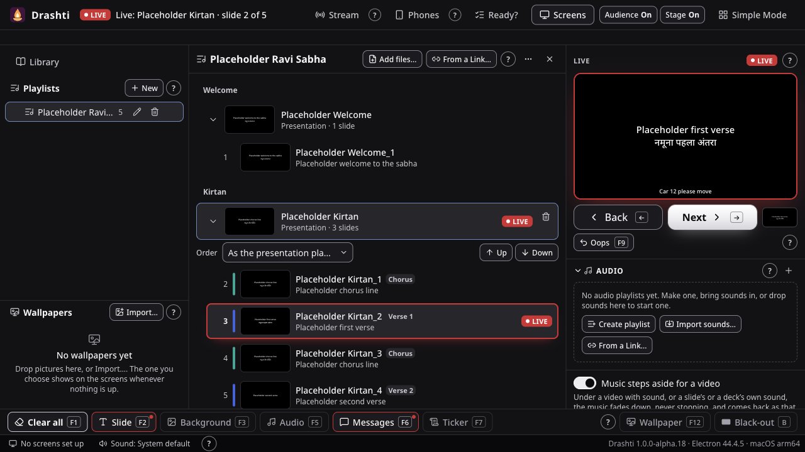
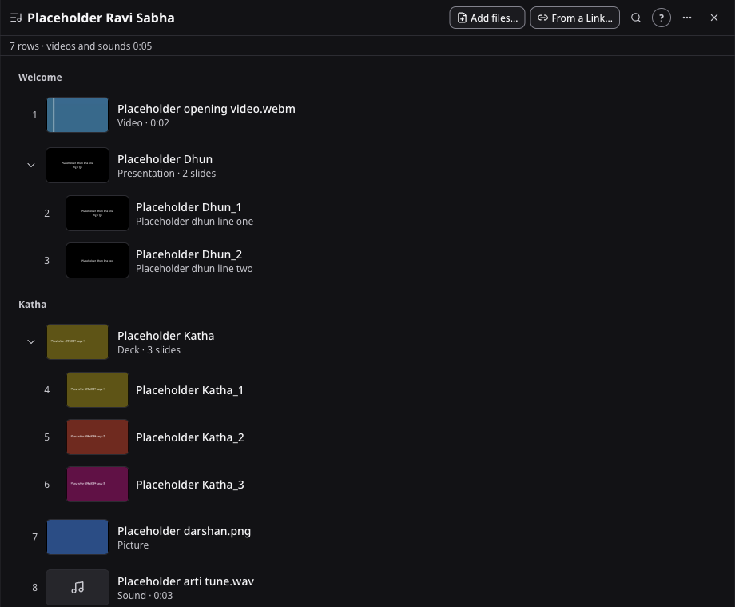
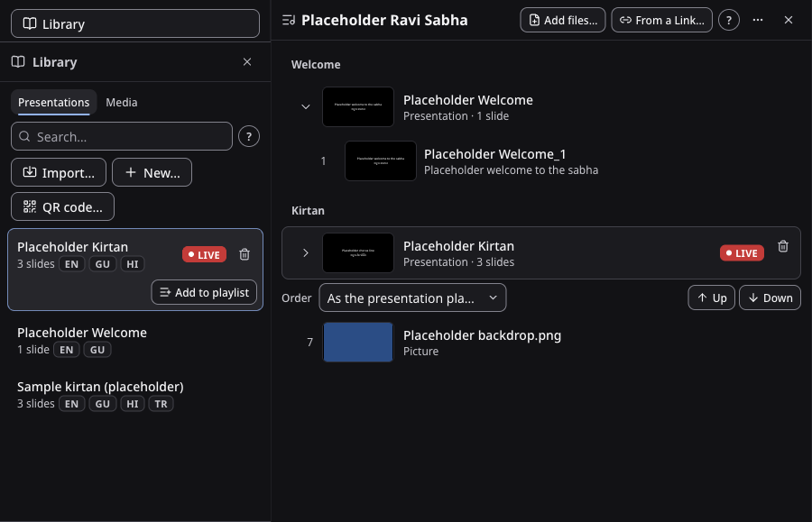
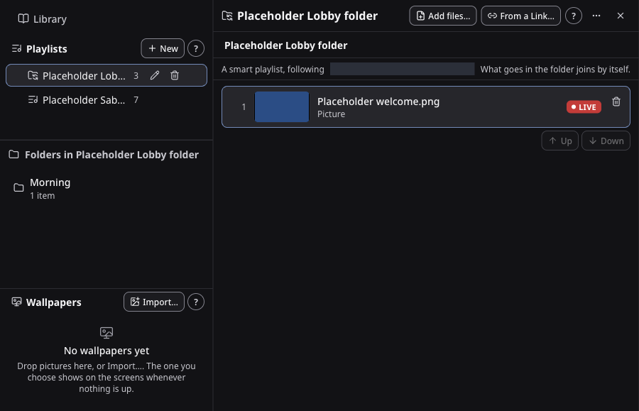
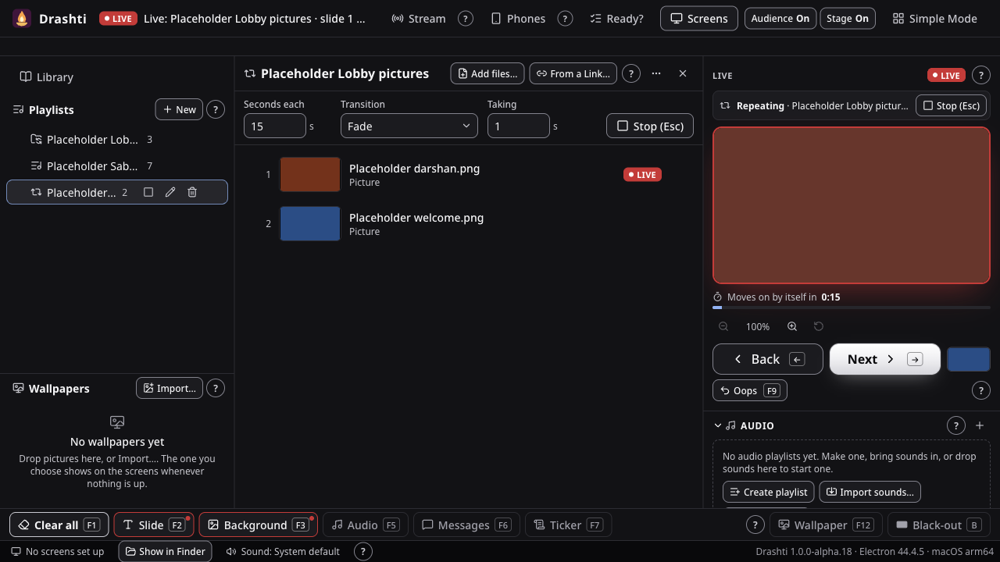
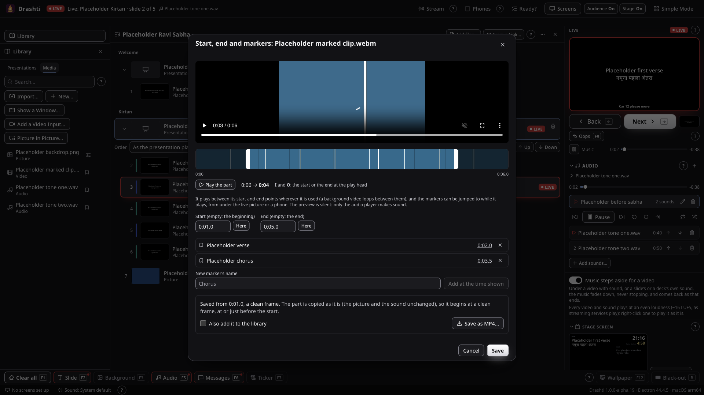
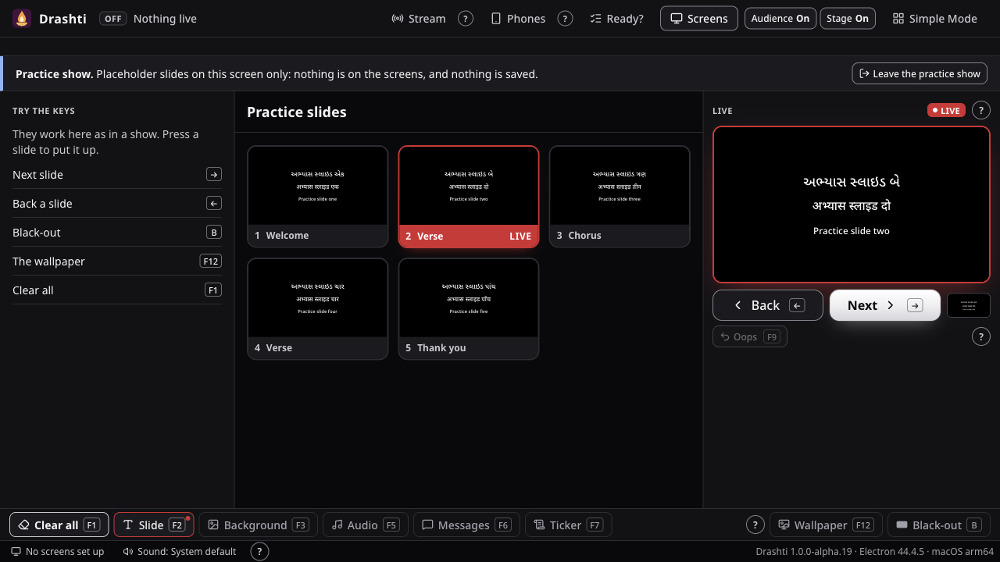
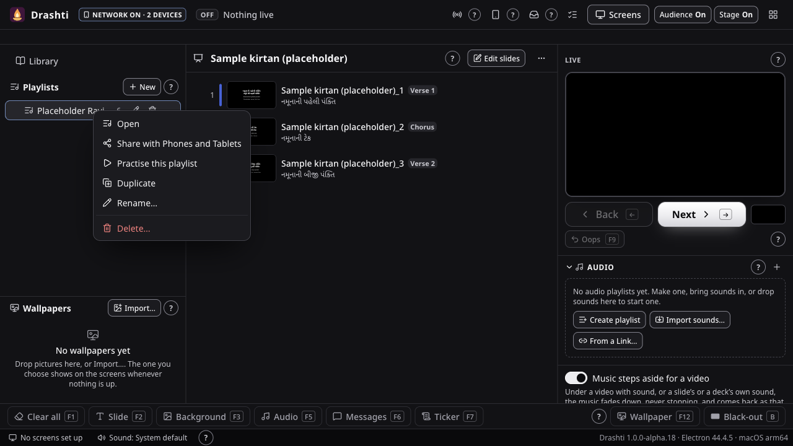
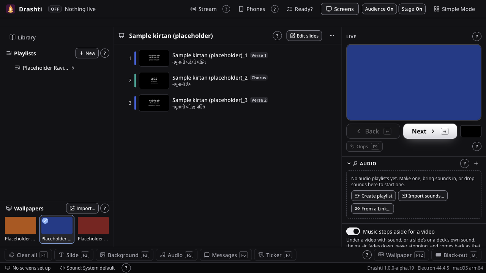

# Playlists and wallpapers

The left column holds the playlists, in folders, and under them the wallpapers. A playlist is the running order for one sabha: its rows go on the screens one after another.

## Playlists and folders

**What it is.** The list of playlists on the left. **+ New** makes a playlist, a folder (to keep playlists together), a smart playlist or a Repeat Slides playlist. The chosen one shows **Rename** and **Delete** at its end.

**When you would use it.** Each week, to make or open the night's playlist.

**How:**

1. Press **+ New**, then **New playlist**.
2. Type its name (for example "Placeholder Ravi Sabha") and press Enter.
3. Click a playlist to open it in the middle.
4. Drag a playlist onto a folder to put it there.

## The open playlist

**What it is.** The middle of the window. A presentation, a PDF or a deck is a row with its name, and a row under it for each slide. A picture, a video, a sound and a video input are a row each. **One click on any row puts it on the screens at once.**

The new timing, Find and M3U controls are in Pro Mode.

**When you would use it.** All through the sabha.

**How:**

1. Click a row: it goes up at once.
2. Click a presentation's name to fold its slides away, or open them again.
3. **Cmd**-click (Ctrl-click on Windows) a row to choose it without putting it up.
4. Right-click a row for its menu.

Under the name, the row count and the length of its videos and sounds include their start and end points. **Ends at** appears while a video or sound from this playlist plays, when the end can be known. It follows videos set to **When it ends › Next item**, and does not appear with **Repeat all**, a loop, a pause, an unknown length or a row that waits for a person.

Press the search button **Find in playlist** to find a row by its name, original file name or a presentation’s words. **Enter** moves to the next match; **Shift+Enter** moves back; **Esc** closes Find. The count says which match is marked. Find scrolls to a match and never chooses a row or puts anything up. **Cmd+F** (Ctrl+F on Windows) still opens the Library’s search.

In Pro Mode, the open playlist’s **⋯** has **Shuffle** and **Repeat all**, both off to begin with. Shuffle draws the order once and keeps it through a restart. Next, Back, **When it ends › Next item**, Next’s picture and **Practise this playlist** follow that order. A presentation’s slides keep their own order. The numbered rows stay in their places: typing a row’s number still puts that row up. Added rows join the end of the draw; removed rows drop out. Repeat all goes from the last row to the first, and Back can go round the other way. Untick Shuffle to follow the numbered order again.

## Changing a playlist

**What it is.** Adding to a playlist, moving its rows and taking them out, each with **Undo**.

**When you would use it.** While preparing, or when the running order changes during the sabha.

**How:**

1. To add: choose a row in the **Library** and press **Add to playlist**, or drag it onto the playlist.
2. To bring in new files: press **Add files…** above the playlist, or drop files on it.
3. To move a row: drag it, or choose it and press **Alt+↑** or **Alt+↓**.
4. To take a row out: right-click it, then **Remove from playlist**.
5. Press **Cmd+Z** (Ctrl+Z) to undo the last change.

To bring a playlist file in, choose **+ New › Import a Playlist File (M3U)…**. Its local files come through the usual import into a new playlist named after the file, in its file order. A file can name at most 2,000 entries and be at most 1 MB. Anything not taken is listed; web addresses are never fetched. Files that need a playable copy wait for the show to be idle, as with any import. Choose the open playlist’s **⋯ › Export as M3U…** to save a UTF-8 `.m3u8` with the library files’ full paths, row labels and playing lengths; presentations are named in comments. The files stay in Drashti’s library, so the exported list works where those files can be reached.

**A running order for the team.** Before a sabha, the sanchalak, the anchor and the sound desk can have the playlist’s running order. In Pro Mode, choose the open playlist’s **⋯ › Copy running order**, then paste it into the team’s group chat. It is plain lines: the playlist’s name, each header as a section line, every other row numbered with its name and its length where it has one, a slot as what it asks for, and the videos’ and sounds’ time in all. **⋯ › Print running order…** prints it on one A4 list, each header as a section’s title, every row with what it is and its length, and the date; **⋯ › Save running order as PDF…** saves the same page where you choose. Like the manual’s printing, both wait until nothing is up, on air or recording: until then, choosing either says so and prints nothing.

## Smart playlists

**What it is.** A playlist that follows a folder on the computer: whatever is put in that folder joins it by itself.

**When you would use it.** When someone fills a shared folder with the week's pictures and videos.

**How:**

1. Press **+ New**, then **Smart Playlist from a Folder…**, and choose the folder.
2. Or drop the folder anywhere on the window.
3. Its line says which folder it follows and what is coming in. A file still being copied joins once it is whole; if it has not changed for 2 minutes, the line says its copy may have stopped, or it is damaged.
4. A row whose file left the folder says **Not in the folder**: **Remove the missing** takes those out.

## Repeat Slides

**What it is.** A playlist whose pictures and slides go round by themselves, the last back to the first.

**When you would use it.** For the lobby, or before the sabha starts.

**How:**

1. Press **+ New**, then **Repeat Slides**.
2. Put pictures, decks and presentations in it.
3. Set **Seconds each** and the **Transition** under its name.
4. Press **Start**. LIVE says **Repeating**.
5. Press **Stop (Esc)** to end it: the slide on the screens stays up.

## When a video ends

**What it is.** What a video row does at its end, kept for that row: **Wallpaper**, **Next item**, **Loop** or **Freeze**.

**When you would use it.** For a video that should go round, or lead straight into the next row.

**How:**

1. Right-click the video's row in the playlist.
2. Choose **When it ends**, then **Wallpaper**, **Next item**, **Loop** or **Freeze**.
3. **Undo** takes the change back.

## Trimming a playlist's video

**What it is.** A new video of just the part you want, in **Media** and in that row. The original file never changes.

**When you would use it.** When only a few minutes of a long video are needed tonight.

**How:**

1. Right-click the video's row and choose **Trim (start, end and markers)…**.
2. Set **Start** and **End** on its timeline.
3. Press **Save trimmed video**. The row says **Preparing**, and under it why it waits, such as **Waiting: a video is playing**, or how far it is. A still slide, a picture, the Wallpaper or a video that has ended never holds it.
4. When it is ready, a notice says it is in **Media**. **Show in Media** (Pro Mode) finds it; **Export…** saves a copy of its file where you choose, Downloads to begin with. **Export…** is in the row's **Trim** too.
5. **Reset to original** puts the whole video back in that row.

## Practise this playlist

**What it is.** The whole playlist run in this window only, row by row, with a banner saying nothing goes to the screens, the phones or the stream.

**When you would use it.** To rehearse before the sabha, or to train a volunteer.

**How:**

1. Open the playlist's menu (**⋯** in the middle, or right-click it on the left).
2. Choose **Practise this playlist**.
3. Use **Next**, **Back** and the keys as in a sabha.
4. Press **Stop practising** when done.

## Duplicate

**What it is.** A copy of a playlist, every row in its order, named "… copy", just after it.

**When you would use it.** To start this week's playlist from last week's.

**How:**

1. Open the playlist's menu (**⋯** in the middle, or right-click it on the left).
2. Choose **Duplicate**.
3. Rename the copy. **Undo** deletes it again.

## Wallpapers

**What it is.** The pictures the hall sees whenever nothing is up, under the playlists. Several pictures dropped on one wallpaper go round, each fading into the next.

**When you would use it.** Before the sabha, and between items.

**How:**

1. Drop pictures on **Wallpapers**, or press **Import…** beside its heading.
2. Click a wallpaper to use it. Click it again to use none (black).
3. Right-click it for **Edit wallpaper…** (order, **Seconds each**, **Fade**), **Rename…** and **Delete…**.
4. **F12** (or **Wallpaper** along the bottom) puts it over whatever is up.

## Sabha flow

**What it is.** The sabha's running order, from a PDF, at the top of the left column under **Library**. Only this window and a paired phone show it, never the screens or the stream. Drashti reads its numbered items in the PDF's own language (English, Gujarati or Hindi), and shows **Now** and, larger, **Next up**.

**When you would use it.** During the sabha, to see where it is and what comes next: the talk or video, who presents it, and for how long.

**How:**

1. Click **Sabha flow** at the top of the left column to open it (click again to fold it).
2. Press **Choose PDF…** and pick the running order.
3. **Read list** shows each item as "1 · Program · Details · Duration · Presenter", the total at the bottom; **PDF page** shows the page, with **Zoom in** and **Zoom out**.
4. Click a row, or press **Next**, to mark where the sabha is. **Back** goes one item back.
5. **Replace…** beside its name chooses another PDF; **Remove** takes Drashti's copy away, asking first.

In Pro Mode, drop a PDF on Sabha flow to use it as the running order; with one already loaded, confirm **Replace the running order?** or Cancel to keep it, and when several PDFs are dropped only the first is used.

A scanned PDF, or one whose letters come out wrong, says so and shows only its page.

