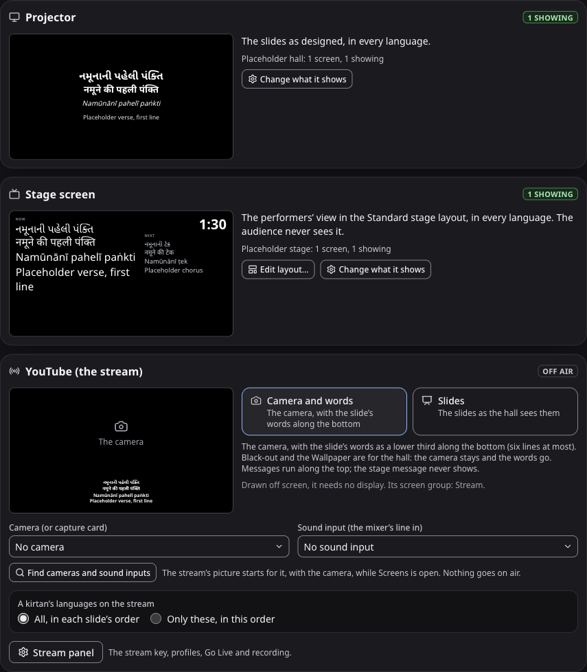
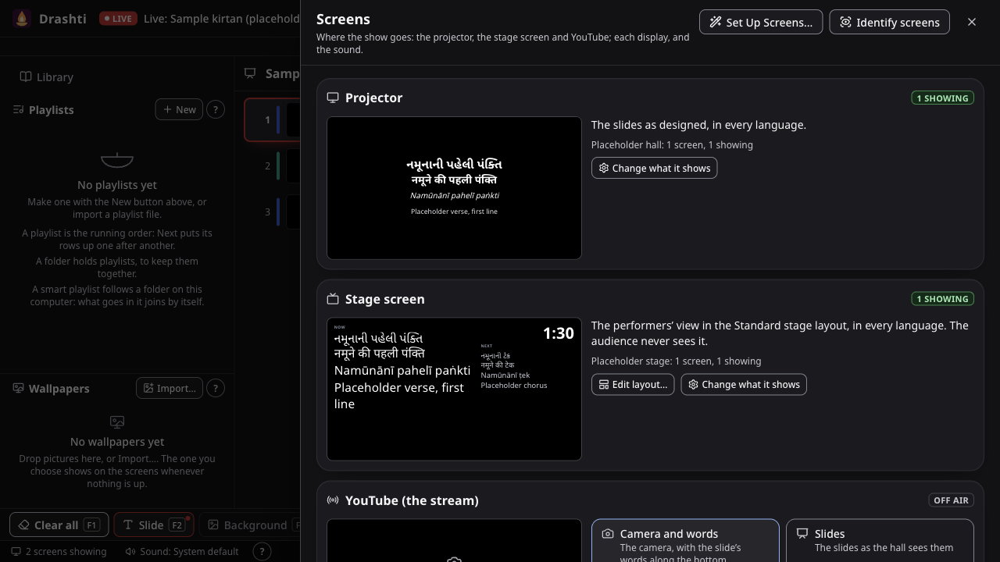
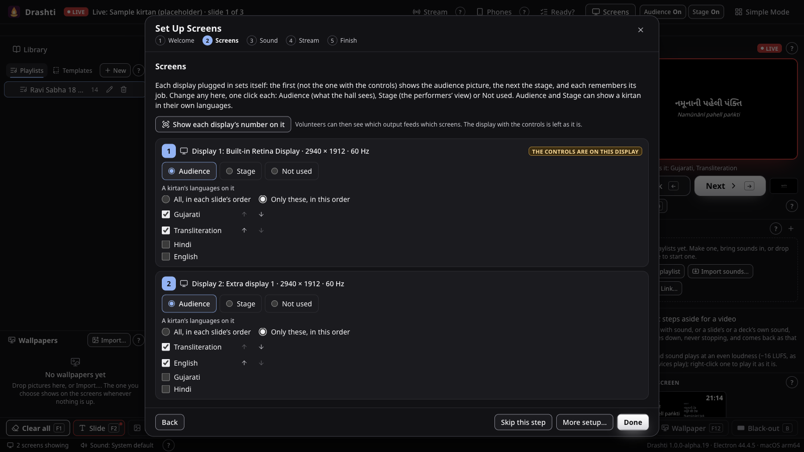
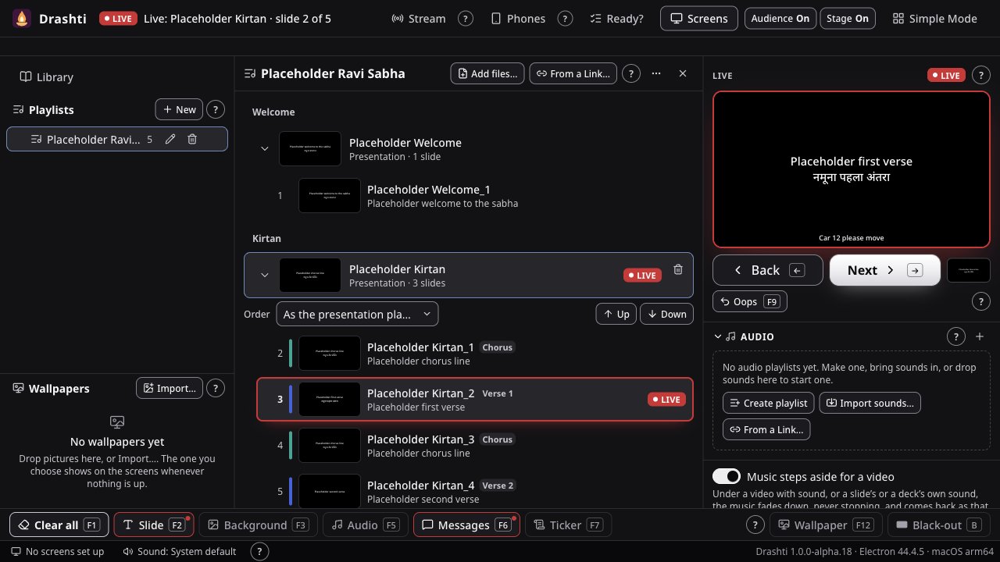
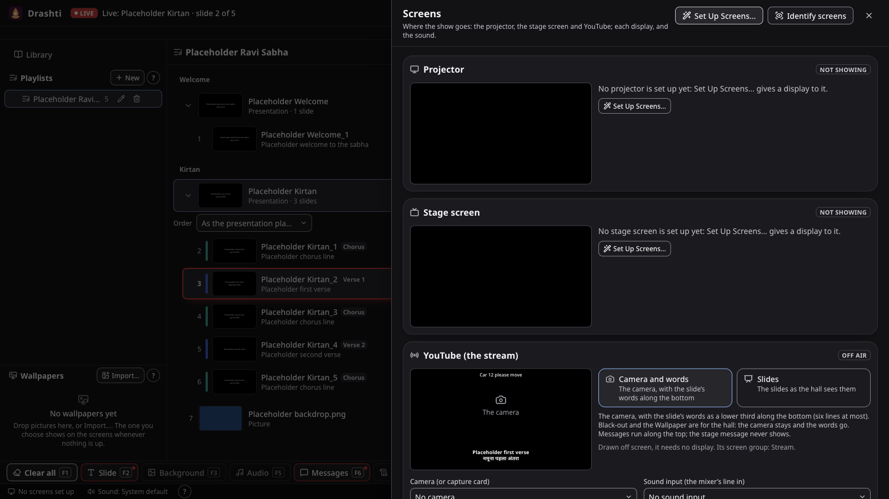
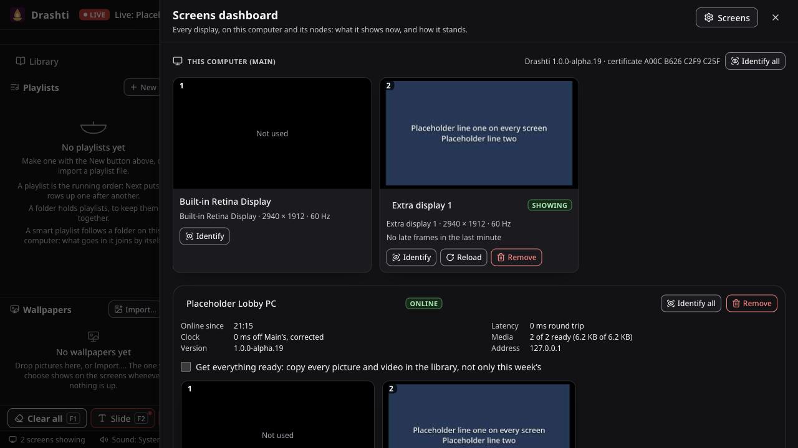
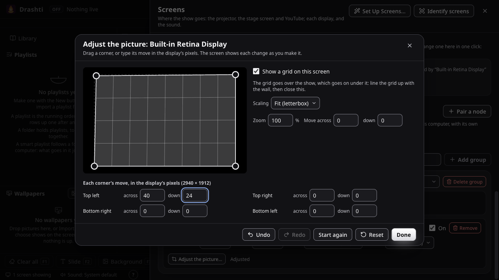
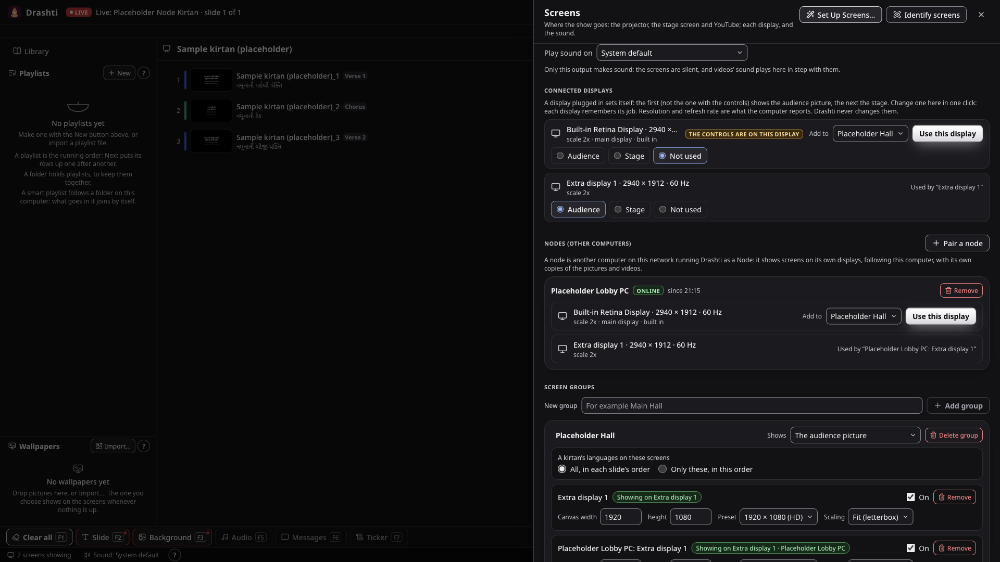
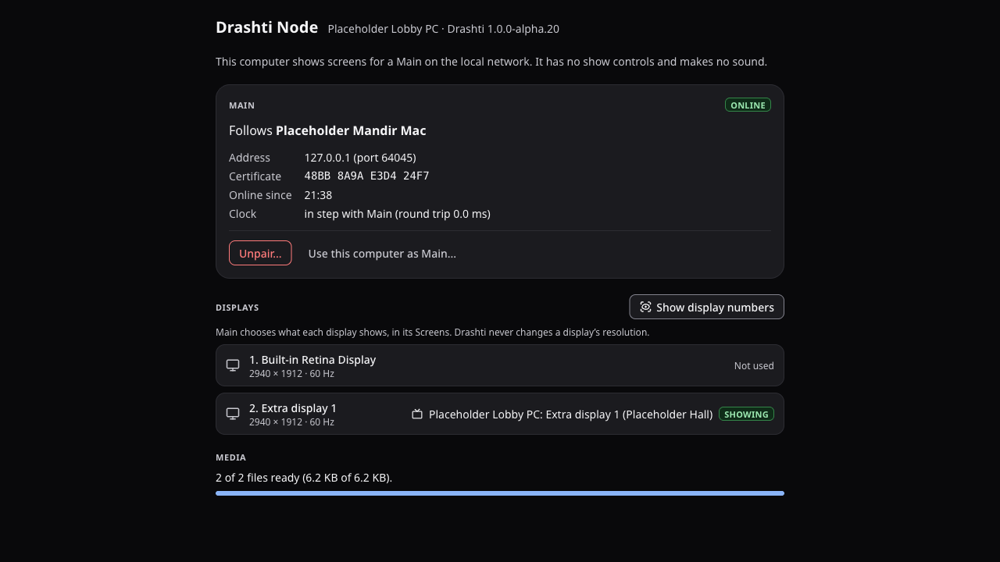

# Screens and screen geometry

**Screens**, in the top bar, says what each display shows: the audience picture, the stage, or nothing. A display plugged in sets itself, so most sabhas need nothing here. Pro Mode's.

## Screens

**What it is.** A window with three cards at its top (**Projector**, **Stage screen** and **YouTube (the stream)**), then the displays, each with its job, the screen groups, the nodes and the sound output.

**When you would use it.** When setting up a hall, or to change what a display shows.

**How:**

1. Press **Screens** in the top bar (or **Cmd+Shift+S**).
2. For each display, choose **Audience**, **Stage** or **Not used**.
3. Press **Identify screens** to put each screen's name on it, if you are not sure which is which.
4. Close it: each change is kept at once.

## A display plugged in

**What it is.** Drashti uses a projector or screen the moment it is plugged in, asking nothing: the first shows the audience picture, the next the stage. The status bar along the bottom says **New screen set up**, with **Change…**; rest the mouse on it for the whole line. The display with these controls is never taken.

**When you would use it.** Every time a projector is plugged in.

**How:**

1. Plug the projector in. The status bar says **New screen set up**; rest the mouse on it to see its name.
2. Press **Change…** to give it another job.
3. Extend, never mirror: on a Mac, **System Settings**, **Displays**, then **Use as: Extended display**; on Windows, Windows+P, then **Extend**.

## Set Up Screens…

**What it is.** A short setup that shows each display as it is used now, with one click for its job, then the sound and the stream.

**When you would use it.** The first time in a hall, or after a change of projectors.

**How:**

1. Choose **View**, then **Set Up Screens…**.
2. For each display, choose **Audience**, **Stage** or **Not used**. "The controls are on this display" marks the one to keep.
3. Press **Done**, or **More setup…** for the sound and the stream, then **Finish**.

## Audience and Stage

**What it is.** Two switches in the top bar, each a small dot and **On** or **Off** (amber while off). **Audience** off closes this computer's hall screens (their displays show the desktop). **Stage** off makes every stage screen show the audience picture. The show carries on.

**When you would use it.** When the hall's projector must show the computer's desktop for a moment, or the stage should show what the hall sees.

**How:**

1. Press **Audience** (or **Cmd+1**), or **Stage** (or **Cmd+2**).
2. Drashti asks first while those screens show something: press **Turn off**.
3. The status bar says **Audience off** or **Stage off**, with **Turn on**.
4. **Audience** is on again every time Drashti starts. **Stage** starts off in a new library, then as it was left.
5. Stage on with no screen set to Stage says **No Stage screen** in the status bar: press **Set up Stage screen…** there, then **Stage** beside the display that shows the stage.

After an audience screen is turned on or reloaded mid-show, the picture already up is prepared first. Next then loads ahead as usual. The existing wait for a picture stays at three seconds.

## Keep these screens?

**What it is.** A question, counting down 15 seconds, whenever a change made by hand puts a picture over the display with these controls. Nothing pressed, the screens go back by themselves.

**When you would use it.** It asks by itself; answer it.

**How:**

1. Press **Keep** (or **Enter**) if the change is right.
2. Press **Go back** (or **Esc**) to put the screens back as they were.
3. If a screen ever covers the controls, press **Cmd+Shift+U** (Ctrl+Shift+U on Windows).

## The screens dashboard

**What it is.** A small picture of what every screen really shows: the hall's, the stage's and the second computer's, each **Online** and ready.

**When you would use it.** Before the sabha, and when a screen looks wrong.

**How:**

1. Click the screens' line in the status bar (for example "3 screens showing").
2. Check each picture, and that each node says **Online**.
3. Press **Identify** to put a screen's number on it.
4. Press **Reload** on a screen that is black or frozen.

## Adjust the picture…

**What it is.** A screen's picture fitted to a display that does not show it squarely: **Zoom** and **Move across** and **down** for a television that cuts its edges, and the four corners for a projector that is not square to the wall (keystone). The stream, LIVE and the phones are never changed.

**When you would use it.** Once, when setting up a projector or television.

**How:**

1. In **Screens**, press **Adjust the picture…** on the screen's row.
2. Tick **Show a grid on this screen**, so the grid shows over the show there.
3. Drag the corners, or use **Zoom** and **Move**, until the grid lines up with the wall.
4. Each change is kept at once. **Undo**, **Start again** and **Reset** take changes back.

## One wide picture…

**What it is.** Two to four projectors side by side making one wide picture, each overlapping the next and fading into it (an edge blend), so the wall shows it once, evenly lit.

**When you would use it.** For a wide wall lit by more than one projector.

**How:**

1. In **Screens**, on an audience group with two to four screens, press **One wide picture…**.
2. Set the **Overlap**, then press **Make one wide picture**.
3. Line the overlaps up with each screen's **Adjust the picture…**, the grid on both.
4. **Separate pictures** gives each screen its own picture again.

## A screen without a graphics chip

**What it is.** On a computer without a graphics chip, zoom, move and the edge blend cost nothing, but a video on a picture pinned by its corners plays unevenly. **Adjust the picture…** says so on such a screen once a corner is moved.

**When you would use it.** When **Adjust the picture…** shows that note.

**How:**

1. Put the corners back (**Reset**).
2. Use the projector's own keystone instead.
3. Or run that screen from a computer with a graphics chip.

## A second computer (the node)

**What it is.** Another computer that runs more of the hall's screens, following this one (Main) over the network. Pictures and videos are copied to it ahead of time.

**When you would use it.** When the hall has more screens than one computer can drive, or they are far apart.

**How:**

1. On the second computer, choose **File**, then **Use This Computer as a Node…**.
2. In **Screens** on Main, pair it with the code it shows.
3. Give its displays their jobs, as for this computer's.
4. Check it says **Online** on the screens dashboard.

## Following the show on another computer

**What it is.** **Shared show view**: a paired node's window becomes **Drashti Controller**, following LIVE, NEXT and the coming rows. Main can let it run the show controls, or pause and play media.

**When you would use it.** For a second operator at another desk.

**How:**

1. On Main, open **Screens** and tick **Shared show view** beside the paired node.
2. Tick **Show controls** and, if wanted, **Media playback** under it.
3. On the node, a press says **Applied on Main**, **No change on Main**, or why not.

The operator's guide, **Following the show on another computer**, explains the controls and what to check before pressing again. For a video the node cannot show, see **LIVE, Back and Next › When a video cannot play**.

