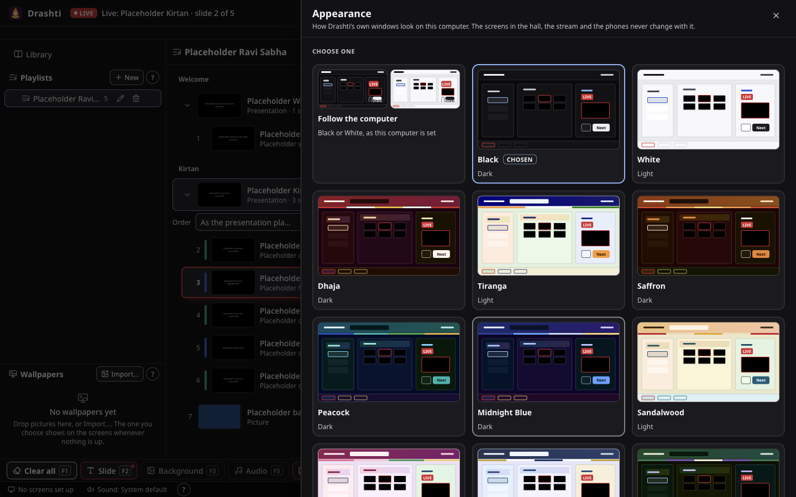
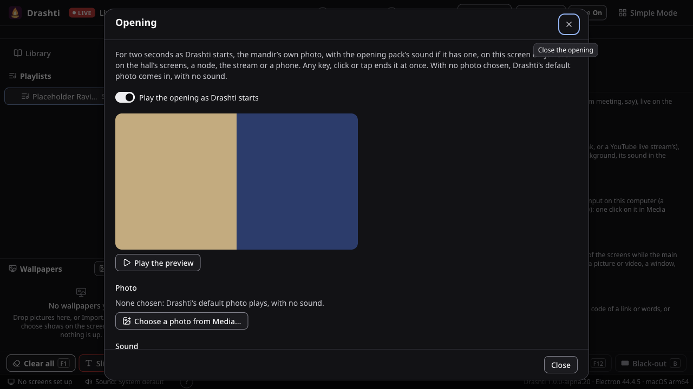
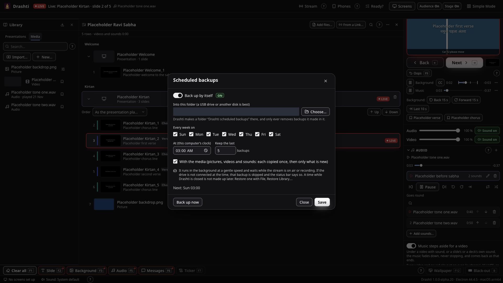
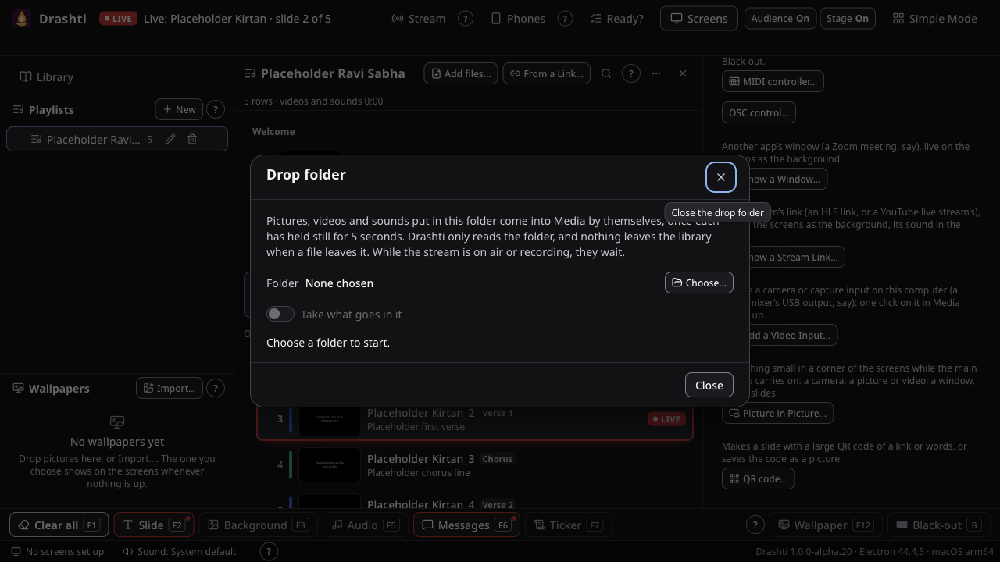
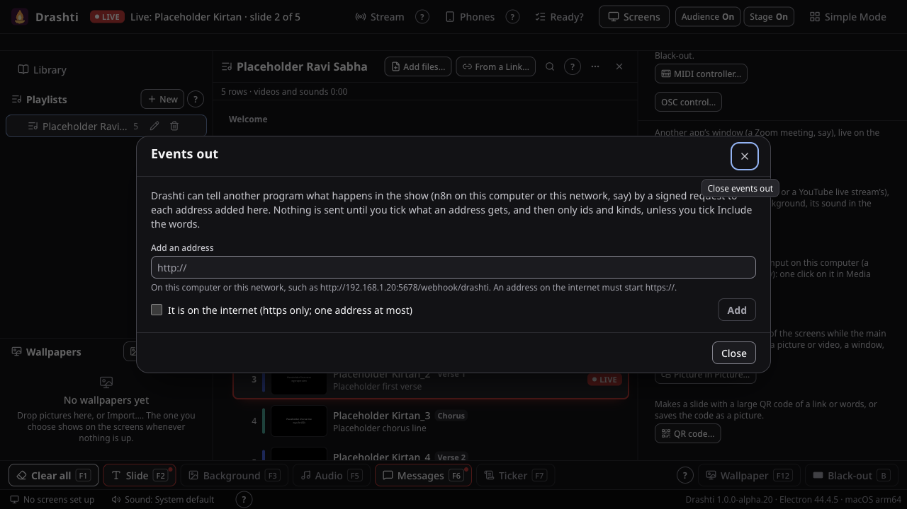
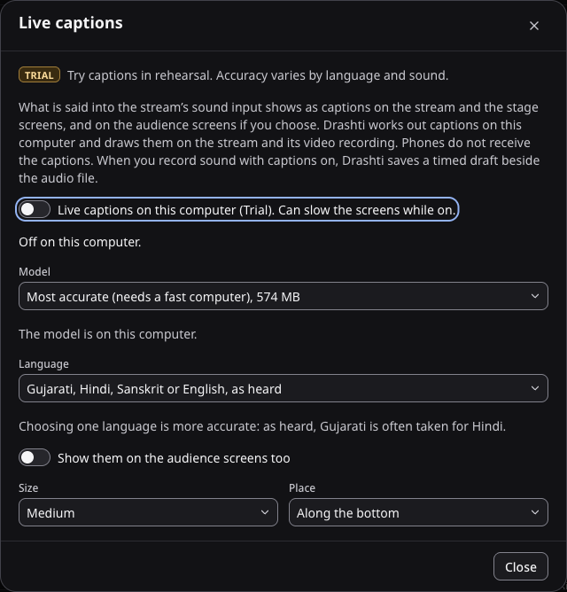
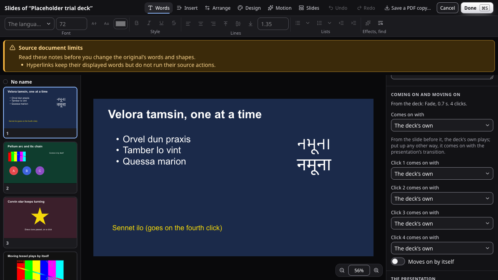
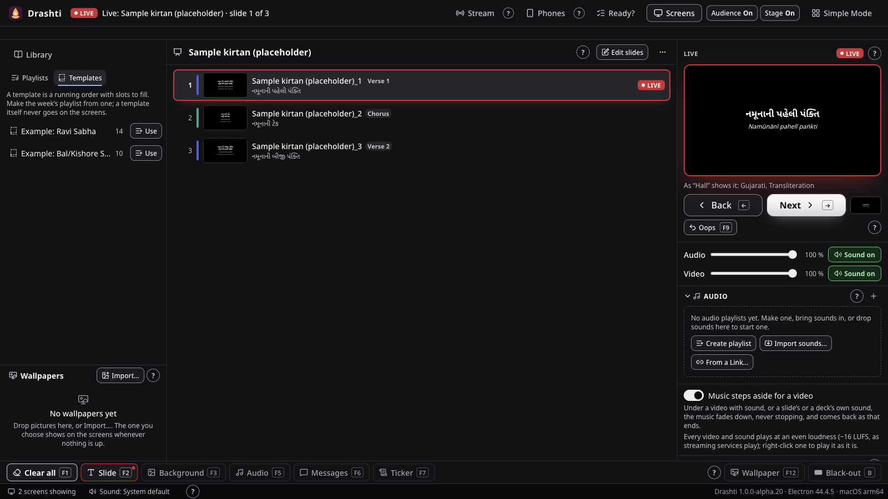
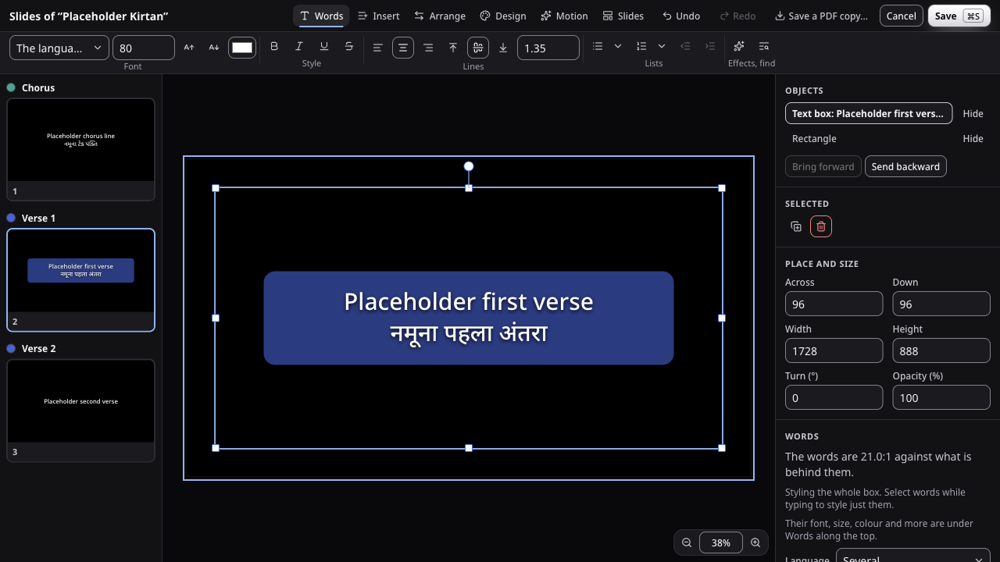

# Settings and appearance

How Drashti looks on this computer, how it opens, and what it does by itself: backups, a drop folder, events for other programs, live captions and decks. Most are under **File** and **View** in the menu bar, in Pro Mode. On Windows, **File › Run Ahead of Other Programs** keeps Drashti ahead of other programs on a busy computer.

## Appearance

**What it is.** **View › Appearance**: Drashti's own colours on this computer. There are sixty-four, in families: **Plain** (**Black** and **White**), **Flags** (**Dhaja** and **Tiranga**), **Dusk**, **Festivals**, **Nature**, **Jewels**, **Crafts and textiles** and **Mandir materials**, besides **Follow the computer** (Black or White, as the computer is set). Every one is easy on the eyes: the dark ones are deep colours rather than black, and the light ones soft paper rather than bright white, with words that read clearly without glaring. Black keeps its look as it was. The hall's screens, the stream and the phones never change with it.

**When you would use it.** To make the window easier on the eyes, or to suit the occasion.

**How:**

1. Choose **View**, then **Appearance**, then one of them. It changes at once.
2. Or choose **Appearance…** there to see each as a small picture of this window, in its family. Type a word of its name or its family in **Find an appearance** to see only those.
3. Press **Favourite** to keep the one chosen at the top, under **Favourites**. Press it again to take it off.
4. It stays chosen when Drashti starts again.

## Your own appearance

**What it is.** An appearance you make from one Drashti came with: your name, **Dark** or **Light**, and the colour of the next thing to do. Drashti works out the rest, and says if a colour could be taken for LIVE or a warning.

**When you would use it.** For the mandir's own colours.

**How:**

1. Choose **View**, **Appearance**, then **Appearance…**.
2. Choose one, then **Make a copy of …**.
3. Give it a name, choose **Dark** or **Light** and the colour.
4. Press **Save and use it**. It shows under **Your own**.

## Moving appearances

**What it is.** Twenty-eight of the sixty-four appearances move gently: the top bar's colours drift, the thin band under it shimmers, or a touch of the occasion passes across the top bar (a diya's glow, petals, kites, rain or clouds). The Appearance window says what the chosen one moves. Only the top bar and the band move, behind their words; LIVE, Next, Back, the clears, the slides and the hall's screens never do.

**When you would use it.** For a festival's look, or turn **Moving** off to keep the window still.

**How:**

1. Choose **View**, **Appearance**, then **Appearance…**.
2. Turn **Moving** on or off. It stays as you leave it.
3. Drashti keeps it still by itself on a computer without a graphics chip, while streaming or recording on a computer with four cores or fewer, and when the computer is set to reduce motion.

## Interface motion

**What it is.** How Drashti's own window moves: **Calm**, **Lively** or **Off**. Next, Back, the clears, the slides and the live picture never move, whichever you choose.

**When you would use it.** Choose **Off** if moving panels distract, or for someone who finds motion hard.

**How:**

1. Choose **View**, **Appearance**, then **Appearance…**.
2. Under **Interface motion**, choose **Calm**, **Lively** or **Off**.
3. The computer's own setting to reduce motion turns it all off too.

## The opening

**What it is.** Two seconds of a photo as Drashti starts, perhaps with a quiet sound, on this computer only, never on the hall's screens. Any key, click or tap ends it at once.

**When you would use it.** To open with the mandir's own photo.

**How:**

1. Choose **File**, then **Opening…**.
2. Tick **Play the opening as Drashti starts**.
3. Press **Choose a photo from Media…** and choose a picture you imported.
4. Press **Play the preview** to see it.

## Backing up the library

**What it is.** The whole library copied into one backup, and put back from one. **Scheduled Backups…** makes one by itself, each week, into a folder you choose.

**When you would use it.** Every week, and before a big change or a new computer.

**How:**

1. Choose **File**, then **Scheduled Backups…**.
2. Turn on **Back up by itself**, choose the folder (a USB drive is best), the day and the time.
3. Press **Save**. **Back up now** makes one at once.
4. **File › Restore Library…** puts a backup back.

## The drop folder

**What it is.** A folder on this computer whose pictures, videos and sounds come into **Media** by themselves. Drashti never writes to it.

**When you would use it.** When a volunteer puts the week's pictures in a shared folder.

**How:**

1. Choose **File**, then **Drop Folder…**.
2. Press **Choose…** and choose the folder. It is on.
3. In **Media**, **From the drop folder** shows what came from it.
4. A file still being copied waits until it is whole. **Not taken** lists one whose copy may have stopped or is damaged, and says why.

## Events out

**What it is.** Drashti telling another program what happens in the show (a slide going up, black-out, going on air), so it can dim the lights or keep a log. Nothing is sent until you set it up.

**When you would use it.** With a receiver such as n8n on the mandir's network.

**How:**

1. Choose **File**, then **Events Out…**.
2. Type the receiver's address under **Add an address**, then add it.
3. Press **Copy** beside the secret: it says **Copied**. Paste it into the receiver, then press **Done**. It is shown once.
4. Tick what that address gets. **Send a test** checks it.

If the secret was not kept, **New secret** makes another. Copy it into the receiver too; the old one still signs for a day while you change over. The admin's guide, **Events out**, has the receiver's setup; `docs/api.md` has its request format.

## Live captions

**What it is.** A trial: the speaker's words written as captions, on the stage screens and the stream, and on the audience screens only if chosen. They start off and can slow the screens while on. With a language's own model, that language's captions show one phrase at a time. Bad words never show: captions leave them out.

**When you would use it.** Only when whoever looks after Drashti has set them up and rehearsed them.

**How:**

1. Choose **File**, then **Live Captions…**.
2. Turn them on or off there.
3. When the next speaker uses another language, choose **File**, then **Speaker’s Language**, then that language.
4. Tell whoever looks after Drashti if they are wrong or lag behind. Misspelt names and terms can be added under **Caption Words…** there, and words to leave out under **Words Left Out…**.

## Decks with their animations

**What it is.** **File › Decks With Their Animations on This Computer**: a PowerPoint or Keynote deck comes in with its clicks and transitions, made by that app where Drashti cannot play them itself.

**When you would use it.** On a computer with PowerPoint or Keynote, for decks that move.

**How:**

1. Choose **File**, and tick **Decks With Their Animations on This Computer**.
2. Import the deck. Slides still being made say **Preparing**.
3. Check each moving slide's clicks before going live.

## Books, templates and kirtan details

**What it is.** **View › Show Books, Templates and Kirtan Details**: the library's **Books** tab, the playlist templates and the kirtan filters. Off to begin with.

**When you would use it.** When the sabha uses passages from books, or kirtans found by their details.

**How:**

1. Choose **View**, then tick **Show Books, Templates and Kirtan Details**.
2. Open the **Library**: **Books** shows beside **Presentations** and **Media**.
3. Untick it to hide them again.

## Safe areas

**What it is.** **View › Show Safe Areas**: guides in the slide editor showing where words are safe on every screen. They never show on the screens.

**When you would use it.** When making slides for a screen that cuts its edges.

**How:**

1. Choose **View**, then tick **Show Safe Areas**.
2. Open **Edit slides…** and keep the words inside the guides.

