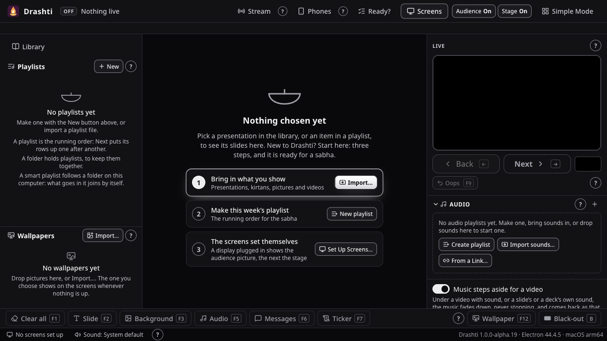
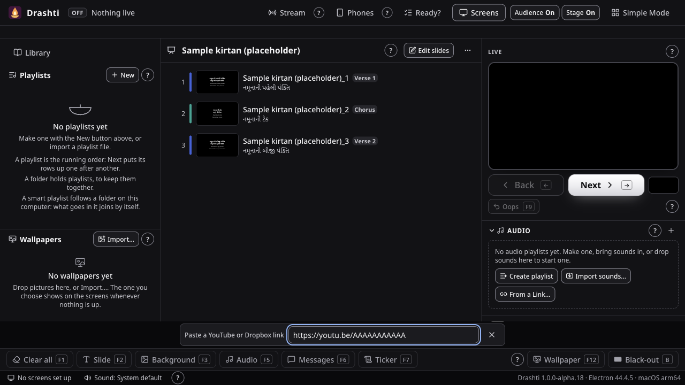
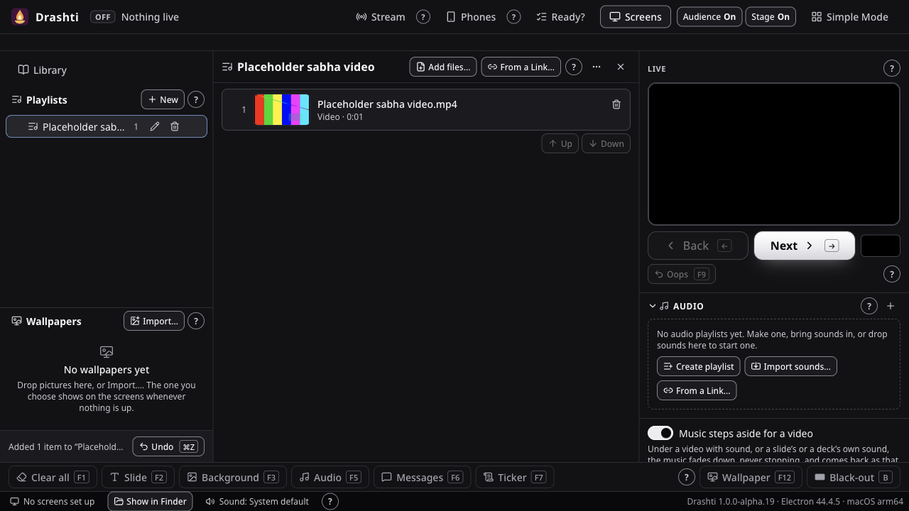
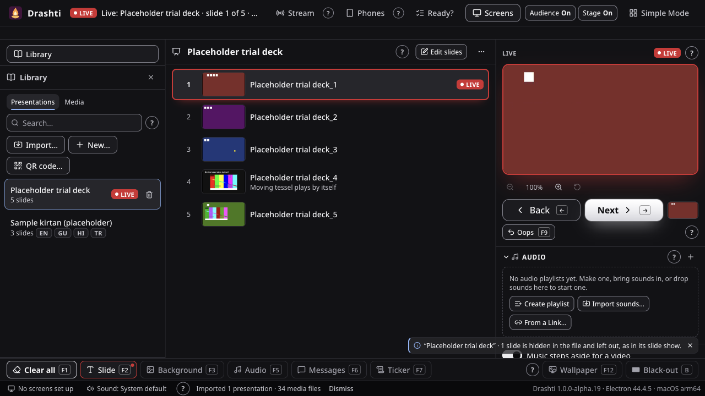
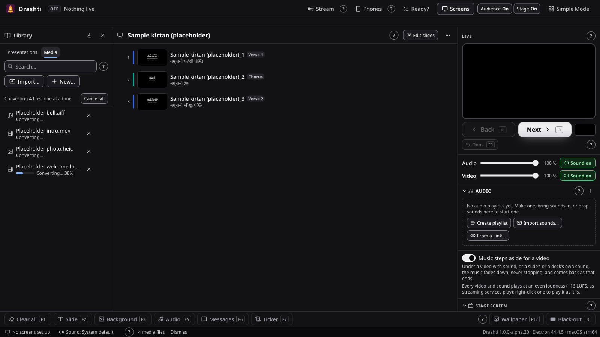
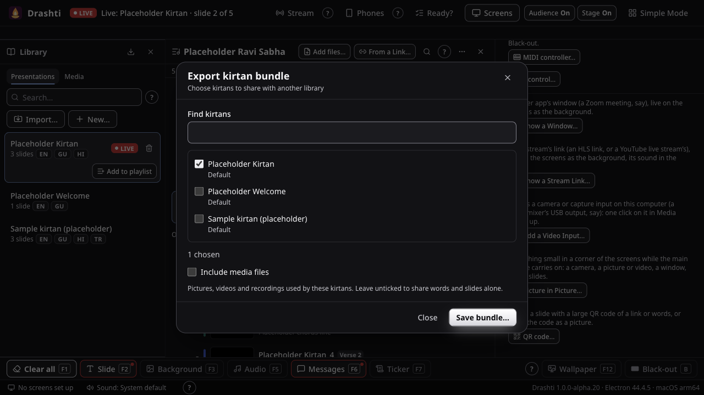

# Bringing things in and sharing

Files come into Drashti by **Import…**, **Add files…**, a drop, **From a Link…**, the drop folder or a phone. Kirtans go from one library to another as a kirtan bundle. Nothing brought in ever goes on the screens by itself.

## Dropping files and folders

**What it is.** Files dropped on the open playlist come in where you drop them; files dropped on the open **Library** come into the library only. A folder dropped anywhere becomes a smart playlist that follows it.

**When you would use it.** The quickest way to bring the night's files in.

**How:**

1. Drag files from the Finder (Explorer on Windows) onto the open playlist.
2. With no playlist open, Drashti asks: **A new playlist** or **A new folder**. Press **Create**.
3. Anything that did not come in has a notice in the bottom-right corner saying why.
4. **Undo** takes what came in out of the playlist again.

## From a Link…

**What it is.** A YouTube or Dropbox share link downloaded into the open playlist, at the best quality up to 1080p, or at the **Quality** you choose for a YouTube video. You choose where to save before pressing **Download**. Pasting a link only checks it; nothing is downloaded yet.

**When you would use it.** When someone sends a link to a video for tonight.

**How:**

1. Press **From a Link…** above the playlist (or in the library's **Import…**).
2. Paste the link into its small window and wait for its name and details.
3. Check or change **Name** and **Save in**. Press **Choose…** to choose the folder before the download starts.
4. For a YouTube video, change **Quality** if you want: each height it offers, with about how big the file will be. From **Audio**: **Best**, **192 kbps** or **128 kbps**.
5. Press **Download** (Enter). The status bar shows how it goes and the quality, with **Stop**.

## A YouTube video's captions

**What it is.** **Download its captions**, in **From a Link…**: the creator's captions in their languages, and the original language of any automatic captions, saved as SRT files beside the video, with a copy in **Captions for learning**. Ticked to begin with.

**When you would use it.** For a video whose captions the hall may need: see **LIVE, Back and Next › A video's captions** for **CC** and the language choice.

**How:**

1. In **From a Link…**, leave **Download its captions** ticked.
2. Change the **Captions for learning** folder with **Choose…**, if wanted.
3. Press **Download**. A caption that fails keeps the video, with a notice.

## PowerPoint and Keynote decks

**What it is.** A deck imported with its slides as rows. Drashti plays a PowerPoint deck's own clicks and transitions itself, on a Mac and on Windows.

**When you would use it.** When a speaker brings their own deck.

**How:**

1. Import the deck, or drop it on the playlist.
2. Click its first slide's row: each **Next** plays its next click.
3. A notice names any slide that uses the closest effects Drashti can play: check its clicks before going live.

PowerPoint table styles and first-line spacing come across more closely in alpha.20. A deck's own Wipe also sweeps on a computer without a graphics chip. Wheel and Random Bars look closer too; where PowerPoint's own video can be made, a slide using those effects keeps it. Check words, tables and clicks before the sabha, on the screens you use. The original deck stays unchanged. For editing its copy, see **Editing slides**; the admin's guide, **Decks with their animations**, has the effect list.

## Files Drashti converts

**What it is.** A file the screens can't play as it is (some AVI, WMA or HEVC files, say) is converted by itself: Drashti makes a copy that plays and keeps the original. An H.264 video above 4K gets a 4K copy; an interlaced video, such as 1080i, gets a smooth picture. The file says **Converting…** until its copy is ready.

**When you would use it.** It happens by itself: bring such files in before the sabha.

**How:**

1. Import the file as usual.
2. Watch **Media**: the file says **Converting…** until ready. Converting waits while anything is up or playing, or the stream is on air or recording; it carries on afterwards.
3. One that fails has a notice saying why, with **Try again**.

**Library › Media information** says why a file needs a copy. Older library files are checked at quiet moments too. For a video that fails while up, see **LIVE, Back and Next › When a video cannot play**. The admin's guide, **Video and sound files**, has the file kinds and limits.

## Sharing kirtans

**What it is.** **Export kirtan bundle…**, in the library: chosen kirtans saved as one `.drashti-kirtans` file, with their languages, details, notes, arrangements and, if you like, their media.

**When you would use it.** To give another mandir's library the kirtans you prepared.

**How:**

1. Open the **Library** and press **Export kirtan bundle…**.
2. Tick the kirtans to share, and **Include media files** if needed.
3. Press **Save bundle…** and choose where to save it.
4. Send the file privately.

## Bringing in a kirtan bundle

**What it is.** A `.drashti-kirtans` file imported like any other file. A kirtan already here is updated, but only where nobody has edited it ("Local edits kept").

**When you would use it.** When another mandir sends you a bundle.

**How:**

1. Open the **Library**.
2. Press **Import…**, then **Files…**, and choose the bundle (or drop it on the library).
3. The kirtans come in. What is on the screens plays on as it was.

