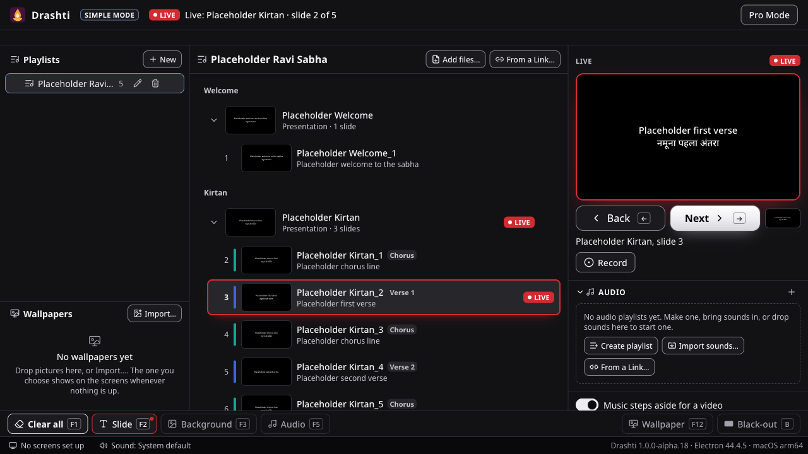
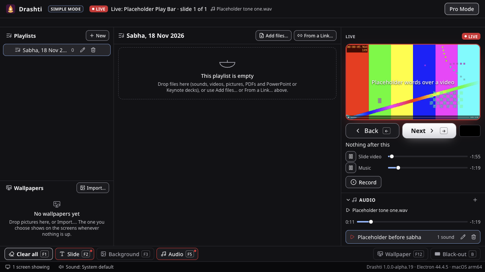
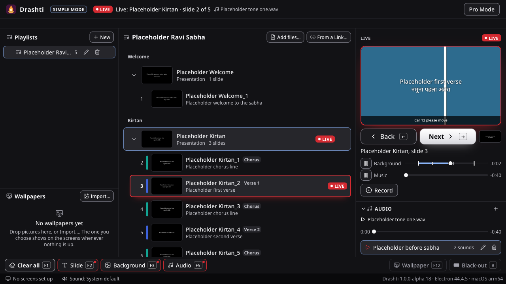
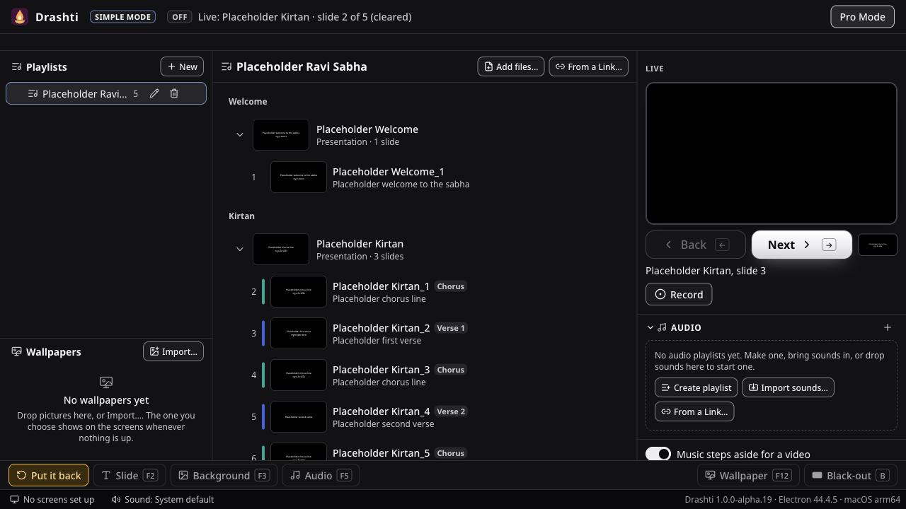
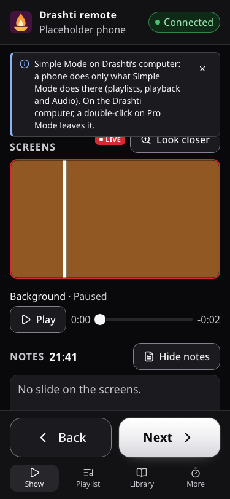

# Simple Mode

Simple Mode is this window with only what a small sabha with one projector needs, for a volunteer: the playlists and the wallpapers on the left, the open playlist in the middle, and **LIVE**, **Next**, **Back**, the time bar, **Record** and **Audio** on the right. The stage, messages, timers, lower thirds and the screens' setup stay in Pro Mode, unless an admin brings up to three of those tools into Simple Mode.

## Simple Mode

**What it is.** A plainer window for running a sabha from a playlist. Along the bottom: **Clear all**, **Slide**, **Background** and **Audio**, **Wallpaper** and **Black-out**, each with its key. A display plugged in sets itself, as in Pro Mode.

**When you would use it.** For a small sabha run by a volunteer, or a computer whose access is Simple Mode only.

**How:**

1. Open the night's playlist on the left.
2. Click its first row to put it up.
3. Press **Next** or **Back** (or their keys) for each slide.
4. Read what **Next** will put up, in words under it.

## Switching to Simple Mode

**What it is.** One double-click at the top right, with nothing to type. Simple Mode opens the playlist that was open.

**When you would use it.** When handing the computer to a volunteer.

**How:**

1. Open the night's playlist.
2. Double-click **Simple Mode** at the top right (one click only says to double-click it).
3. Or choose **View**, then **Switch to Simple Mode**.

## Running a sabha in Simple Mode

**What it is.** The same show as in Pro Mode: a click on a row puts it up, **Next** and **Back** go on from there, and the time bar works the same.

**When you would use it.** All through a Simple Mode sabha.

**How:**

1. Click a row to put it up, or type its number and press Enter.
2. Press **Pause** or **Play** on the time bar, or drag it.
3. **Clear all**, then **Put it back** at once, if you cleared by mistake.
4. **F9** (Oops) puts back what was up before the last change.

## Music and sound in Simple Mode

**What it is.** **Audio**, under the time bar: the audio playlists, as in Pro Mode, and just above it the **Audio** and **Video** levels with their mute switches.

**When you would use it.** For music before the sabha.

**How:**

1. In **Audio**, press **Create playlist** or **Import sounds…**, or drop sounds on it.
2. Press **Play**. It steps aside under a video with sound.
3. Drag the **Audio** or **Video** level, or press its switch to mute it. See **Audio and the levels › Muting**; Drashti starts with the sound on.

## Changing the playlist in Simple Mode

**What it is.** Bringing things in and changing the playlist, as far as Simple Mode allows: **Add files…**, **From a Link…**, files dropped, and a row's **Rename…** and **Remove from playlist**.

**When you would use it.** When the volunteer must add a file or take one out.

**How:**

1. Press **Add files…** above the playlist, or drop files on it.
2. Drag a row to move it.
3. Right-click a row for **Rename…**, **Remove from playlist**, **When it ends** or **Edit slides…**.
4. Choose **Edit**, then **Undo** (**Cmd+Z**), to take the last change back.

## Back to Pro Mode

**What it is.** One double-click on **Pro Mode** at the top right, with nothing to type. Where **Simple Mode only on this computer** shows instead, this computer's access is for Simple Mode only.

**When you would use it.** When the admin or the lead operator takes over.

**How:**

1. Double-click **Pro Mode** at the top right.
2. Or choose **View**, then **Switch to Pro Mode**.
3. With the keyboard on **Pro Mode**, press **Enter** twice.

## Pro Mode's tools in Simple Mode

**What it is.** Up to three of Pro Mode's tools under LIVE, brought into Simple Mode by an admin in Pro Mode, each with its own on/off switch: **Stage screen**, **Messages**, **Chat**, **Timers**, **Lower Thirds**, **Show a Window**, **Show a Stream Link**, **Video inputs** and **Picture in Picture**. In Simple Mode each is a folding section under **Audio**, folded until it is opened, with only what runs the show: **Chat**, say, reads the day's messages and sends as **Operator**. None is on to begin with.

**When you would use it.** When a volunteer's sabha needs one or two of Pro Mode's tools, a message or a countdown, say, and nothing more.

**How:**

1. In Pro Mode, choose **Edit**, then **Simple Mode Features…**.
2. Turn on one or two tools with their switches (three at most).
3. Press **Done**, then switch to Simple Mode.
4. Open a tool's section under **Audio** to use it.
5. To take one away again, turn its switch off in Pro Mode.

## A phone in Simple Mode

**What it is.** A paired phone does what Simple Mode's window does: the playlists, **Next** and **Back**, the clears, **Pause**, **Play** and the time bar, and **Audio** under **More**. Its **Chat** works as in Pro Mode. It refuses what Simple Mode refuses, in words.

**When you would use it.** When the volunteer runs the slides from a phone.

**How:**

1. Pair the phone in Pro Mode first, and turn on **Let paired phones and tablets connect**.
2. Switch the computer to Simple Mode. The phone says once what it does there.
3. Open any playlist from the phone's **Playlist** tab, and tap rows to put them up.

