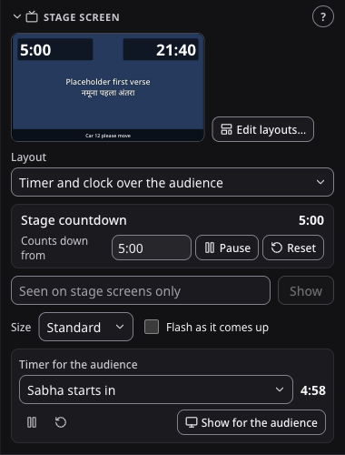
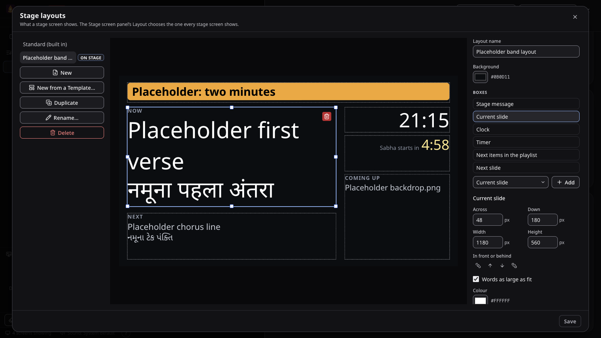
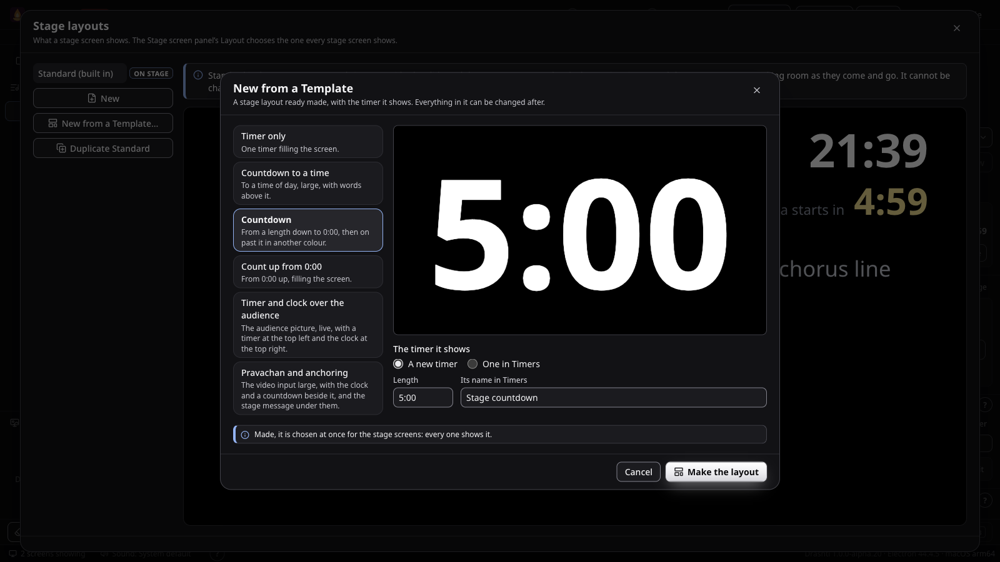
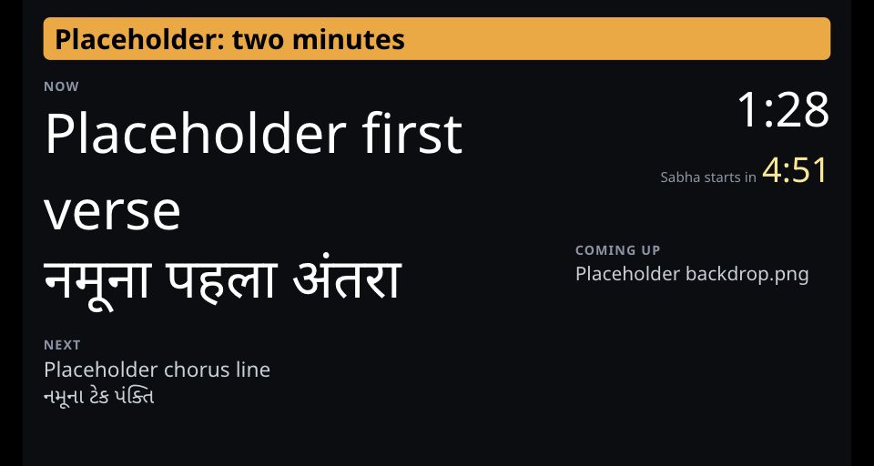

# Stage screen

The stage screen is what the speaker and the singers see, never the hall. The **Stage screen** panel, under the live picture, chooses its layout, sends it a message, and runs its timers.

## The stage screen

**What it is.** The panel that runs every stage screen at once: its **Layout**, its **Video input**, a message for the stage, and the layout's timers. With **Stage** off, every stage screen shows exactly the audience picture.

**When you would use it.** Whenever the people on the stage need to see something the hall does not.

**How:**

1. Press **Stage screen** under LIVE to open it, then choose the **Layout** every stage screen shows (**Standard** to begin with).
2. Choose the **Video input** a layout's live video box shows, if it has one.
3. Look at the stage's small picture beside it: it shows what the stage sees.

## A message for the stage

**What it is.** A short message on every stage screen, such as "Two minutes left", in its own size, with a flash if you like. The hall's screens, the stream and the phones never show it.

**When you would use it.** To tell the speaker the time, or to give the singers a cue.

**How:**

1. In **Stage screen**, type the message.
2. Choose its **Size**, and tick **Flash as it comes up** to catch their eye.
3. Press **Show** (or Enter). **Hide** takes it off.
4. The last few are under **Shown before:**, one press each to show again.

## Stage layouts

**What it is.** What a stage screen shows and where: the slide, the next one, notes, the clock, timers, the message, the audience picture live, and more, each in a box.

**When you would use it.** When the speaker wants notes and a clock, or the singers want the next slide.

**How:**

1. Press **Edit layouts…** in **Stage screen**.
2. Press **New**, or **Duplicate** to start from one you have.
3. Add the boxes needed, then drag them into place.
4. Press **Save**, then choose it as the **Layout**.

## A timer on the stage

**What it is.** A ready-made stage layout with its timer: a countdown, a count up, a countdown to a time, a timer and clock over the audience, or Pravachan and anchoring.

**When you would use it.** When the speaker needs to see how long is left.

**How:**

1. Press **Edit layouts…**, then **New from a Template…**.
2. Choose a template, such as **Countdown**, and its length.
3. Press **Make the layout**: every stage screen shows it at once.
4. Use **Start**, **Pause** and **Reset** beside it in the **Stage screen** panel.

## The video input on the stage

**What it is.** A layout's box **The video input, live**: the camera chosen in **Video input**, shown on the stage with no extra delay, whatever the hall's screens show.

**When you would use it.** When the singers need to see the speaker, or the anchor needs the camera.

**How:**

1. Name a video input first (**Add a Video Input…**, in the **Video inputs** section).
2. In **Stage screen**, choose it under **Video input**.
3. Use a layout with **The video input, live** in it, such as **Pravachan and anchoring**.

