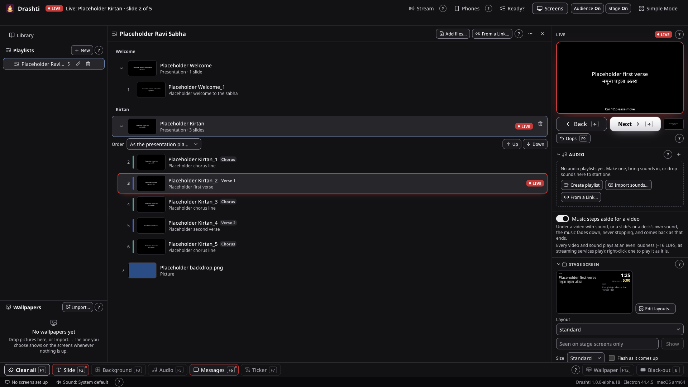
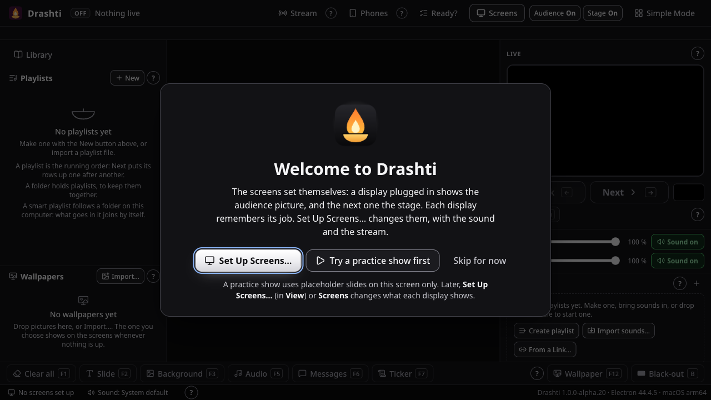
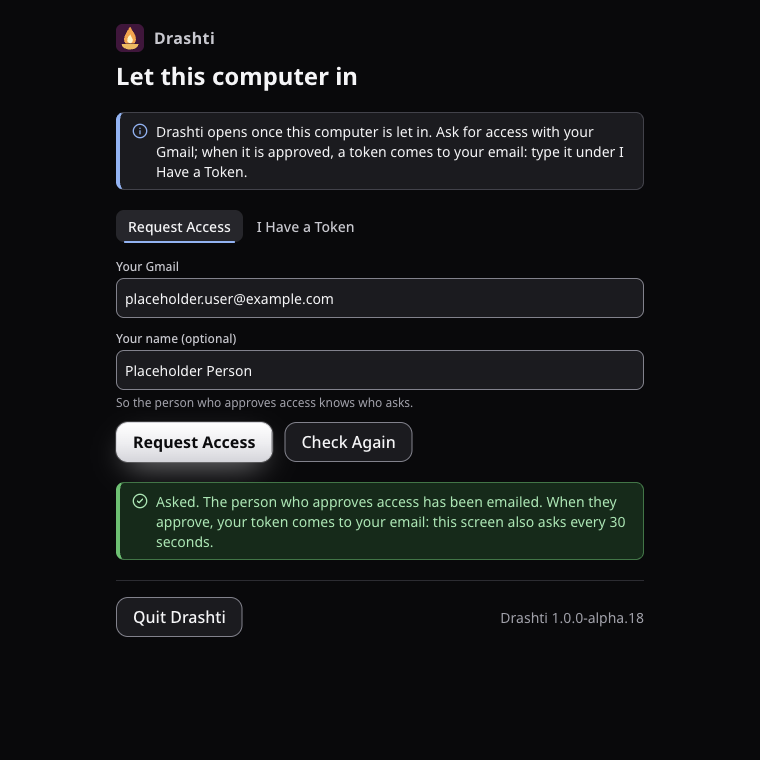
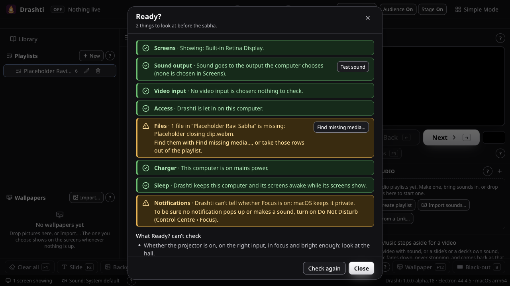
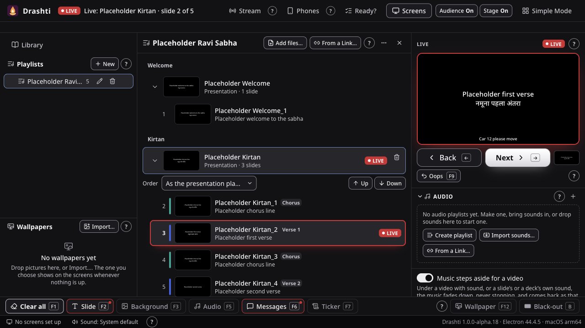
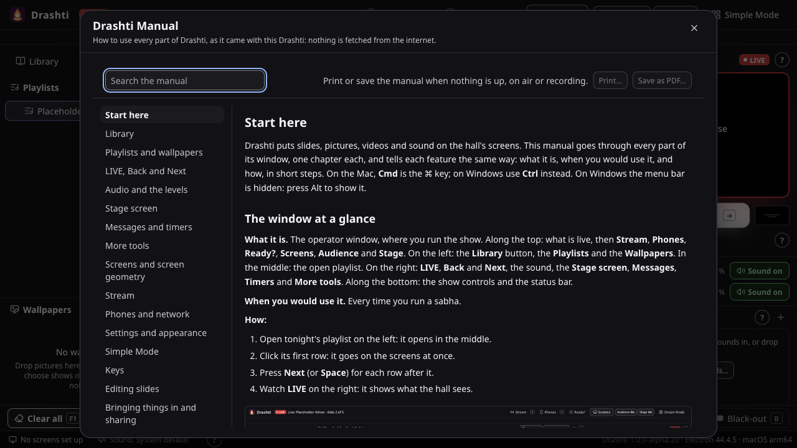

# Start here

Drashti puts slides, pictures, videos and sound on the hall's screens. This manual goes through every part of its window, one chapter each, and tells each feature the same way: what it is, when you would use it, and how, in short steps. On the Mac, **Cmd** is the ⌘ key; on Windows use **Ctrl** instead. On Windows the menu bar is hidden: tap **Alt** to show it.

## The window at a glance

**What it is.** The operator window, where you run the show. Along the top: what is live, then **Stream**, **Phones**, **Ready?**, **Screens**, **Audience** and **Stage**. On the left: the **Library** button, the **Playlists** and the **Wallpapers**. In the middle: the open playlist. On the right: **LIVE**, **Back** and **Next**, the sound, then folding sections: **Audio**, the **Stage screen**, **Messages**, **Chat**, **Timers** and one for each tool (**Lower Thirds**, **QR code** and more). Each section is folded when Drashti starts: press its heading to open it. Along the bottom: the show controls and the status bar.

**When you would use it.** Every time you run a sabha.

**How:**

1. Open tonight's playlist on the left: it opens in the middle.
2. Click its first row: it goes on the screens at once.
3. Press **Next** (or **Space**) for each row after it.
4. Watch **LIVE** on the right: it shows what the hall sees.

## The first start

**What it is.** A new library opens with a welcome: Drashti's lamp lights, then three choices. **Try a practice show first** puts five placeholder slides on this screen only, so you can learn the keys safely.

**When you would use it.** The first time Drashti opens on a computer, or to teach a new volunteer.

**How:**

1. Press **Try a practice show first**.
2. Try **Next**, **Back**, **B** (Black-out), **F12** (the Wallpaper) and **F1** (Clear all). Nothing goes to the hall.
3. Press **Leave the practice show**, then **Skip for now**.
4. Follow the three steps in the middle: import what you show, make this week's playlist, check the screens.

## Letting this computer in

**What it is.** Drashti opens only on a computer that whoever looks after Drashti has let in, for a Gmail they have let in. On a computer not let in yet it shows a lock screen.

**When you would use it.** On a new computer, or when the lock screen asks for it.

**How:**

1. Under **Request Access**, type your Gmail and press **Request Access**.
2. Wait for the email with your token, once access is approved.
3. Under **I Have a Token**, type the same Gmail and the token.
4. Press **Let This Computer In**. A token works once, on one computer, for 3 days.

## Ready? before the sabha

**What it is.** **Ready?**, in the top bar, checks eight things at once: the screens, the sound output, the video input, access, the playlist's files, the charger, sleep and notifications. Each line is green, or amber with what to do.

**When you would use it.** About 30 minutes before the sabha, as the last check.

**How:**

1. Press **Ready?** in the top bar (in a narrow window, its checklist icon alone: point at it to see its name).
2. Put right each amber line, as it says.
3. Press **Check again** until every line is green.
4. Read **What Ready? can’t check** and look at those yourself.

## The status bar

**What it is.** The line along the very bottom. It says how many screens are showing, where the sound goes, what is coming in, any warning, and Drashti's version. **Audience off**, **Stage off**, **Audio muted** or **Video muted** show there while they are so, after **Help**, so the screens' count, the sound and **Help** never move as they come and go. With no internet, after about 2 minutes **No access list · 14 days** shows there, short, in place of the version, with the days left (the hours in the last day, the minutes in the last hour); rest the mouse on it (or let a screen reader read it) for the whole line, **Can’t reach the access list: Drashti keeps working for … more.** **Help** there shows every **?** and the keys on the buttons (**Help and when something goes wrong › What is this?**).

The status bar stays in one row. In a narrow window its screens summary shows the count with a screen or warning icon, and Sound shows its icon and levels; where the levels differ, Audio comes before Video (for example, 0/100%). Rest the mouse on either for the whole sentence; a screen reader reads the whole sentence too. Their slots keep the same width as warnings come and go. The calendar keeps a small icon in the same place in a narrow window; its full date and festivals remain in its tooltip and screen-reader words.

**When you would use it.** Whenever you want to know at a glance that all is well.

**How:**

1. Look at the status bar along the bottom.
2. A warning in yellow says what to look at.
3. Click the screens' line (for example "3 screens showing") to open the screens dashboard.
4. Press **Turn on** beside **Audience off** or **Stage off** to bring those screens back.

## Using this manual

**What it is.** This manual, inside Drashti. It needs no internet. With **Help** on in the status bar, each **?** on a panel's heading first shows its short help in that panel. **Open the manual** there opens this manual at that panel's chapter and feature.

**When you would use it.** Whenever you are not sure how something works.

**How:**

1. Choose **Help**, then **Drashti Manual…**, or press **Open the manual** in a panel's **?** card.
2. Choose a chapter on the left, or type a word in **Search the manual**.
3. Choose a result to read it in its place.
4. Press **Print…**, or **Save as PDF…** to keep it for the setup kit. Both wait while anything is up, on air or recording.
5. Press **Esc** to close it.

