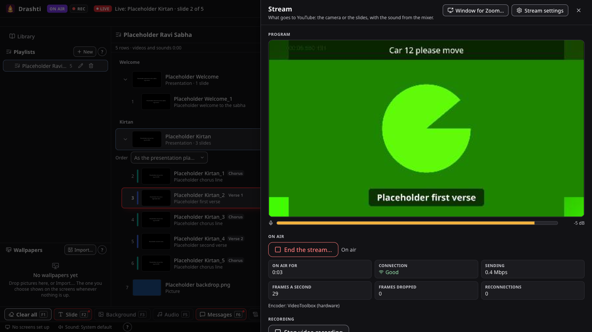
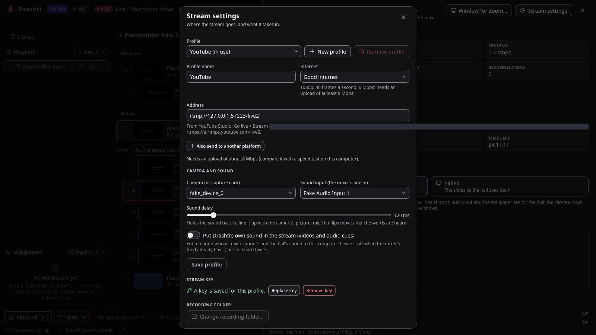
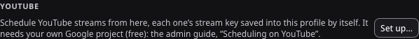
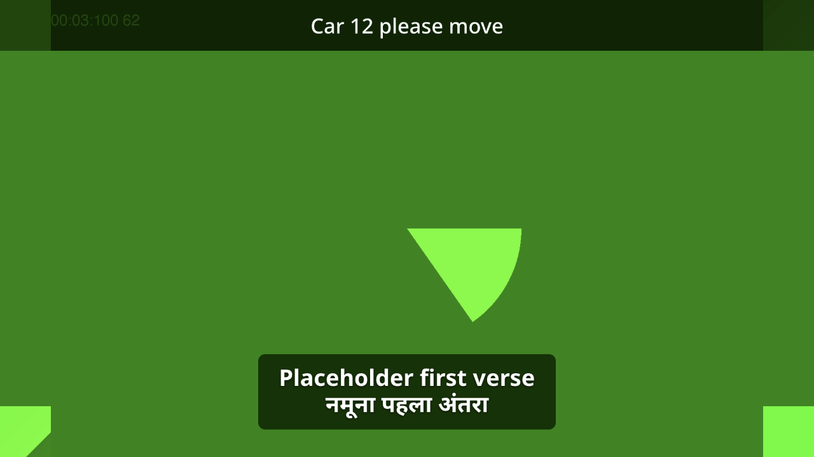
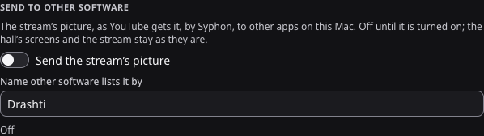

# Stream

**Stream**, in the top bar, opens the Stream panel: the stream from this computer to YouTube or another platform, and recording. **ON AIR** and **REC** in the header say when it is public and when it is being recorded. Only the computer that streams needs it.

## The Stream panel

**What it is.** The panel with what the stream shows (**Camera and words**, or **Slides**), its preview and sound bar, **Go live…**, **Record**, **Stream settings** and **Window for Zoom…**.

**When you would use it.** Before and during a streamed sabha.

**How:**

1. Press **Stream** in the top bar.
2. Choose **Camera and words** (the camera, with the slide's words as a lower third) or **Slides** (as the hall sees them).
3. Check the preview, and that the sound bar moves when someone speaks.

When the stream starts following a show already running, the current picture is prepared before Next. Its existing wait for a picture stays at three seconds.

## Going live

**What it is.** The stream starting on the platform. Going live always asks first, and has no key.

**When you would use it.** A few minutes before a streamed sabha starts.

**How:**

1. In the Stream panel, press **Go live…**.
2. Read what it says, then press **Go live**.
3. The header says **ON AIR**. Check the stream on the platform after a few seconds.
4. If the internet drops, it says **Reconnecting** and tries again by itself.

## Ending the stream

**What it is.** The stream stopped on the platform. Ending always asks first.

**When you would use it.** When the sabha ends.

**How:**

1. Press **End the stream…**, then **End the stream**.
2. ON AIR goes from the header.
3. End the broadcast in YouTube Studio too, unless Drashti scheduled it (then it ends there by itself).

## Recording

**What it is.** A recording of the sabha on this computer: **Record sound** (the sound input alone) or **Record video** (the stream's picture with its sound). It works off air or on air.

**When you would use it.** To keep the sabha, or the speaker's words for captions.

**How:**

1. In the Stream panel, open **Record**.
2. Choose **Record sound** or **Record video**. The header says **REC**.
3. Press **Stop sound recording** or **Stop video recording** when finished.
4. The file goes to the **Recording folder** set in **Stream settings**.

## Stream settings

**What it is.** The stream's settings: the platform's address and key (kept locked away, never shown again), the camera, the sound input, the quality, the sound delay and the recording folder.

**When you would use it.** Once, when setting up the stream, or when the camera or internet changes.

**How:**

1. In the Stream panel, press **Stream settings**.
2. Paste the platform's stream key in **Stream key**, then press **Save key**.
3. Choose the camera and the **Sound input** (the mixer's line in).
4. Press **Save profile**.

## Scheduling on YouTube

**What it is.** **Stream settings › YouTube**: a broadcast scheduled on your own YouTube channel from Drashti, its new key saved straight into the profile. Unlisted at first. Going live never waits on Google.

**When you would use it.** Each week, before a streamed sabha, instead of copying a key from YouTube Studio.

**How:**

1. Once, follow **Scheduling YouTube streams from Drashti: your Google project** (`docs/youtube-setup.md`), then **Set up…** and **Sign in to YouTube…**.
2. Press **Schedule a stream…**, give its title, date and time, and **Who can watch**.
3. Leave **Stream to it from** this profile ticked, so its key goes in.
4. Go live from the Stream panel as usual. **End the stream…** ends it on YouTube too.

## Window for Zoom

**What it is.** A window with exactly the stream's picture and nothing else, for Zoom to share. Drashti sends no sound to Zoom.

**When you would use it.** When another mandir joins the sabha by a Zoom meeting.

**How:**

1. In the Stream panel, press **Window for Zoom…** (or **View**, then **Window for Zoom…**).
2. Leave the window open where it can stay, never minimised.
3. In Zoom, press **Share Screen**, choose the **Drashti for Zoom** window, then **Share**.
4. To stop, **Stop Share** in Zoom, then close the window.

## Sending the picture to other software

**What it is.** The stream's picture sent to other software on this computer, such as OBS: Syphon on a Mac, Spout on Windows. No sound, nothing over the network, off until someone turns it on.

**When you would use it.** When OBS or a similar program should take Drashti's picture without sharing a window.

**How:**

1. In the Stream panel, press **Stream settings**.
2. Under **Send to other software**, turn on **Send the stream’s picture**.
3. The line below says **Sending**, and the name other apps list it by (**Drashti**).
4. In the other app, add a Syphon (Mac) or Spout2 (Windows) source named **Drashti**.

