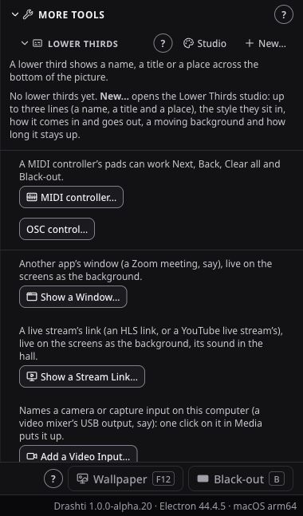
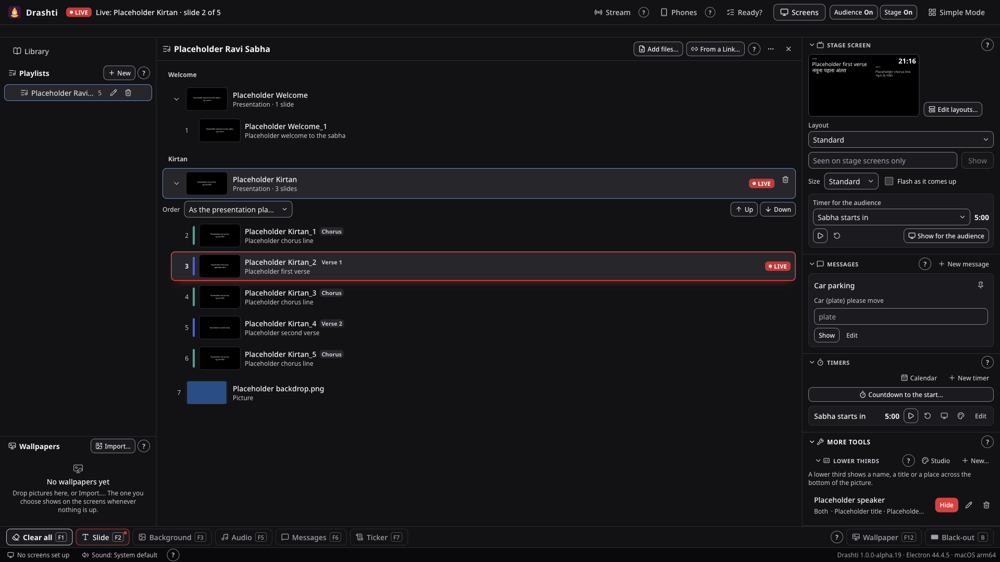
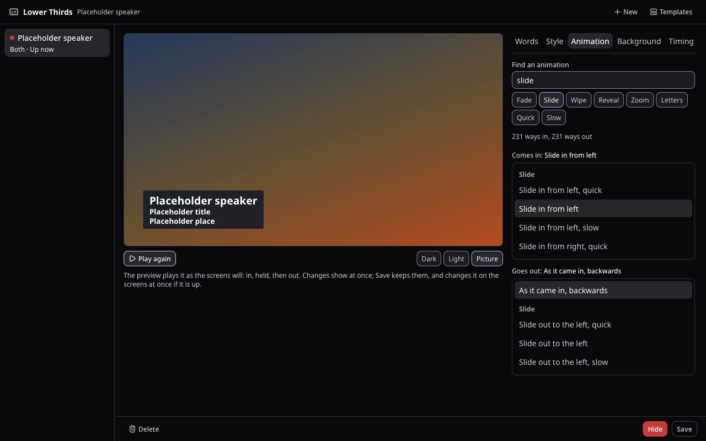
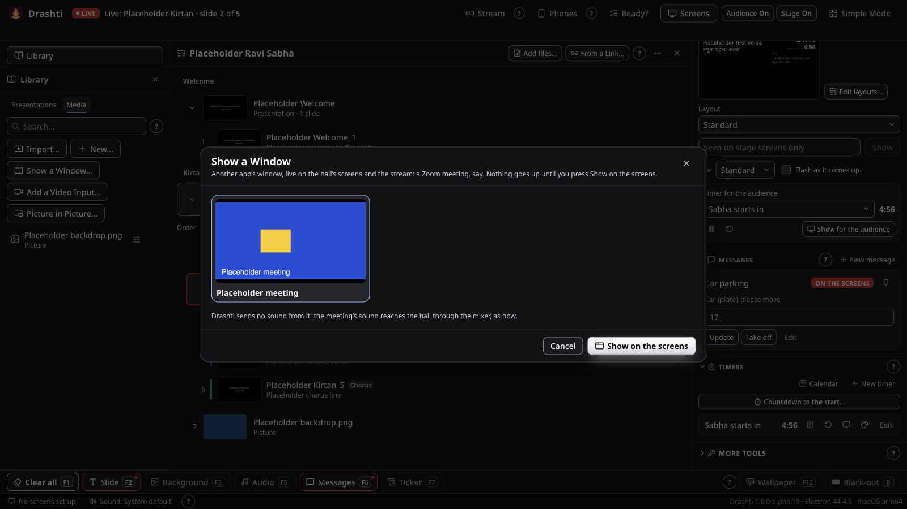
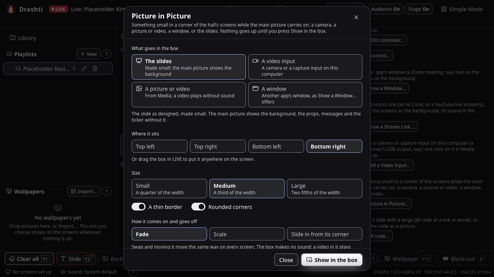
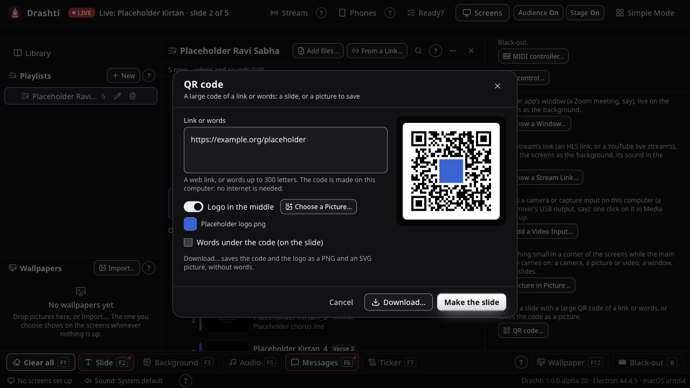
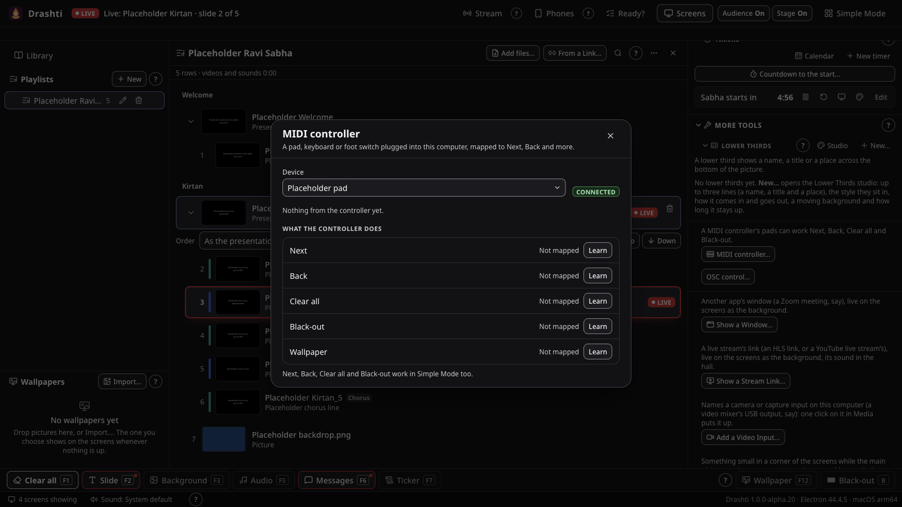
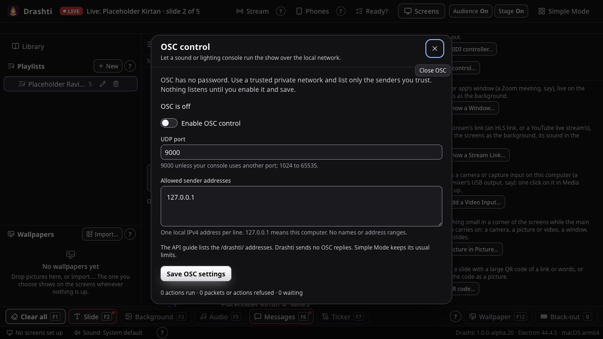

# More tools

**More tools**, folded away at the end of the right column, holds the tools a sabha needs now and then: Lower Thirds, the MIDI controller, OSC control, Show a Window…, Add a Video Input…, Picture in Picture… and QR code…. They are Pro Mode's.

## More tools and the Tools menu

**What it is.** The folded group at the end of the right column, each tool with a line saying what it does. **Tools** in the menu bar has the same: Show a Window…, Add a Video Input…, Picture in Picture…, QR code…, then Lower Thirds Studio…, MIDI Controller… and OSC Control….

**When you would use it.** Whenever you need one of these tools.

**How:**

1. Press **More tools** at the end of the right column to open it.
2. Press the tool you need.
3. Press **More tools** again to fold it away.
4. Or choose the tool from **Tools** in the menu bar.

## Lower Thirds

**What it is.** A name, a title or a place across the bottom of the hall's screens, the stream, or both, coming in and going out in its own way.

**When you would use it.** When a speaker begins, so the hall knows who is speaking.

**How:**

1. In **More tools**, find **Lower Thirds**.
2. Press **Show** beside a lower third to put it up.
3. Press the same button, now **Hide**, to take it off.
4. **Studio** or **New…** opens the studio to make one.

## The Lower Thirds studio

**What it is.** A window of its own for making lower thirds, with a live preview and five tabs: **Words**, **Style**, **Animation**, **Background** and **Timing**. **Templates** offers ready-made ones to start from.

**When you would use it.** Before the sabha, to make the night's lower thirds.

**How:**

1. Press **Studio** (or **New…**) under **Lower Thirds**.
2. Press **Templates** and click one to start from it.
3. In **Words**, type up to three lines (placeholder: "Placeholder Speaker", "Placeholder Title").
4. Set the **Style**, **Animation**, **Background** and **Timing**.
5. Press **Save**, then **Show** when it is time.

## Show a Window

**What it is.** Another app's open window (a Zoom meeting, say) shown live on the hall's screens as the background. Never a whole screen, and never Drashti's own.

**When you would use it.** When a speaker joins by Zoom and the hall should see them.

**How:**

1. Open the other app's window first, not minimised.
2. In **More tools**, press **Show a Window…**.
3. Choose the window by its name and its small live picture.
4. Press **Show on the screens**. **F3** or **Clear all** takes it off.

## Video inputs

**What it is.** A camera or capture input on this computer (the video mixer's USB output, say), named once and then one click away in **Media**. It goes up as the background, with the slide's words over it.

**When you would use it.** To show the camera or the mixer's picture on the hall's screens.

**How:**

1. In **More tools**, press **Add a Video Input…**.
2. Choose the input by its small live picture, and give it a name, such as "Input 1".
3. Press **Add to Media**. Nothing goes up yet.
4. In **Media**, click it to put it up.

## Picture in Picture

**What it is.** Something small in a corner of the hall's screens while the main picture carries on: the slides, a video input, a picture or video, or another app's window.

**When you would use it.** To keep the slides in view while a video plays, or to show the camera small.

**How:**

1. In **More tools**, press **Picture in Picture…**.
2. Under **What goes in the box**, choose what goes in it.
3. Choose **Where it sits**, the **Size** and how it comes on.
4. Press **Show in the box**. Under **LIVE**, **Swap** and **Take off** work on it.

## QR code

**What it is.** A large code that phones can scan, made on this computer with no internet: a slide, or a picture to save with **Download…**. It can have a logo in its middle.

**When you would use it.** To share a link or a few words with everyone in the hall, or to print the code on a poster or a notice.

**How:**

1. In **More tools**, press **QR code…**.
2. Paste a link or type words under **Link or words** (300 letters at most).
3. For a logo in the middle, press **Choose a Picture…** and choose it: a PNG or JPEG, such as the mandir's logo from the setup kit. Drashti remembers it. **Logo in the middle** turns it on or off.
4. Check the code. For a slide with the code alone, untick **Words under the code**.
5. Press **Make the slide**. It comes into the library, ready to put up.
6. Or press **Download…** and choose where to save it. Drashti saves the code as a PNG picture and an SVG picture, with no words.
7. Scan it with a phone before the sabha.

## MIDI controller

**What it is.** A pad, keyboard or foot switch that runs **Next**, **Back**, **Clear all**, **Black-out** and the **Wallpaper**.

**When you would use it.** When an operator prefers pads or a foot switch to the keyboard.

**How:**

1. Plug the controller in.
2. In **More tools**, press **MIDI controller…** and choose the device.
3. For each action, press **Learn**, then the pad.
4. Close it. The pads work in Simple Mode too.

## OSC control

**What it is.** A sound or lighting console, or Companion, on the mandir's network, running **Next**, **Back**, the clears, the covers, timers and messages. It is off until someone turns it on, and has no password.

**When you would use it.** When the sound desk should move the slides.

**How:**

1. In **More tools**, press **OSC control…**.
2. Set the **UDP port**, and list each sender's address under **Allowed sender addresses**.
3. Turn on **Enable OSC control**, then **Save OSC settings**.
4. **OSC on** shows in the header; **Turn OSC off** closes it.

