# The operator's guide: running a sabha in Pro Mode

This guide is for the **operators**: the people who run a sabha's screens in Drashti's Pro Mode, from switching on to switching off. It goes through a whole sabha in the order things happen. A small sabha with one projector, run by a volunteer, can use Simple Mode instead (section 9), and setting Drashti up (screens, backups, the node, schedules) is in the admin's guide (`docs/admin-guide.md`), for whoever looks after Drashti.

On the Mac, **Cmd** is the ⌘ key; on Windows use **Ctrl** instead. On Windows the menu bar is hidden: press **Alt** to show it.

**This guide is inside Drashti too:** **Help**, then **Guides…**, with the presenter's guide (and in Pro Mode the admin's and the setup day's). Type a word in **Search the guides** to find every passage that holds it, by section, after up to three answers to questions such as "When a screen is black or frozen, what do I do?"; choose one to read it in its place. The guides need no internet. **Esc** closes it.

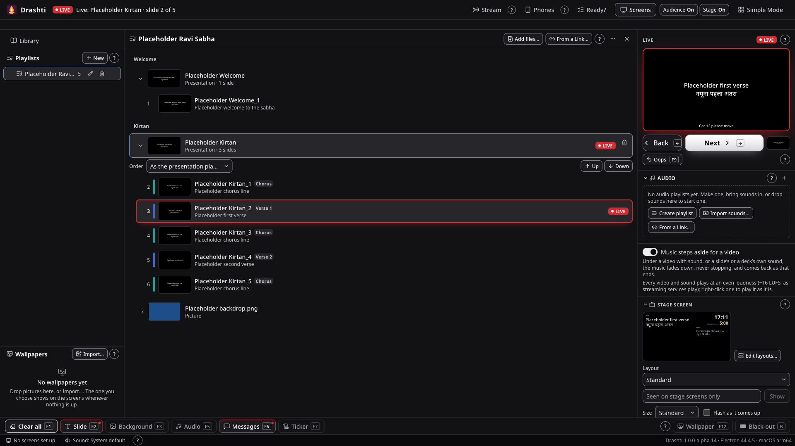

**The window, left to right:**

- **Along the top:** what is live now (with **ON AIR** and **REC** while the stream is live or recording), then **Stream**, **Phones**, **Announcements**, **Ready?** (section 1), **Screens**, the **Audience** and **Stage** switches (section 2) and **Simple Mode**. With phones able to connect, a window less than 1680 pixels wide shows **Stream**, **Phones**, **Announcements** (with how many are waiting), **Ready?** and **Simple Mode** as their icons alone: the mouse over one names it. **Screens** and the two switches always keep their words.
- **Left column:** the **Playlists**, as many as you like, in folders: **+ New** makes one, and the chosen one shows **Rename** and **Delete** at its end. At its top, the **Library** button opens the library over them: Presentations and Media, with the search box and, under it, **Import…** (files, a folder, or from a link), **New…** (a presentation from pasted words) and **QR code…** (a slide with a large code: section 2). Drag from it into a playlist, or choose and press **Add to playlist**; **Close** or **Esc** shuts it, and **Cmd+F** (Ctrl+F) opens it at the search box. A playlist made from a folder lists the folders inside the one shown under the playlists: drag the line above them to give them more room, and Drashti remembers it. Under them all, just above the bar along the bottom, are the **Wallpapers** (below). The **Books** tab (in the library), the Templates and the kirtan filters show only while **View › Show Books, Templates and Kirtan Details** is ticked.
- **Middle:** the **open playlist** has the whole middle: its name, **Add files…**, **From a Link…** and its menu (**⋯**), then its rows. A presentation, a PDF, a PowerPoint or Keynote deck and a passage from a book are a row with its name and, under it, a row for each slide in the order they play, named after it ("Placeholder Katha_1", "Placeholder Katha_2", and on; a slide of words shows its first line too); a click on the name folds its slides away, or opens them again. A picture, a video, a sound, a video input and a header are a row each, with a small picture, its name, what it is and its length. **One click on any row puts it on the screens at once**: a slide, a picture, a video, a sound or a video input (so does Enter on it; a double click puts it up only once, and one already up is never started again; on a presentation's slide, the double click then opens **Edit slides…** at that slide). **Cmd**-click (Ctrl-click on Windows) or **Shift**-click only chooses rows, **Alt**-click (Option-click on a Mac) chooses one without putting it up, and a right-click opens its menu. Drag a row to move it, or drop presentations, pictures, videos or files anywhere on it. A number at the left of each row that goes up lets you put it up from the keyboard (**Jump to a row**, in section 2). A playlist made from a folder shows one folder at a time: that folder's own items here, its folders under the playlists (click one to see what is in it), and the way back up above the items ("Placeholder Sabha › Week 1"); clicking the playlist itself goes back to the main folder. **Next**, Simple Mode and the phones still go through the whole playlist, folder after folder, and the middle follows. With no playlist open (**×** closes it), the presentation chosen in the library fills the middle the same way: its name, then its slides as rows.
- **Right column:** the live picture, headed **LIVE** (what the hall sees now), with **Back** and **Next** under it (Next, in the appearance's one strong colour, is always the next thing to do, and the small picture beside it shows what it will put up; each does exactly what its key does), **Oops** under Back, and, under them, a time bar for whatever plays, then **Audio** (its audio playlists), the **Stage screen** (its layout, its message, and its layout's timers), **Messages**, **Timers** (one line each: start or pause, reset, show for the audience, Edit), and **More tools**, folded away: Lower Thirds and the MIDI controller, each with a line saying what it is.
- **Along the bottom:** **Clear all** (F1), the **clear buttons** for each layer in the order of their keys (**Slide** F2, **Background** F3, **Audio** F5, **Messages** F6, **Ticker** F7), **Wallpaper** (F12) and **Black-out** (B), each with its key beside its word, then the **status bar** (the version, the screens, imports, warnings, and **Audience off** or **Stage off** while those screens are switched off). A clear button whose layer has nothing on the screens is dimmed, so what is up shows at a glance. Just above the clears, the **quick bar** holds what you pinned there (section 2), and is hidden while it holds nothing.

**Wallpapers.** Under the playlists, just above the bar along the bottom, are the pictures the hall sees whenever nothing is up. Drag pictures there from the Finder (Explorer on Windows) or from **Media**, or press **Import…** beside the heading; anything that is not a picture is refused, saying why. Click one to use it: it then shows on the audience screens whenever nothing is up there (as Drashti starts, on a display just plugged in, after **Clear all**, and when a video ends: **When it ends**, in section 2), and under **Wallpaper** (**F12**), over whatever is up. Click it again to use none: the screens are then black when nothing is up. Pictures dropped on a wallpaper go into it, and its pictures then go round, each fading into the next: its right-click menu's **Edit wallpaper…** sets their order, the **Seconds each** and the **Fade**. The same menu has **Rename…** and **Delete…**, each with **Undo**; deleting the one in use asks first. The idle rotation of earlier versions is the wallpaper **Idle rotation** now, its pictures and its quotes (each made into a picture) going round: click it to use it.

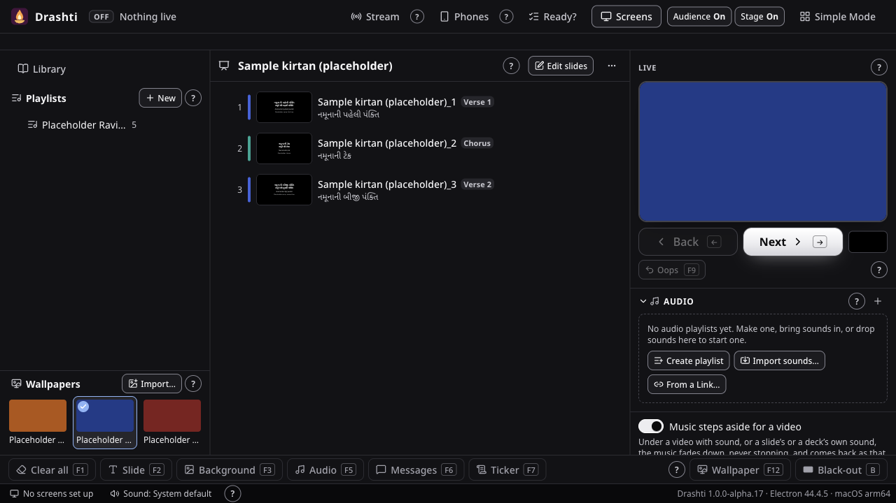

**The first start.** A new library opens with a welcome: Drashti's lamp lights, then the choices. The screens set themselves (below), so nothing has to be set up first: **Set Up Screens…** changes what each display shows, with the sound and the stream (the admin's guide has it). **Try a practice show first** puts five placeholder slides on this screen only, with a banner saying so: try Next, Back, **B**, **F12** and **F1** as in a sabha; nothing goes to the hall's screens, the phones or a stream, and nothing is saved. **Leave the practice show** brings the welcome back. A new library starts with no presentations, not even test slides. **Skip for now** leaves the middle of the window showing three steps to a sabha: **Import…** what you show, make **this week's playlist**, and the screens, which set themselves (**Set Up Screens…** to change them). In a small window these steps, and the practice show's keys, scroll: none is ever hidden under the bars along the bottom. The welcome comes once; **View › Set Up Screens…** opens the setup any time.

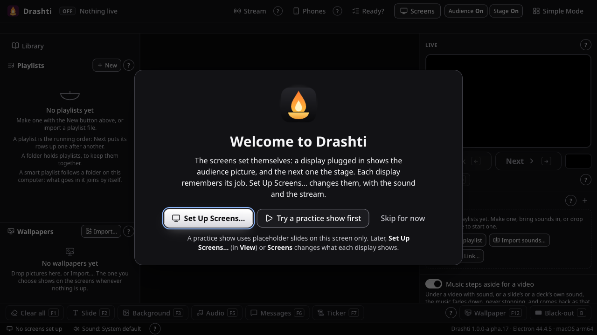

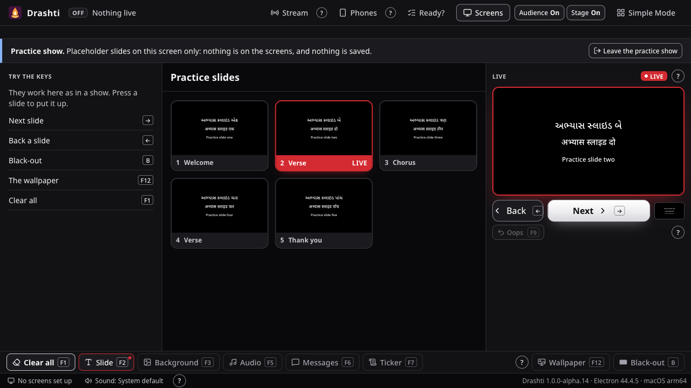

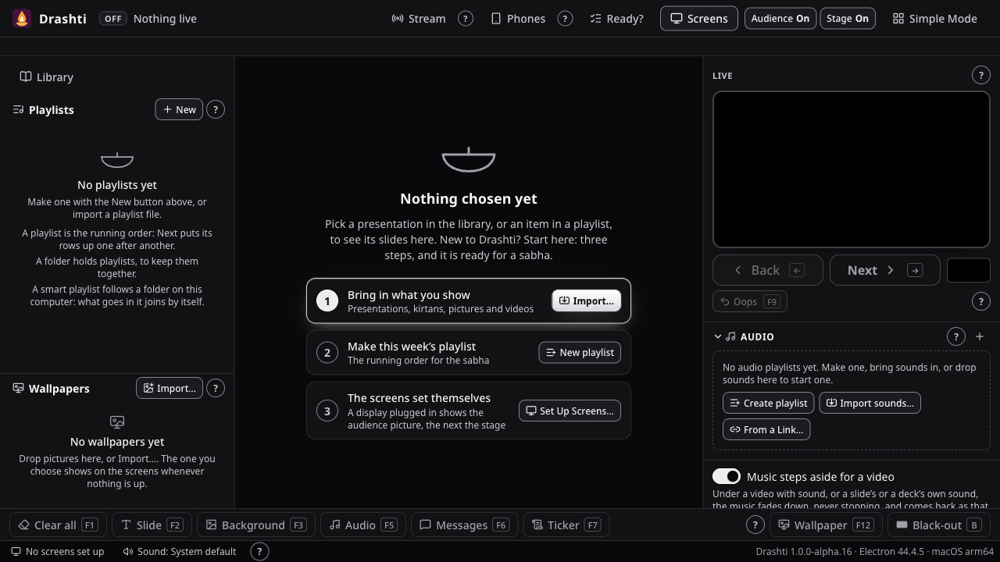

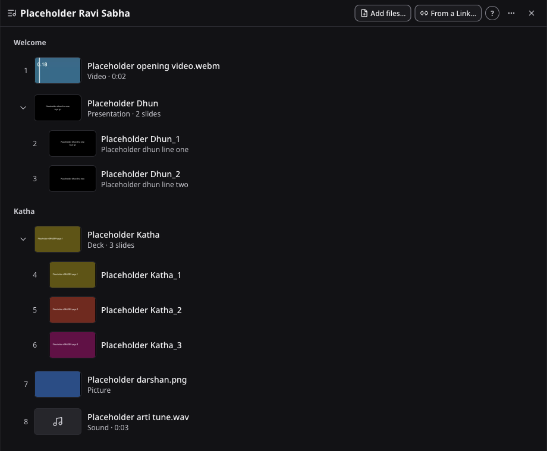

**A display plugged in sets itself.** Plug in a projector or a screen and Drashti uses it at once, asking nothing: the first display that is not the one with these controls (nor the computer's own built-in screen) shows the audience picture, the next one the stage, and any more the audience picture too. A line under the top bar says what happened ("“Hall projector” shows the audience picture."), with **Change…**, which opens **Screens** at that display: there one click gives it another job, **Audience**, **Stage** or **Not used**. Each display remembers its job, known by the display itself: plugged in again, into another port, or after a restart, it goes straight back to it, and a job changed by hand is remembered instead. With two projectors as two displays (not through a splitter), the second starts as the stage: one **Change…** to **Audience** makes it show the audience picture too, from then on. The display with these controls is never taken. A screen just started shows the chosen wallpaper (black with none chosen) until something is put up: there is no test slide. **Identify** (on the screens dashboard, and in **Screens**) puts each screen's number on it, only when pressed. **Extend, never mirror:** if the computer mirrors its own screen onto the projector, Drashti sees one display, and the line says once how to extend instead (on a Mac, **System Settings**, then **Displays**, the projector, and **Use as: Extended display**; on Windows, Windows+P, then **Extend**).

**Keep these screens?** Only a change made by hand that puts an output on the display these controls are on (in **Set Up Screens…** or **Screens**, or from a phone) asks **Keep these screens?**, counting down 15 seconds; nothing else asks. It stays on top: anything opened meanwhile (the guides, say) opens under it, and Enter and Esc still answer it. **Keep** (Enter) keeps the new screens. **Go back** (Esc) puts back what that change changed, and nothing else, and so does pressing nothing for 15 seconds, with a notice saying so. The output now over the controls asks the same in its middle: Enter keeps, Esc goes back. If Drashti stops before an answer (a crash or a power cut), the next start goes back to the screens as they were before that change, and a notice says so. Turning a screen off asks nothing.

**How Drashti looks on this computer.** **View**, then **Appearance**, chooses its look: **Follow the computer** (the first choice: Black when the computer is set to dark, White when it is set to light, changing with it), **Black**, **White**, **Dhaja** (the mandir flag's red and white, with gold), **Tiranga** (India's saffron, white and green, with navy), **Saffron**, **Peacock**, **Midnight Blue**, **Sandalwood**, **Lotus**, **Marble**, **Tulsi**, **Diwali**, **Holi**, **Aarti**, **Monsoon**, **Sandhya**, **Forest**, **Navratri**, **Neel**, **Ratna**, **Prabhat**, **Mehndi**, **Haldi**, **Himalaya**, **Uttarayan** or **Mogra**. Every one but Black and White has a top bar in its own colours, shading from one to the next, with a thin band of its colours under it, and its own colours for headings and for the tab and row you have chosen; the left column, the middle, the right column and the bar of show controls along the bottom each have a colour of their own too, and so do the panels' title strips and the layer buttons, four colours at least in each. It changes Drashti's own window at once, and stays chosen when Drashti starts again; **the screens in the hall, the stream and the phones never change with it**. In every one, LIVE is red with its word (in the top bar it sits on a plain panel, never on the bar's colour), the next thing to do is the one strong colour, and warnings are amber. **Appearance…** there shows each as a small picture of this window. It also has **Make a copy of …**, to make your own: give it a name, choose **Dark** or **Light** and the colour of the next thing to do, and Drashti works out the rest, its top bar and band too. **Choose the second colour myself** lets you pick the colour for headings and for what is chosen as well; Drashti says if it could be taken for LIVE, a warning, success or danger, and offers the nearest that works. It says at once if that colour is too close to LIVE's red, ON AIR or a warning, and offers the nearest colour that works; **Save and use it** waits until every check is met. Your own appear under **Your own**, where **Delete…** asks first (if it was in use, Drashti follows the computer again); the ones Drashti came with can't be deleted. **Interface motion**, there too, is **Calm** (things arrive and leave gently), **Lively** (tabs glide, cards arrive one after another, buttons answer a press, one appearance fades into the next and its band sweeps in once) or **Off** (nothing moves); whichever you choose, Next, Back, the clears, Black-out, the Wallpaper, the slides and the live picture never move, and the computer's own setting to reduce motion turns it all off. Simple Mode shows the appearance chosen here, with no way to change it.

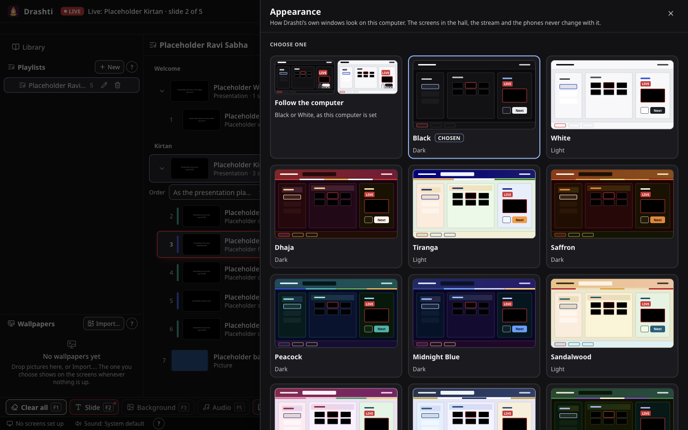

---

## 1. Before the sabha

**When the screens open.** Let the picture finish drawing before judging it. The screens start without waiting for the Lower Thirds studio’s fonts; after a restart or reconnect, words restored in one of those fonts may appear a moment after their band. There is no setting to change for this.

Do these about 30 minutes before the sabha starts.

1. **Switch on and start Drashti.** It opens in Pro Mode, with nothing to type. If the access list let this computer in within the last 15 days, it opens at once, with the internet or without it, and checks again in the background; otherwise it needs the internet as it starts, and says **Checking this computer’s access…** meanwhile (if it shows a lock screen instead, see section 3). If the screen shows Simple Mode (as when Drashti stopped unexpectedly in it), double-click **Pro Mode** at the top right (section 9). If it says **Simple Mode only on this computer** there instead, this computer's access is for Simple Mode only: ask whoever approves access for Pro access (section 3). If it opens with two seconds of a photo (the opening), perhaps with a quiet sound, any key, click or tap ends it at once, and that key does nothing else.
2. **Check the screens.** Click the screens line in the status bar (for example "3 screens showing"). The **screens dashboard** shows a small picture of what every screen really shows, the hall's, the stage's and the second computer's (the node). Every node should say **Online** and its pictures and videos **ready** (for example "14 of 14 ready"). **Identify** puts a screen's number on it if you are not sure which is which.

   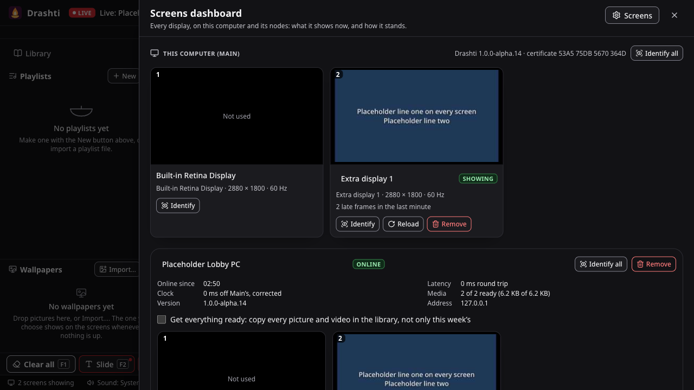

3. **Open tonight's playlist.** Under **Playlists** click it: it opens in the middle. If it is a playlist from an earlier week, open it now (a click is enough): the second computer then copies its pictures and videos in good time.
4. **Check the sound.** Play a sound from the playlist, or press **Play** in **Audio**, and check the mixer hears it. The status bar always says where the sound goes; a warning there means the chosen output is not connected.
5. **Music before the sabha.** In **Audio**, choose the list and press **Play**. It plays one sound after another with short fades, whatever goes on the screens, until you press **Pause** or clear the sound (**Music during the sabha**, in section 2).

   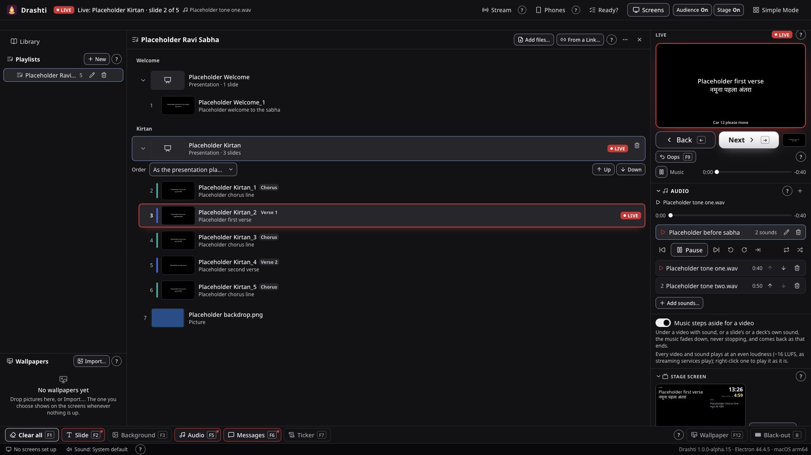

6. **The wallpaper.** In **Wallpapers**, under the playlists, click the one the hall should see while nothing is up (the mandir's darshan pictures going round, say, or **Idle rotation**). It shows until the first thing goes up, and again whenever nothing is up.
7. **A countdown for the start** (if wanted): in **Timers**, press **Countdown to the start…**, set **The sabha’s time** and press **Show the countdown**. The hall's screens and the stage screens show the time left to it over the wallpaper ("The sabha starts in"), and it goes by itself at zero; a time already passed today is refused, saying so. **Hide the countdown** takes it off sooner. For any other timer on the hall's screens, use its **Show for the audience** (section 2), a timer slide ("Starting in 4:59": section 2), or a message such as "Sabha starts in {time}", with {time} set to **Timer: Sabha starts in** in place of **Typed in**.
8. **The stream** (only on the computer that streams, and only if tonight's sabha is streamed): press **Stream** in the header, choose **Camera and words** or **Slides**, press **Record** if it should be recorded, then **Go live…** and **Go live**. The header says **ON AIR** (and **REC**). Section 6 of `docs/parallel-run.md` has the details.
9. **Phones** (if a phone remote or a stage tablet is used): press **Phones**, check **Let paired phones and tablets connect** is on, and check each phone says **Connected**.
10. **Ready?** Last, press **Ready?** in the top bar. It checks eight things and shows each green, or amber with what to do: the **Screens** (each connected and showing, **Audience** and **Stage** on, the projector extended, not mirrored), the **Sound output** (**Test sound** plays a short tone to it), the chosen **Video input**, **Access**, the open playlist's **Files** (**Find missing media…** when some are gone), the **Charger**, **Sleep** and **Notifications**. Put each amber line right, then press **Check again**, until every line is green. Under them, **What Ready? can’t check** lists what to look at yourself: the projector's picture, the hall's sound, the stream's internet and the phones' batteries. It looks only when you press it.

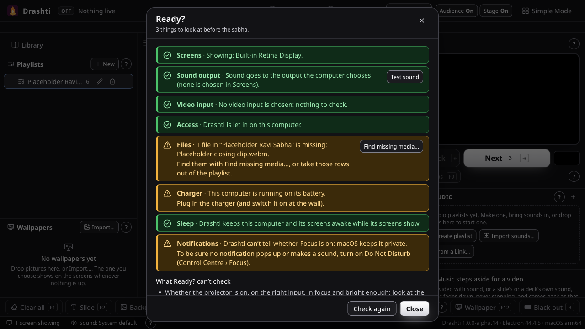

**Live captions (Trial).** They start off and can slow the screens while on. When an admin has turned them on, captions may show along the bottom of that computer's stage screens and the stream (or at the top, if chosen), and on the audience screens only if chosen too. Tell the admin if they are wrong or lag behind; **File › Live Captions…** turns them off. There is nothing to do in Simple Mode. The admin's guide, section 25, has the settings and the rehearsal.

## 2. Running the sabha

**Starting.** In the open playlist, click the first row: it goes up at once, whatever it is (a slide, a picture, a video or a sound). **Space** (or **→**), or **Next** under LIVE, then puts up the row after it.

**Going through it:**

| Key                                      | What it does                                                                                 |
| ---------------------------------------- | -------------------------------------------------------------------------------------------- |
| **Space**, **→**, **↓** or **Page Down** | The next slide; at the end of an item, on into the next (headers are stepped over)           |
| **←**, **↑** or **Page Up**              | The slide before                                                                             |
| **Shift+→** or **Shift+↓**               | The start of the next item                                                                   |
| **Shift+←** or **Shift+↑**               | The start of the item before                                                                 |
| **Next** or **Back** under LIVE          | The same as **Space** and **←**, at once                                                     |
| A click on a row                         | That row, at once: a slide, a picture, a video, a sound or a video input                     |
| A row's number, then Enter               | That row, at once (Esc puts the number away)                                                 |
| A click on a presentation's name         | Its slides fold away, or open again; with nothing up, **Next** then starts it from its first |

- What the next press will bring shows beside **Next** (its small picture), on the stage screen (its **Next**), on a presenter's phone or tablet, and in Simple Mode.
- Pictures and videos in the playlist go up as the **background**; the words of the next presentation go over them. A video input in the playlist goes up the same way (section 6). A sound plays through the mixer and leaves the picture as it is.
- **Jump to a row by its number.** With no field chosen, type the number at a row's left: "Row 12 · Enter puts it up · Esc cancels" shows over the middle. Enter puts that row up, as a click does; Backspace takes a digit off; Esc, or any other key, puts the number away (a number with no row says so). It works in Simple Mode too.
- **A finished video starts again.** A click on the row of a video that has played to its end starts it again from its start point; one still playing carries on (a click never starts it again by mistake), and a paused one stays paused. A finished sound starts again too.
- **When it ends.** Right-click a video's row for what happens at its end, kept for that row in this playlist: **When it ends: Wallpaper** (to begin with: the video comes off and the chosen wallpaper shows, when nothing else is up; with no wallpaper chosen, or a slide or a box over it, its last picture stays), **Next item** (the next row goes up, as **Next** would; at the end of the playlist, as Wallpaper), **Loop** (it goes round) or **Freeze** (its last picture stays). **Undo** takes a change back.
- **The last 10 seconds.** In a video's last 10 seconds, its row and its time under LIVE turn amber, and every stage screen says "Video ends in 0:08" across its top. Not for a video going round, a paused one, or one whose length is not known yet.
- A presentation can play in its own **arrangement** (a chorus sung three times shows three times): choose its row, then its **Order**, on the line under it with **Up** and **Down**. It changes this playlist only.
- **A deck's slides in this playlist's own order.** Drag a slide's row among its own deck's rows: this playlist then plays that deck's slides in the new order, and its **Order** says **This playlist’s own order** (choosing another order there sets it aside, with **Undo**). Drag a slide's row anywhere else in the playlist and it becomes an item of its own there, the deck keeping the rest. A row keeps its name ("Placeholder Katha_3" stays _3), each drag has one **Undo**, and the presentation in the library never changes. A slide added to the presentation later comes at the end of the deck's item; one deleted drops out.
- **Repeat Slides** (its icon is two arrows going round): a playlist whose pictures and slides go round by themselves, the last back to the first, for a lobby or before the sabha. **+ New › Repeat Slides** makes one; put pictures, PDF or PowerPoint decks and presentations in it (a video, a sound or a video input is refused, saying why). Under its name: **Seconds each** (15 to begin with, 3 to 600), the **Transition** (Fade to begin with, or Cut, Fade through black, Slide or Slow zoom) and how long it takes (1 s to begin with, 0.3 to 3 s, never more than half the seconds each); a change takes effect from the next slide. **Start** (there, or ▶ on its row) starts from its first slide, and a click on any of its rows starts it going round from there. LIVE names the playlist beside **Repeating**, with **Stop (Esc)**. **Esc** (when no dialog, menu or field has the keyboard) or **Stop** ends it, and **the slide on the screens stays up**; putting anything else up, Clear all and clearing the slide end it too. **Black-out** and the **Wallpaper** cover it while it goes on underneath. After an unexpected restart it carries on. Simple Mode can start and stop it, but not change its settings; a presenter's phone shows it, can start it (**Start going round**, with that playlist chosen) and can stop it.
- **Transitions**: any presentation or slide can pick Fade, Fade through black, Slide or Slow zoom in the slide editor, as a Repeat Slides playlist does, and Wipe, Push, Zoom, Line by line or Word by word. Every screen moves calmly, so Wipe, Push and Zoom fade, as Fade does. Pictures always fade, and a kirtan's slides never come word by word. Every screen runs them at the same moment, and each takes the time the slide gives it.
- **A PowerPoint or Keynote deck with its animations.** On a computer with PowerPoint (or Keynote, on a Mac), and with **File › Decks With Their Animations on This Computer** ticked (ticked to begin with on a Mac; on Windows, off until it has been tried on the mandir's PC on setup day), a deck comes in with its own transitions and animations: each **Next** (or **Space**) plays its next click, as the deck's slideshow does, and **Back** goes back a click; every screen shows the same click at the same moment, and what is live, along the top, says which click is up ("click 1 of 2"). Its videos and sounds come in as real videos and sounds. Its music plays as in its slideshow: a sound set to play across slides (PowerPoint's **Play Across Slides**, or **Stop playing** after a number of slides; Keynote's soundtrack) plays on as the clicks and slides change, with its time bar under LIVE as the sound playing; **Next** and **Back** never start it again, and it stops at its end, after its last slide, when anything else goes live, or at **Clear all** or Audio's clear (**F5**). Unticked, a deck comes in as pictures, as before, with its videos still real videos and its music across slides as well, and so does one imported while the stream is on air or recording (import it again afterwards). A deck that came in as pictures, imported again with its animations, asks first in the import report: **Replace** (what was changed in it since is lost), **Keep both** or **Skip**. On a computer with neither app, only its videos and sounds come in, into **Media**: import the deck on a computer with one, or save it there as PDF and import the PDF.
- **A QR-code slide.** **QR code…**, beside **New…** in the library, makes a slide with a large code that phones can scan: paste a link or type words under **Link or words** (300 letters at most), check the code and the words under it as the slide will show them, and press **Make the slide**. It is made on this computer, with no internet, and comes into the library chosen ("QR code: …"): one click on its row puts it up, or add it to a playlist as any presentation.
- A **passage from a book** (with the Books tab shown): open the library, and in its **Books** tab type its reference (for example `SD 14` or `Vach G.Pr. 1`) and press Enter; its slides show as rows, as a presentation's do.
- To find any kirtan quickly: **Cmd+F** (Ctrl+F), type a few letters of its title or its words, and press Enter.
- **The right-click menu.** Every row, file, folder, video, sound and picture has one menu, wherever it shows (the library, **Media**, a playlist's rows, a folder playlist's folders, an audio playlist's tracks and the wallpapers): right-click it, press **Shift+F10** with the keyboard on it (on a Mac laptop, **Fn+Shift+F10**), or on a touch screen hold a finger on it. It holds what fits: what only that place has first (a playlist row's **Timers when it goes up…**, say), then **Picture editor…** or **Edit slides…**, **Trim (start, end and markers)…** for a video or a sound, **Save picture…**, **When it ends**, **Even loudness**, **Trim black and silence**, **Rename…**, **Show in Finder** (**Show in Explorer** on Windows: the file it came from while that is still there, else Drashti's own copy), and last, apart, **Delete…** (in a playlist, **Remove from playlist**).
- **A playlist's own menu** (its **⋯** in the middle, or a right-click on it under **Playlists**) has **Practise this playlist**, **Duplicate**, and a rename and a delete (**Rename playlist…** and **Delete playlist…** in the ⋯ menu). **Duplicate** makes "<its name> copy" just after it with every row in its order (**Undo** deletes the copy), and **Practise this playlist** runs it in this window only, as the first start's practice show does: each row in turn, with a banner saying nothing goes on the screens, the phones or the stream and nothing is saved, until **Stop practising**.
- **Media** lists the pictures, videos and sounds you imported, and those the drop folder took in by itself, if one is set up (**From the drop folder**, above the list, shows those alone). A PDF, PowerPoint or Keynote file's pages are its presentation's slides, so they stay out of Media (a page you also import on its own shows there). Above them, **Video inputs** lists this computer's cameras and capture inputs, once one is named: one click puts one up, and one can go in a playlist too (section 6).
- **Every video and sound file.** Drashti takes nearly any video or sound file: MP4, MOV, MKV, WebM, AVI, WMV, MPEG, MTS, FLV, VOB, MXF and more; MP3, WAV, M4A, AAC, FLAC, OGG, Opus, WMA, AIFF, AC-3, DTS and more. One it can't play as it is (an AVI, a WMA, an AIFF or an MKV with AC-3 or DTS sound, say, or an HEVC video on a computer that can't play HEVC, as many Windows PCs can't) is converted by itself a moment after the import, one file at a time: Drashti makes a copy that plays and uses it everywhere, and the original stays as it is. The original added again later (to a playlist, a slide or **Audio**, or imported again) uses the copy too. Until then the file says **Converting…** (in **Media**, the playlist and **Audio**) and can't go live. Nothing is converted while the stream is on air or recording: it waits. A conversion waiting or under way when Drashti quits (or stops) starts again by itself at the next start, about 10 seconds after the window opens; one cancelled (**Cancel all**, or the cancel button beside a file) or failed does not. The import report says what Drashti is converting, and then what it converted. A file that plays as it is (HEVC too, where this computer can play it) is never converted. A file imported again takes that import's start and end points and markers, and what is up playing it moves to them at once (the report says so).
- **Every picture.** Drashti takes JPEG (also as .jfif or .jpe), PNG (animated too), GIF, WebP, AVIF, BMP, HEIC, TIFF, icons, Targa, Photoshop and JPEG 2000 pictures, every way in: **Import…**, **Add files…**, a drop, the drop folder, the wallpapers and a phone. One a screen can't show as it is (HEIC, TIFF, Targa, Photoshop or JPEG 2000) is converted by itself at import, never while the stream is on air or recording. A JPEG XL picture, an SVG drawing or a camera's raw picture is refused, saying what to do (save it as a JPEG or a PNG), and so is a damaged file with a picture's name. A photo that does not fill the screen (a phone's upright photo, say) has a blurred, darker copy of itself behind it instead of black bars. A picture's **Picture editor…** (in its right-click menu) can **Rotate** it, **Flip across**, **Flip up and down** and **Crop** it (Free, 16:9, 4:3 or 1:1), each kept with the picture and never in its file, and turns the fill off with **Blurred fill behind** (on for a photo, off for a deck's slide); **As it was taken** puts it all back (`docs/admin-guide.md`, section 10). **Save picture…**, in a picture's or a deck slide's right-click menu, saves it full size where you choose, rotated, flipped and cropped as it shows: a photo as a JPEG, anything else as a PNG.
- **Deleting.** **Delete…** is last in every right-click menu, always with **Undo**. Taken out of a playlist (**Remove from playlist**), an item only leaves that playlist, and Drashti asks first while it is on the screens; a folder playlist's folder (**Remove the folder from playlist…**) takes everything in it out, with one Undo. Deleted from the library (a presentation, or a picture, video or sound in **Media**), it is Drashti's own copy that goes, never a file of yours outside Drashti's data folder: Drashti asks first only when it is on the screens or used, saying where (which playlists, slides, audio playlists and wallpapers), and otherwise deletes it at once. The chosen row, and the row under the mouse, also show a **trash** button at their end, which does what the **Delete** key does (Backspace on a Mac). **Choosing many** works in every list you can delete from: drag a box over the rows from an empty place (the list scrolls by itself at its top and bottom), **Shift**-click for a run of rows, **Cmd**-click (Ctrl-click) to add or take away one, or **Cmd+A** (Ctrl+A) for the whole list. A bar then says how many are chosen, with **Delete** for them all and **Clear**; **Delete** or **Backspace** does the same, and one **Undo** brings them all back. The show controls are never chosen this way. A presentation deleted from the library leaves its rows in any playlist it is in, marked **Removed from the library**, and **Next** goes past them. **Cmd+Z** (Ctrl+Z), or **Undo** in the bar at the bottom of the left column, brings it back. Deleted media leaves playlists, audio playlists and wallpapers, and slides show nothing in its place, as with a missing file (a slide with it as its background, or as its sound, goes up with that left as it was, and LIVE says **File missing**: section 3); what is on the screens stays up until you change it. Its file goes only when Drashti next starts, when Undo can no longer bring it back; importing the same file again brings it back everywhere it was used.
- **What is this?** The small **?** on a panel's heading (and beside Next and Back, the show controls, Stream, Phones and Announcements in the header, the open playlist, the Wallpapers, Audio, More tools and the status bar) says in two or three sentences what it is for and what to do first. **Read more** opens this guide at the passage it comes from; **Got it** closes it.
- **Closing with changes asks first.** The words editor (**New…** from words, in the library), the slide editor, the stage layout editor, the Lower Thirds studio and the other editors ask "Keep your changes …?" before anything typed is lost: **Save changes** (it has the keyboard: Enter saves), **Keep editing** (Esc), or **Throw them away**. When what it changes is on the screens, it says so: saving then changes the screens at once, so **Keep editing** has the keyboard instead (Enter keeps editing; click Save changes when you mean it).
- **A smart playlist** (its icon is a folder with arrows; **+ New › Smart Playlist from a Folder…** makes one) follows a folder on the computer: what is put in that folder joins it by itself, at the end of its folder's part, and the line under its name says which folder and how it goes ("Adding 2 files…"). Move its items about as in any playlist: they stay where you put them. An item whose file was taken out of the folder says **Not in the folder**, and still plays (Drashti keeps its own copy); **Remove the missing** takes those out (Undo brings them back). A file changed in the folder replaces its item, but never what is on the screens: that stays up until you change it. What you take out of it, or delete from the library, stays out, even when its file changes later (Undo brings it back). If the folder is not there (a USB stick taken out), the line says so; nothing is lost, and the playlist carries on when the folder is back.
- **After an import:** the import report offers **Add to playlist**: everything that import brought in, in its order, into the open playlist, another, or a new one named after the file or folder. In **Import from a Link…**, **When it's imported, add it to:** does the same by itself when the download's import ends, even with the dialog closed. It offers first the playlist the last download went into, else the open one, else a new one named after the download (a playlist's own **From a Link…** offers that playlist); with no playlist at all, it asks for the new playlist's name before the download starts. When the download is in, that playlist opens with the new item chosen, ready for one click to put it up: it never goes up by itself. Undo takes it out again.
- **Changing the playlist without dragging:** press **Library**, choose a presentation, a picture or video, or a passage from a book and press **Add to playlist** under it; it goes after the playlist's chosen item (in a playlist made from a folder, with nothing chosen, at the end of the folder shown). To move an item, choose it (**Cmd**-click, or Ctrl-click on Windows, chooses a row without putting it up) and press **Up** or **Down** under it (or **Alt+↑** / **Alt+↓**). **On a slide’s row**, **Alt+↑** / **Alt+↓** moves that slide within its deck: it stays at either end, never moving the whole deck or the next item. The library order and the slide’s original number stay as they were. In Pro Mode, the row’s right-click menu (or **Shift+F10**) also has **Make it an item of its own**: it goes just after its deck, with the keyboard following it; Simple Mode keeps its Rename and Remove choices instead. **Cmd+Z** (Ctrl+Z) takes back the last add or move. Dragging works too: a presentation, a picture or video, or a search result, onto the open playlist (an empty one too) or onto a playlist's name in the list. Files dragged from the Finder (Explorer on Windows) onto the open playlist are imported and go where you drop them, in the order you dragged them.

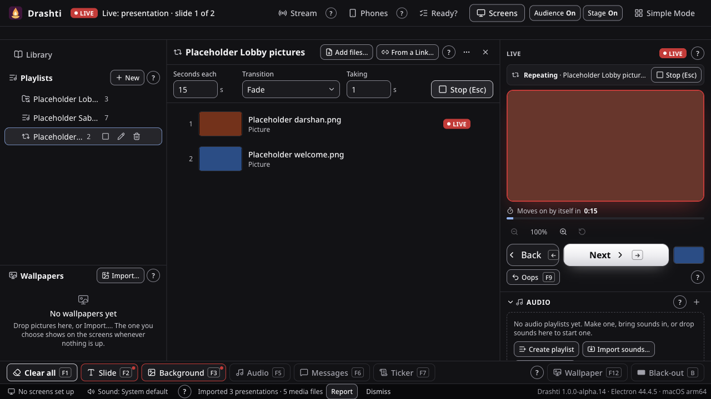

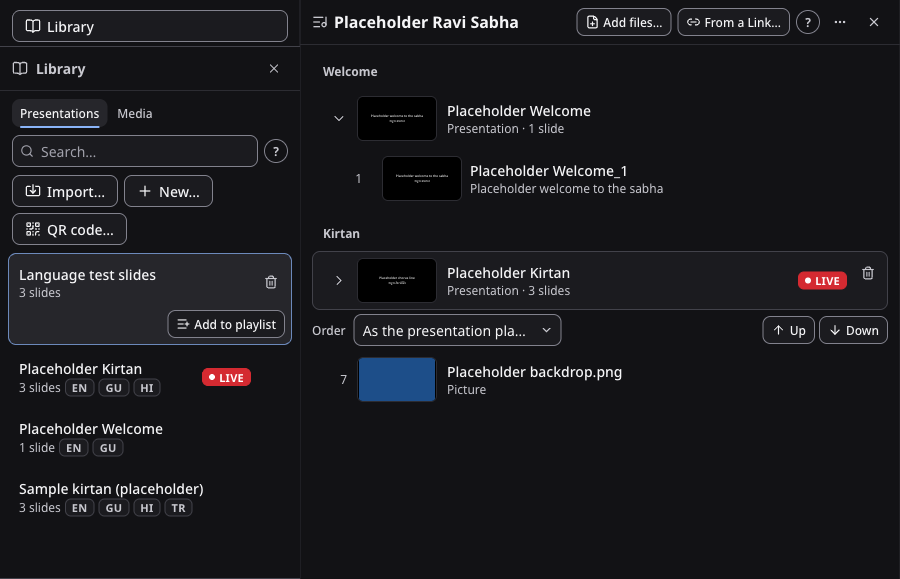

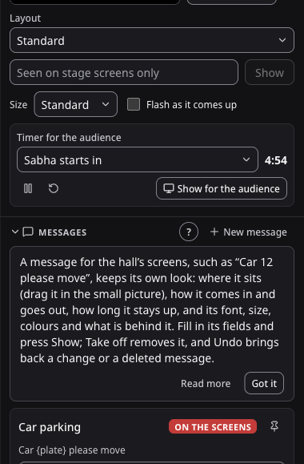

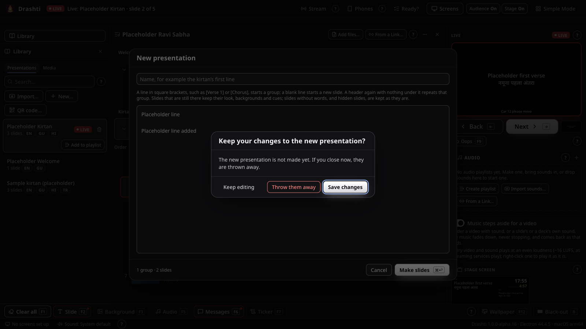

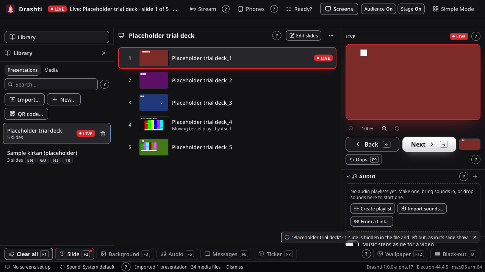

**Covering and clearing:**

| Key or button                          | What it does                                                                                                                                        |
| -------------------------------------- | --------------------------------------------------------------------------------------------------------------------------------------------------- |
| **B** (or **.**), **Black-out**        | Black on the hall's screens, and back exactly as it was. The stage screens keep the words.                                                          |
| **F12**, **Wallpaper**                 | The chosen wallpaper over the picture, and back as it was (black until a wallpaper is chosen)                                                       |
| **F1**, **Clear all**                  | Everything off the hall's screens. Straight after it, **Put it back** brings it all back.                                                           |
| **F2**, **F3**, **F5**, **F6**, **F7** | One layer off each, in this order: the slide's words (the background stays), the background, the sound, messages, the ticker. F4 and F8 do nothing. |
| **F9**, **Oops**                       | What was on the screens before the last change comes back, one step a press (the last 20)                                                           |

The clear buttons along the bottom go in this order too, left to right, each with its key beside its word. A clear button is lit, with a dot beside its key, while its layer is on the screens, and dimmed while its layer has nothing up; **Wallpaper** and **Black-out** are dimmed while off, and in LIVE's red while on. **Oops**, under **Back**, puts back the slide, the background, the sound and every other layer as they were before the last change, a video carrying on where it would be by now; it is dimmed while there is nothing to put back.

**The quick bar.** Up to 8 things you want one press away sit in a row just above the clear buttons: a slide's row, a playlist's row, a picture, video or sound from **Media**, or a message. Right-click one and choose **Pin to the quick bar**; in **Messages**, each message has a pin button of its own. One click on a pin, or **Alt+1** to **Alt+8** (⌥1 to ⌥8 on a Mac), puts it up as a click on its row would, and a message as its **Show** would. Right-click a pin for **Move left**, **Move right** and **Unpin from the quick bar**. A full bar says to take one off first, and something deleted since it was pinned says so when pressed. The bar is kept with the library, hidden while it is empty, and Pro Mode's only.

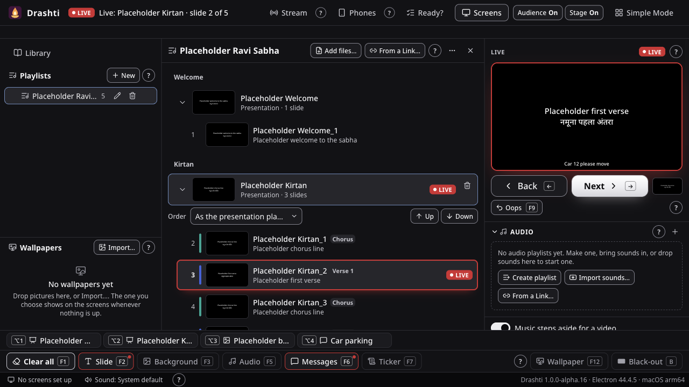

**The keys that moved.** Drashti's keys follow what the operators already press. **F5** now clears the sound and **F6** messages (they changed places); **F7** clears the ticker; F4 and F8 do nothing. The clear buttons moved with them, into the order of their keys. **F12** puts the wallpaper up, where it put the logo. **Cmd+1** (Ctrl+1 on Windows) turns the Audience screens off and on, and **Cmd+2** (Ctrl+2) the Stage screens. On a Mac laptop the F-keys may need Fn held down, unless **Use F1, F2, etc. keys as standard function keys** is on (System Settings, **Keyboard**, **Keyboard Shortcuts…**, **Function Keys**); a Windows laptop may need Fn Lock.

**Audience and Stage.** Beside **Screens** in the top bar, **Audience** and **Stage** each say **On** or **Off**. Turning **Audience** off closes the hall's screens on this computer (key and fill too): their displays show the computer's desktop. Turning **Stage** off makes every stage screen show exactly the audience picture, in place of its layout; the hall's screens never change with it. The show carries on, and nothing else changes: LIVE, the stream, recording, the second computer's screens and the other switch's screens go on as before. While those screens show something, and in the first moments after Drashti starts, before it knows which screens are open, Drashti asks first ("Turn Audience off?"): **Turn off** or **Cancel** (Cancel has the keyboard). If a screen covers the controls, it asks the same in its middle, large: Enter turns them off, Esc cancels. While one is off, the status bar says **Audience off** (or **Stage off**) with **Turn on**, which puts those screens back as they were, as the switch does, and asks nothing. Turning one of them off and on again in **Screens** meanwhile asks nothing either: it stays off until its switch is on again. The screens dashboard shows the hall's screens as off, with **This computer’s desktop** in place of their picture; a stage layout's audience picture keeps showing the hall's picture, with **Audience off** in its bottom left corner, where a stage message along the top can't cover it, on the stage screens and a stage tablet alike. (With no group in **Screens** showing the audience picture, that picture is black and says **No audience screens** in the same corner, and a box of the audience screens' state says **No audience screens** too.) **View** has both too (ticked while on, with **Cmd+1** and **Cmd+2** beside them), and so do the keys: **Cmd+1** for Audience and **Cmd+2** for Stage (not while you type in a field). Both are on again every time Drashti starts. Simple Mode can only turn them back on (**Turn on** in its status bar, or the same keys).

If the single-letter keys are turned off (**Keys at a glance**, below), **B** and **.** do nothing: use the **Black-out** button. **F12** still puts the wallpaper up.

**Messages.** In **Messages**, fill in a message's fields (for example the car's number in "Car {plate} please move") and press **Show** (or Enter in the field). It goes on the hall's screens, across the bottom unless its look says otherwise. While it is up, its **Show** says **Update**, which puts changed words up; **Take off** removes it, and **F6** removes them all. **Edit** gives each message a look of its own, kept with it: where it sits (top, middle or bottom, and left, centre or right, or dragged anywhere in its small picture), how it **Comes in and goes out** (sliding in from an edge, a fade, or one of the Lower Thirds' animations), **How long** it stays up (**Until it is taken off**, or a set time, after which it goes by itself), its **Font**, **Weight** and **Size** (**Smaller**, **Bigger**), its **Words colour**, and what is **Behind the words** (a band, a box or nothing, with **Its colour** and how **See-through** it is). The small picture shows it as it will look, and **Play** there shows it coming in; **Undo** brings back a change, or a message deleted.

**Timers.** In **Timers**: **Start**, **Pause**, **Reset**, and **Show for the audience**, which puts that timer on the hall's screens in its own look, coming on with a fade; **Hide** takes it off. **How it looks for the audience…** sets that look: **Where** (full screen, or a corner), **Behind it** (over the wallpaper, or over what is up), a **Label above it** ("Activity ends in"), its **Font**, **Format**, size and colours, the **Time left** as a ring or a bar, **A warning colour near the end** and **Flash near the end**, what it does **At zero** (it stays, shows a message, shows the wallpaper, or goes by itself), and whether it shows **On the stage screens too**. One timer at a time is up for the audience: LIVE names it, with **Hide**, and **Clear all** takes it off (**Put it back** and **Oops** bring it back). The **Stage screen** panel has the same under its message (**Timer for the audience**: choose it, then start, reset, show and hide it). The stage screens show every running timer by themselves (a stage layout of their own shows the timers in it: below).

**A timer on a slide.** In the slide editor, **Timer** puts one of the timers on the slide, live: choose which. Its **Kind** (a countdown, a count up, a countdown to a time or a clock) and its **Length** (or the time it **Counts down to**) can be changed there too, which changes the timer itself, everywhere it shows. For this slide it has a **Format**, looks as words do (font, size, weight, colour, shadow, outline, alignment), and can have **A warning colour near the end**, **Another colour at zero** and **Flash for ten seconds at zero**; **At zero**, a countdown can **Hold at 0:00**, let **The next slide comes on**, **Show a message in its place**, or go (**It goes**). **New Timer Slide…** (in a slide row's right-click menu, or beside the slide editor's new slide button) adds a whole slide after that one, in the presentation's own look: **Timer only**, or **Timer with words** ("Starting in" until you write your own). **Add the slide** puts it in, and **Undo** takes it back. On the screens only the digits that change move, once a second, fading from one to the next.

**The stage message.** In **Stage screen**, under the live picture, type a short message for the speaker or the singers ("Two minutes left"), choose its **Size** (**Small**, **Standard**, **Large** or **Very large**) and, to catch their eye, tick **Flash as it comes up**, then press **Show** (or Enter). Every stage screen shows it, whatever its layout (over a layout with no message box, as a banner across it; with **Stage** off, over the audience picture there); the hall's screens, the stream and the phones' live picture never do. **Hide** takes it off; Clear all leaves it. The last few are under it, after **Shown before:**, one press each to show again. **Layout**, above it, chooses the one layout every stage screen shows, at once, kept when Drashti starts again (**Standard** is the stage screen Drashti comes with); **Video input**, beside it, chooses the input a layout's **The video input, live** box shows, whatever the hall's screens show. **Edit layouts…** beside the stage's picture opens the stage layout editor at the layout in use: **New**, **New from a Template…**, **Duplicate**, **Rename…** and **Delete**, each with **Undo** (deleting the layout in use goes back to **Standard**). In a layout, the chosen box goes with its delete button, or **Delete** or **Backspace**, and **Undo** brings it back.

**A timer on the stage screens.** For a time the performers can see: in **Stage screen**, press **Edit layouts…**, then **New from a Template…**. Choose **Timer only**, **Countdown to a time** (to a time of day, large, with "Starting in" above it), **Countdown** (from a length down to 0:00, then on past it in another colour), **Count up from 0:00**, **Timer and clock over the audience** (the hall's picture, live, with a timer at the top left and the clock at the top right), or **Pravachan and anchoring** (the video input large, with the clock and a countdown beside it, and the stage message under them). Under **The timer it shows**, choose **One in Timers** or keep **A new timer** (its length, or the time it counts down to, and **Its name in Timers**). **Make the layout** makes it, and the stage screens show it at once. **Stage screen** then lists the layout's timers, each with what it counts to (change it there) and **Start**, **Pause** and **Reset** (a countdown to a time has **Stop**), so nobody has to look for them in **Timers** during the sabha. Everything in the layout can be changed after, in the editor: its boxes moved, sized and coloured (the admin's guide has the details).

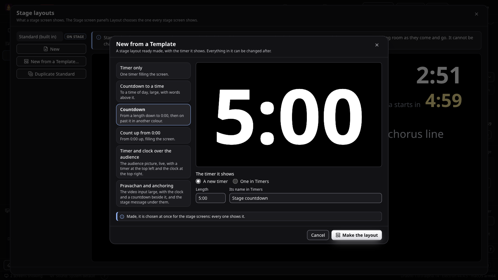

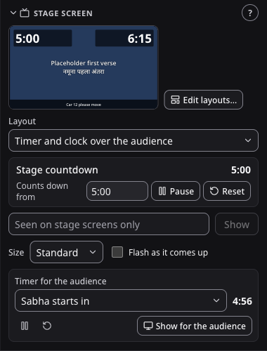

**Audio.** In the right column, under the live picture, **Audio** lists its audio playlists: sounds that play one after another, for before the sabha. **+** at its top makes one (**Create playlist**) or brings sounds in from the computer (**Import**); with none yet, it offers **Create playlist**, **Import sounds…** and **From a Link…** (a YouTube video's sound as an MP3, or a Dropbox link), and sounds dropped there start one. Sounds dragged onto an audio playlist, from the Finder (Explorer on Windows) or from the library's sheet, go into it. A folder imported as a playlist puts its sounds in an audio playlist of their own too, named after it with " - Audios" (the same sounds, not copies). **Play** starts a list; **Clear audio** along the bottom (or **F5**) stops whatever sound is playing. Under the lists, **Music steps aside for a video** (on to begin with) lowers the music under a video with sound, or under a slide's or a deck's own sound (**Music during the sabha**, below). Every video and sound plays at an even loudness (−16 LUFS, the level streaming services play at), in the hall and on the stream, its file never changed: right-click one and untick **Even loudness** to play it as it is.

**More tools.** Folded away at the end of the right column: **Lower Thirds** and the **MIDI controller…** (a pad, keyboard or foot switch mapped to Next, Back, Clear all, Black-out and the Wallpaper). Press **More tools** to open it or fold it again; each tool starts with a line saying what it does.

**Lower Thirds.** A name, a title or a place across the bottom of the picture, made in the **Lower Thirds** studio, a window of its own. In **Lower Thirds** (under **More tools**), **Studio** or **New…** opens it, and so does a lower third's pencil button, or a double-click on it. The studio lists the lower thirds down its left, with **New** and **Templates** (ready-made ones to start from) at its top. In its middle, a live preview plays the lower third in, holds it and plays it out, again and again, as the screens will: **Play again** starts it over, and **Behind the preview** is **Dark**, **Light** or **Picture**. Five tabs on its right set it:

- **Words**: up to three lines (a name, a title and a place, say), and **Where it shows**: **The hall's screens**, **The stream** or **Both**.
- **Style**: what **The words sit in** (**Box**, **Band across**, **Pill**, **Ribbon**, **Outline**, **Glass**, **Two colours** and more), the colours of the **Words** and the **Band**, a **Second colour**, **How solid the band is**, the **Font** (Gujarati and Hindi ones among them) and its **Weight**, the **Size**, left, centre or right (**Across the picture**), and how far **From the bottom**.
- **Animation**: how it comes in and how it goes out, each found by typing a word ("slide", "blur", "typewriter"). It goes out **As it came in, backwards** until you choose another way.
- **Background**: something **Moving behind the words**, such as **Colours sweeping**, **Light passing over** or **Shapes drifting**, in the band's colours.
- **Timing**: it **Stays up** **Until it is hidden**, or **For a set time** (5 to 60 seconds), then goes out by itself.

In the studio, **Save** keeps it, **Show** puts it up (**Save and show** when it has changes), and **Hide** takes it off, going out its own way. Choosing another, or closing the studio, with changes not saved asks first. **Delete** takes it away, and **Undo** brings it back. In the panel, the **Show** beside a lower third puts it up, and the same button, now **Hide** in LIVE's colour, takes it off; one with a set time shows its seconds ("5 s"), and its bin button deletes it, with **Undo**. **Clear all** (F1) takes it off at once with everything else, and **Put it back** brings it back (one whose seconds are over by then stays off); **Black-out** and the **Wallpaper** cover it, as they cover the slide. On a key and fill pair (for a video switcher), the key and the fill draw a lower third alike at every moment, as it comes in and goes out too.

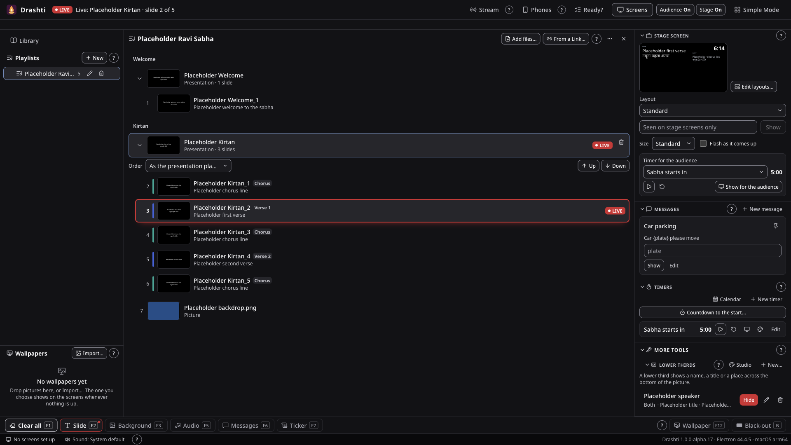

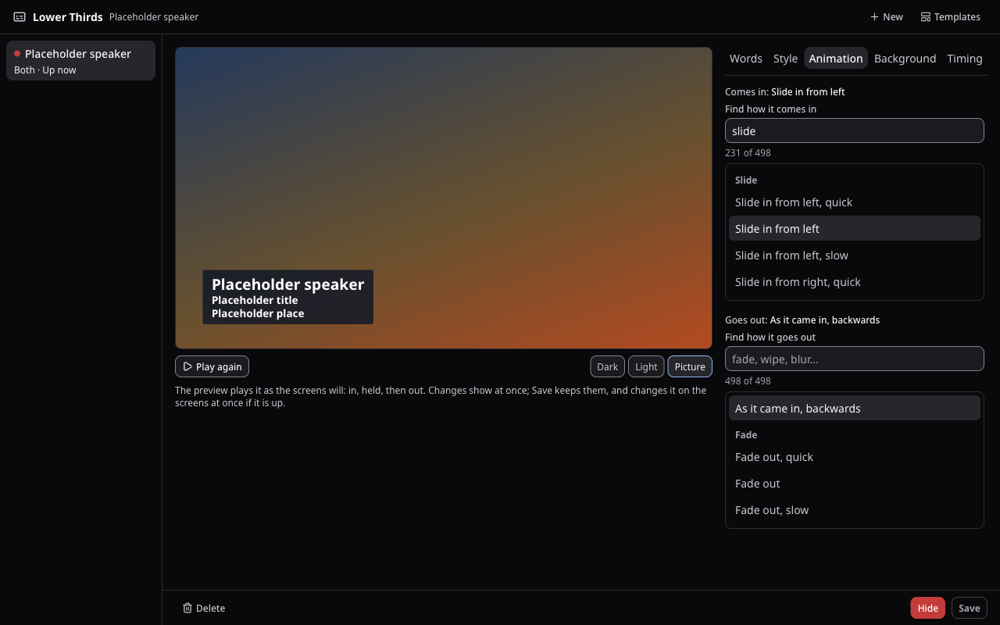

**Announcements from phones.** While the network is on, **Announcements** in the header says how many are waiting. Open it, read each one, fix a typo with **Edit**, then **Approve** it into the ticker or as a message, or **Reject** it.

**The phone remote.** In Pro Mode, a paired phone or tablet's remote has much of this window: LIVE's picture with its lines and time bars, the clear buttons in their order with their keys' names (the **Wallpaper** among them), **Back 15 s**, **Forward 15 s** and **Last 10 s**, the music with **Play**, the stage's layout, its message (its size, its flash, **Hide** and the last few) and its timers, timers for the audience, lower thirds, and the library's **Presentations** and **Media** (`docs/presenter-guide.md` has the phone's side). **Look closer**, or a tap on its live picture, shows the screens' picture full screen and sharp, to zoom with two fingers on the phone alone. While a picture is up on the screens (a picture slide, or a picture with no slide over it) and zoomed there on the phone, **Show this zoom on the screens** puts that zoom on every screen, as far as the screens can zoom, and **Back to Whole** undoes it, in Simple Mode too. **Look through** goes through a presentation's slides on the phone alone (a deck's click by click), and a picture or video in the playlist or **Media** has a button of its own to look at it, or play it, there; a picture's page, and a deck slide's, has **Save**. A phone’s Playlist shows the same slide rows under each presentation, PDF or deck; tap its name to fold them, or a slide to put it up once. Hold a row for its menu, including Rename, Remove and Undo where offered; in Pro Mode, pictures also have Save and the Picture editor, and videos have When it ends. Save offers the phone’s save/share route, or opens the picture to save there if sharing is unavailable. The Show page has the quick bar’s pinned actions, and More has the wallpapers, with their own choices and menus. On the Show picture, a clear one-finger swipe left is Next, and right is Back; vertical scrolling, a control being used and a two-finger pinch do not advance the show. The visible Next and Back buttons still work. A phone sets up this computer’s own things too (below); the Access List stays on the owner’s computer. Simple Mode’s exceptions are in section 9.

**This computer's screens from a phone** (since alpha.13). On a phone remote, **More** starts with **The Drashti computer**: **Audience** and **Stage**, and **Set Up Screens…**, which opens this computer's **Screens** on the phone: its displays as this computer sees them, the screen groups and each screen, changed as here. Turning **Audience** or **Stage** off asks **Turn Audience off?** on the phone first, as here, while its screens show something. A change that puts an output on the display with these controls asks **Keep these screens?** on that phone, with its countdown; nothing pressed, the screens go back by themselves. A phone never covers these controls by itself: when it would put an output on the display they are on, this computer asks **Cover the Drashti controls?** in its own box, and only **Cover the controls** here lets it. In Simple Mode a phone can turn a switch on, keep or go back, and change nothing else of the screens.

**The rest of this computer from a phone** (since alpha.13). Under them, **The Drashti computer** has: **Video inputs and windows…** (this computer's video inputs, named, changed and removed as **Media** does, choosing among the cameras this computer lists, and one put up as a click in **Media** puts it; another app's window from the list **Show a Window…** makes, by its name); **Picture in picture…** (a picture or video from **Media**, a video input, a window or the slides in the box, its corner and size, **Swap** and **Take off**); **Change the library…** (a presentation made from words; a playlist made, renamed or deleted; presentations and files from **Media** added to a playlist, moved up or down and taken out; each delete with **Undo**); **MIDI…** (the controller's device, chosen among those this computer lists; a mapping forgotten; **Learn**, which waits for a press on the controller here); and **Announcements…** (each waiting one put in the ticker or up as a message, or rejected; one on the screens taken off). The Mac's **Camera** and **Screen Recording** settings are answered here, never from a phone. In Simple Mode a phone is refused, in words, what this window refuses.

**Files and phones.** To let the phones look at a playlist's files, right-click the playlist and choose **Share with Phones and Tablets** (offered while a phone remote is paired): its row gets a mark, and the remote's **Library** has **Shared from Drashti** beside **Presentations** and **Media**, its files to look at and play on the phone only. **Stop Sharing**, in the same menu, ends it. With **Phones and tablets may add files** turned on in **Phones** (it is off until someone turns it on), the remote's **Media** has **Add from this Phone…** at its top: a picture, video, sound, PDF, PowerPoint (`.pptx`) or Keynote file, up to 2 GB, comes into **Media** and the playlist **Added from Phones**, marked with the phone's name. It never goes on the screens by itself, and a PDF, PowerPoint or Keynote file waits while the stream is on air or recording. Beside it, **Add photos** sends pictures from the phone's camera roll, several at once, to the end of the playlist open in this window (a phone's HEIC photos are converted by themselves), and the phone says which playlist that is; they never go on the screens by themselves either. With no playlist open (or a smart or Repeat Slides playlist) they go into **Added from Phones**. In Simple Mode a file from a phone, sent either way, goes to the end of Simple Mode's playlist instead (and into **Media**, or the library for a deck).

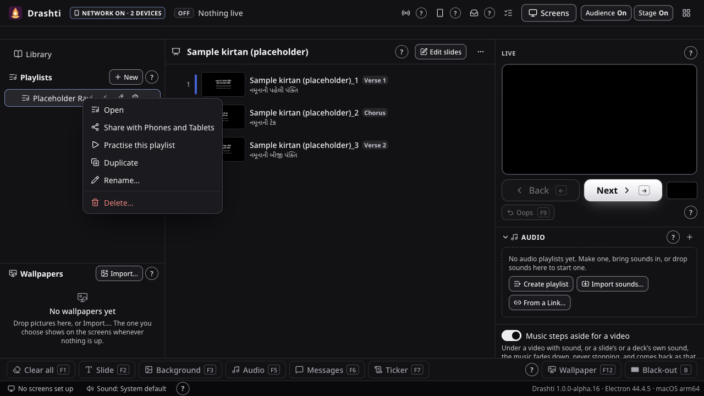

**Zooming the picture on the screens.** While a picture is up (a picture item, or a slide that is a picture, such as a PDF or PowerPoint page), scroll or pinch over the **LIVE** picture to zoom it and drag it to move it, or use **+** and **−** under it; on a touch screen, two fingers pinch and move it. Every screen follows smoothly, together. It lasts for that showing: the next slide comes up as it is kept. **Reset**, or a double click (or a double tap) on the picture, goes back; **Keep this zoom** (Pro Mode only) saves it with the picture, so it shows that way wherever it shows from then on. Simple Mode zooms too. A phone can put a zoom on the screens as well (**The phone remote**, above). A picture's zoom and enhancements are set once in the **Picture editor** (`docs/admin-guide.md`, section 10).

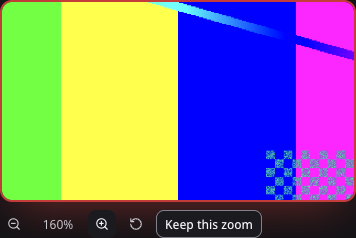

**The time bar.** While a video or a sound plays, a bar under **Back** and **Next** shows it, one for each thing playing: **Background**, **Slide video**, **Box video** (in the picture-in-picture box), **Sound**, or **Music** for an audio playlist's track (which has its bar in **Audio** too). Before the bar is the time played, after it the time left; its start and end points are short upright lines, and its markers are ticks. In a video's last 10 seconds its times turn amber. Click or drag along it to move there: while you drag it shows the time, and it moves once, as you let go, on every screen, the second computer, the stream and the sound together. **Play** and **Pause** are at the start of its row. With the keyboard on the bar, **→** and **↑** move it 5 seconds on, **←** and **↓** 5 seconds back, **Page Up** and **Page Down** 30 seconds on and back, and Home and End go to its start and end points; there they never change the slide. Simple Mode shows the bar and the time left, with **Play** while something is paused, so nothing stays paused there; nothing in Simple Mode, not even a phone, moves what plays, jumps it (**Back 15 s**, **Forward 15 s**, **Last 10 s**) or pauses it; the same refusal applies to a phone’s marker jumps. A video on a slide can show a thin play bar on the screens too, along its bottom, with its time: turn on **Show the play bar on the screens** for it in the slide editor (it is off to begin with).

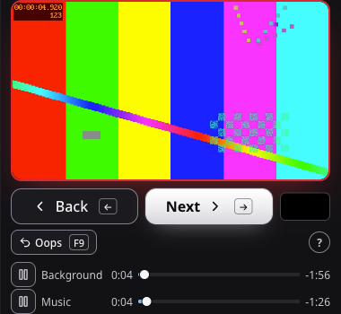

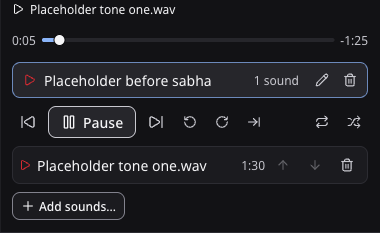

**Markers.** While a video or a sound with markers plays, its markers are buttons under the live picture: a press jumps every screen and the sound there together. A video's start and end (where it plays from and to) are set on its timeline: **Trim (start, end and markers)…** in its row's right-click menu, or its row in **Media** (`docs/admin-guide.md`, section 10). It plays between them as the background and on a slide (its sound too), on every screen alike: going round between them if it loops, or stopping at its end point if it plays once. In the picture-in-picture box, swapped or not (section 7), it goes round between them. The marker buttons, and the jumps below, are for the background's video and a sound alone. **Trim black and silence**, in a video's right-click menu, sets its start and end points past any black and silence at its start and end (only where it is black and silent at once), with **Undo**; a video brought in with **From a Link…** has it done by itself. The file is never cut, and the points can be changed after.

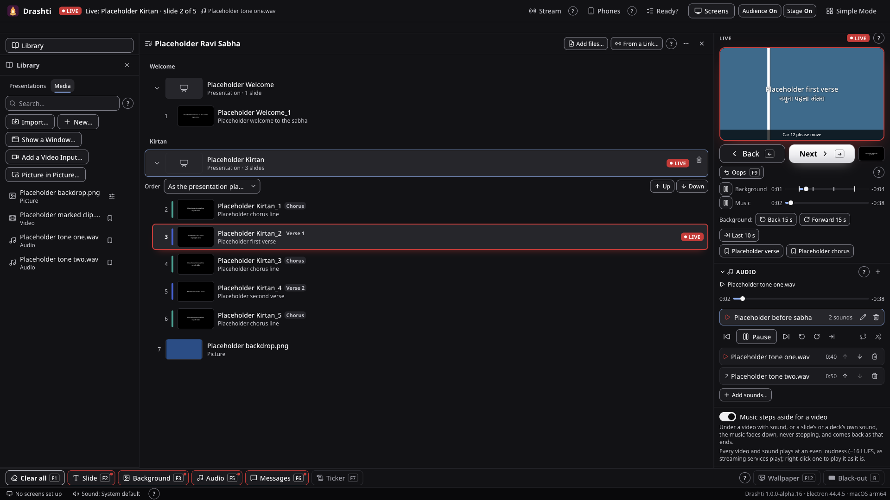

**Back 15 s, Forward 15 s, Last 10 s.** While a video plays as the background, or a sound plays on its own, its row under the live picture (**Background:** or **Sound:**) has **Back 15 s**, **Forward 15 s** and **Last 10 s**, before its markers; for an audio playlist's track they are in **Audio**, in the row with **Play** and **Pause**, as three small buttons after the next track's (the mouse over one names it). Each is a jump, as to a marker: every screen and the sound land there together, in step. They never go past the file's start or end (or the start and end points set on its timeline): **Back 15 s** in the first 15 seconds goes to the start, **Forward 15 s** in the last 15 seconds goes to the end, and **Last 10 s** on a file shorter than 10 seconds goes to the end. At the end, what always happens there happens: a looping video goes round, a file played once stops at its end (and **Back 15 s** there plays it again at once, on every screen together), and an audio playlist goes on to its next track. While the music is paused, they move the place where **Play** starts it again. They are dimmed until Drashti knows how long the file is (most files are measured as they come in).

**Music during the sabha.** A sound, or an audio playlist, keeps playing whatever goes up: a picture, a video (whose own sound plays too), a PDF's page or a deck's slide. A sound's row clicked while a PDF or a deck is up plays the sound, and leaves the slides, and **Next**, where they are. Under a video with sound, or a slide's or a deck's own sound, the music fades down (by about 14 dB, over a second), never stopping, and comes back up when that ends or is cleared: turn **Music steps aside for a video** off, in **Audio**, to keep it as loud. A slide whose sound file is missing leaves the music as it is (**File missing**, in section 3). **Clear audio** (the **Audio** button along the bottom, or **F5**) stops it, and **Put it back**, pressed at once, brings it back where it would be by now.

## 3. When something goes wrong

**The controls are covered by an output.** Press **Cmd+Shift+U** (Ctrl+Shift+U on Windows): every output over the controls turns off. It works even when Drashti is not the active app. Straight after a change made by hand that put it there, that output asks **Keep these screens?** in its middle: Esc goes back to the screens as they were. **Cmd+1** and **Cmd+2** ask there too ("Turn Audience off?"): Enter turns them off, Esc cancels.

**A screen shows the computer's desktop, or the stage shows the hall's picture.** **Audience** (or **Stage**) may be off: the status bar then says **Audience off** (or **Stage off**). Press **Turn on** there, or **Cmd+1** (**Cmd+2** for the stage screens), and they come back as they were.

**A mistake on the screens.** Put the right row up with a click, press **←** (the slide before), or press **F9** (**Oops**) to put back what was there before the last change. After **Clear all** by mistake, press **Put it back** at once.

**A screen is black or frozen.** Open the screens dashboard: its picture shows what that screen really shows. Pro Mode can **Reload** it there. Drashti also restarts a screen that stops drawing by itself, within about 10 seconds. If a screen kept failing, a red notice at the top of the window says so ("“Main Hall 1” has stopped"), in Pro Mode and in Simple Mode, and the status line says **stopped**: Drashti tries it again every few minutes, and **Try again** on the notice (or in **Screens**, **Cmd+Shift+S**) tries at once. The notice goes by itself when the screen is back, or when you close it. If a whole output computer stopped (a node offline), carry on: its screens keep their last picture, and it comes back by itself when the network does.

**No sound in the hall.** Check the status bar: it says where the sound goes and warns when the chosen output is missing (Drashti then plays on the computer's own speakers). Check the mixer's channel.

**No sound on the stream.** While on air or recording, the header shows **No sound** beside ON AIR when nothing has reached the stream for 20 seconds (or 3 seconds after its microphone was unplugged), and a yellow notice under the header says what to check: the microphone, its cable and the sound desk. It goes by itself as soon as sound comes back. Drashti never changes the microphone by itself; choosing another is in Stream settings (Pro Mode).

**The stream's picture has stopped.** A red notice under the header says so when the stream's own page kept failing (six times in a minute), in Simple Mode too: the stream shows its last picture. Press **Try again**; if it stops again, tell whoever looks after Drashti.

**A red notice says Drashti couldn’t read the playlists, this playlist, a presentation or what the screens are showing.** The screens keep what they show. Press **Try again** on the notice; it goes by itself once Drashti can read it. Until then Simple Mode’s **Next** says it has nothing to start, and while Drashti can’t read what the screens are showing (it asks again by itself for a few seconds first), Next, Back and the clears wait. If Try again doesn’t work, tell whoever looks after Drashti.

**The stream says Reconnecting.** Do nothing: Drashti tries again by itself and the recording carries on. The hall's screens are not affected. If it also says **the stream server's certificate could not be checked**, waiting will not help: tell whoever looks after Drashti (the admin guide, section 12).

**Font not on this computer.** Beside LIVE (and on the screens dashboard, for the screen it is about) this names a font the live slide uses that the computer does not have: its words show in another font. Carry on, and tell whoever looks after Drashti afterwards (the admin guide, section 11).

**File missing.** Under the live picture, **File missing: “…”. The background stays as it was.** names the picture or video behind the live slide that Drashti cannot find: one not found when the slide was imported, or one deleted from **Media**. Nothing goes up for it: the background stays as it was, never black because of it. That slide's row in the middle says **Missing**, Simple Mode says the same, and if Drashti closes by itself, the slide it puts back says so again. **File missing: “…”. The sound stays as it was.** names the live slide's sound that Drashti cannot find, for the same reasons. Nothing plays for it: the sound or music already playing carries on. Simple Mode says it too, and so does the slide put back if Drashti closes by itself. Before it goes up, that slide's small picture in the middle says **Missing** with the sound's mark in its bottom left corner (a missing background's is in its top left), the slide editor says so under the slide's sound, and Simple Mode's **Next** names it. Carry on, and tell whoever looks after Drashti afterwards: once the file is found (**Find missing media…** in the import report), or a deleted one imported again, the line goes, and the slide shows or plays it the next time it goes up.

**Drashti closed by itself.** Start it again: it puts back what was on the screens (the slide, the background, sound, timers, a timer for the audience, messages, lower thirds and the picture-in-picture box) and says so at the top. A video (the background's, or one on a slide, or in the picture-in-picture box) or a sound carries on where it would be by now, between its start and end points; the background's video and a sound count from their last jump (a marker, **Back 15 s**, **Forward 15 s** or **Last 10 s**). Under LIVE, the slide put back names again a file still missing (**File missing**, section 3) or a video input this computer does not have (**Video input not on this computer**, section 6). A video input, as the background or in the picture-in-picture box, is put back while it is still in **Media**; if a screen then finds no camera of that name (unplugged, say), it comes off again (the box with it) within 20 seconds, and the note at the top names it. One no longer in **Media** is not put back, and the note names it too. If Drashti was on air less than 5 minutes ago, it goes live again by itself. This happens only within 3 hours of the stop: started later than that (the next morning, say), Drashti puts nothing on the screens, and the note at the top says what was live and when. Within those 3 hours it also comes back in the mode it was in (Pro Mode or Simple Mode); started later, it starts as after a quit on purpose. After Drashti was quit on purpose, it always starts with nothing on the screens. And if it stopped while **Keep these screens?** was waiting, it starts with the screens as they were before that change, and a notice says so. Whatever it puts back, a phone's or tablet's remote and a stage display left open carry on by themselves once Drashti is back, showing what is up now: no need to reload their pages; after an update that needs it, such a page reloads itself once.

**A lock screen in place of the window.** Drashti opens only on a computer that whoever looks after Drashti has let in, for a Gmail they have let in. It asks the access list as it starts (in the background, within 15 days of an answer that let this computer in), every 15 seconds while it runs, and at once when the network comes back. On a computer not let in yet, it shows a lock screen, **Let this computer in**: ask whoever looks after Drashti. Under **Request Access**, type your Gmail and press **Request Access**; once they approve it, an email brings you a token, and says what you may use (Pro Mode and Simple Mode, or Simple Mode only). Then, under **I Have a Token**, type that Gmail and the token, and press **Let This Computer In**. A token works once, on one computer, and runs out after 3 days. **Quit Drashti** always works there.

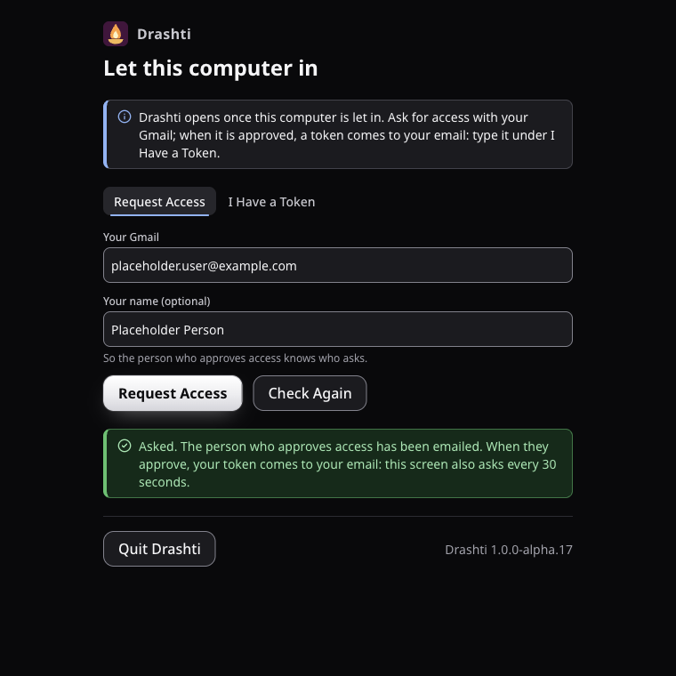

**Simple Mode only.** Whoever approves access gives each Gmail Pro access (Pro Mode and Simple Mode) or Simple access (Simple Mode only). With Simple access, Drashti opens in Simple Mode and stays there: **Simple Mode only on this computer** shows where **Pro Mode** would be, **View** has no way to Pro Mode, and nothing on this computer, a phone or a MIDI pad reaches what Simple Mode refuses. A change they make reaches this computer within 15 seconds while it is online: moved to Simple access, Drashti goes to Simple Mode; given Pro access again, it goes back to Pro Mode by itself if its access had put it in Simple Mode.

**No internet.** If Drashti can't reach the access list while it runs (no internet), it keeps working, for up to 15 days from the list's last answer. After about 2 minutes without an answer, one line under the top bar says so and counts down, **Can’t reach the access list: Drashti keeps working for 14 days 6 hours more.**, with nothing in the window moving for it. The show carries on: the screens, the sound, the second computer and the phones, and the stream waits and carries on by itself once the computer is online again, while the recording keeps going. Get the internet back (the mandir's wired connection, or a phone's hotspot as the spare): Drashti asks the list the moment the network comes back, and the line goes with its answer. Started with no internet, Drashti opens at once within those 15 days. Once they are up, it stops, as below.

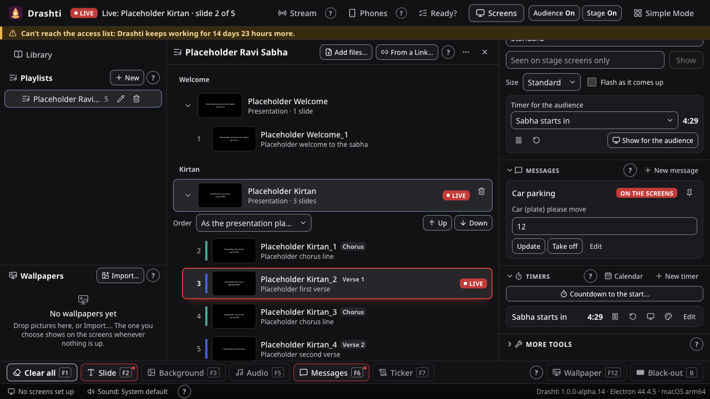

**When your access ends.** Whoever approves access may give a Gmail access for a length of time (a mandir computer's is Unlimited, with no end). From 7 days before it ends (at once for a shorter length), a bar under the top bar says when: **Your access to Drashti ends on …**, with how long is left. It never covers a control. Ask whoever approves access for more time before then: the bar goes once they give it. When the time is up, Drashti stops as below, saying **Your access to Drashti has ended**; once they have given more time, start Drashti again.

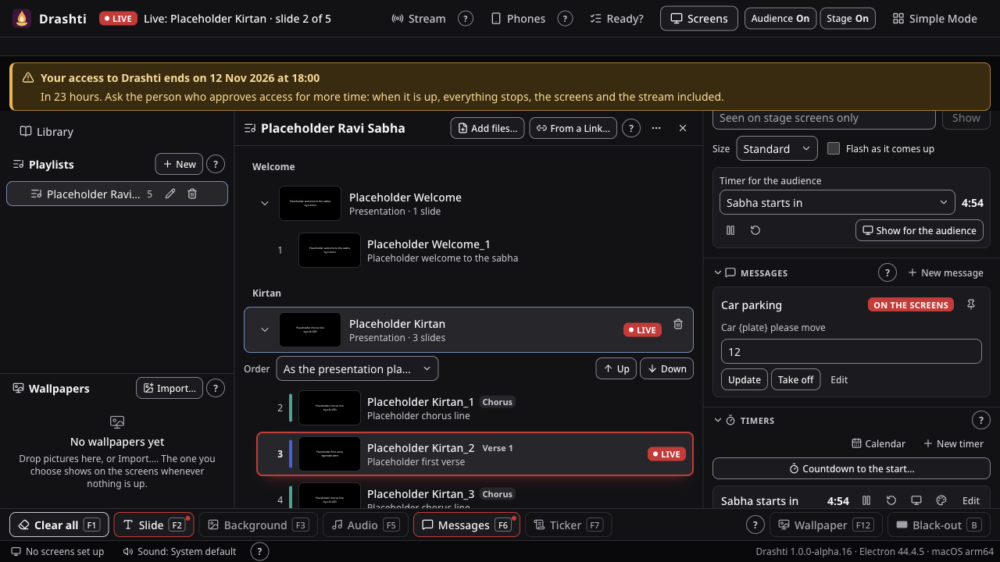

**Drashti has stopped everything.** If this computer's access is removed or has ended, or 15 days pass without an answer from the access list, Drashti stops at once, saying so in place of the controls (**Your access to Drashti has been removed**, **Your access to Drashti has ended**, or **Drashti could not check your access for 15 days**): every screen fades to black, the stream and recording end, imports, conversions and downloads stop, the second computer and the phones stop too, and only **Quit Drashti** works. Once the screens have faded, a screen that covered the controls is turned off, so the message is always in view: switch it on again in **Screens** once Drashti is let in again. After 15 days without the internet, this computer's access has ended: connect it to the internet, start Drashti again, and ask for access again with **Request Access**. Otherwise, tell whoever looks after Drashti. If the sabha must go on meanwhile, fall back to the old program (below).

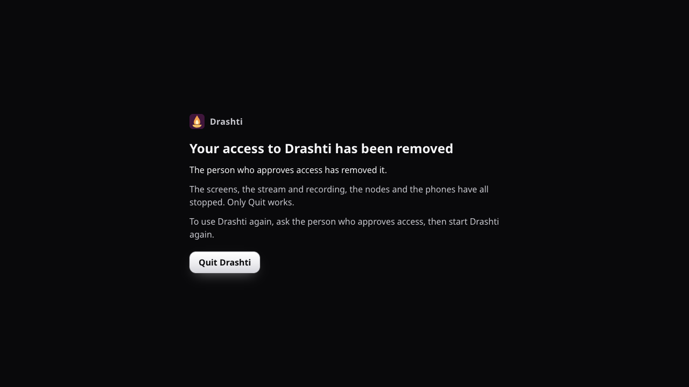

**When to fall back to the old program.** If Drashti cannot keep the screens right, the named fallback operator quits Drashti (**Cmd+Q**, or close its window on Windows) and opens the mandir's old presentation program, as practised (`docs/parallel-run.md`, section 9). Then save diagnostics (below) for whoever looks after Drashti.

## 4. After the sabha

1. **The stream**: **End the stream…**, then **End the stream**, and **Stop recording**. End the broadcast in YouTube Studio too.
2. **F1** (Clear all), so nothing is left up.
3. If anything went wrong, **Help**, then **Save Diagnostics…**: a file appears on the Desktop. Send it to whoever looks after Drashti with the time and what you saw. It holds no kirtan words, names or file paths. If Drashti asks about crash files, leave **Include crash files** unticked unless whoever looks after Drashti asks for them: they can hold words from slides.
4. Quit Drashti, or switch to Simple Mode for the next volunteer (**View**, then **Switch to Simple Mode**).

## 5. Zoom

Drashti works with Zoom both ways, and needs nothing paid for it: no Zoom account of its own, no paid Zoom plan, and nothing installed but Zoom itself. A free Zoom account keeps Zoom's own 40-minute limit on meetings of three or more people.

**Zoom sees the stream's picture.** For a meeting that should see what YouTube sees (a sabha shared with another mandir, say):

1. In the **Stream** panel, press **Window for Zoom…** (or **View**, then **Window for Zoom…**). A window called **Drashti for Zoom** opens with exactly the stream's picture: the camera with the words as a lower third, or the slides, as the stream's layout says, whether or not the stream is on air. Nothing else is drawn on it: no buttons, no words of Drashti's own.
2. Leave it open where it can stay (beside the controls, or on a spare display), never minimised: Zoom shares only an open window. Make it bigger or smaller from a corner: it keeps the picture's shape, and opens there again next time. It never goes full screen or covers a display by itself.
3. Zoom's microphone: in Zoom, beside **Mute**, choose the mixer's input, the same one the stream uses. For kirtans and music, turn on Zoom's **Original sound for musicians** (Zoom's settings, **Audio**). Drashti sends no sound to Zoom.
4. In Zoom: **Share Screen**, choose the **Drashti for Zoom** window, then **Share** (leave **Share sound** off).
5. To stop: **Stop Share** in Zoom, then close the window. Closing it changes nothing on the screens or the stream.

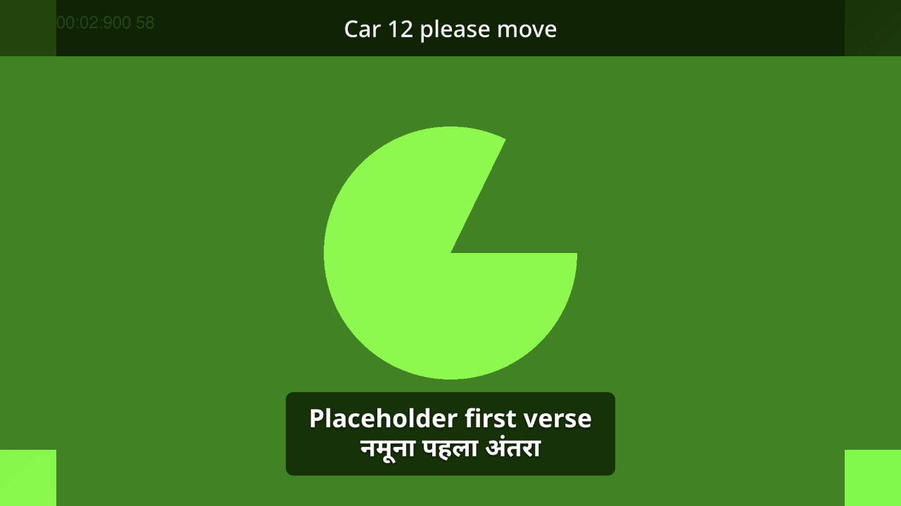

**The meeting on the hall's screens.** For a speaker who joins by Zoom, shown live in the hall:

1. Join the meeting in Zoom first, and leave Zoom's window open (not minimised) the way the hall should see it: speaker view or gallery view.
2. **Library**, then **Media**, then **Show a Window…**. It lists the other apps' open windows, each by name with a small live picture: never a whole screen, and never Drashti's own. On a Mac, the first time, it says why it needs **Screen Recording** and opens System Settings, where it is turned on (`docs/admin-guide.md`, section 4).
3. Choose Zoom's window (usually **Zoom Meeting**), look at its small picture (never an inbox or a chat), and press **Show on the screens**. Nothing goes up before that.
4. It is now the background, fitted in with black around it: slides, a lower third, messages and the ticker go over it as over a video. **Black-out** and the **Wallpaper** cover it; **F1** (Clear all) or **F3** (the background) takes it off; **Put it back**, straight after Clear all, brings it back while the window is still open. The stream shows it wherever it shows the hall's background. Stage screens say **Window on the screens**, and an output node's screens (another computer's) show the rest of the show without it, as the screens dashboard says.
5. Its sound: none from Drashti. The meeting's sound reaches the hall through the mixer, as now.
6. If Zoom's window is closed, minimised or hidden, the screens keep its last picture and a yellow notice under the header says so: open the window again to carry on live, or press **Clear the window**.
7. After Drashti stops unexpectedly, the window is not put back (it may be gone): the note at the top names it. Show it again with **Show a Window…**.

The phone remote names it (**A window: Zoom Meeting**), and its **Clear** takes it off; a phone can never choose a window. In Simple Mode, **F3** and **Clear all** take it off too, but only Pro Mode can show one.

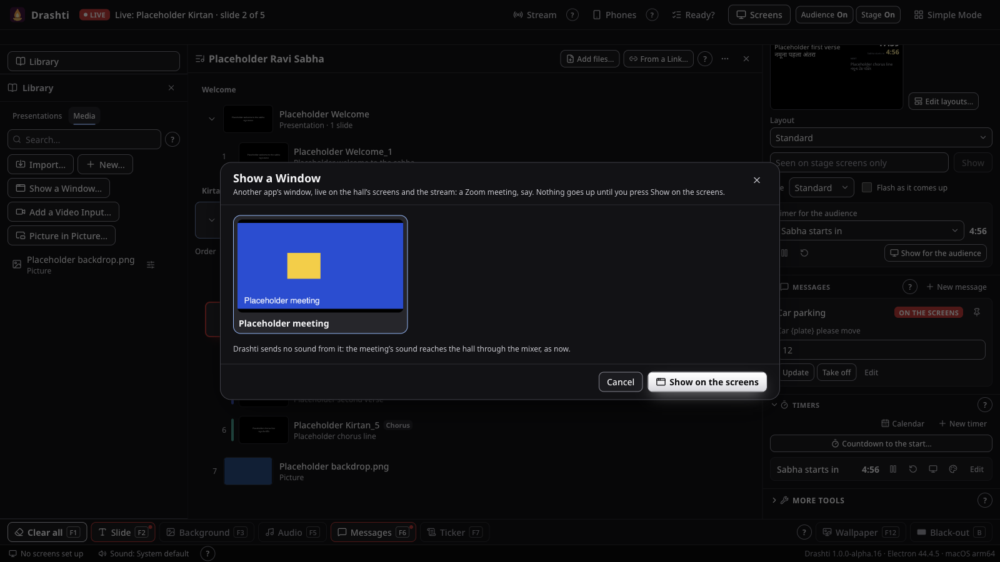

## 6. Video inputs

A **video input** is a camera or a capture input on this computer: the video mixer's program through its USB output, say. It is named once, for example "Input 1" (**Library**, then **Media**, then **Add a Video Input…**; `docs/admin-guide.md` has the details), and from then on it is one click away.

**A warning.** If the mixer's program is Drashti's own picture, showing the mixer's program in Drashti makes a picture inside itself, over and over. Use it while the mixer shows a camera.

1. **Library**, then **Media**: **Video inputs** lists them above the files, each with its own small live picture and a line saying how it sits on the screen (or why it has no picture now).
2. Click it ("Input 1", say). It fades in as the background, and the slide's words, a lower third, messages and the ticker stay over it. Nothing goes up before that click.
3. It shows on **LIVE**, on the hall's screens and in the stream's **Slides** layout: YouTube sees what the hall sees. **Camera and words** keeps the stream's own camera. Stage screens say **Video input on the screens**, and an output node's screens (another computer's) show the rest of the show without it, as the screens dashboard says.
4. **Black-out** and the **Wallpaper** cover it. **F1** (Clear all) or **F3** (the background) takes it off; **Put it back**, straight after Clear all, brings it back.
5. Its sound: none from Drashti. The hall's sound comes through the mixer, as now. A mixer's USB output is also a sound input, so it can be chosen as the stream's **Sound input** in Stream settings.
6. If it stops (its cable out, or another app using it), the screens keep its last picture, and a yellow notice under the header says so, with **Clear the input**. It comes back by itself when the input returns. If the notice says the computer no longer lets Drashti use the camera, tell whoever looks after Drashti.
7. After Drashti stops unexpectedly, it is put back if it is there; if it is not, the note at the top names it.

**In one press, under LIVE.** On a computer with a video input in **Media**, a button under the time bars names the input chosen in **Stage screen**'s **Video input** ("Input 1 on the audience"): it puts that input up as the hall's background, the slide staying over it, and pressed again takes it off, bringing back what was there. The stage screens never follow it: they show their own layout (a **The video input, live** box shows the same input, from the same feed, with no extra delay), or with **Stage** off the audience picture.

**In a playlist.** An input goes in a playlist as a picture or video does: in **Media**, right-click its row and choose **Add to “…”**, which names the open playlist, or drag the row onto a playlist; neither puts it up (a plain click on the row in **Media** does). Its row in the playlist says **Video input**. One click on that row puts it up as the background, coming on over 1 second, and takes the slide off, as a picture does; so does **Next** coming to it.

**Behind a slide.** In the slide editor, under **Behind it and with it**, **Choose** (or **Change**) beside the background lists **Video inputs on this computer** above the pictures and videos. Choose one, and the slide says **Background: the video input “Input 1”**; its row in the middle names the input too. When the slide goes up, the input comes on behind it over 1 second, and the slides after it with no background of their own keep it.

**On a computer without it.** A playlist and a slide keep the input by its name, as the library travels: on another computer, that computer's input of the same name goes up (name them alike). Where no input has that name, the row says **Not on this computer**, and **Next** goes on past it to the next item (with that row chosen, Next says the input is not on this computer). A slide naming one goes up with the background left as it was, never black because of it, and LIVE says **Video input not on this computer: “Input 1”. The background stays as it was.** If Drashti closes by itself, the slide it puts back says so again. Renaming an input in **Media** (**Change** on its row) takes this computer's playlists and slides with it, to the new name, and what is on the screens carries on. Another computer still finds its own input by the name: give that computer's input the same new name too, or there they say **Not on this computer**. The **Change** dialog says both, under **Name** and **Fit**.

The phone remote names it (**Video input: Input 1**), and its **Clear** takes it off; a phone never chooses one, but tapping a playlist's video input item, or **Next** coming to it, puts it up. In Simple Mode, **F3** and **Clear all** take it off too, and **Next** (or a click on its row) puts up a playlist's video input; only Pro Mode can choose one in Media. The input on the screens can't be deleted from Media until it is taken off.

## 7. Picture in picture

Something small in a corner of the hall's screens while the main picture carries on: a camera, a picture or video, another app's window, or the slides.

1. **Library**, then **Media**, then **Picture in Picture…** (beside **Show a Window…** and **Add a Video Input…**).
2. Under **What goes in the box**, choose **The slides** (made small: the main picture shows the background, messages and the ticker without them), **A video input**, **A picture or video** (from Media) or **A window** (another app's, as **Show a Window…** offers).
3. **Where it sits**: a corner. **Size**: **Small**, **Medium** or **Large** (a quarter, a third or two fifths of the screen's width). Then **A thin border**, **Rounded corners**, and **How it comes on and goes off**: **Fade**, **Scale** or **Slide in from its corner**.
4. **Show in the box**: nothing goes up before that. With a box up, **Put this in the box** changes what is in it, and the other choices change it on the screens at once.
5. Under **LIVE**, a line names what is in the box (**Picture in picture** and its name), with **Swap**, **Take off** and its settings. Drag the box in **LIVE** to put it anywhere on the screen; let go near a corner and it goes into that corner.
6. **Swap** changes them over: with the slides in the box, the slides fill the screen and the background goes small; with anything else, it takes the background's place, under the slides, and the background goes in the box. The main picture dissolves from one to the other while the box makes its own move, never a cut and never black: the main picture never grows, shrinks or slides. **Swap** again changes them back.
7. **Black-out** and the **Wallpaper** cover it. **Clear all** or **Take off** takes it off, and **Put it back**, straight after Clear all, brings it back (a video input in it as Media has it now: one taken out of Media meanwhile stays off).
8. The box makes no sound: a video in it plays without its sound, going round between its start and end points (**Markers**, in section 2), swapped or not.

The stream shows it whenever it shows the hall's picture: in its **Slides** layout, and in **Camera and words** while a picture or video fills the stream in the camera's place (never over the stream's own camera). Every audience screen shows it; a key and fill pair leaves it out. An output node's screens show a picture, a video or the slides in the box, but not a video input or a window. Where the box sits and how it looks are remembered for next time. After Drashti stops unexpectedly, the box comes back with the rest of the show. A video input in it comes back while it is still in **Media**; if a screen then finds no camera of that name, the box goes off again with its usual move (within 20 seconds), and the note at the top names the input. One no longer in **Media** is not put back, and the note names it too. The phone remote names it, and its **Take off** takes it off; a phone can't set one up. In Simple Mode the line under the live picture names it with **Take off**, and **Clear all** takes it off too, but only Pro Mode can set one up, swap it or move it.

## 8. Keys at a glance

In Drashti, **Help**, then **Keyboard Shortcuts…** (or press **?** when no field is chosen) lists every key, as your computer writes it. They follow what the operators already press (**The keys that moved**, in section 2). At its top, the switch **Single-letter keys** turns **B**, **.** and **?** off, for someone who works the computer by speaking to it or with a switch, so that a word said never blacks out the hall. Then those three keys do nothing, the list says **Off** beside them, the wallpaper keeps **F12**, and **Black-out** and **Wallpaper** work from their buttons, a MIDI pad and the phone remote as always. The full key card, including the slide editor's keys, is at the end of `docs/parallel-run.md`. Going live, ending the stream and recording have no keys: always the buttons, and always a question first.

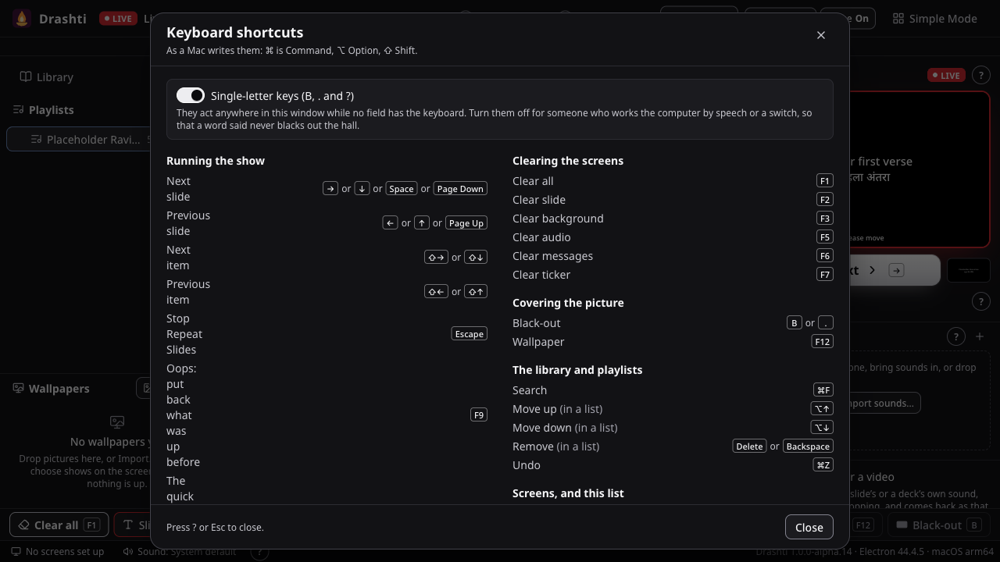

## 9. Simple Mode, for a sabha with one projector

Simple Mode is this window with only what a small sabha with one projector needs, for a volunteer: the one playlist in the middle, the wallpapers on the left, and on the right **LIVE**, **Next** and **Back** and the time bar, with the keys in a line under them; along the bottom, **Clear all**, **Wallpaper** and **Black-out**. It has no stream, no stage screen, no messages, timers or lower thirds, and no screens to set up: a display plugged in sets itself (above). The first time it opens, three short first steps under the top bar say what it is; **Skip** puts them away.

**Switching to it.** Open the night's playlist, then double-click **Simple Mode** at the top right (one click only says to double-click it; or **View**, then **Switch to Simple Mode**). Simple Mode works on that playlist; with none open, it makes a new one, "Sabha, " and the day's date, at the top of the list (or uses again an empty one it made before). After a restart it opens the same playlist. If that playlist was deleted, Simple Mode makes a new, empty one, named apart from the deleted one ("Sabha, 30 Oct 2026 (2)"), so it is never taken for the deleted one come back.

**Running the sabha in it.** One click on a row puts it up, as in Pro Mode: a slide of a PDF or deck, a picture, a video or a sound. A click on a presentation's name folds its slides and chooses it, and **Next** with nothing up starts the chosen one (else the first row that plays). **Next** and **Back** (and their keys, a clicker's too) go on from there, and what **Next** will put up is said in words under them. Type a row's number and press Enter to put that row up. Drag a row to move it, and **Undo** puts it back. A playlist made from a folder shows whole, a header before each folder. **Clear all**, its **Put it back**, the **Wallpaper** and **Black-out** are along the bottom; **F9** (Oops) works too, with no button. Music started in Pro Mode plays on, shown in the time bar, until **Clear all** or **F5**.

**Bringing things in.** **Add files…** and **From a Link…** above the playlist, or files dropped on it (on a row they go there, anywhere else at the end). Simple Mode brings in sounds, videos, pictures, PDFs and PowerPoint or Keynote decks; anything else is left out, and a line says why. A file changed since it first came in is kept beside the old one, never in its place. **From a Link…** always brings it into this playlist, and a Dropbox folder's files go at its end, a header before each folder in it.

**Changing the playlist.** Right-click a row (or press **Shift+F10** with the keyboard on it) for **Rename…** and **Remove from playlist** (it asks first while that row is up; **Undo** brings it back). The wallpapers work as in Pro Mode: **Import…**, a click to use one (and again for none), pictures dropped on one to make them go round, and its right-click **Rename…** and **Delete…**; **Edit wallpaper…** (their order, seconds and fade) is Pro Mode's. **Edit**, then **Undo** (**Cmd+Z**), puts back what **Clear all** took off, straight after it, or else the last row removed, renamed or moved.

**The phone in Simple Mode.** Pair and enable the phone in Pro Mode first. When the computer changes to Simple Mode, the phone opens its own playlist and explains once why it shows less, naming that playlist; Next and Back, its rows, Clear all, Black-out and the Wallpaper still work. Hold one of its rows for Rename or Remove, with Undo; the wallpapers can be chosen, renamed or deleted too, while their editor is Pro Mode’s. Play resumes content already paused, but Pause and marker jumps are refused, as are seeking, starting another music playlist and the Pro-only messages, timers, lower thirds, editing and setup controls. The phone hides those tools or dims the unavailable action, and a request sent from an older page is refused in words. With Simple-only access it says so; with Pro access, switch the computer back to Pro Mode to use those tools again. A file the phone sends, with **Add photos** or **Add from this Phone…**, goes to the end of this playlist (and into Media, or the library for a deck) and never goes live by itself; a PDF or deck waits until the stream and recording have ended.
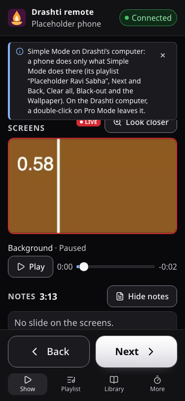

**Back to Pro Mode.** Double-click **Pro Mode** at the top right: nothing to type (one click says so). With the keyboard on it, press Enter twice; **View**, then **Switch to Pro Mode**, switches at once too. Where **Simple Mode only on this computer** shows instead, this computer's access is for Simple Mode only (**Simple Mode only.**, in section 3).

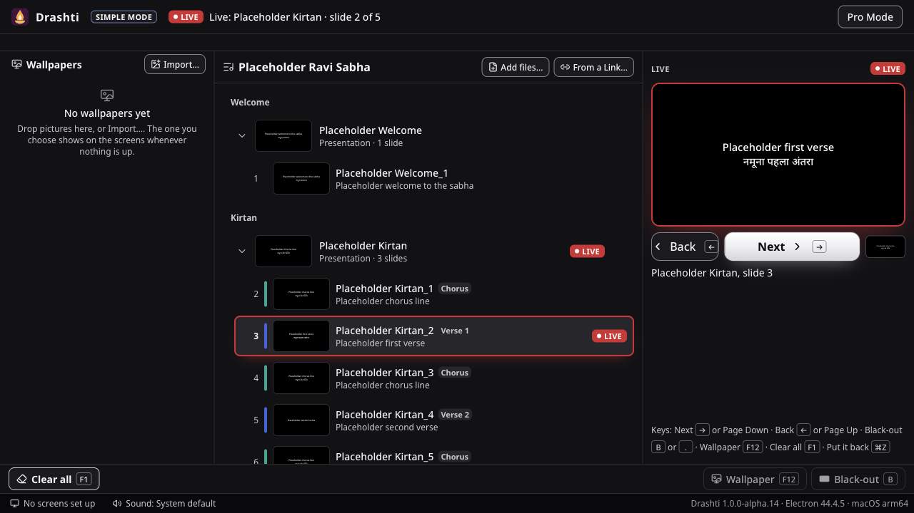

## 10. Editing slides in its own window

**Edit slides opens its own window.** In Pro Mode, right-click a presentation or one of its slides and choose **Edit slides…**, or use **Edit slides** beside its name. A double-click on a presentation’s slide puts it up once, then opens the editor there. The operator window keeps the show controls; the editor has six groups along the top: **Words**, **Insert**, **Arrange**, **Design**, **Motion** and **Slides**. Choose a slide on the left and something on its canvas to change it; **Tab** and **Shift+Tab** choose the next or previous thing. Bare show F-keys pressed in the editor still act on the show, so use them with the same care as in the operator window.

**Keep the last words, and save.** Double-click words to type, or use **Enter while a text box is selected in the editor**. Undo and Redo take back typing and gestures inside the editor; **Save** keeps the presentation as one operator Undo, so you can take back that saved change from the operator window too. Save waits while a chosen image or video is still being read. Native window close and a presentation switch include unfinished typing before asking **Save changes**, **Keep editing** or **Throw them away**; do not assume the last word must lose focus first. If saving would change what is on the screens, the question says so. **Esc** stops typing first, then lets go of the selection, then closes with the same protection.

**Words: type and change the words.** Choose a whole text box, or select only some words while typing, then use **Words** for the font, size, colour, bold, italic, underline and strike, alignment and spacing, lists, shadow, outline and glow. Drashti’s bundled fonts work on the other computers and phones without installing them there. Keep each language in its own box where the slide uses language-specific placement; a selected run changes only those words. **Find and replace** searches the presentation, including its shared master once. A change of layout preserves the words and the other objects already on the slide.
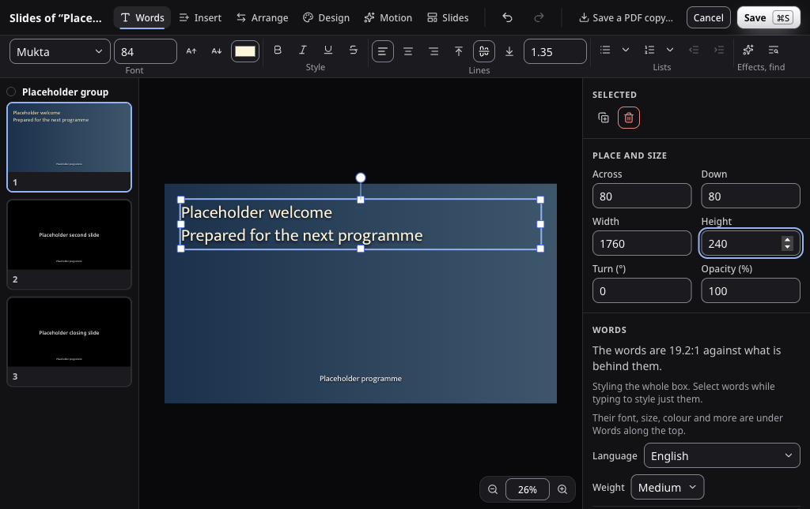

**Insert: add something to the slide.** Add an editable text box; a rectangle, rounded rectangle, ellipse, line, arrow, triangle or diamond; a picture or video from the library; a sound for this slide; or a live timer. Sound is a cue that plays when the slide goes up, rather than a visible box. A timer can reuse one in Timers or make **New timer…**; Undo of its box takes the box away, while the reusable definition remains in the Timers panel. Selecting a picture or video can take a moment to read its size; let the picker finish, or press Save and let it wait.

**Tables and icons.** Insert’s table makes up to 10 rows and 10 columns as ordinary text cells and bordered shapes, grouped together. Double-click a cell to change its words; the whole table is selected again when typing ends. Move, resize or turn the group together; **Ungroup** lets you change the separate cells and shapes. Icons begin with **Star**, **Heart** and **Check mark**, editable geometric shapes with fill, outline and opacity.
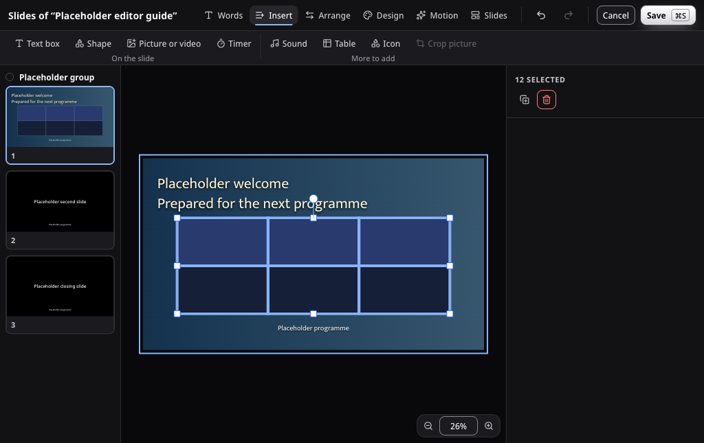

**Crop only this slide.** Select a picture on the slide, then **Crop picture**. Set the percentage cut from each of its four edges; **Whole picture** resets it, and Undo puts a change back. This crop changes only this placement: the library picture and its other uses keep their own look. For a picture’s library-wide turn, flip and enhancements use the **Picture editor** instead.

**Arrange a group or a selection.** Shift-click adds or removes a selected thing; drag a selection box to choose several. **Group** keeps them together, and selecting one member selects the group; double-click a member to edit its words. **Ungroup** separates them. Arrange aligns the selected things, spaces three or more selection units evenly, moves them in front or behind, turns them by a quarter turn or a chosen angle, and flips across or down. A group acts as one unit for alignment and spacing; one selected group can line up with the slide itself. Copy, paste and duplicate keep a copied group together without tying it to the original.

**Place things with guides.** Snapping begins on; hold **Alt** while dragging to place freely. Automatic edge and centre guides help line things up. Add up to 32 saved guides in either direction, position them numerically or drag them, and remove one when it is no longer needed; a guide drag is one Undo. Rulers and the optional 50-pixel grid help in the editor only: neither they nor the guides appear on the audience screens. The canvas zoom controls, a trackpad pinch, **Cmd/Ctrl+plus**, **Cmd/Ctrl+minus** and **Cmd/Ctrl+0** (fit) change how closely you work, not the audience picture.
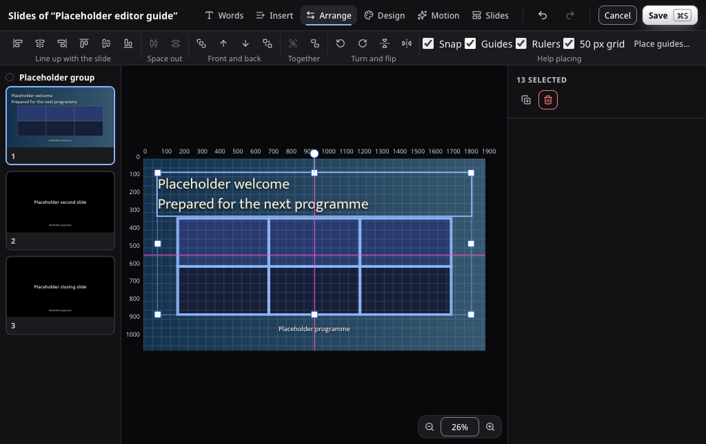

**Design the background and layout.** **Design** offers a colour, a two-colour gradient or a library picture. A picture can **Fill the slide**, show the **Whole picture** or **Stretch**; choosing a new designed background removes the old background cue, while keeping the slide’s sound. **Give every slide this slide’s look** carries that look to the presentation after asking first; Undo puts it back. **Words**, **Heading and words** and **Two columns** rearrange words while preserving existing text, table cells, pictures and other content. The existing whole/band darkening still helps words read over the picture and includes the master’s words.

**One size for the presentation.** Choose **Slide size** for Wide (16:9), Standard (4:3) or custom whole-pixel width and height, from 16 to 16384 pixels. **Fit and centre the existing content** scales and centres the slides’ content and the master together; with it off, elements keep their pixel positions and sizes. Undo restores the old size and placements. An imported deck or PDF may begin with pages of different sizes: Fit works from each page's own size when resizing them. Choose a practical canvas size and inspect it on the actual screens before the sabha.

**One shared master.** In Design, **Edit master** makes or opens the one visual master behind this presentation’s slides. Put repeated words, shapes or pictures there, then **Done editing master** returns to the slide; the master itself is not a playable slide. **Use master** controls whether a slide shows it, and **Use master background** follows its background: a slide’s own background or background cue takes priority. Master words keep their position on every screen. Sound insertion and slide-only notes or transitions are unavailable while editing this visual master. Removing a master is undoable.
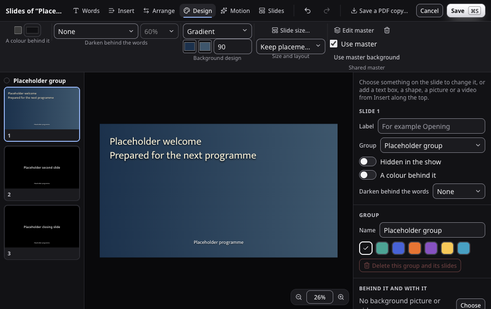

**Motion timing.** In **Motion**, a selected element can have **Comes in** (Fade, Rise or Grow), **Draws attention** (Breathe or Rock) and **Goes out** (Fade, Lower or Shrink). Each start and duration is in seconds **from the slide going up**, rather than from the previous effect; attention runs one cycle. **None** removes a saved effect, including after Save and reopen. Preview uses the same drawing as the show and stops when you edit, select something, Undo or change slides. Choose the slide’s **Comes on with** transition and how long it takes, or keep **The presentation’s**; a deck’s own transitions and click overrides stay in its side panel. **Moves on by itself** advances after the chosen time, so rehearse it before using it live.

**The same motion on every screen.** Hall screens, the node, phone live pictures and Program use the same motion; keep them on the **same updated build**. Designed, master-based or animated slides keep their **full slide** in every layout, including the stream’s **Camera** layout, so a layout does not pull the moving words into a lower third. Older plain slides keep their previous layout and playback. Check Program without going live or starting a recording.
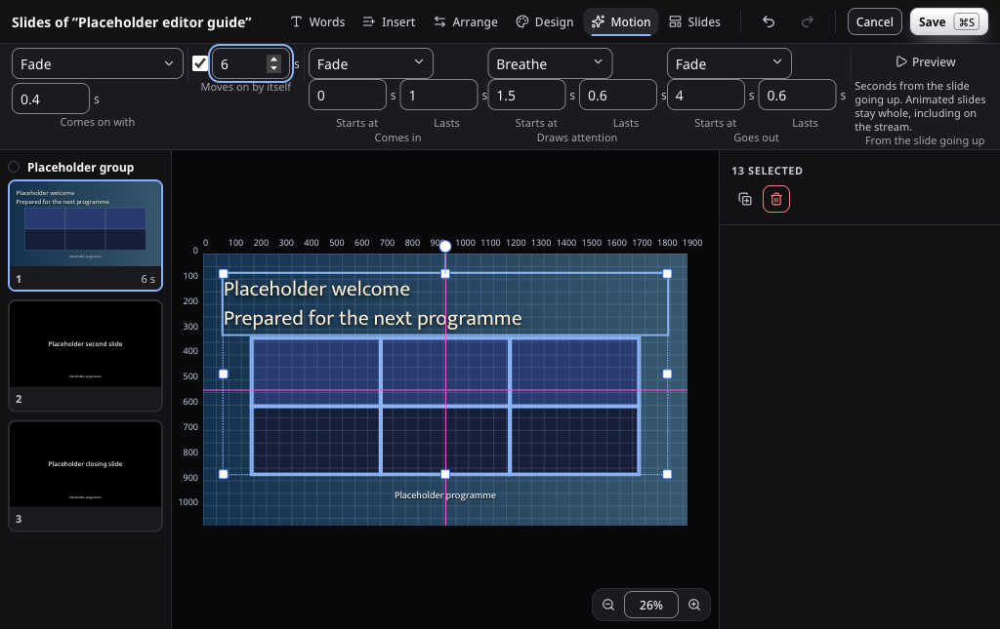

**Slides and notes.** **Slides** has new, duplicate, delete and hide, and **Slides across** opens a horizontal strip as an alternative to the vertical list. Drag there to reorder slides; the drag is one Undo or Redo. **Notes…** works even with a box selected: type notes for the stage, then **Keep notes**. They save as typed and appear on the stage and presenter’s phone, never on the audience picture. With nothing selected, the Inspector’s Notes field still works too.
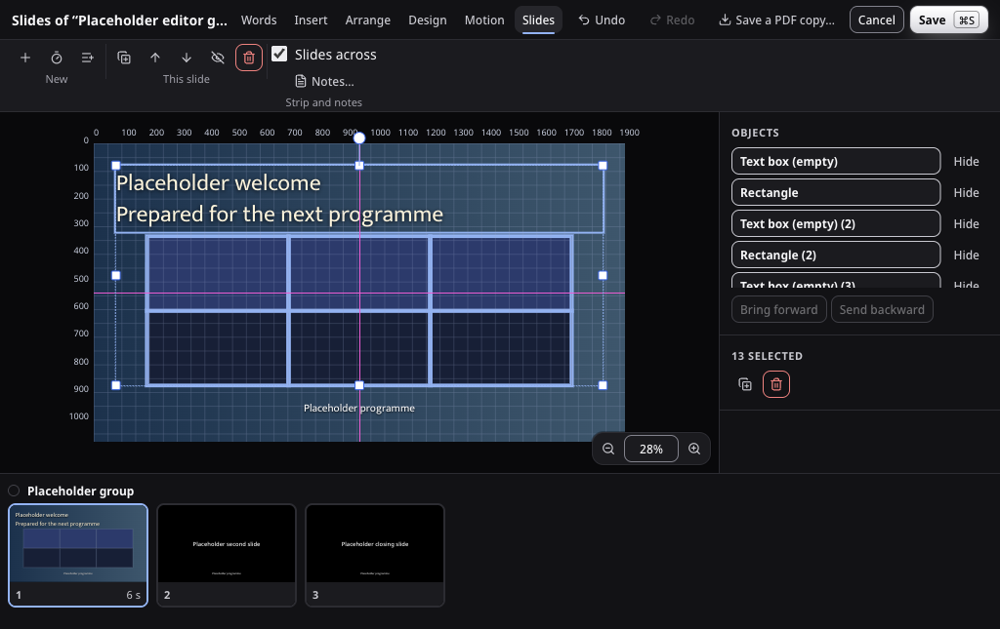

**Keys while preparing.** Use Cmd on a Mac and Ctrl on Windows: **Cmd/Ctrl+S** or **Cmd/Ctrl+Enter** saves, **Cmd/Ctrl+F** opens Find and replace, **Cmd/Ctrl+Z** undoes, and **Cmd/Ctrl+Shift+Z** redoes (also **Ctrl+Y on Windows**). **Cmd/Ctrl+=** or **Cmd/Ctrl+plus** zooms in, **Cmd/Ctrl+minus** zooms out and **Cmd/Ctrl+0** fits. These are the editor’s combinations; ordinary typing keeps its own editing keys. The rest of the editor key card is at the end of `docs/parallel-run.md`.

**Imported words, shapes and pictures.** In alpha.15 an imported PDF or PowerPoint (`.pptx`) slide can offer its original words, supported shapes and pictures to edit in Drashti's own copy. Let preparation finish, then read the source notes: a missing font or an unsupported drawing may change how the page looks. A scanned PDF's words may be only a picture, so they cannot be typed over as text. Check the prepared page against the original before Save. The original file is kept unchanged.

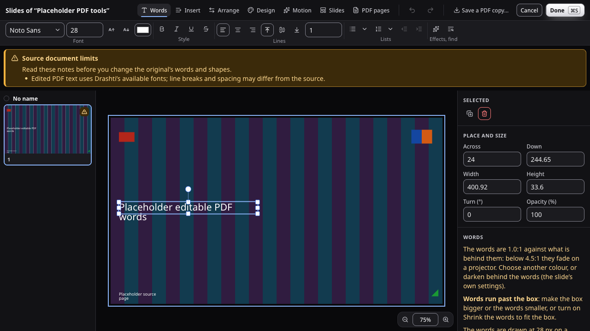

**An animated slide asks first.** Before a content change replaces an animated slide's original clicks and animations, Drashti asks **Make this slide editable**. Choose it only after reading the source notes; **Keep original** cancels that change. Only the changed slide becomes Drashti's own: untouched slides keep their original playback. Adding notes or editor guides alone does not replace the source. Use Undo if the change is not wanted, and **Save** when the copy is right.

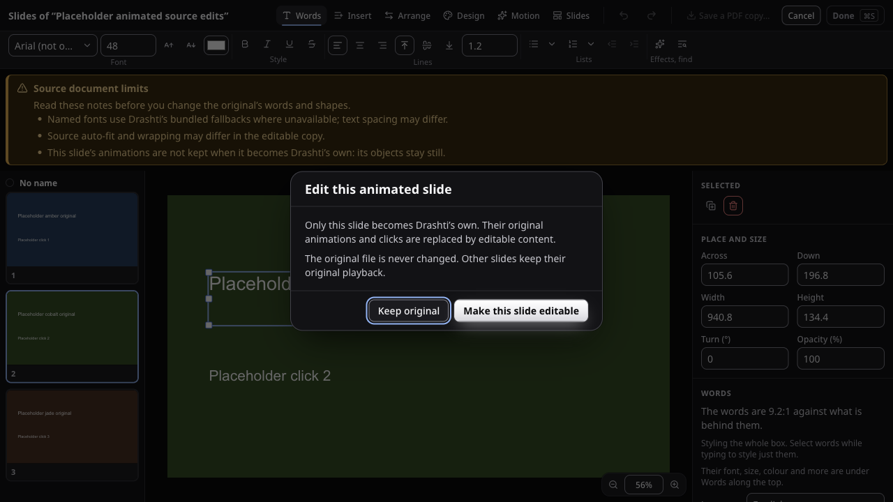

**Mark a PDF page.** Choose the page on the left, then **PDF pages**. **Highlight**, **Underline**, **Strike through**, **Draw** and **Cover** mark it: drag over the part wanted, or draw, and press Esc to cancel a mark before finishing it. Underline and Strike through can also style selected editable words. Finished marks can be selected, moved or removed, with Undo and Redo. **Cover** puts a visible patch over the page; it does not remove the words underneath and must not be used to make a private document safe to share.

**Turn, remove or move a page.** In **PDF pages**, **Turn page right** turns the chosen page a quarter turn; **Delete page** removes that page. Drag a page in the slide list or **Slides across** to change its order. Undo and Redo put each change back. These are changes in the editor until **Save** keeps them in the library; the retained original PDF stays as it was.

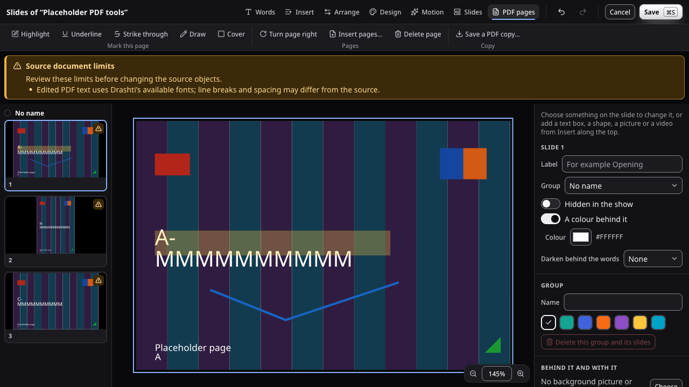

**Bring in another PDF's pages.** Choose the page they should follow, then **PDF pages › Insert pages…**. Choose a **PDF in the library** and **Insert pages**, or **Choose a PDF file…**. All its pages go after the chosen one, in order. A file chosen here does not make another presentation in the library, and the PDF chosen from the library stays unchanged. **Cancel** stops preparation. All the inserted pages are one Undo or Redo; nothing is kept in this presentation until **Save**.

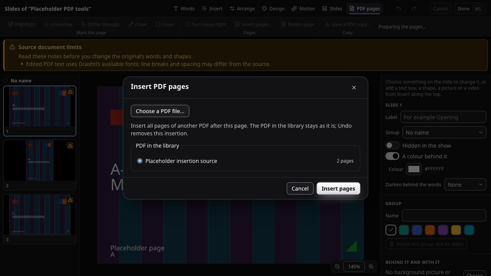

**Pages of different sizes.** A PDF page keeps its own paper size and turn: choose it before judging its canvas, rulers, alignment or thumbnail. Inserted pages keep their own sizes too. When **Slide size** resizes mixed pages, **Fit and centre the existing content** fits each from its own paper; with it off, objects keep their pixel positions and sizes. The shared master fits to each page without changing the master itself. Notes and editor guides stay off the audience picture, whatever the page's size.

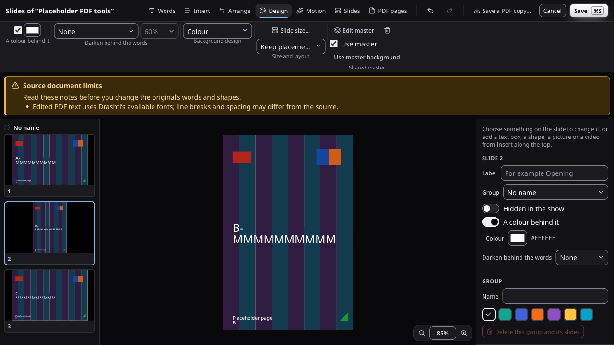

**An older import needs a matching page.** If an old slide has only a saved picture, use **Link source page…**. For a PowerPoint or Keynote slide, first save a PDF reading copy from the deck's own program. In **Link a PDF reading copy**, **Choose a PDF reading copy…**, choose the **Saved source picture to replace** and its **Matching page in the PDF reading copy**, then **Link selected page**. Check that both pictures are the same page; Drashti leaves an uncertain match to you. Only that picture is replaced: what you added to the slide, and its notes, guides and size, stay. Read warnings before approving an animated slide. An unsupported crop, turn or other change to the source picture may prevent linking; keep the original rather than choose a wrong page. Undo puts the saved picture back, and Save keeps the link.

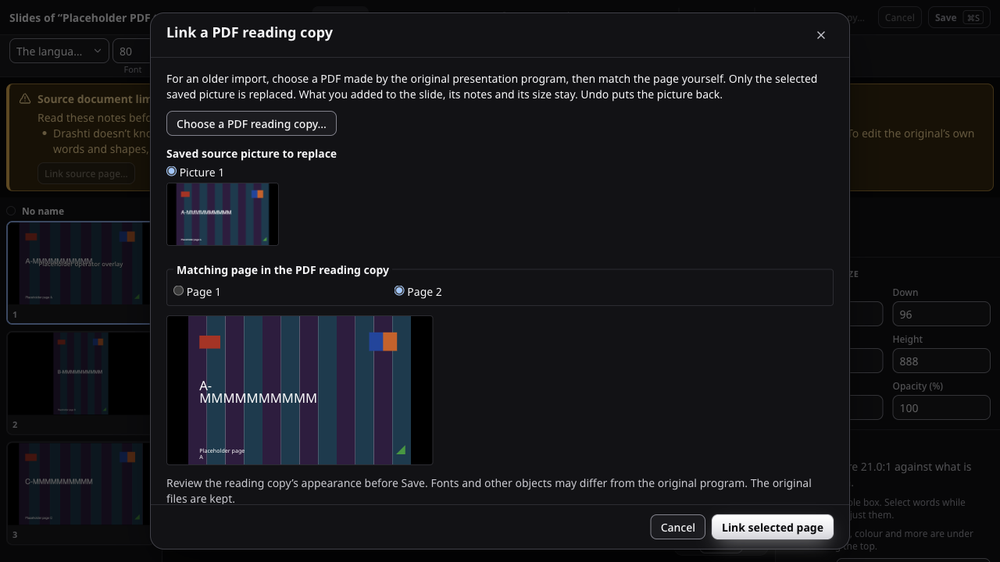

**Save a new PDF.** **PDF pages › Save a PDF copy…** writes the pages as they now look to a new PDF where you choose. It refuses the original file, including another name for the same file. Give the copy a different name and open it to check every page, font, mark, size and turn. Exporting does not save your edits to the library: use **Save** there too. A PDF copy is for reading; do not expect the deck's clicks, video or sound to play in it.

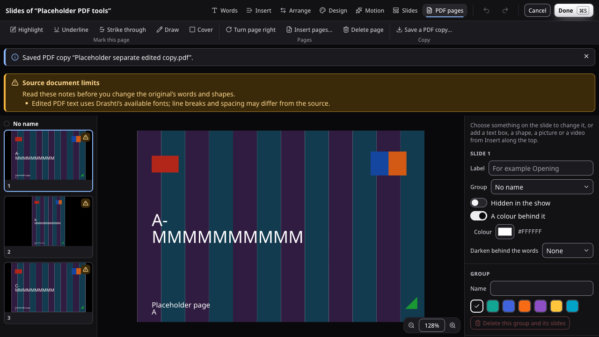

## 11. AI helpers while preparing a sabha

**Choose only the helpers you want.** In Pro Mode, **File › AI helpers…** has five switches, all off at first: **Meaning and spelling search**, **Import suggestions**, **Playlist suggestions**, **Book references** and **Follow singing (Trial)**. Each is a **Trial** and can slow the screens while on. Rehearse before choosing one for a sabha. Each works offline on this computer; the choices are kept. Suggestions wait for you to check them. They do not change Books. Nothing goes on the screens until you choose it, and no helper starts a stream or recording. These tools are not offered in Simple Mode or on a phone.

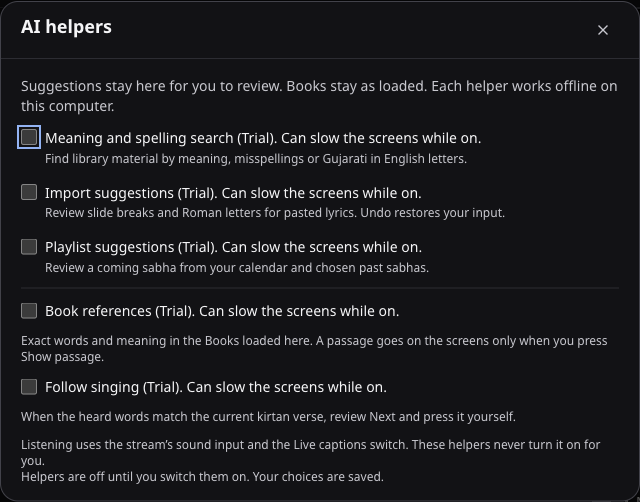

**Find by meaning.** With Meaning and spelling search on, open **Library**, type in its search box and press **Find by meaning**. The usual exact matches stay, with suggestions for meaning, a misspelling or Gujarati typed in English letters. Each suggestion leads to a real presentation, media item or loaded book passage; look at it before adding it to the playlist. It does not make up words or references. If the helper cannot finish, use the usual search.

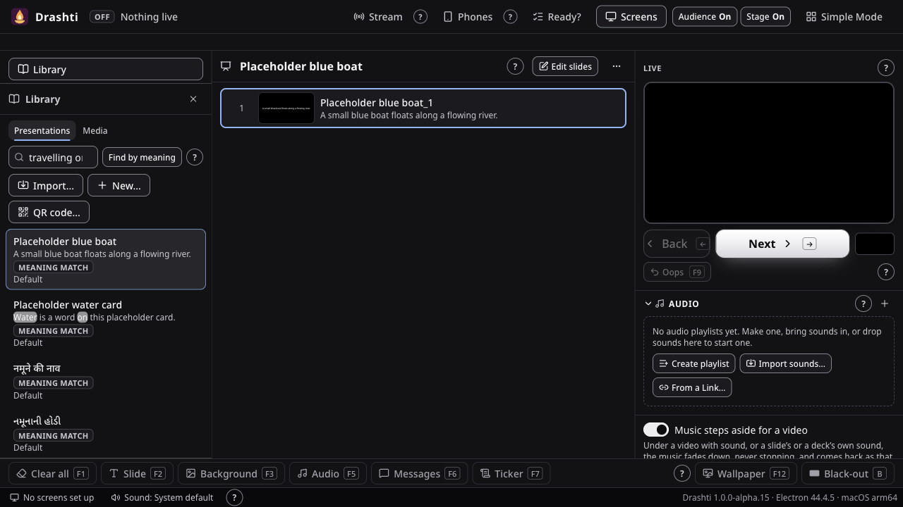

**Suggestions for newly pasted words.** With Import suggestions on, use the library's **New…** and paste the words for a new presentation. **Suggest slide breaks** offers places to split them; **Suggest transliteration** offers Roman letters using Drashti's existing rules. The review names the language when recognised and shows each change with its source line. Tick only the changes you want, then **Apply selected changes**. **Undo suggestion** restores your input, even after the helper has been switched off. Read the words and the Roman letters before making the presentation. This helper does not rewrite words already in the library or in Books.

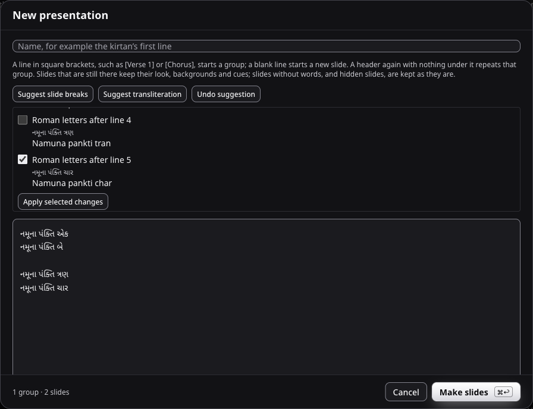

**Suggest a playlist.** With Playlist suggestions on, choose **Suggest a playlist**, then the **Sabha date** and the **Past sabhas** it may draw from. **Suggest playlist** shows its proposed order and the calendar entry, if there is one; without an entry it uses a past sabha you chose. Check each row and where it came from, change the **Playlist name**, move rows up or down, and **Remove suggestion** for anything unwanted. Only **Make playlist** makes a new playlist; **Cancel** leaves the existing playlists as they were. Open the new one and rehearse it before the sabha.

### Book references during pravachan

**Find a passage, then choose whether to show it.** In Pro Mode, turn on **Book references** under **File › AI helpers…**; it starts off. The **Speech helpers** panel beside LIVE has **Look in loaded Books**: type Gujarati, Hindi or English and press **Find in Books**. Typed search works with listening and Live captions off. It searches only the original words in Books loaded here, showing their references and quoted words. Exact matches appear first while meaning is checked; **No good match in the loaded Books** means nothing suitable was found.

**To listen during pravachan**, ask the admin to turn on **Live captions on this computer**, choose the stream's sound input and wait for the model (admin guide, section 25). Both speech helpers need that separate switch for listening; neither turns it on. Heard words can then suggest passages in the same panel. If listening is waiting, let it wait or use typed search. Read the reference and quoted words before pressing **Show passage — …**: only that press puts a passage on the screens. If its book has changed or been removed, or the suggestion has expired, search again and check a fresh result. Books stay as loaded; the helper writes no new passage or translation.

### Follow singing (Trial)

**A suggestion for Next, with the operator in charge.** In Pro Mode, turn on **Follow singing (Trial)** under **File › AI helpers…**; it starts off and also needs Live captions switched on for listening. Put the kirtan's verse on **LIVE** as usual. When heard words clearly match that verse, the Speech helpers panel offers **Next suggested verse**. Check it, then press it when ready, or use the usual **Next**. It follows the current play order, never jumps to another verse and never advances by itself. Without a clear match, carry on with Next yourself.

A suggestion is for the current live state and expires: changing the slide, leaving Pro Mode or losing the operator makes it unusable. Wait for a fresh match if needed. It is a **Trial**: try it in a rehearsal before a sabha, with the admin's chosen captions language. Turn it off again under **AI helpers…** if it is not useful; turning a speech helper off does not turn Live captions off.
