# The operator's guide: running a sabha in Pro Mode

This guide is for the **operators**: the people who run a sabha's screens in Drashti's Pro Mode, from switching on to switching off. It goes through a whole sabha in the order things happen. A volunteer who only presses Next uses Simple Mode instead (see "Simple Mode, for a volunteer" in `docs/parallel-run.md`), and setting Drashti up (screens, backups, the node, schedules) is in the admin's guide (`docs/admin-guide.md`), for whoever looks after Drashti.

On the Mac, **Cmd** is the ⌘ key; on Windows use **Ctrl** instead. On Windows the menu bar is hidden: press **Alt** to show it.

**This guide is inside Drashti too:** **Help**, then **Guides…**, with the presenter's guide (and in Pro Mode the admin's and the setup day's). Type a word in **Search the guides** to find every passage that holds it, by section, after up to three answers to questions such as "When a screen is black or frozen, what do I do?"; choose one to read it in its place. The guides need no internet. **Esc** closes it.

**The window, left to right:**

- **Along the top:** what is live now (with **ON AIR** and **REC** while the stream is live or recording), then **Themes**, **Stream**, **Phones**, **Announcements**, **Screens**, the **Audience** and **Stage** switches (section 2) and **Simple Mode**. With phones able to connect, a window less than 1680 pixels wide shows **Themes**, **Stream**, **Phones**, **Announcements** (with how many are waiting) and **Simple Mode** as their icons alone: the mouse over one names it. **Screens** and the two switches always keep their words.
- **Left column:** the **Playlists**, as many as you like, in folders, fill it: **+ New** makes one, and the chosen one shows **Rename** and **Delete** at its end. At its top, the **Library** button opens the library over them: Presentations and Media, with the search box and, under it, **Import…** (files, a folder, or from a link) and **New…** (a presentation from pasted words). Drag from it into a playlist, or choose and press **Add to playlist**; **Close** or **Esc** shuts it, and **Cmd+F** (Ctrl+F) opens it at the search box. A playlist made from a folder lists the folders inside the one shown at the bottom of the column: drag the line above them to give them more room, and Drashti remembers it. The Shastra tab (in the library), the Templates and the kirtan filters show only while **View › Show Shastra, Templates and Kirtan Details** is ticked.
- **Middle:** the **open playlist** at the top: its name, **Add files…**, **From a Link…** and its menu (**⋯**), then its items as cards, each with a picture, its name, what it is (a presentation, a deck, a video, a picture, a sound, a header) and its length or how many slides. **One click** on a video, a picture or a sound puts it on the screens at once (so does Enter on its card; a double click puts it up only once, and one already up is never started again). A presentation, a PDF or deck, a Shastra passage, a video input, a header or a slot opens in the middle instead. **Cmd**-click (Ctrl-click on Windows) or **Shift**-click only chooses cards, **Alt**-click (Option-click on a Mac) shows one in the middle without putting it up, and a right-click opens its menu. Drag a card to move it, or drop presentations, pictures, videos or files anywhere on it. A playlist made from a folder shows one folder at a time: that folder's own items here, its folders at the bottom of the left column (click one to see what is in it), and the way back up above the items ("Placeholder Sabha › Week 1"); clicking the playlist itself goes back to the main folder. **Next**, Simple Mode and the phones still go through the whole playlist, folder after folder, and the middle follows. Below it, the **slides** of the item opened, in the order they play. With no playlist open (**×** closes it), the slides of the presentation chosen in the library fill the middle.
- **Right column:** the live picture, headed **LIVE** (what the hall sees now), with **Back** and **Next** under it (Next, in the appearance's one strong colour, is always the next thing to do; each does exactly what its key does) and, under them, a time bar for whatever plays, then **Audio** (its audio playlists), the **Stage screen** (its message, and its layout's timers), **Messages**, **Timers** (one line each: start or pause, reset, show on the screens, Edit), **Props** and **Looks**, and **More tools**, folded away: Lower Thirds, Masks, the Idle rotation and the MIDI controller, each with a line saying what it is.
- **Along the bottom:** **Clear all** (F1), the **clear buttons** for each layer in the order of their keys (**Slide** F2, **Background** F3, **Props** F4, **Audio** F5, **Messages** F6, **Ticker** F7, **Masks** F8), **Logo** (F12) and **Black-out** (B), each with its key on it, then the **status bar** (the version, the screens, imports, warnings, and **Audience off** or **Stage off** while those screens are switched off).

**The first start.** A new library opens with a welcome: Drashti's lamp lights, then the choices. With a display for the hall connected, the first is **Show on** and its name: one click makes it the hall's screen. **Set Up Screens…** opens the setup on the displays (the admin's guide has it). **Try a practice show first** puts five placeholder slides on this screen only, with a banner saying so: try Next, Back, **B**, **L** and **F1** as in a sabha; nothing goes to the hall's screens, the phones or a stream, and nothing is saved. **Leave the practice show** brings the welcome back. A new library starts with no presentations, not even test slides. **Skip for now** leaves the middle of the window showing three steps to a sabha: **Import…** what you show, make **this week's playlist**, and the screens (**Show on** a connected display, or **Set Up Screens…**). In a small window these steps, and the practice show's keys, scroll: none is ever hidden under the bars along the bottom. The welcome comes once; **View › Set Up Screens…** opens the setup any time. Whenever no screen shows the hall's picture and a display is connected, a line under the top bar offers **Show on** it too, one click; **Not now** puts it away until the displays change.

**Keep these screens?** After a change that puts a screen on a display (**Show on**; **Done** or **Finish** in **Set Up Screens…**; **Use this display**, ticking **On**, a group's **Shows** or a key and fill screen's **Sends**, in **Screens**), Drashti asks **Keep these screens?** and counts down 15 seconds. It stays on top: anything opened meanwhile (the guides, say) opens under it, and Enter and Esc still answer it. **Keep** (Enter) keeps the new screens. **Go back** (Esc) puts back what that change changed, and nothing else, and so does pressing nothing for 15 seconds, with a notice saying so. If the change put a screen over the controls, that screen asks the same in its middle: Enter keeps, Esc goes back. If Drashti stops before an answer (a crash or a power cut), the next start goes back to the screens as they were before that change, and a notice says so. Turning a screen off asks nothing.

**How Drashti looks on this computer.** **View**, then **Appearance**, chooses its look: **Follow the computer** (the first choice: Black when the computer is set to dark, White when it is set to light, changing with it), **Black**, **White**, **Dhaja** (the mandir flag's red and white, with gold), **Tiranga** (India's saffron, white and green, with navy), **Saffron**, **Peacock**, **Midnight Blue**, **Sandalwood**, **Lotus**, **Marble**, **Tulsi**, **Diwali**, **Holi**, **Aarti**, **Monsoon**, **Sandhya**, **Forest**, **Navratri**, **Neel**, **Ratna**, **Prabhat**, **Mehndi**, **Haldi**, **Himalaya**, **Uttarayan** or **Mogra**. Every one but Black and White has a top bar in its own colours, shading from one to the next, with a thin band of its colours under it, and its own colours for headings and for the tab and row you have chosen; the left column, the middle, the right column and the bar of show controls along the bottom each have a colour of their own too, and so do the panels' title strips and the layer buttons, four colours at least in each. It changes Drashti's own window at once, and stays chosen when Drashti starts again; **the screens in the hall, the stream and the phones never change with it**. In every one, LIVE is red with its word (in the top bar it sits on a plain panel, never on the bar's colour), the next thing to do is the one strong colour, and warnings are amber. **Appearance…** there shows each as a small picture of this window. It also has **Make a copy of …**, to make your own: give it a name, choose **Dark** or **Light** and the colour of the next thing to do, and Drashti works out the rest, its top bar and band too. **Choose the second colour myself** lets you pick the colour for headings and for what is chosen as well; Drashti says if it could be taken for LIVE, a warning, success or danger, and offers the nearest that works. It says at once if that colour is too close to LIVE's red, ON AIR or a warning, and offers the nearest colour that works; **Save and use it** waits until every check is met. Your own appear under **Your own**, where **Delete…** asks first (if it was in use, Drashti follows the computer again); the ones Drashti came with can't be deleted. **Interface motion**, there too, is **Calm** (things arrive and leave gently), **Lively** (tabs glide, cards arrive one after another, buttons answer a press, one appearance fades into the next and its band sweeps in once) or **Off** (nothing moves); whichever you choose, Next, Back, the clears, Black-out, Logo, the slides and the live picture never move, and the computer's own setting to reduce motion turns it all off. Simple Mode shows the appearance chosen here, with no way to change it.

---

## 1. Before the sabha

Do these about 30 minutes before the sabha starts.

1. **Switch on and start Drashti.** It needs the internet as it starts, to check that this computer is let in (if it shows a lock screen instead, see section 3). It opens in Pro Mode, with nothing to type. If the screen shows Simple Mode (big buttons, as when Drashti stopped unexpectedly in it), press **Switch to Pro Mode…** at the top right, and type the word **pro**.
2. **Check the screens.** Click the screens line in the status bar (for example "3 screens showing"). The **screens dashboard** shows a small picture of what every screen really shows, the hall's, the stage's and the second computer's (the node). Every node should say **Online** and its pictures and videos **ready** (for example "14 of 14 ready"). **Identify** puts a screen's number on it if you are not sure which is which.

   

3. **Open tonight's playlist.** Under **Playlists** click it: it opens in the middle. If it is a playlist from an earlier week, open it now (a click is enough): the second computer then copies its pictures and videos in good time.
4. **Check the sound.** Play a sound from the playlist, or press **Play** in the **Music** panel, and check the mixer hears it. The status bar always says where the sound goes; a warning there means the chosen output is not connected.
5. **Music before the sabha.** In the **Music** panel, choose the list and press **Play**. It plays one sound after another with short fades, apart from the slides, until a slide's own sound takes over or you press **Pause**.

   

6. **Darshan pictures and quotes on the screens** (if the idle rotation is set up): unfold **More tools** and press **Start** in the **Idle rotation** panel. It stops by itself when the first slide goes up.
7. **A countdown for the start** (if wanted): in **Timers**, press **Start** beside the countdown (for example one named "Sabha starts in"), then **Show on the screens** beside it. The hall's screens show its time alone ("4:59"), in the slide's place over the background, until the first slide goes up. For words with the time, use a timer slide ("Starting in 4:59": section 2), or a message such as "Sabha starts in {time}", with {time} set to **Timer: Sabha starts in** in place of **Typed in**.
8. **The stream** (only on the computer that streams, and only if tonight's sabha is streamed): press **Stream** in the header, choose **Camera and words** or **Slides**, press **Record** if it should be recorded, then **Go live…** and **Go live**. The header says **ON AIR** (and **REC**). Section 6 of `docs/parallel-run.md` has the details.
9. **Phones** (if a phone remote or a stage tablet is used): press **Phones**, check **Let paired phones and tablets connect** is on, and check each phone says **Connected**.

## 2. Running the sabha

**Starting.** In the open playlist, click the first item. A video, a picture or a sound goes up with that click. A presentation's slides appear in the middle: press **Space** (or **→**), or **Next** under LIVE, to put its first slide on the screens.

**Going through it:**

| Key                                      | What it does                                                                       |
| ---------------------------------------- | ---------------------------------------------------------------------------------- |
| **Space**, **→**, **↓** or **Page Down** | The next slide; at the end of an item, on into the next (headers are stepped over) |
| **←**, **↑** or **Page Up**              | The slide before                                                                   |
| **Shift+→** or **Shift+↓**               | The start of the next item                                                         |
| **Shift+←** or **Shift+↑**               | The start of the item before                                                       |
| **Next** or **Back** under LIVE          | The same as **Space** and **←**, at once                                           |
| A click on a slide                       | That slide, at once                                                                |
| A click on a video, a picture or a sound | That item, at once                                                                 |
| A click on another item, then **Space**  | That item, from its first slide                                                    |

- What the next press will bring shows on the stage screen (its **Next**), on a presenter's phone or tablet, and in Simple Mode.
- Pictures and videos in the playlist go up as the **background**; the words of the next presentation go over them. A video input in the playlist goes up the same way (section 6). A sound plays through the mixer and leaves the picture as it is.
- A presentation can play in its own **arrangement** (a chorus sung three times shows three times): choose it above the slides.
- **Repeat Slides** (its icon is two arrows going round): a playlist whose pictures and slides go round by themselves, the last back to the first, for a lobby or before the sabha. **+ New › Repeat Slides** makes one; put pictures, PDF or PowerPoint decks and presentations in it (a video, a sound or a video input is refused, saying why). Under its name: **Seconds each** (15 to begin with, 3 to 600), the **Transition** (Fade to begin with, or Cut, Fade through black, Slide or Slow zoom) and how long it takes (1 s to begin with, 0.3 to 3 s, never more than half the seconds each); a change takes effect from the next slide. **Start** (there, or ▶ on its row) starts from its first slide; clicking one of its items shows all its slides in the middle, and a click on a slide starts from there. LIVE then says **Repeating · Stop (Esc)**. **Esc** (when no dialog, menu or field has the keyboard) or **Stop** ends it, and **the slide on the screens stays up**; putting anything else up, Clear all and clearing the slide end it too. **Black-out** and the **logo** cover it while it goes on underneath. After an unexpected restart it carries on. Simple Mode can start and stop it, but not change its settings; a presenter's phone shows it, can start it (**Start going round**, with that playlist chosen) and can stop it.
- **Transitions**: any presentation or slide can pick Fade, Fade through black, Slide or Slow zoom in the slide editor, as a Repeat Slides playlist does, and Wipe, Push, Zoom, Line by line or Word by word. Wipe, Push and Zoom move the words only on screens whose Look is Bold (chosen in **Screens**); other screens fade. Pictures always fade, and a kirtan's slides never come word by word. Every screen runs them at the same moment, and each takes the time the slide gives it.
- **A PowerPoint or Keynote deck with its animations.** On a computer with PowerPoint (or Keynote, on a Mac), and with **File › Decks With Their Animations on This Computer** ticked (ticked to begin with on a Mac; on Windows, off until it has been tried on the mandir's PC on setup day), a deck comes in with its own transitions and animations: each **Next** (or **Space**) plays its next click, as the deck's slideshow does, and **Back** goes back a click; every screen shows the same click at the same moment, and what is live, along the top, says which click is up ("click 1 of 2"). Its videos and sounds come in as real videos and sounds. Unticked, a deck comes in as pictures, as before, with its videos still real videos, and so does one imported while the stream is on air or recording (import it again afterwards). A deck that came in as pictures, imported again with its animations, asks first in the import report: **Replace** (what was changed in it since is lost), **Keep both** or **Skip**. On a computer with neither app, only its videos and sounds come in, into **Media**: import the deck on a computer with one, or save it there as PDF and import the PDF.
- A **Shastra passage** (with the Shastra tab shown): open the library, and in its **Shastra** tab type its reference (for example `SD 14` or `Vach G.Pr. 1`) and press Enter; its slides appear in the middle like a presentation's.
- To find any kirtan quickly: **Cmd+F** (Ctrl+F), type a few letters of its title or its words, and press Enter.
- A playlist, folder or item has a menu (rename, delete, timers when it goes up, and more): right-click it, or press **Shift+F10** with the keyboard on it (on a Mac laptop, **Fn+Shift+F10**).
- **Media** lists the pictures, videos and sounds you imported, and those the drop folder took in by itself, if one is set up (**From the drop folder**, above the list, shows those alone). A PDF, PowerPoint or Keynote file's pages are its presentation's slides, so they stay out of Media (a page you also import on its own shows there). Above them, **Video inputs** lists this computer's cameras and capture inputs, once one is named: one click puts one up, and one can go in a playlist too (section 6).
- **Every video and sound file.** Drashti takes nearly any video or sound file: MP4, MOV, MKV, WebM, AVI, WMV, MPEG, MTS, FLV, VOB, MXF and more; MP3, WAV, M4A, AAC, FLAC, OGG, Opus, WMA, AIFF, AC-3, DTS and more. One it can't play as it is (an AVI, a WMA, an AIFF or an MKV with AC-3 or DTS sound, say, or an HEVC video on a computer that can't play HEVC, as many Windows PCs can't) is converted by itself a moment after the import, one file at a time: Drashti makes a copy that plays and uses it everywhere, and the original stays as it is. The original added again later (to a playlist, a slide or **Audio**, or imported again) uses the copy too. Until then the file says **Converting…** (in **Media**, the playlist and **Audio**) and can't go live. Nothing is converted while the stream is on air or recording: it waits. A conversion waiting or under way when Drashti quits (or stops) starts again by itself at the next start, about 10 seconds after the window opens; one cancelled (**Cancel all**, or the cancel button beside a file) or failed does not. The import report says what Drashti is converting, and then what it converted. A file that plays as it is (HEVC too, where this computer can play it) is never converted.
- **Deleting.** The chosen row, and the row under the mouse, show a **trash** button at their end: on a playlist or folder, a presentation, a picture, video or sound in **Media**, and on music and its sounds. It does what the **Delete** key does (Backspace on a Mac). The presentation open in the middle has **Delete…** in its **⋯** menu, after **Edit slides** (**Delete from the library…** while it is open from a playlist, as it goes from the library, not only from that playlist): it asks first too, and **Undo** brings it back (open from its card again, if that playlist is still open). **Choosing many** works in every list you can delete from: drag a box over the rows from an empty place (the list scrolls by itself at its top and bottom), **Shift**-click for a run of rows, **Cmd**-click (Ctrl-click) to add or take away one, or **Cmd+A** (Ctrl+A) for the whole list. A bar then says how many are chosen, with **Delete** for them all and **Clear**; **Delete** or **Backspace** does the same. It asks once for them all, and one **Undo** brings them all back. The show controls are never chosen this way. It asks first for a playlist, a presentation or media, saying where a picture, video or sound is used (which playlists, slides, music, props and themes), and, for a presentation, that any playlist it is in keeps its card, marked **Removed from the library**, and **Next** goes past it; a playlist item only leaves its playlist. **Cmd+Z** (Ctrl+Z), or **Undo** in the bar at the bottom of the left column, brings it back. Deleted media leaves playlists and music, and slides show nothing in its place, as with a missing file (a slide with it as its background, or as its sound, goes up with that left as it was, and LIVE says **File missing**: section 3); what is on the screens stays up until you change it. Its file goes only when Drashti next starts, when Undo can no longer bring it back; importing the same file again brings it back everywhere it was used.
- **What is this?** The small **?** on a panel's heading (and beside Next and Back, the show controls, Stream, Phones and Announcements in the header, the open playlist, Audio, More tools and the status bar) says in two or three sentences what it is for and what to do first. **Read more** opens this guide at the passage it comes from; **Got it** closes it.
- **Closing with changes asks first.** Edit words, the slide editor and the other editors ask "Keep your changes …?" before anything typed is lost: **Save changes** (it has the keyboard: Enter saves), **Keep editing** (Esc), or **Throw them away**. When the presentation is on the screens, it says so: saving then changes the screens at once, so **Keep editing** has the keyboard instead (Enter keeps editing; click Save changes when you mean it).
- **A smart playlist** (its icon is a folder with arrows; **+ New › Smart Playlist from a Folder…** makes one) follows a folder on the computer: what is put in that folder joins it by itself, at the end of its folder's part, and the line under its name says which folder and how it goes ("Adding 2 files…"). Move its items about as in any playlist: they stay where you put them. An item whose file was taken out of the folder says **Not in the folder**, and still plays (Drashti keeps its own copy); **Remove the missing** takes those out (Undo brings them back). A file changed in the folder replaces its item, but never what is on the screens: that stays up until you change it. If the folder is not there (a USB stick taken out), the line says so; nothing is lost, and the playlist carries on when the folder is back.
- **After an import:** the import report offers **Add to playlist**: everything that import brought in, in its order, into the open playlist, another, or a new one named after the file or folder. In **Import from a Link…**, **When it's imported, add it to:** does the same by itself when the download's import ends, even with the dialog closed. It offers first the playlist the last download went into, else the open one, else a new one named after the download (a playlist's own **From a Link…** offers that playlist); with no playlist at all, it asks for the new playlist's name before the download starts. When the download is in, that playlist opens with the new item chosen, ready for one click to put it up: it never goes up by itself. Undo takes it out again.
- **Changing the playlist without dragging:** press **Library**, choose a presentation, a picture or video, or a Shastra passage and press **Add to playlist** under it; it goes after the playlist's chosen item (in a playlist made from a folder, with nothing chosen, at the end of the folder shown). To move an item, choose it (**Cmd**-click, or Ctrl-click on Windows, chooses a video, a picture or a sound without putting it up) and press **Up** or **Down** under it (or **Alt+↑** / **Alt+↓**). **Cmd+Z** (Ctrl+Z) takes back the last add or move. Dragging works too: a presentation, a picture or video, or a search result, onto the open playlist (an empty one too) or onto a playlist's name in the list. Files dragged from the Finder (Explorer on Windows) onto the open playlist are imported and go where you drop them, in the order you dragged them.

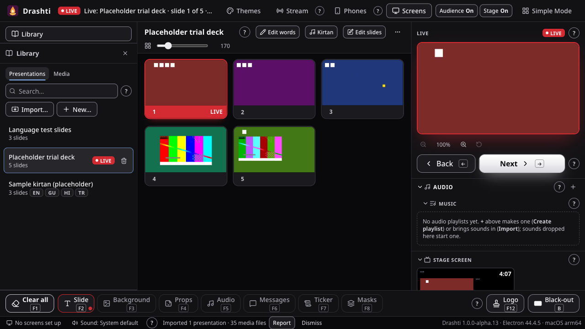

**Covering and clearing:**

| Key or button                                          | What it does                                                                                                                                         |
| ------------------------------------------------------ | ---------------------------------------------------------------------------------------------------------------------------------------------------- |
| **B** (or **.**), **Black-out**                        | Black on the hall's screens, and back exactly as it was. The stage screens keep the words.                                                           |
| **F12** (or **L**), **Logo**                           | The mandir's logo instead of the picture, and back                                                                                                   |
| **F1**, **Clear all**                                  | Everything off the hall's screens. Straight after it, **Put it back** brings it all back.                                                            |
| **F2**, **F3**, **F4**, **F5**, **F6**, **F7**, **F8** | One layer off each, in this order: the slide's words (the background stays), the background, props, the sound, messages, the ticker, the Masks layer |

The clear buttons along the bottom go in this order too, left to right, each with its key under its word. A clear button is lit, with a dot beside its key, while its layer is on the screens.

**The keys that moved.** Drashti's keys follow what the operators already press. **F5** now clears the sound and **F6** messages (they changed places); **F7** clears the ticker and **F8** the Masks layer (they changed places too). The clear buttons moved with them, into the order of their keys. **F12** is the logo (**L** still works). **Cmd+1** (Ctrl+1 on Windows) turns the Audience screens off and on, and **Cmd+2** (Ctrl+2) the Stage screens. On a Mac laptop the F-keys may need Fn held down, unless **Use F1, F2, etc. keys as standard function keys** is on (System Settings, **Keyboard**, **Keyboard Shortcuts…**, **Function Keys**); a Windows laptop may need Fn Lock.

**Audience and Stage.** Beside **Screens** in the top bar, **Audience** and **Stage** each say **On** or **Off**. Turning **Audience** off closes the hall's screens on this computer (key and fill too): their displays show the computer's desktop. **Stage** does the same for the stage screens. The show carries on, and nothing else changes: LIVE, the stream, recording, the second computer's screens and the other switch's screens go on as before. While those screens show something, and in the first moments after Drashti starts, before it knows which screens are open, Drashti asks first ("Turn Audience off?"): **Turn off** or **Cancel** (Cancel has the keyboard). If a screen covers the controls, it asks the same in its middle, large: Enter turns them off, Esc cancels. While one is off, the status bar says **Audience off** (or **Stage off**) with **Turn on**, which puts those screens back on the same displays, as the switch does, and asks nothing. Turning one of them off and on again in **Screens** meanwhile asks nothing either: it stays off until its switch is on again. The screens dashboard shows them as off, with **This computer’s desktop** in place of their picture; a stage layout's audience picture keeps showing the hall's picture, with **Audience off** in its bottom left corner, where a stage message along the top can't cover it, on the stage screens and a stage tablet alike. (With no group in **Screens** showing the audience picture, that picture is black and says **No audience screens** in the same corner, and a box of the audience screens' state says **No audience screens** too.) **View** has both too (ticked while on, with **Cmd+1** and **Cmd+2** beside them), and so do the keys: **Cmd+1** for Audience and **Cmd+2** for Stage (not while you type in a field). Both are on again every time Drashti starts. Simple Mode can only turn them back on (**Turn on** in its status bar, or the same keys).

If the single-letter keys are turned off (**Keys at a glance**, below), **B**, **.** and **L** do nothing: use the **Black-out** button, and **F12** or the **Logo** button for the logo.

**Messages.** In **Messages**, fill in a message's fields (for example the car's number in "Car {plate} please move") and press **Show** (or Enter in the field). It goes across the bottom of the hall's screens. **Take off** removes it; **F6** removes them all.

**Timers.** In **Timers**: **Start**, **Pause**, **Reset**, and **Show on the screens**, which puts that timer up alone: its time in the slide's place, over the background, coming on with a fade. LIVE then says **Timer** and its name, with **Take off**. Pressing it again (**Take off the screens**) or **F2** (the slide's clear button) takes it off with a fade, and **Clear all** at once; **Next** goes on in the playlist from where the show was. The stage screens show every running timer by themselves (a stage layout of their own shows the timers in it: below).

**A timer on a slide.** In the slide editor, **Timer** puts one of the timers on the slide, live: choose which. It looks as words do (font, size, weight, colour, shadow, outline, alignment), with **Another colour in the last minute** (from 1:00 left; off to begin with) and, for a countdown, **At zero**: **Hold at 0:00** or **The next slide comes on**. **New Timer Slide…** (in a slide's right-click menu in the middle, or beside the slide editor's new slide button) adds a whole slide after that one, in the presentation's theme: **Timer only**, or **Timer with words** ("Starting in" until you write your own). **Add the slide** puts it in, and **Undo** takes it back. On the screens only the digits that change move, once a second: they fade on screens whose Look is Calm, and roll up where it is Bold.

**The stage message.** Under the live picture, **Stage screen**: type a short message for the performers ("Two minutes left") and send it. Only the stage screens show it, and Clear all leaves it; its own **Clear** takes it off. **Edit layout…** beside its picture opens the stage layout editor at the layout the stage screens use now.

**A timer on the stage screens.** For a time the performers can see: in **Stage screen**, press **Edit layout…**, then **New from a Template…**. Choose **Timer only**, **Countdown to a time** (to a time of day, large, with "Starting in" above it), **Countdown** (from a length down to 0:00, then on past it in another colour), **Count up from 0:00**, or **Timer and clock over the audience** (the hall's picture, live, with a timer at the top left and the clock at the top right). Under **The timer it shows**, choose **One in Timers** or keep **A new timer** (its length, or the time it counts down to, and **Its name in Timers**). **Make the layout** makes it, and the stage screens show it at once. **Stage screen** then lists the layout's timers, each with what it counts to and **Start**, **Pause** and **Reset** (a countdown to a time has **Stop**), so nobody has to look for them in **Timers** during the sabha. Everything in the layout can be changed after, in the editor: its boxes moved, sized and coloured (the admin's guide has the details).

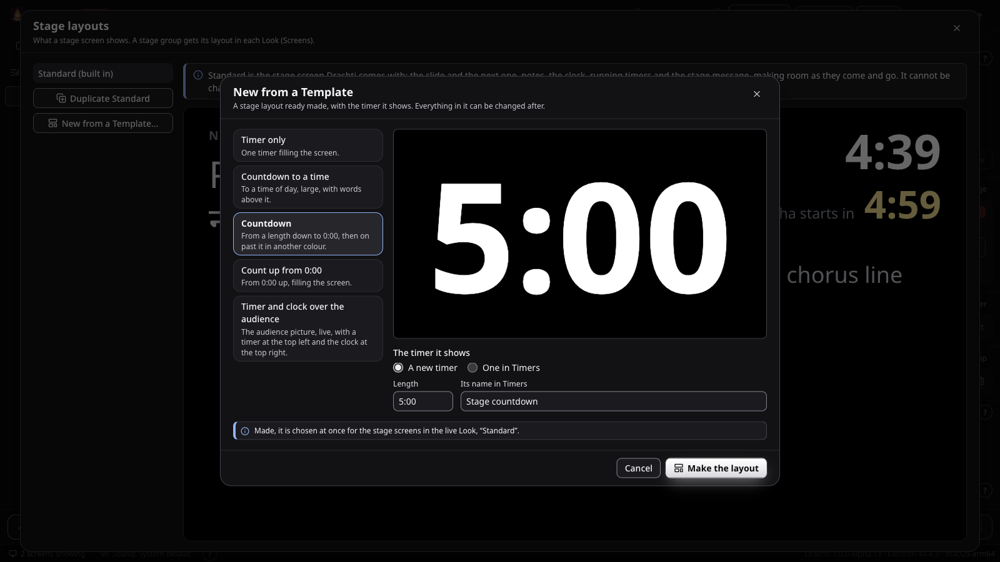

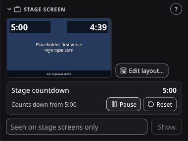

**Props.** In **Props**, **Show** puts one up (the mandir's name, say) over whatever slide is live; **Hide** or **F4** takes it down.

**Looks.** If there is more than one Look ("Gujarati only", "Lower thirds"), switch between them in **Looks**: every screen changes at once.

**Audio.** In the right column, under the live picture, **Audio** holds **Music**: audio playlists, sounds that play one after another, for before the sabha. **+** at the top of **Audio** makes one (**Create playlist**) or brings sounds in from the computer (**Import**). Sounds dragged onto an audio playlist there, from the Finder (Explorer on Windows) or from the library's sheet, go into it. A folder imported as a playlist puts its sounds in an audio playlist of their own too, named after it with " - Audios" (the same sounds, not copies). **Play** starts a list; **Clear audio** along the bottom (or **F5**) stops whatever sound is playing.

**More tools.** Folded away at the end of the right column: **Lower Thirds**, **Masks**, the **Idle rotation** and **MIDI controller…** (a pad, keyboard or foot switch mapped to Next, Back, Clear all, Black-out and the Logo). Press **More tools** to open it or fold it again; each tool starts with a line saying what it does.

**Lower Thirds.** A name, a title or a place across the bottom of the picture. In **Lower Thirds** (under **More tools**), **New…** makes one: up to three lines (a name, a title and a place, say); how it looks (the words' and the band's colours, how solid the band is, one of Drashti's fonts and its weight, its size, left, centre or right, and how far from the bottom); where it shows (**The hall's screens**, **The stream** or **Both**); and how it comes in and goes out: type in **Find an animation** ("fade", "slide left", "bounce", "typewriter") and choose one, and it plays in the small picture above the list (**Play again** plays it once more). **Save** keeps it. Then **Show** puts it up, and the same button, now **Hide** in LIVE's colour, takes it off again, going out the way it came in. **Clear all** (F1) takes it off at once with everything else, and **Put it back** brings it back; **Black-out** and the **Logo** cover it, as they cover the slide. On a key and fill pair (for a video switcher), the key and the fill draw a lower third alike at every moment, as it comes in and goes out too. **Edit** changes one (if it is up, the screens change at once); several can be chosen together and deleted at once, and **Undo** brings them back.

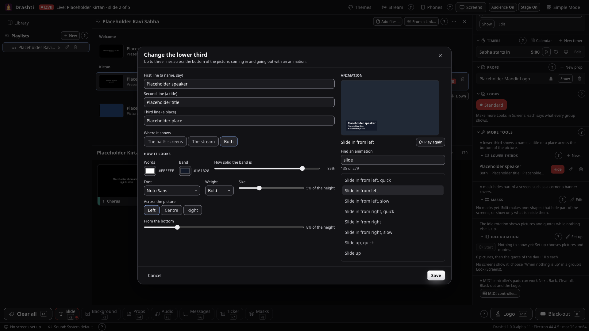

**Announcements from phones.** While the network is on, **Announcements** in the header says how many are waiting. Open it, read each one, fix a typo with **Edit**, then **Approve** it into the ticker or as a message, or **Reject** it.

**The phone remote.** A paired phone or tablet's remote has much of this window: LIVE's picture with its lines and time bars, the clear buttons in their order with their keys' names, **Back 15 s**, **Forward 15 s** and **Last 10 s**, the music with **Play**, the stage message and the stage layout's timers, timers shown on the screens, props, lower thirds, the idle rotation, and the library's **Presentations** and **Media** (`docs/presenter-guide.md` has the phone's side). **Look closer**, or a tap on its live picture, shows the screens' picture full screen and sharp, to zoom with two fingers on the phone alone. While a picture is up on the screens (a picture slide, or a picture with no slide over it) and zoomed there on the phone, **Show this zoom on the screens** puts that zoom on every screen, as far as the screens can zoom, and **Back to Whole** undoes it (not in Simple Mode). **Look through** goes through a presentation's slides on the phone alone (a deck's click by click), and a picture or video in the playlist or **Media** has a button of its own to look at it, or play it, there. Screen setup, the **Audience** and **Stage** switches, video inputs, windows, setting up picture in picture and approving announcements stay on this computer.

**Files and phones.** To let the phones look at a playlist's files, right-click the playlist and choose **Share with Phones and Tablets** (offered while a phone remote is paired): its row gets a mark, and the remote's **Library** has **Shared from Drashti** beside **Presentations** and **Media**, its files to look at and play on the phone only. **Stop Sharing**, in the same menu, ends it. With **Phones and tablets may add files** turned on in **Phones** (it is off until someone turns it on), the remote's **Media** has **Add from this Phone…** at its top: a picture, video, sound, PDF, PowerPoint or Keynote file, up to 2 GB, comes into **Media** and the playlist **Added from Phones**, marked with the phone's name. It never goes on the screens by itself, and a PDF, PowerPoint or Keynote file waits while the stream is on air or recording.

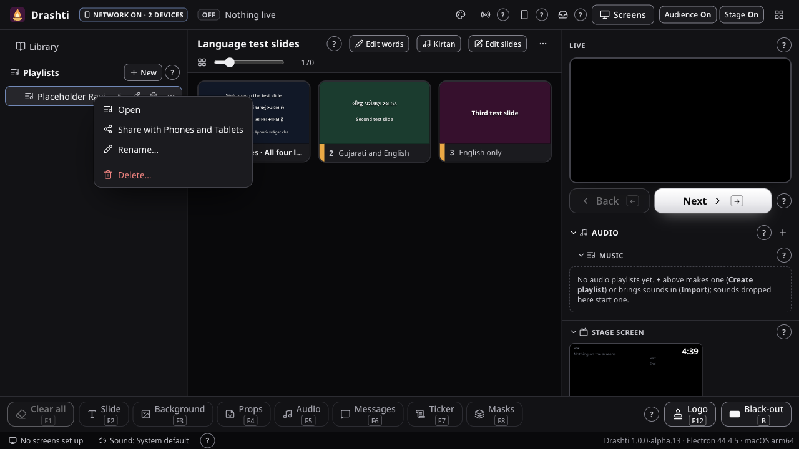

**Zooming the picture on the screens** (Pro Mode). While a picture is up (a picture item, or a slide that is a picture, such as a PDF or PowerPoint page), scroll or pinch over the **LIVE** picture to zoom it and drag it to move it, or use **+** and **−** under it; every screen follows smoothly, together. It lasts for that showing: the next slide comes up as it is kept. **Reset** goes back; **Keep this zoom** saves it with the picture, so it shows that way wherever it shows from then on. A phone can put a zoom on the screens too (**The phone remote**, above). A picture's zoom and enhancements are set once in the **Picture editor** (`docs/admin-guide.md`, section 10).

**The time bar.** While a video or a sound plays, a bar under **Back** and **Next** shows it (in Simple Mode, under the live picture), one for each thing playing: **Background**, **Slide video**, **Box video** (in the picture-in-picture box), **Sound**, or **Music** for an audio playlist's track (which has its bar in the **Music** panel too). Before the bar is the time played, after it the time left; its start and end points are short upright lines, and its markers are ticks. Click or drag along it to move there: while you drag it shows the time, and it moves once, as you let go, on every screen, the second computer, the stream and the sound together. **Play** and **Pause** are at the start of its row. With the keyboard on the bar, **→** and **↑** move it 5 seconds on, **←** and **↓** 5 seconds back, **Page Up** and **Page Down** 30 seconds on and back, and Home and End go to its start and end points; there they never change the slide. Simple Mode shows the bar and the time left only. In Simple Mode nothing, not even a phone, moves what plays, jumps it (**Back 15 s**, **Forward 15 s**, **Last 10 s**) or pauses it, apart from the music's own **Pause music**; **Play** always works, so nothing stays paused, and a phone's markers still jump. A video on a slide can show a thin play bar on the screens too, along its bottom, with its time: turn on **Show the play bar on the screens** for it in the slide editor (it is off to begin with).

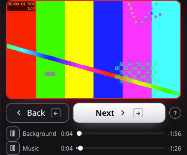

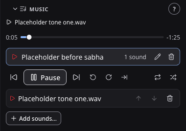

**Markers.** While a video or a sound with markers plays, its markers are buttons under the live picture: a press jumps every screen and the sound there together. A video's start and end (where it plays from and to) are set on its timeline: **Start, end and markers…** in its card's menu, or its row in **Media** (`docs/admin-guide.md`, section 10). It plays between them as the background, on a slide (its sound too), as a prop and as the logo, on every screen alike: going round between them if it loops, or stopping at its end point if it plays once. In the picture-in-picture box, swapped or not (section 7), it goes round between them. The marker buttons, and the jumps below, are for the background's video and a sound alone.

**Back 15 s, Forward 15 s, Last 10 s.** While a video plays as the background, or a sound plays on its own, its row under the live picture (**Background:** or **Sound:**) has **Back 15 s**, **Forward 15 s** and **Last 10 s**, before its markers; for an audio playlist's track they are in the **Music** panel, in the row with **Play** and **Pause**, as three small buttons after the next track's (the mouse over one names it). Each is a jump, as to a marker: every screen and the sound land there together, in step. They never go past the file's start or end (or the start and end points set on its timeline): **Back 15 s** in the first 15 seconds goes to the start, **Forward 15 s** in the last 15 seconds goes to the end, and **Last 10 s** on a file shorter than 10 seconds goes to the end. At the end, what always happens there happens: a looping video goes round, a file played once stops at its end (and **Back 15 s** there plays it again at once, on every screen together), and an audio playlist goes on to its next track. While the music is paused, they move the place where **Play** starts it again. They are dimmed until Drashti knows how long the file is, a moment after it starts.

**Music during the sabha.** A slide or item with a sound of its own stops the music (with a short fade); a slide whose sound file is missing leaves it playing (**File missing**, in section 3). **Clear audio** (the **Audio** button along the bottom, or **F5**) stops it too, and **Put it back**, pressed at once, brings it back where it would be by now.

## 3. When something goes wrong

**The controls are covered by an output.** Press **Cmd+Shift+U** (Ctrl+Shift+U on Windows): every output over the controls turns off. It works even when Drashti is not the active app. Straight after a change to the screens, that output asks **Keep these screens?** in its middle: Esc goes back to the screens as they were. **Cmd+1** and **Cmd+2** ask there too ("Turn Audience off?"): Enter turns them off, Esc cancels.

**A screen shows the computer's desktop.** **Audience** (or **Stage**) may be off: the status bar then says **Audience off** (or **Stage off**). Press **Turn on** there, or **Cmd+1** (**Cmd+2** for the stage screens), and they come back on the same displays.

**A mistake on the screens.** Put the right slide up with a click, or press **←** (the slide before). After **Clear all** by mistake, press **Put it back** at once.

**A screen is black or frozen.** Open the screens dashboard: its picture shows what that screen really shows. Pro Mode can **Reload** it there. Drashti also restarts a screen that stops drawing by itself, within about 10 seconds. If a screen kept failing, a red notice at the top of the window says so ("“Main Hall 1” has stopped"), in Pro Mode and in Simple Mode, and the status line says **stopped**: Drashti tries it again every few minutes, and **Try again** on the notice (or in **Screens**, **Cmd+Shift+S**) tries at once. The notice goes by itself when the screen is back, or when you close it. If a whole output computer stopped (a node offline), carry on: its screens keep their last picture, and it comes back by itself when the network does.

**No sound in the hall.** Check the status bar: it says where the sound goes and warns when the chosen output is missing (Drashti then plays on the computer's own speakers). Check the mixer's channel.

**No sound on the stream.** While on air or recording, the header shows **No sound** beside ON AIR when nothing has reached the stream for 20 seconds (or 3 seconds after its microphone was unplugged), and a yellow notice under the header says what to check: the microphone, its cable and the sound desk. It goes by itself as soon as sound comes back. Drashti never changes the microphone by itself; choosing another is in Stream settings (Pro Mode).

**The stream's picture has stopped.** A red notice under the header says so when the stream's own page kept failing (six times in a minute), in Simple Mode too: the stream shows its last picture. Press **Try again**; if it stops again, tell whoever looks after Drashti.

**A red notice says Drashti couldn’t read the playlists, this playlist, a presentation or what the screens are showing.** The screens keep what they show. Press **Try again** on the notice; it goes by itself once Drashti can read it. Until then Simple Mode’s **Next** says it has nothing to start, and while Drashti can’t read what the screens are showing (it asks again by itself for a few seconds first), Next, Back and the clears wait. If Try again doesn’t work, tell whoever looks after Drashti.

**The stream says Reconnecting.** Do nothing: Drashti tries again by itself and the recording carries on. The hall's screens are not affected. If it also says **the stream server's certificate could not be checked**, waiting will not help: tell whoever looks after Drashti (the admin guide, section 12).

**Font not on this computer.** Beside LIVE (and on the screens dashboard, for the screen it is about) this names a font the live slide uses that the computer does not have: its words show in another font. Carry on, and tell whoever looks after Drashti afterwards (the admin guide, section 11).

**File missing.** Under the live picture, **File missing: “…”. The background stays as it was.** names the picture or video behind the live slide that Drashti cannot find: one not found when the slide was imported, or one deleted from **Media**. Nothing goes up for it: the background stays as it was, never black because of it. That slide's picture in the middle says **Missing**, Simple Mode says the same, and if Drashti closes by itself, the slide it puts back says so again. **File missing: “…”. The sound stays as it was.** names the live slide's sound that Drashti cannot find, for the same reasons. Nothing plays for it: the sound or music already playing carries on. Simple Mode says it too, and so does the slide put back if Drashti closes by itself. Before it goes up, that slide's picture in the middle says **Missing** with the sound's mark in its bottom left corner (a missing background's is in its top left), the slide editor says so under the slide's sound, and Simple Mode's **Next** names it. Carry on, and tell whoever looks after Drashti afterwards: once the file is found (**Find missing media…** in the import report), or a deleted one imported again, the line goes, and the slide shows or plays it the next time it goes up.

**Drashti closed by itself.** Start it again: it puts back what was on the screens (the slide or a timer shown alone, the background, sound, timers, messages, props and the picture-in-picture box) and says so at the top. A video (the background's, or one on a slide, a prop or the logo, or in the picture-in-picture box) or a sound carries on where it would be by now, between its start and end points; the background's video and a sound count from their last jump (a marker, **Back 15 s**, **Forward 15 s** or **Last 10 s**). Under LIVE, the slide put back names again a file still missing (**File missing**, section 3) or a video input this computer does not have (**Video input not on this computer**, section 6). A video input, as the background or in the picture-in-picture box, is put back while it is still in **Media**; if a screen then finds no camera of that name (unplugged, say), it comes off again (the box with it) within 20 seconds, and the note at the top names it. One no longer in **Media** is not put back, and the note names it too. If Drashti was on air less than 5 minutes ago, it goes live again by itself. This happens only within 3 hours of the stop: started later than that (the next morning, say), Drashti puts nothing on the screens, and the note at the top says what was live and when. Within those 3 hours it also comes back in the mode it was in (Pro Mode or Simple Mode); started later, it starts as after a quit on purpose. After Drashti was quit on purpose, it always starts with nothing on the screens. And if it stopped while **Keep these screens?** was waiting, it starts with the screens as they were before that change, and a notice says so. Whatever it puts back, a phone's or tablet's remote and a stage display left open carry on by themselves once Drashti is back, showing what is up now: no need to reload their pages; after an update that needs it, such a page reloads itself once.

**A lock screen in place of the window.** Drashti opens only on a computer that whoever looks after Drashti has let in, for a Gmail they have let in, and it checks over the internet as it starts and every 15 seconds while it runs. On a computer not let in yet, it shows a lock screen, **Let this computer in**: ask whoever looks after Drashti. Under **Request Access**, type your Gmail and press **Request Access**; once they approve it, an email brings you a token. Then, under **I Have a Token**, type that Gmail and the token, and press **Let This Computer In**. A token works once, on one computer, and runs out after 3 days. **Quit Drashti** always works there.

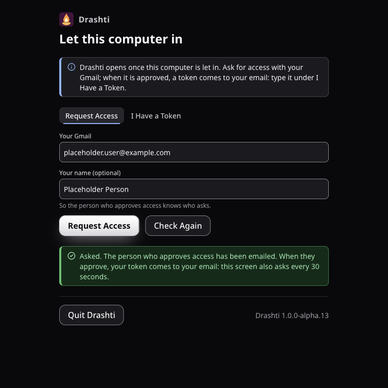

**A countdown: no internet.** If Drashti can't reach the internet while it runs, a warning at the top counts down: **No internet: Drashti stops in … unless it can check your access**. The show carries on meanwhile: get the internet back (the mandir's wired connection, or a phone's hotspot as the spare), and the warning goes once Drashti can check again. After 2 minutes with no answer, Drashti stops, as below (time the computer spends asleep does not count). With no internet as it starts, it does not open: press **Try Again** once the internet is back (it also tries again by itself every 15 seconds).

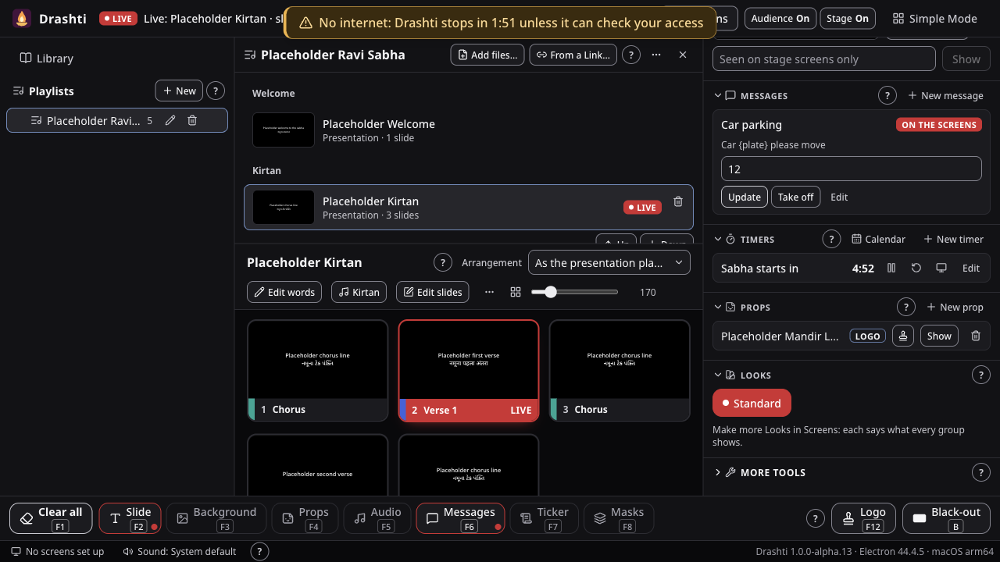

**Drashti has stopped everything.** If this computer's access is removed, or the countdown runs out, Drashti stops at once, saying so in place of the controls (**Your access to Drashti has been removed**, or **Drashti stopped: no internet**): every screen fades to black, the stream and recording end, imports, conversions and downloads stop, the second computer and the phones stop too, and only **Quit Drashti** works. Once the screens have faded, a screen that covered the controls is turned off, so the message is always in view: switch it on again in **Screens** once Drashti is let in again. After the countdown, quit, get the internet back and start Drashti again; otherwise tell whoever looks after Drashti. If the sabha must go on meanwhile, fall back to the old program (below).

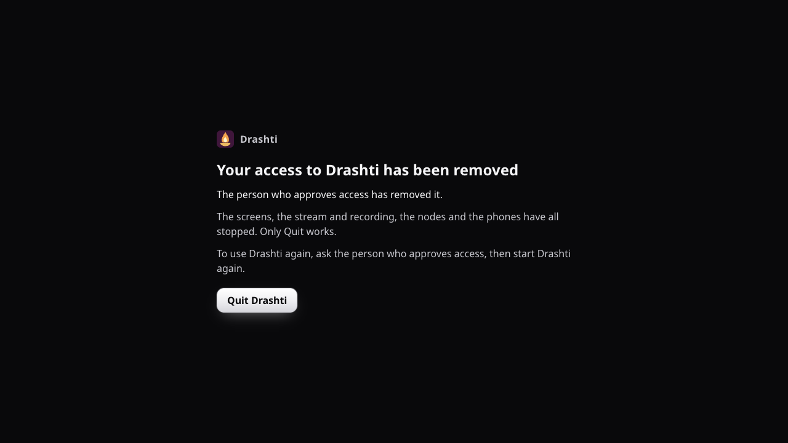

**When to fall back to the old program.** If Drashti cannot keep the screens right, the named fallback operator quits Drashti (**Cmd+Q**, or close its window on Windows) and opens the mandir's old presentation program, as practised (`docs/parallel-run.md`, section 9). Then save diagnostics (below) for whoever looks after Drashti.

## 4. After the sabha

1. **The stream**: **End the stream…**, then **End the stream**, and **Stop recording**. End the broadcast in YouTube Studio too.
2. **F1** (Clear all), so nothing is left up.
3. If anything went wrong, **Help**, then **Save Diagnostics…**: a file appears on the Desktop. Send it to whoever looks after Drashti with the time and what you saw. It holds no kirtan words, names or file paths. If Drashti asks about crash files, leave **Include crash files** unticked unless whoever looks after Drashti asks for them: they can hold words from slides.
4. Quit Drashti, or switch to Simple Mode for the next volunteer (**View**, then **Switch to Simple Mode**).

## 5. Zoom

Drashti works with Zoom both ways, and needs nothing paid for it: no Zoom account of its own, no paid Zoom plan, and nothing installed but Zoom itself. A free Zoom account keeps Zoom's own 40-minute limit on meetings of three or more people.

**Zoom sees the stream's picture.** For a meeting that should see what YouTube sees (a sabha shared with another mandir, say):

1. In the **Stream** panel, press **Window for Zoom…** (or **View**, then **Window for Zoom…**). A window called **Drashti for Zoom** opens with exactly the stream's picture: the camera with the words as a lower third, or the slides, as the stream's layout says, whether or not the stream is on air. Nothing else is drawn on it: no buttons, no words of Drashti's own.
2. Leave it open where it can stay (beside the controls, or on a spare display), never minimised: Zoom shares only an open window. Make it bigger or smaller from a corner: it keeps the picture's shape, and opens there again next time. It never goes full screen or covers a display by itself.
3. Zoom's microphone: in Zoom, beside **Mute**, choose the mixer's input, the same one the stream uses. For kirtans and music, turn on Zoom's **Original sound for musicians** (Zoom's settings, **Audio**). Drashti sends no sound to Zoom.
4. In Zoom: **Share Screen**, choose the **Drashti for Zoom** window, then **Share** (leave **Share sound** off).
5. To stop: **Stop Share** in Zoom, then close the window. Closing it changes nothing on the screens or the stream.

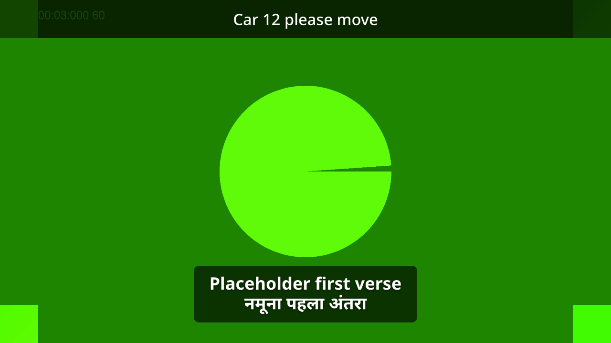

**The meeting on the hall's screens.** For a speaker who joins by Zoom, shown live in the hall:

1. Join the meeting in Zoom first, and leave Zoom's window open (not minimised) the way the hall should see it: speaker view or gallery view.
2. **Library**, then **Media**, then **Show a Window…**. It lists the other apps' open windows, each by name with a small live picture: never a whole screen, and never Drashti's own. On a Mac, the first time, it says why it needs **Screen Recording** and opens System Settings, where it is turned on (`docs/admin-guide.md`, section 4).
3. Choose Zoom's window (usually **Zoom Meeting**), look at its small picture (never an inbox or a chat), and press **Show on the screens**. Nothing goes up before that.
4. It is now the background, fitted in with black around it: slides, a lower third, messages and the ticker go over it as over a video. **Black-out** and **Logo** cover it; **F1** (Clear all) or **F3** (the background) takes it off; **Put it back**, straight after Clear all, brings it back while the window is still open. The stream shows it wherever it shows the hall's background. Stage screens say **Window on the screens**, and an output node's screens (another computer's) show the rest of the show without it, as the screens dashboard says.
5. Its sound: none from Drashti. The meeting's sound reaches the hall through the mixer, as now.
6. If Zoom's window is closed, minimised or hidden, the screens keep its last picture and a yellow notice under the header says so: open the window again to carry on live, or press **Clear the window**.
7. After Drashti stops unexpectedly, the window is not put back (it may be gone): the note at the top names it. Show it again with **Show a Window…**.

The phone remote names it (**A window: Zoom Meeting**), and its **Clear** takes it off; a phone can never choose a window. In Simple Mode, **F3** and **Clear all** take it off too, but only Pro Mode can show one.

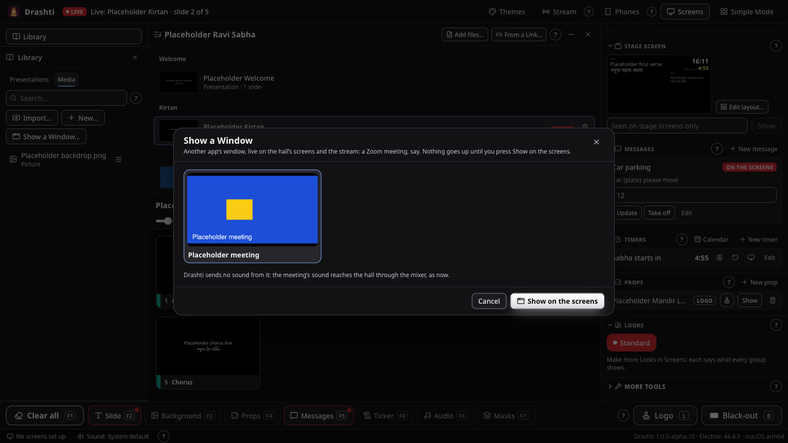

## 6. Video inputs

A **video input** is a camera or a capture input on this computer: the video mixer's program through its USB output, say. It is named once, for example "Input 1" (**Library**, then **Media**, then **Add a Video Input…**; `docs/admin-guide.md` has the details), and from then on it is one click away.

**A warning.** If the mixer's program is Drashti's own picture, showing the mixer's program in Drashti makes a picture inside itself, over and over. Use it while the mixer shows a camera.

1. **Library**, then **Media**: **Video inputs** lists them above the files, each with its own small live picture and a line saying how it sits on the screen (or why it has no picture now).
2. Click it ("Input 1", say). It fades in as the background, and the slide's words, a lower third, messages and the ticker stay over it. Nothing goes up before that click.
3. It shows on **LIVE**, on the hall's screens and in the stream's **Slides** layout: YouTube sees what the hall sees. **Camera and words** keeps the stream's own camera. Stage screens say **Video input on the screens**, and an output node's screens (another computer's) show the rest of the show without it, as the screens dashboard says.
4. **Black-out** and **Logo** cover it. **F1** (Clear all) or **F3** (the background) takes it off; **Put it back**, straight after Clear all, brings it back.
5. Its sound: none from Drashti. The hall's sound comes through the mixer, as now. A mixer's USB output is also a sound input, so it can be chosen as the stream's **Sound input** in Stream settings.
6. If it stops (its cable out, or another app using it), the screens keep its last picture, and a yellow notice under the header says so, with **Clear the input**. It comes back by itself when the input returns. If the notice says the computer no longer lets Drashti use the camera, tell whoever looks after Drashti.
7. After Drashti stops unexpectedly, it is put back if it is there; if it is not, the note at the top names it.

**In a playlist.** An input goes in a playlist as a picture or video does: in **Media**, right-click its row and choose **Add to “…”**, which names the open playlist, or drag the row onto a playlist; neither puts it up (a plain click on the row does). Its card says **Video input**. Click the card and the middle shows its live picture; a click on that picture, or **Next** coming to the item, puts it up as the background, coming on over 1 second, and takes the slide off, as a picture item does.

**Behind a slide.** In the slide editor, under **Behind it and with it**, **Choose** (or **Change**) beside the background lists **Video inputs on this computer** above the pictures and videos. Choose one, and the slide says **Background: the video input “Input 1”**; its picture in the middle names the input too. When the slide goes up, the input comes on behind it over 1 second, and the slides after it with no background of their own keep it.

**On a computer without it.** A playlist and a slide keep the input by its name, as the library travels: on another computer, that computer's input of the same name goes up (name them alike). Where no input has that name, the card says **Not on this computer**, the middle says why, and **Next** goes on past it to the next item (with that item chosen in the middle, Next says the input is not on this computer). A slide naming one goes up with the background left as it was, never black because of it, and LIVE says **Video input not on this computer: “Input 1”. The background stays as it was.** If Drashti closes by itself, the slide it puts back says so again. Renaming an input in **Media** (**Change** on its row) takes this computer's playlists and slides with it, to the new name, and what is on the screens carries on. Another computer still finds its own input by the name: give that computer's input the same new name too, or there they say **Not on this computer**. The **Change** dialog says both, under **Name** and **Fit**.

The phone remote names it (**Video input: Input 1**), and its **Clear** takes it off; a phone never chooses one, but tapping a playlist's video input item, or **Next** coming to it, puts it up. In Simple Mode, **F3** and **Clear all** take it off too, and **Next** (or a click on the item) puts up a playlist's video input; only Pro Mode can choose one in Media. The input on the screens can't be deleted from Media until it is taken off.

## 7. Picture in picture

Something small in a corner of the hall's screens while the main picture carries on: a camera, a picture or video, another app's window, or the slides.

1. **Library**, then **Media**, then **Picture in Picture…** (beside **Show a Window…** and **Add a Video Input…**).
2. Under **What goes in the box**, choose **The slides** (made small: the main picture shows the background, props, messages and the ticker without them), **A video input**, **A picture or video** (from Media) or **A window** (another app's, as **Show a Window…** offers).
3. **Where it sits**: a corner. **Size**: **Small**, **Medium** or **Large** (a quarter, a third or two fifths of the screen's width). Then **A thin border**, **Rounded corners**, and **How it comes on and goes off**: **Fade**, **Scale** or **Slide in from its corner**.
4. **Show in the box**: nothing goes up before that. With a box up, **Put this in the box** changes what is in it, and the other choices change it on the screens at once.
5. Under **LIVE**, a line names what is in the box (**Picture in picture** and its name), with **Swap**, **Take off** and its settings. Drag the box in **LIVE** to put it anywhere on the screen; let go near a corner and it goes into that corner.
6. **Swap** changes them over: with the slides in the box, the slides fill the screen and the background goes small; with anything else, it takes the background's place, under the slides, and the background goes in the box. The main picture dissolves from one to the other while the box makes its own move, never a cut and never black: the main picture never grows, shrinks or slides. **Swap** again changes them back.
7. **Black-out** and **Logo** cover it. **Clear all** or **Take off** takes it off, and **Put it back**, straight after Clear all, brings it back (a video input in it as Media has it now: one taken out of Media meanwhile stays off).
8. The box makes no sound: a video in it plays without its sound, going round between its start and end points (**Markers**, in section 2), swapped or not.

The stream shows it whenever it shows the hall's picture: in its **Slides** layout, and in **Camera and words** while a picture or video fills the stream in the camera's place (never over the stream's own camera). A Look can leave it out on a group of screens (its **Picture in picture** layer, in **Screens**); a key and fill pair leaves it out unless its Look turns that layer on. An output node's screens show a picture, a video or the slides in the box, but not a video input or a window. Where the box sits and how it looks are remembered for next time. After Drashti stops unexpectedly, the box comes back with the rest of the show. A video input in it comes back while it is still in **Media**; if a screen then finds no camera of that name, the box goes off again with its usual move (within 20 seconds), and the note at the top names the input. One no longer in **Media** is not put back, and the note names it too. The phone remote names it, and its **Take off** takes it off; a phone can't set one up. In Simple Mode the line under the live picture names it with **Take off**, and **Clear all** takes it off too, but only Pro Mode can set one up, swap it or move it.

## 8. Keys at a glance

In Drashti, **Help**, then **Keyboard Shortcuts…** (or press **?** when no field is chosen) lists every key, as your computer writes it. They follow what the operators already press (**The keys that moved**, in section 2). At its top, the switch **Single-letter keys** turns **B**, **.**, **L** and **?** off, for someone who works the computer by speaking to it or with a switch, so that a word said never blacks out the hall. Then those four keys do nothing, the list says **Off** beside them, the logo keeps **F12**, and **Black-out** and **Logo** work from their buttons, a MIDI pad and the phone remote as always. The full key card, including the slide editor's keys, is at the end of `docs/parallel-run.md`. Going live, ending the stream and recording have no keys: always the buttons, and always a question first.

