# The operator's guide: running a sabha in Pro Mode

This guide is for the **operators**: the people who run a sabha's screens in Drashti's Pro Mode, from switching on to switching off. It goes through a whole sabha in the order things happen. A volunteer who only presses Next uses Simple Mode instead (see "Simple Mode, for a volunteer" in `docs/parallel-run.md`), and setting Drashti up (screens, PINs, backups, the node, schedules) is the admin's job (`docs/admin-guide.md`).

On the Mac, **Cmd** is the ⌘ key; on Windows use **Ctrl** instead. On Windows the menu bar is hidden: press **Alt** to show it.

**This guide is inside Drashti too:** **Help**, then **Guides…**, with the presenter's guide (and in Pro Mode the admin's and the setup day's). Type a word in **Search the guides** to find every passage that holds it, by section, after up to three answers to questions such as "When a screen is black or frozen, what do I do?"; choose one to read it in its place. It needs no internet. **Esc** closes it.

**The window, left to right:**

- **Left column:** at the top the **Playlists**, as many as you like, in folders: **+ New** makes one, and the chosen one shows **Rename** and **Delete** at its end. Below them the **Library**: Presentations and Media, with the search box and, under it, **Import…** (files, a folder, or from a link) and **New…** (a presentation from pasted words). Drag the line between them to give either more room; Drashti remembers it. The Shastra tab, the Templates and the kirtan filters show only when an admin turns on **View › Show Shastra, Templates and Kirtan Details**.
- **Middle:** the **open playlist** at the top: its name, **Add files…**, **From a Link…** and its menu (**⋯**), then its items as cards, each with a picture, its name, what it is (a presentation, a deck, a video, a picture, a sound, a header) and its length or how many slides. Drag a card to move it, or drop presentations, pictures, videos or files anywhere on it. Below it, the **slides** of the item you clicked, in the order they play. With no playlist open (**×** closes it), the slides of the presentation chosen in the library fill the middle.
- **Right column:** the live picture, headed **LIVE** (what the hall sees now), with **Back** and **Next** under it (Next, in the appearance's one strong colour, is always the next thing to do; each does exactly what its key does), then **Audio** (Music and the Arti), the **Stage screen**, **Messages**, **Timers** (one line each: start or pause, reset, show on the screens, Edit), **Props** and **Looks**, and **More tools**, folded away: Macros, Masks and the Idle rotation, each with a line saying what it is.
- **Along the bottom:** **Clear all** (F1), the **clear buttons** for each layer, **Logo** and **Black-out**, then the **status bar** (the version, the screens, imports, warnings).

**The first start.** A new library opens with a welcome: Drashti's lamp lights, then three choices. **Set Up Screens…** opens the setup (the admin's guide has it). **Try a practice show first** puts five placeholder slides on this screen only, with a banner saying so: try Next, Back, **B**, **L** and **F1** as in a sabha; nothing goes to the hall's screens, the phones or a stream, and nothing is saved. **Leave the practice show** brings the welcome back. **Skip for now** leaves the middle of the window showing three steps to a sabha: **Import…** what you show, make **this week's playlist**, and **Set Up Screens…**. The welcome comes once; **View › Set Up Screens…** opens the setup any time.

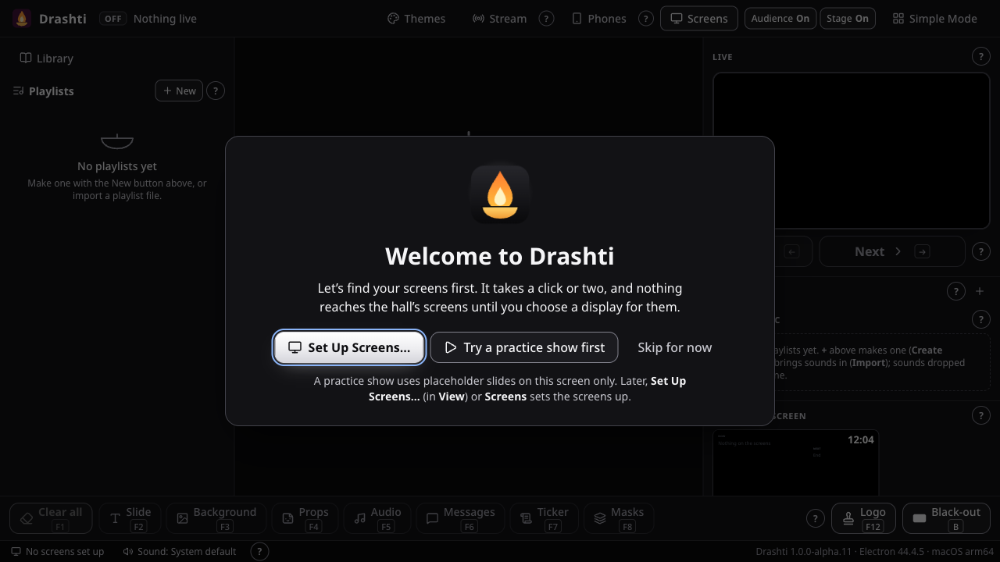

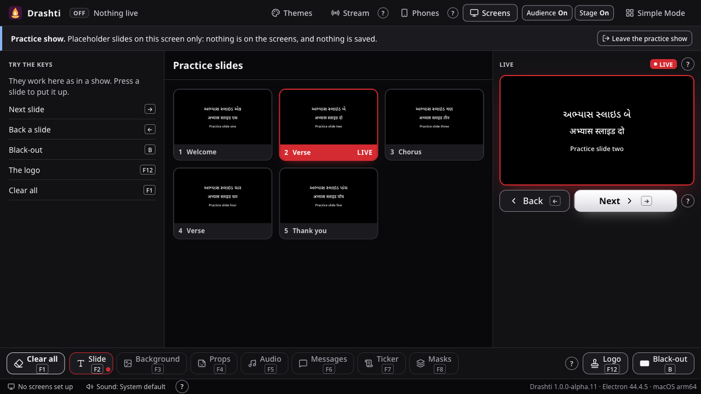

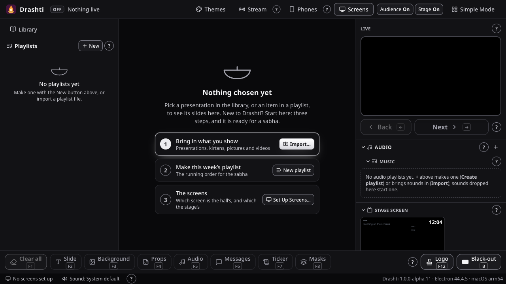

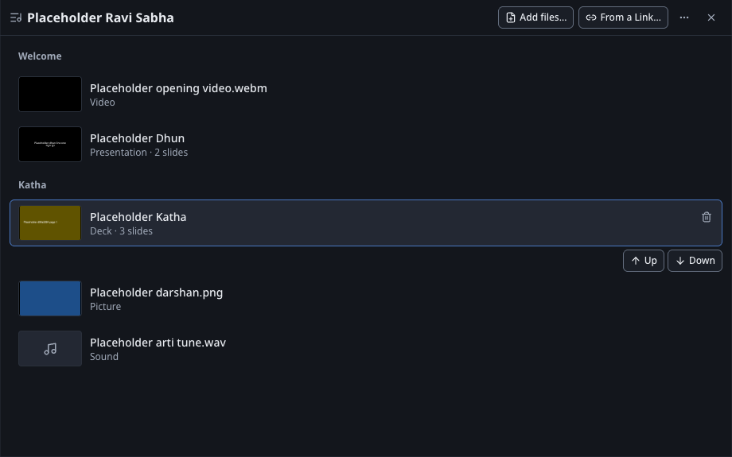

**How Drashti looks on this computer.** **View**, then **Appearance**, chooses its look: **Follow the computer** (the first choice: Black when the computer is set to dark, White when it is set to light, changing with it), **Black**, **White**, **Saffron**, **Peacock**, **Midnight Blue**, **Sandalwood**, **Lotus**, **Marble** or **Tulsi**. It changes Drashti's own window at once, and stays chosen when Drashti starts again; **the screens in the hall, the stream and the phones never change with it**. In every one, LIVE is red with its word, the next thing to do is the one strong colour, and warnings are amber. **Appearance…** there shows each as a small picture of this window. It also has **Make a copy of …**, to make your own: give it a name, choose **Dark** or **Light** and the colour of the next thing to do, and Drashti works out the rest. It says at once if that colour is too close to LIVE's red, ON AIR or a warning, and offers the nearest colour that works; **Save and use it** waits until every check is met. Your own appear under **Your own**, where **Delete…** asks first (if it was in use, Drashti follows the computer again); the ones Drashti came with can't be deleted. **Interface motion**, there too, is **Calm** (things arrive and leave gently), **Lively** (tabs glide, cards arrive one after another, buttons answer a press, one appearance fades into the next) or **Off** (nothing moves); whichever you choose, Next, Back, the clears, Black-out, Logo, the slides and the live picture never move, and the computer's own setting to reduce motion turns it all off. Simple Mode shows the appearance chosen here, with no way to change it.

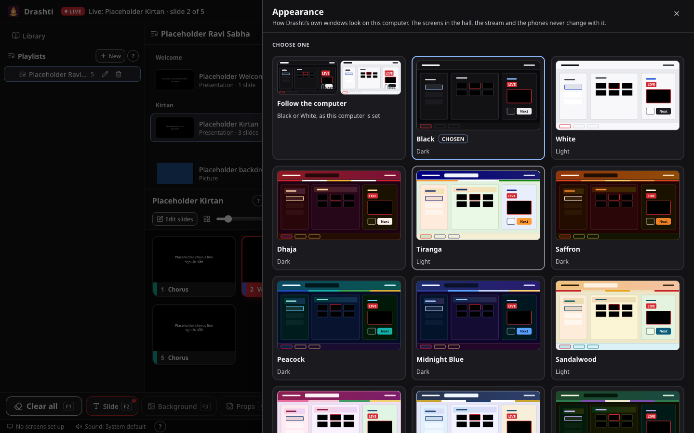

---

## 1. Before the sabha

Do these about 30 minutes before the sabha starts.

1. **Switch on and start Drashti.** Without PINs it opens in Pro Mode. If the screen shows Simple Mode (big buttons, as it does with PINs set), press **Switch to Pro Mode…** at the top right, and type the **operator PIN** (or the word **pro** if PINs are not set).
2. **Check the screens.** Click the screens line in the status bar (for example "3 screens showing"). The **screens dashboard** shows a small picture of what every screen really shows, the hall's, the stage's and the second computer's (the node). Every node should say **Online** and its pictures and videos **ready** (for example "14 of 14 ready"). **Identify** puts a screen's number on it if you are not sure which is which.

   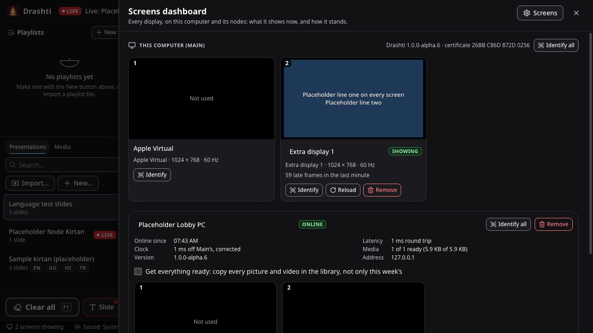

3. **Open tonight's playlist.** Under **Playlists** click it: it opens in the middle. If it is a playlist from an earlier week, open it now (a click is enough): the second computer then copies its pictures and videos in good time.
4. **Check the sound.** Play a sound from the playlist, or press **Play** in the **Music** panel, and check the mixer hears it. The status bar always says where the sound goes; a warning there means the chosen output is not connected.
5. **Music before the sabha.** In the **Music** panel, choose the list and press **Play**. It plays one sound after another with short fades, apart from the slides, until a slide's own sound takes over or you press **Pause**.

   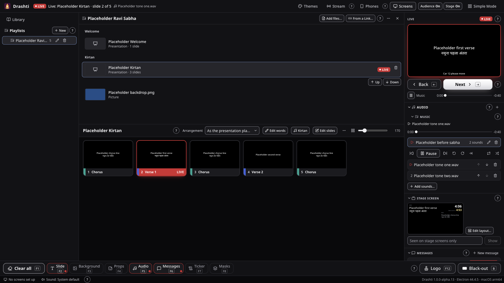

6. **Darshan pictures and quotes on the screens** (if the admin set up the idle rotation): unfold **More tools** and press **Start** in the **Idle rotation** panel. It stops by itself when the first slide goes up.
7. **A countdown for the start** (if wanted): in **Timers**, press **Start** beside the countdown (for example one named "Sabha starts in"), and **Show on the screens** to put it on the hall's screens: they show "Sabha starts in 4:59".
8. **The stream** (only on the computer that streams, and only if tonight's sabha is streamed): press **Stream** in the header, choose **Camera and words** or **Slides**, press **Record** if it should be recorded, then **Go live…** and **Go live**. The header says **ON AIR** (and **REC**). Section 6 of `docs/parallel-run.md` has the details.
9. **Phones** (if a phone remote or a stage tablet is used): press **Phones**, check **Let paired phones and tablets connect** is on, and check each phone says **Connected**.

## 2. Running the sabha

**Starting.** In the open playlist, click the first item. Its slides appear in the middle. Press **Space** (or **→**), or **Next** under LIVE, to put the first slide on the screens.

**Going through it:**

| Key                                      | What it does                                                                       |
| ---------------------------------------- | ---------------------------------------------------------------------------------- |
| **Space**, **→**, **↓** or **Page Down** | The next slide; at the end of an item, on into the next (headers are stepped over) |
| **←**, **↑** or **Page Up**              | The slide before                                                                   |
| **Shift+→** or **Shift+↓**               | The start of the next item                                                         |
| **Shift+←** or **Shift+↑**               | The start of the item before                                                       |
| **Next** or **Back** under LIVE          | The same as **Space** and **←**, at once                                           |
| A click on a slide                       | That slide, at once                                                                |
| A click on an item, then **Space**       | That item, from its first slide                                                    |

- What the next press will bring shows on the stage screen (its **Next**), on a presenter's phone or tablet, and in Simple Mode.
- Pictures and videos in the playlist go up as the **background**; the words of the next presentation go over them. A sound plays through the mixer and leaves the picture as it is.
- A presentation can play in its own **arrangement** (a chorus sung three times shows three times): choose it above the slides.
- **Repeat Slides** (its icon is two arrows going round): a playlist whose pictures and slides go round by themselves, the last back to the first, for a lobby or before the sabha. **+ New › Repeat Slides** makes one; put pictures, PDF or PowerPoint decks and presentations in it (a video or a sound is refused, saying why). Under its name: **Seconds each** (15 to begin with, 3 to 600), the **Transition** (Fade to begin with, or Cut, Fade through black, Slide or Slow zoom) and how long it takes (1 s to begin with, 0.3 to 3 s, never more than half the seconds each); a change takes effect from the next slide. **Start** (there, or ▶ on its row) starts from its first slide; clicking one of its items shows all its slides in the middle, and a click on a slide starts from there. LIVE then says **Repeating · Stop (Esc)**. **Esc** (when no dialog, menu or field has the keyboard) or **Stop** ends it, and **the slide on the screens stays up**; putting anything else up, Clear all and clearing the slide end it too. **Black-out** and the **logo** cover it while it goes on underneath. After an unexpected restart it carries on. Simple Mode can start and stop it, but not change its settings; a presenter's phone shows it and can stop it.
- **Transitions**: any presentation or slide can pick Fade, Fade through black, Slide or Slow zoom in the slide editor, as a Repeat Slides playlist does, and Wipe, Push, Zoom, Line by line or Word by word. Wipe, Push and Zoom move the words only on screens whose Look is Bold (an admin chooses); other screens fade. Pictures always fade, and a kirtan's slides never come word by word. Every screen runs them at the same moment, and each takes the time the slide gives it.
- A **Shastra passage** (with the Shastra tab shown): in the **Shastra** tab, type its reference (for example `SD 14` or `Vach G.Pr. 1`) and press Enter; its slides appear in the middle like a presentation's.
- To find any kirtan quickly: **Cmd+F** (Ctrl+F), type a few letters of its title or its words, and press Enter.
- A playlist, folder or item has a menu (rename, delete, timers when it goes up, and more): right-click it, or press **Shift+F10** with the keyboard on it (on a Mac laptop, **Fn+Shift+F10**).
- **Media** lists the pictures, videos and sounds you imported. A PDF, PowerPoint or Keynote file's pages are its presentation's slides, so they stay out of Media (a page you also import on its own shows there).
- **Deleting.** The chosen row, and the row under the mouse, show a **trash** button at their end: on a playlist or folder, a presentation, a picture, video or sound in **Media**, and on music and its sounds. It does what the **Delete** key does (Backspace on a Mac). It asks first for a playlist, a presentation or media, and saying where a picture, video or sound is used (which playlists, slides, music, props, themes and macros); a playlist item only leaves its playlist. **Cmd+Z** (Ctrl+Z), or **Undo** in the bar at the bottom of the left column, brings it back. Deleted media leaves playlists and music, and slides show nothing in its place, as with a missing file; what is on the screens stays up until you change it. Its file goes only when Drashti next starts, when Undo can no longer bring it back; importing the same file again brings it back everywhere it was used. With roles on, deleting from the library is an admin's.
- **What is this?** The small **?** on a panel's heading (and beside Next and Back, the show controls, Stream, Phones and Announcements in the header, the open playlist, Audio, More tools and the status bar) says in two or three sentences what it is for and what to do first. **Read more** opens this guide at the passage it comes from; **Got it** closes it.
- **Closing with changes asks first.** Edit words, the slide editor and the other editors ask "Keep your changes …?" before anything typed is lost: **Save changes** (it has the keyboard: Enter saves), **Keep editing** (Esc), or **Throw them away**. When the presentation is on the screens, it says so: saving then changes the screens at once, so **Keep editing** has the keyboard instead (Enter keeps editing; click Save changes when you mean it).
- **A smart playlist** (its icon is a folder with arrows) follows a folder on the computer, set up by an admin: what is put in that folder joins it by itself, at the end of its folder's part, and the line under its name says which folder and how it goes ("Adding 2 files…"). Move its items about as in any playlist: they stay where you put them. An item whose file was taken out of the folder says **Not in the folder**, and still plays (Drashti keeps its own copy); **Remove the missing** takes those out (Undo brings them back). A file changed in the folder replaces its item, but never what is on the screens: that stays up until you change it. If the folder is not there (a USB stick taken out), the line says so; nothing is lost, and the playlist carries on when the folder is back.
- **After an import:** the import report offers **Add to playlist**: everything that import brought in, in its order, into the open playlist, another, or a new one named after the file or folder. In **Import from a Link…**, **When it's imported, add it to:** (the open playlist to begin with) does the same by itself when the download's import ends, even with the dialog closed. Undo takes it out again.
- **Changing the playlist without dragging:** choose a presentation, a picture or video, or a Shastra passage in the library and press **Add to playlist** under it; it goes after the playlist's chosen item. To move an item, choose it and press **Up** or **Down** under it (or **Alt+↑** / **Alt+↓**). **Cmd+Z** (Ctrl+Z) takes back the last add or move. Dragging works too: a presentation, a picture or video, or a search result, onto the open playlist (an empty one too) or onto a playlist's name in the list. Files dragged from the Finder (Explorer on Windows) onto the open playlist are imported and go where you drop them, in the order you dragged them.

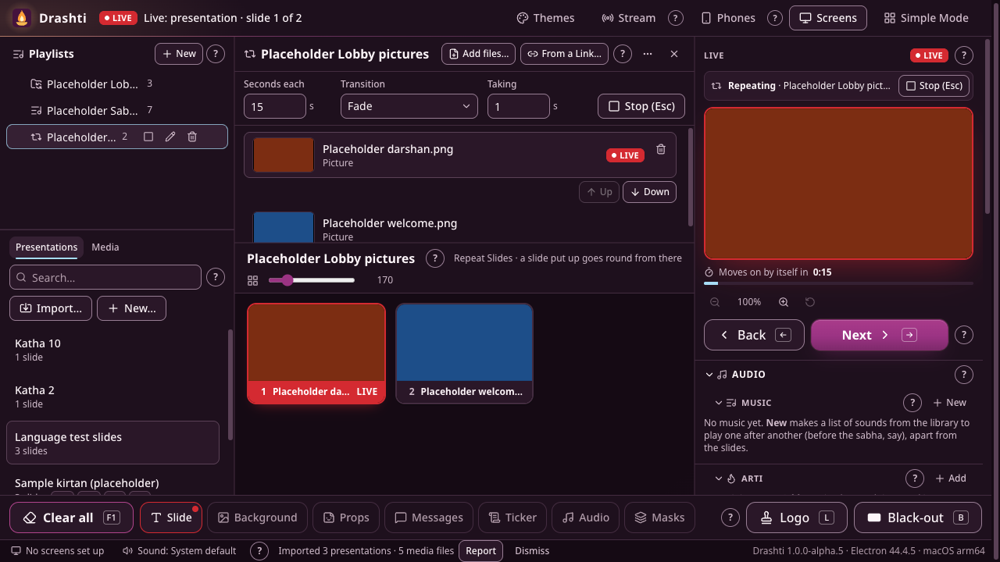

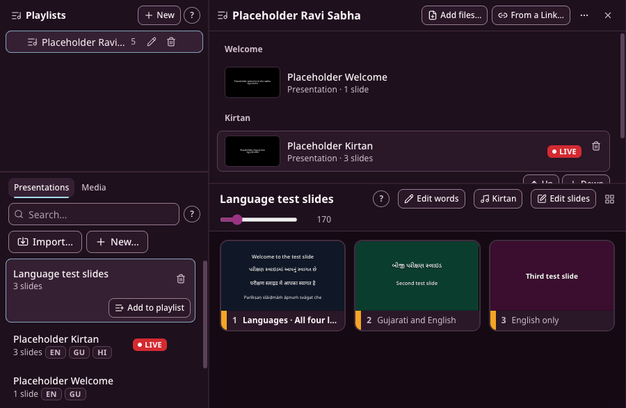

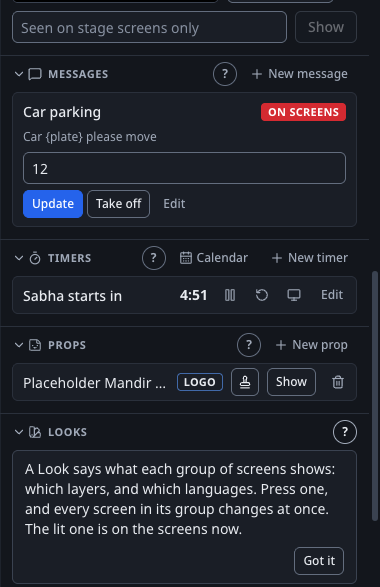

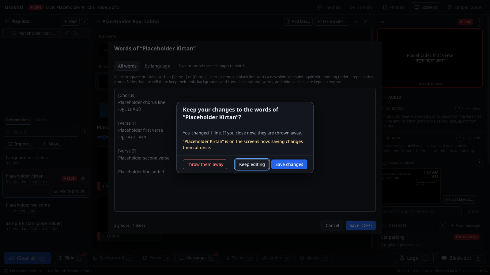

**Covering and clearing:**

| Key or button                                          | What it does                                                                                                                                         |
| ------------------------------------------------------ | ---------------------------------------------------------------------------------------------------------------------------------------------------- |
| **B** (or **.**), **Black-out**                        | Black on the hall's screens, and back exactly as it was. The stage screens keep the words.                                                           |
| **L**, **Logo**                                        | The mandir's logo instead of the picture, and back                                                                                                   |
| **F1**, **Clear all**                                  | Everything off the hall's screens. Straight after it, **Put it back** brings it all back.                                                            |
| **F2**, **F3**, **F4**, **F5**, **F6**, **F7**, **F8** | One layer off each, in this order: the slide's words (the background stays), the background, props, messages, the sound, the Masks layer, the ticker |

A clear button is lit, with a dot, while its layer is on the screens.

If an admin has turned the single-letter keys off (**Keys at a glance**, below), **B**, **.** and **L** do nothing: use the **Black-out** and **Logo** buttons.

**Messages.** In **Messages**, fill in a message's fields (for example the car's number in "Car {plate} please move") and press **Show** (or Enter in the field). It goes across the bottom of the hall's screens. **Take off** removes it; **F5** removes them all.

**Timers.** In **Timers**: **Start**, **Pause**, **Reset**, and **Show on the screens**. The stage screens show every running timer by themselves.

**The stage message.** Under the live picture, **Stage screen**: type a short message for the performers ("Two minutes left") and send it. Only the stage screens show it, and Clear all leaves it; its own **Clear** takes it off. **Edit layout…** beside its picture opens the stage layout editor at the layout the stage screens use now (saving a layout is an admin's).

**Props.** In **Props**, **Show** puts one up (the mandir's name, say) over whatever slide is live; **Hide** or **F4** takes it down.

**Looks.** If the admin made more than one Look ("Gujarati only", "Lower thirds"), switch between them in **Looks**: every screen changes at once.

**Audio.** In the right column, under the live picture, **Audio** holds **Music** (lists of sounds that play one after another, for before the sabha) and the **Arti** (the arti's time and its presentation, which the admin sets). **Play** starts a list; **Clear audio** along the bottom (or **F6**) stops whatever sound is playing.

**More tools.** Folded away at the end of the right column: **Macros**, **Masks** and the **Idle rotation**. Press **More tools** to open it or fold it again; each tool starts with a line saying what it does.

**Macros.** A macro's button (in **Macros**, under **More tools**) does several things at once, as the admin set it up ("Arti": Clear all, the arti prop, the sound, the stage message). Some run by themselves at a time: a strip near the top then counts down ten seconds; press **Cancel** to stop it that time.

**Announcements from phones.** While the network is on, **Announcements** in the header says how many are waiting. Open it, read each one, fix a typo with **Edit**, then **Approve** it into the ticker or as a message, or **Reject** it.

**Zooming the picture on the screens** (Pro Mode). While a picture is up (a picture item, or a slide that is a picture, such as a PDF or PowerPoint page), scroll or pinch over the **LIVE** picture to zoom it and drag it to move it, or use **+** and **−** under it; every screen follows smoothly, together. It lasts for that showing: the next slide comes up as it is kept. **Reset** goes back; **Keep this zoom** saves it with the picture, so it shows that way wherever it shows from then on. An admin sets a picture's zoom and enhancements once in the **Picture editor** (`docs/admin-guide.md`, section 10).

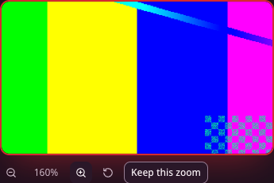

**Markers.** While a video or a sound with markers plays, its markers are buttons under the live picture: a press jumps every screen and the sound there together. A video's start and end (where it plays from and to) are set on its timeline: **Start, end and markers…** in its card's menu, or its row in **Media** (`docs/admin-guide.md`, section 10).

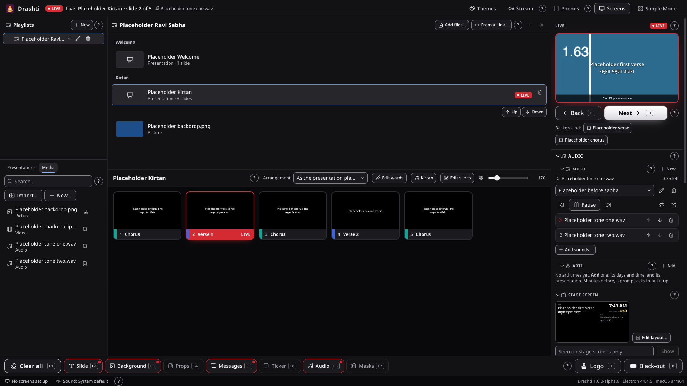

**The arti.** If the admin set the arti's time, a strip under the header names it and counts down to it, from some minutes before. At the time, the arti is what Next shows: press Next at the right moment. **Put up Arti now** puts it up at once; **Not now** leaves it.

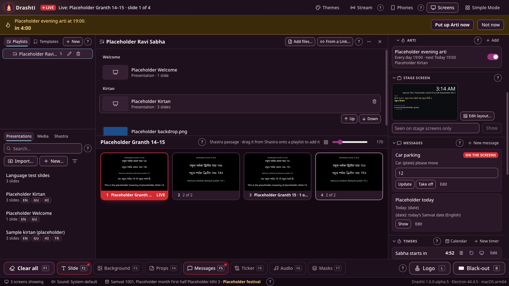

**Music during the sabha.** A slide or item with a sound of its own stops the music (with a short fade). **Clear audio** (the **Audio** button along the bottom, or **F6**) stops it too, and **Put it back**, pressed at once, brings it back where it would be by now.

## 3. When something goes wrong

**The controls are covered by an output.** Press **Cmd+Shift+U** (Ctrl+Shift+U on Windows): every output over the controls turns off. It works even when Drashti is not the active app.

**A mistake on the screens.** Put the right slide up with a click, or press **←** (the slide before). After **Clear all** by mistake, press **Put it back** at once.

**A screen is black or frozen.** Open the screens dashboard: its picture shows what that screen really shows. Pro Mode can **Reload** it there. Drashti also restarts a screen that stops drawing by itself, within about 10 seconds. If a screen kept failing, a red notice at the top of the window says so ("“Main Hall 1” has stopped"), in Pro Mode and in Simple Mode, and the status line says **stopped**: Drashti tries it again every few minutes, and **Try again** on the notice (or in **Screens**, **Cmd+Shift+S**) tries at once. The notice goes by itself when the screen is back, or when you close it. If a whole output computer stopped (a node offline), carry on: its screens keep their last picture, and it comes back by itself when the network does.

**No sound in the hall.** Check the status bar: it says where the sound goes and warns when the chosen output is missing (Drashti then plays on the computer's own speakers). Check the mixer's channel.

**No sound on the stream.** While on air or recording, the header shows **No sound** beside ON AIR when nothing has reached the stream for 20 seconds (or 3 seconds after its microphone was unplugged), and a yellow notice under the header says what to check: the microphone, its cable and the sound desk. It goes by itself as soon as sound comes back. Drashti never changes the microphone by itself; choosing another is in Stream settings (Pro Mode).

**The stream's picture has stopped.** A red notice under the header says so when the stream's own page kept failing (six times in a minute), in Simple Mode too: the stream shows its last picture. Press **Try again**; if it stops again, tell whoever looks after Drashti.

**A red notice says Drashti couldn’t read the playlists, this playlist, a presentation or what the screens are showing.** The screens keep what they show. Press **Try again** on the notice; it goes by itself once Drashti can read it. Until then Simple Mode’s **Next** says it has nothing to start, and while Drashti can’t read what the screens are showing (it asks again by itself for a few seconds first), Next, Back and the clears wait. If Try again doesn’t work, tell whoever looks after Drashti.

**The stream says Reconnecting.** Do nothing: Drashti tries again by itself and the recording carries on. The hall's screens are not affected. If it also says **the stream server's certificate could not be checked**, waiting will not help: tell whoever looks after Drashti (the admin guide, section 12).

**Font not on this computer.** Beside LIVE (and on the screens dashboard, for the screen it is about) this names a font the live slide uses that the computer does not have: its words show in another font. Carry on, and tell whoever looks after Drashti afterwards (the admin guide, section 11).

**Drashti closed by itself.** Start it again: it puts back what was on the screens (the slide, background, sound, timers, messages and props) and says so at the top. If it was on air less than 5 minutes ago, it goes live again by itself. This happens only within 3 hours of the stop: started later than that (the next morning, say), Drashti puts nothing on the screens, and the note at the top says what was live and when. Within those 3 hours it also comes back in the mode it was in (Pro Mode or Simple Mode); started later, it starts as after a quit on purpose. After Drashti was quit on purpose, it always starts with nothing on the screens.

**When to fall back to the old program.** If Drashti cannot keep the screens right, the named fallback operator quits Drashti (**Cmd+Q**, or close its window on Windows) and opens the mandir's old presentation program, as practised (`docs/parallel-run.md`, section 9). Then save diagnostics (below) for whoever looks after Drashti.

## 4. After the sabha

1. **The stream**: **End the stream…**, then **End the stream**, and **Stop recording**. End the broadcast in YouTube Studio too.
2. **F1** (Clear all), so nothing is left up.
3. If anything went wrong, **Help**, then **Save Diagnostics…**: a file appears on the Desktop. Send it to whoever looks after Drashti with the time and what you saw. It holds no kirtan words, names or file paths. If Drashti asks about crash files, leave **Include crash files** unticked unless the admin asks for them: they can hold words from slides.
4. Quit Drashti, or switch to Simple Mode for the next volunteer (**View**, then **Switch to Simple Mode**). With PINs set, admin locks itself.

## 5. Keys at a glance

In Drashti, **Help**, then **Keyboard Shortcuts…** (or press **?** when no field is chosen) lists every key, as your computer writes it. At its top, an admin can turn the single-letter keys (**B**, **.**, **L** and **?**) off, for someone who works the computer by speaking to it or with a switch, so that a word said never blacks out the hall. Then those four keys do nothing, the list says **Off** beside them, and **Black-out** and **Logo** work from their buttons, a MIDI pad and the phone remote as always. The full key card, including the slide editor's keys, is at the end of `docs/parallel-run.md`. Going live, ending the stream and recording have no keys: always the buttons, and always a question first.

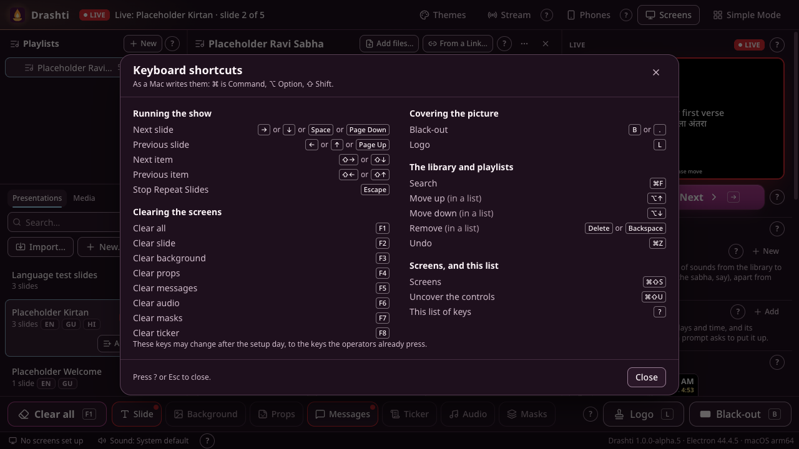
