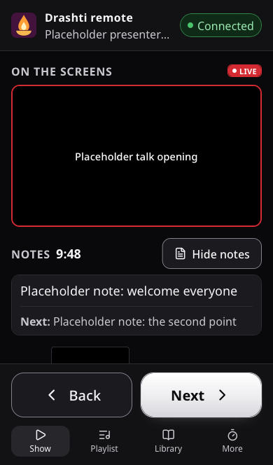
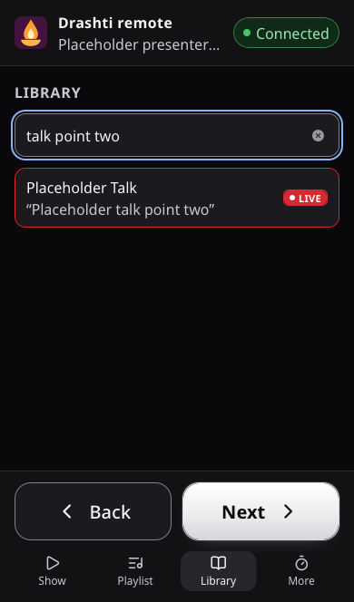
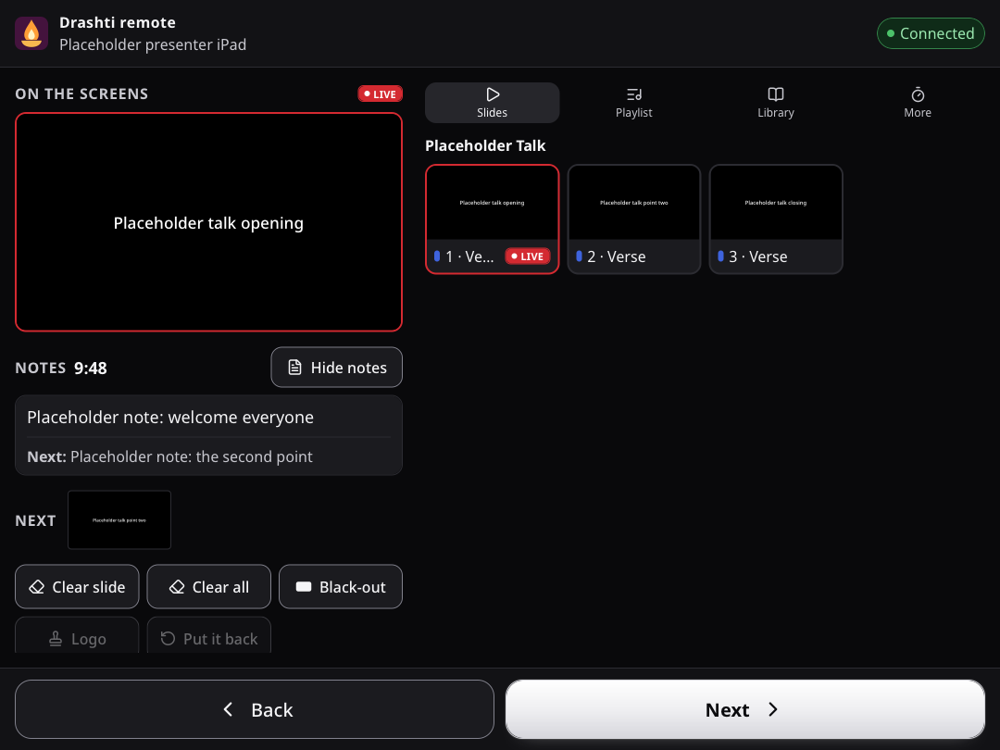

# Drashti on your phone or iPad: a guide for presenters

For anyone who speaks or leads from the front: you see what is on the screens, your notes, and the next slide, and you move through any presentation in Drashti's library from your phone, your iPad or a laptop. The screens follow. The page has the operator's show controls too: the clears, what is playing, the music, the stage screen, timers, messages and props. It costs nothing and needs no app: it is a page that Drashti itself shows on the mandir's Wi-Fi.

## Once: pair your phone or iPad

1. Join the **mandir's Wi-Fi** (the same network as the Drashti computer, not a guest network).
2. Ask the operator to pair it. On the Drashti computer they press **Phones** in the header, type a name for your phone (for example "Remote: speaker's iPad"), and press **Pair a Remote device**. A QR code and a six-digit code appear for two minutes.
3. On your phone or iPad, point the **camera** at the QR code and open the link. (Or open the address the operator reads out, for example `http://192.168.1.20:8740`, and type the code.)
4. The page says **Connected** at the top. That's it: it stays paired. Next time, just open it again.

## Once: put it on your Home Screen

So it opens like an app, from one tap:

- **iPhone or iPad** (in Safari): tap the **Share** button (the square with an arrow), then **Add to Home Screen**, then **Add**.
- **Android phone or tablet** (in Chrome): tap the **⋮** menu, then **Add to Home screen** (or **Install app**).
- **A laptop** (Windows or Mac, in Edge or Chrome): open the **⋯** or **⋮** menu, then **Apps** (or **Cast, save and share**), then **Install this site as an app** (or **Create shortcut**). Or simply bookmark the page.

## Using it

On a phone, **Show**, **Playlist**, **Library** and **More** along the bottom change what the page shows.

- **At the top: what is on the screens now**, with a red LIVE badge. Under it are the lines the operator sees under LIVE: **File missing** when the live slide's background or sound is not there, and **Moves on by itself in** with the time left when a slide moves on by itself.
- **While a video or a sound plays**, a time bar for it sits under the picture, named for what plays (**Background**, **Slide video**, **Sound**, **Music**): the time gone and the time left, with small marks for its start and end points and its markers. Tap or drag along it to move there: every screen moves with it as your finger lifts. **Pause** and **Play** are beside it, and under **Playing** are **Back 15 s**, **Forward 15 s**, **Last 10 s** and the file's markers.
- **Under it: Notes.** Your notes for this slide, and below them the next slide's notes. **Hide notes** and **Show notes** switch them off and on; your phone remembers which. The notes are the slides' own notes in Drashti, the ones the stage screens show: at the Drashti computer, open the presentation in the editor, pick a slide, and type them under **Notes** in the Inspector on the right.
- Under the notes, **Next** says in words what the next press puts up (the presentation and slide, a deck's click, the next item, or a file that is missing), beside a picture of the next slide.
- **The clears** are the operator's own, in the same order and with the keys the operator presses, so you both mean the same button: **Clear all** F1, **Slide** F2, **Background** F3, **Props** F4, **Audio** F5, **Messages** F6, **Ticker** F7, **Masks** F8, **Logo** F12 and **Black-out** B. One with something to clear is lit; **Logo** and **Black-out** turn red and say so while they are on, and **Logo** says so when no logo has been chosen yet. Straight after **Clear all**, **Put it back** takes its place and brings it all back.
- **Next** and **Back** are always at the bottom of the page. Tapping fast is safe: two quick taps on **Next** go on two slides and never zoom the page, and pulling down at the top does not reload it. A PowerPoint or Keynote deck that came in with its animations goes one click at a time: **Next** plays its next click on the screens, and **Back** goes back one; the live picture on your phone shows each click once it has played.
- **Library**: **Presentations** is every presentation in Drashti, by name. Type in the search box to find a talk, a kirtan, or words on a slide. Tap a presentation to see its slides. **Nothing changes on the screens until you tap a slide.** Then that slide goes up, and Next carries on from it. **Media** is the library's pictures, videos and sounds, found by a word of their names: one tap puts one on the screens (a sound plays over the rest), and **Take off** takes it off again.
- **On the screens** takes you back to the slides that are showing now, after you have looked at another presentation.
- **Playlist**: the sabha's running order, each item with what it is and its length or slides ("Video · 1:23"). Tap an item to see its slides; a picture, a video, a sound or a video input (a camera, marked **Video input**) goes up as you tap it. A Repeat Slides playlist goes round instead: **Start going round** above its items (or **Next** with nothing up) starts it, and tapping one of its items goes round from that item.
- **More**: the rest of the operator's right column, in its order. **Music**: **Play music** or **Pause music**, **Previous track** and **Next track**, and each audio playlist with **Play** (the one playing has **Pause**, and once it is paused, its **Play** goes on with the same track). **Stage screen**: a message only the stage screens show (type it, then **Show**; **Clear** takes it off), and the stage screens' timers, each with what it counts to and **Start**, **Pause** and **Reset**. Then **Messages** (**Show**, then **Take off**), **Timers** (**Start**, **Pause**, **Reset**, and **Show on the screens** to put one up alone), **Props** (**Show**, **Hide**), **Looks** (tap one to make it live), **Shastra** (a reference, then **Show**), **Lower thirds** (**Show**, **Hide**) and the **Idle rotation** (**Start the idle rotation**).
- **Repeating** under the live picture: slides are going round by themselves (Repeat Slides). **Stop** (or **Stop going round** in the Playlist) ends it, and the slide on the screens stays up.

**On an iPad held sideways** (or a laptop): the live picture, your notes, what comes next and the clears are on the left, and the slides are on the right, with the Playlist, the Library and More (in two columns) a tab away above them; Back and Next run along the bottom. Held upright, the iPad shows the playlist or the library beside the show, and More under it. A phone held sideways keeps a phone's tabs, with Back and Next in reach.

The operator can always change the screens from the computer too; your page follows whatever is up.

## Looking closer, on your phone only

- **Look closer** (beside **On the screens**, or tap the live picture) shows what is on the screens over your whole phone, sharp. **Look through**, above a presentation's slides, shows its slides (a PDF's or a deck's pages too) one by one, from the one on the screens if it is up; a deck that came in with its animations goes click by click, each click playing its motion and then holding still. Beside a picture or a video in the **Playlist** and in **Media**, the magnifying glass shows the picture and the play button plays the video, with its sound and its own time bar, on your phone alone; tapping the item itself puts it on the screens.
- Two fingers zoom in and out, up to 400% (two quick taps too), and one finger moves what you have zoomed; the buttons along the bottom do the same, and step to the page before or after. **Close**, or your phone's own Back (Android's back, an iPhone's swipe from the edge), goes back to the remote. None of this changes the screens.
- **Show this zoom on the screens**: when the picture you have zoomed into is the one on the screens (a red LIVE at the top), this large button at the side puts your zoom on the screens, and **Back to Whole** shows the whole picture again. It is there for a slide's own picture, or a picture up on its own, and only while the screens can zoom as far as you have; never for words over a picture behind them, nor on anything not live.

## Files between your phone and Drashti

- **Shared from Drashti**, beside **Presentations** and **Media** in the **Library** while the operator shares a playlist with phones (in Drashti, right-click it and choose **Share with Phones and Tablets**): tap the playlist, then a file, to look at it or play it on your phone alone, with the playlist's other files before and after it. Nothing there changes the playlist or the screens.
- **Add from this Phone…**, at the top of the library's **Media**, while the operator has turned on **Phones and tablets may add files** (in **Phones** on the Drashti computer): choose pictures, videos, sounds, PDF, PowerPoint or Keynote files, up to 2 GB each. Each goes whole, with a bar showing how much has gone and **Cancel**; if the Wi-Fi drops, it picks up again by itself. Drashti adds it to the playlist **Added from Phones** (and to Media or the library), marked with your phone's name, and your phone says when it is in; a PDF or a deck waits until the stream and recording have ended. It never goes on the screens by itself. On an iPhone, choose a video from **Files** to send it whole: one chosen from the photo library may go as a smaller copy.

## If something is not right

- **"Not connected"** at the top: the page tries again by itself. Check that you are on the mandir's Wi-Fi, and ask the operator whether Drashti is open and the network is on in **Phones**.
- **"This device was removed"**: ask the operator to pair it again (a new code).
- **"Drashti has stopped"** over the whole page: Drashti stopped on its computer because that computer's access was removed or could not be checked (Drashti opens only for a Gmail its owner has let in, and checks over the internet). A video or a sound playing on your phone stops with it, and nothing on your page works until Drashti is started there again and let in: tell the operator. Your phone stays paired, and the page carries on by itself once Drashti is back.
- **The screen goes dark during the talk**: on an iPhone or iPad, **Settings**, **Display & Brightness**, **Auto-Lock**, and choose a longer time for the evening. Put it back afterwards.
- **A button says it cannot be done**: while Drashti on the computer is in Simple Mode, some things are Pro Mode's only: switching the Look; moving, skipping or pausing what plays (the music's own **Pause** still works, **Play** always does, and so do the markers); and **Show this zoom on the screens** and **Back to Whole**.

What the page never does: it never changes the words, the playlists or the themes in the library (a file you add goes into the playlist **Added from Phones**, and no other), and what you look at, zoom or play on your phone stays there unless you tap **Show this zoom on the screens**. Setting Drashti up stays on the computer: the screens with their Audience and Stage switches, video inputs, windows, picture in picture, the Access List and the Announcements queue.
