# Drashti on your phone or iPad: a guide for presenters

This guide describes **1.0.0-alpha.15**, including the phone’s playlist rows, gestures and Simple Mode limits, and the completed slide editor on the Drashti computer.

Live captions and all five AI helpers are **Trial** and start off. Each can slow the screens while on. Ask the operator about a slowdown; their switches are on the Drashti computer, not your phone.

For anyone who speaks or leads from the front: you see what is on the screens, your notes, and the next slide, and you move through any presentation in Drashti's library from your phone, your iPad or a laptop. The screens follow. The page has the operator's show controls too: the clears, what is playing, the music, the stage screen, messages, timers and lower thirds. It costs nothing and needs no app: it is a page that Drashti itself shows on the mandir's Wi-Fi.

## Once: pair your phone or iPad

1. Join the **mandir's Wi-Fi** (the same network as the Drashti computer, not a guest network).
2. Ask the operator to pair it. On the Drashti computer they press **Phones** in the header, type a name for your phone (for example "Remote: speaker's iPad"), and press **Pair a Remote device**. A QR code and a six-digit code appear for two minutes.
3. On your phone or iPad, point the **camera** at the QR code and open the link. (Or open the address the operator reads out, for example `http://192.168.1.20:8740`, and type the code.)
4. The page says **Connected** at the top. That's it: it stays paired. Next time, just open it again.

## Once: put it on your Home Screen

So it opens like an app, from one tap:

- **iPhone or iPad** (in Safari): tap the **Share** button (the square with an arrow), then **Add to Home Screen**, then **Add**.
- **Android phone or tablet** (in Chrome): tap the **⋮** menu, then **Add to Home screen** (or **Install app**).
- **A laptop** (Windows or Mac, in Edge or Chrome): open the **⋯** or **⋮** menu, then **Apps** (or **Cast, save and share**), then **Install this site as an app** (or **Create shortcut**). Or simply bookmark the page.

## Using it

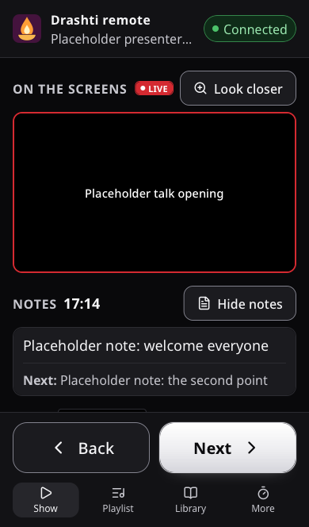

On a phone, **Show**, **Playlist**, **Library** and **More** along the bottom change what the page shows.

- **At the top: what is on the screens now**, with a red LIVE badge (or **Black-out** or **Wallpaper** while one of them covers the picture). With nothing up, it shows the wallpaper the operator chose, as the screens do. Under it are the lines the operator sees under LIVE: **File missing** when the live slide's background or sound is not there, **Moves on by itself in** with the time left when a slide moves on by itself, and **Timer for the audience** with its name and **Hide** while a timer is up on the hall's screens.
- **While a video or a sound plays**, a time bar for it sits under the picture, named for what plays (**Background**, **Slide video**, **Slide sound**, **Box video**, **Sound**, **Music**): the time gone and the time left, with small marks for its start and end points and its markers. Tap or drag along it to move there: every screen moves with it as your finger lifts. **Pause** and **Play** are beside it, and under **Playing** are **Back 15 s**, **Forward 15 s**, **Last 10 s** and the file's markers.
- **Under it: Notes.** Your notes for this slide, and below them the next slide's notes. **Hide notes** and **Show notes** switch them off and on; your phone remembers which. The notes are the slides' own notes in Drashti, the ones the stage screens show: at the Drashti computer, open the presentation in the editor, pick a slide, then choose **Slides**, **Notes…**; it works even with a text box selected. With nothing selected, **Notes** in the Inspector is another way. Notes stay on the phone and stage screens, never the audience picture.
- Under the notes, **Next** says in words what the next press puts up (the presentation and slide, a deck's click, the next item, or a file that is missing), beside a picture of the next slide.
- **The clears** are the operator's own, in the same order and with the keys the operator presses, so you both mean the same button: **Clear all** F1, **Slide** F2, **Background** F3, **Audio** F5, **Messages** F6, **Ticker** F7, **Wallpaper** F12 and **Black-out** B. One with something to clear is lit, and one with nothing to clear is dimmed. **Wallpaper** puts the wallpaper the operator chose over the picture (black when none is chosen); it and **Black-out** turn red and say so while they are on (**Wallpaper is on**, **Black-out is on**). Straight after **Clear all**, **Put it back** takes its place and brings it all back.
- **Next** and **Back** are always at the bottom of the page. Tapping fast is safe: two quick taps on **Next** go on two slides and never zoom the page, and pulling down at the top does not reload it. A PowerPoint or Keynote deck that came in with its animations goes one click at a time: **Next** plays its next click on the screens, and **Back** goes back one; the live picture on your phone shows each click once it has played.
- **Swipe on the Show page:** left for **Next**, right for **Back**. Use one finger across the picture; a vertical scroll or a two-finger zoom does not change the show. The Back and Next buttons stay available.

- **Library**: **Presentations** is every presentation in Drashti, by name. Type in the search box to find a talk, a kirtan, or words on a slide. Tap a presentation to see its slides. **Nothing changes on the screens until you tap a slide.** Then that slide goes up, and Next carries on from it. **Media** is the library's pictures, videos and sounds, found by a word of their names: one tap puts one on the screens (a sound plays over the rest), and **Take off** takes it off again.
- **On the screens** takes you back to the slides that are showing now, after you have looked at another presentation.
- **Playlist**: the sabha’s running order, with a row for each slide under its presentation, PDF or deck name, and one row for a picture, video, sound or video input. A tap on the name folds or opens its slides; your phone remembers the fold. A tap on a slide or file puts it up at once, and LIVE marks the row that is up. Its slide number stays its own even when the playlist has moved it. A Repeat Slides playlist has **Start going round** and **Stop going round**; tapping an item starts from that item.
  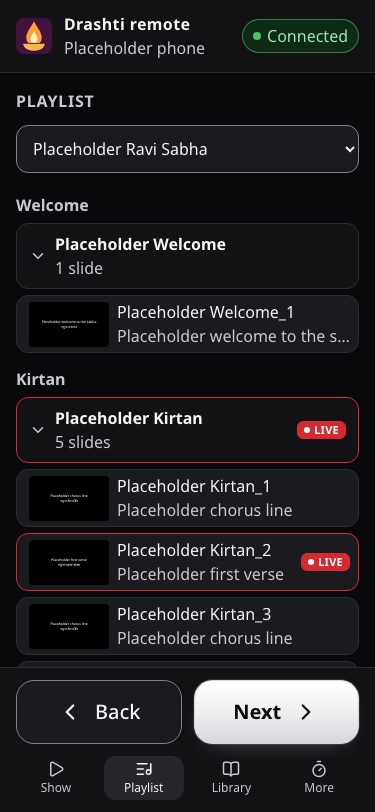
- **More**: the rest of the operator's right column, in its order. **Music**: **Play music** or **Pause music**, **Previous track** and **Next track**, and each audio playlist with **Play** (the one playing has **Pause**, and once it is paused, its **Play** goes on with the same track). **Stage screen**: the **Layout** every stage screen shows (**Standard**, or one made in Drashti), and a message only the stage screens show, never the hall's: type it under **Message for the stage**, choose its **Size** (**Small**, **Standard**, **Large** or **Very large**) and whether it flashes (**Flash as it comes up**), then tap **Show**. While it is up, **On stage** shows it, with **Hide** to take it off; the last few are under **Shown before, a tap away**, one tap each to show again. Under it are the stage screens' timers, each with what it counts to and **Start**, **Pause** and **Reset**. Then **Messages** (**Show**, then **Take off**), **Timers** (**Start**, **Pause**, **Reset**, and **Show for the audience**, which puts that timer on the hall's screens in the look the operator gave it, then **Hide**), **Books** (a reference, then **Show**) and **Lower thirds** (**Show**, **Hide**).
- **Repeating** under the live picture: slides are going round by themselves (Repeat Slides). **Stop** (or **Stop going round** in the Playlist) ends it, and the slide on the screens stays up.

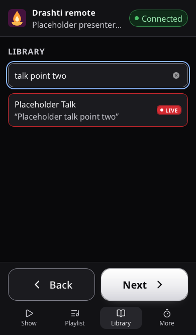

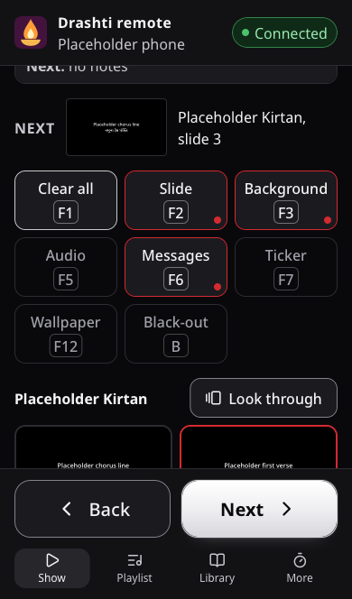

**On an iPad held sideways** (or a laptop): the live picture, your notes, what comes next and the clears are on the left, and the slides are on the right, with the Playlist, the Library and More (in two columns) a tab away above them; Back and Next run along the bottom. Held upright, the iPad shows the playlist or the library beside the show, and More under it. A phone held sideways keeps a phone's tabs, with Back and Next in reach.

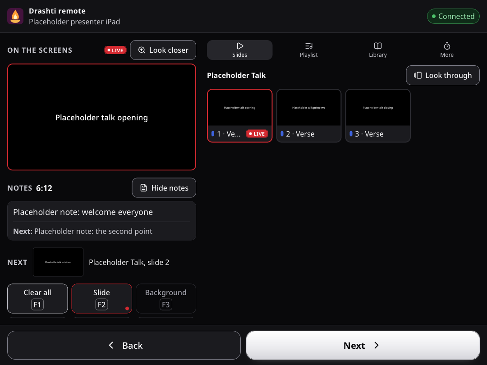

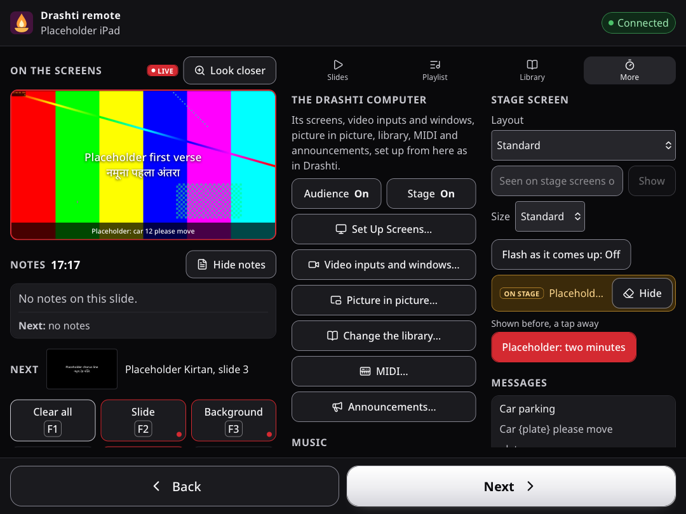

The operator can always change the screens from the computer too; your page follows whatever is up. **More** starts with **The Drashti computer** (its screens, **Video inputs and windows…**, **Picture in picture…**, **Change the library…**, **MIDI…** and **Announcements…**): those are the operator's, for setting up the hall; leave them to them.

**On the stage screens** (and a tablet used as a stage display): the layout the operator chose, with your notes or the next slide if it has them, and a message from the operator over it, sometimes flashing as it comes up; the hall never sees that message. In a video's last 10 seconds, **Video ends in 0:08** runs across the top, so you know the hall is about to change.

**A long press on a row** opens what can be done there: look at or play the file on this phone, Rename…, Remove from playlist with Undo, Save picture… where a picture is available, and, in Pro Mode, Picture editor…, a video’s When it ends and Pin to the quick bar or Unpin from the quick bar. Remove asks first if that row is on the screens and never deletes your own file; on a slide row it takes the whole presentation, PDF or deck item out of the playlist, not one slide. Save picture… uses the phone’s Share sheet where available; otherwise the browser downloads the picture, which you can open and share from its downloads. Looking at and saving a picture on this phone remains available in Simple Mode. The Picture editor changes the picture’s kept Crop, Turn and Flip, with Whole picture to reset the crop: Save keeps the look used by Drashti, while the original file stays as it was.
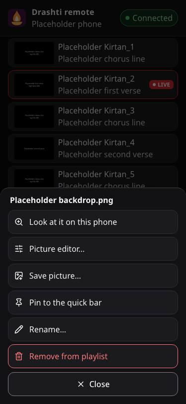

**Wallpapers and the quick bar.** The phone can choose the wallpaper as the computer does, and the quick bar gives its pinned actions one tap each. Pro Mode can change the pins and edit picture looks; the quick bar is hidden in Simple Mode, whose wallpapers and permitted playlist actions remain available.

**Preparing slides, at the Drashti computer.** In Pro Mode, **Edit slides…** opens a window of its own: **Words**, **Insert**, **Arrange**, **Design**, **Motion** and **Slides**. It prepares text and lists, tables and cropped pictures, grouped and aligned elements, a background and one shared master, timed effects and the slide order. **Undo** and **Redo** include typing and drags; Save keeps the last words still being typed, and closing or switching presentations asks before losing changes. The show controls remain in the operator window. Older presentations and imported decks keep their playback; the phone follows the authored transitions, element effects and automatic advance in step with the screens. See the operator guide for editing.

## Looking closer, on your phone only

- **Look closer** (beside **On the screens**, or tap the live picture) shows what is on the screens over your whole phone, sharp. On a picture's page, or a PDF's or a deck's slide, **Save** keeps it on your phone, as the screens show it: the phone's Share sheet offers where (a download where it has none), and a slide is named after its deck ("Placeholder Katha_3"). **Look through**, above a presentation's slides, shows its slides (a PDF's or a deck's pages too) one by one, from the one on the screens if it is up; a deck that came in with its animations goes click by click, each click playing its motion and then holding still. Beside a picture or a video in the **Playlist** and in **Media**, the magnifying glass shows the picture and the play button plays the video, with its sound and its own time bar, on your phone alone; tapping the item itself puts it on the screens.
- Two fingers zoom in and out, up to 400% (two quick taps too), and one finger moves what you have zoomed; the buttons along the bottom do the same, and step to the page before or after. **Close**, or your phone's own Back (Android's back, an iPhone's swipe from the edge), goes back to the remote. None of this changes the screens.
- **Show this zoom on the screens**: when the picture you have zoomed into is the one on the screens (a red LIVE at the top), this large button at the side puts your zoom on the screens, and **Back to Whole** shows the whole picture again. It is there for a slide's own picture, or a picture up on its own, and only while the screens can zoom as far as you have; never for words over a picture behind them, nor on anything not live.

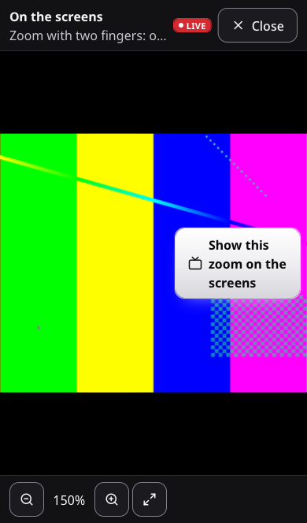

## Files between your phone and Drashti

- **Shared from Drashti**, beside **Presentations** and **Media** in the **Library** while the operator shares a playlist with phones (in Drashti, right-click it and choose **Share with Phones and Tablets**): tap the playlist, then a file, to look at it or play it on your phone alone, with the playlist's other files before and after it. Nothing there changes the playlist or the screens.
- **Add from this Phone…**, at the top of the library's **Media**, while the operator has turned on **Phones and tablets may add files** (in **Phones** on the Drashti computer): choose pictures, videos, sounds, PDF, PowerPoint (`.pptx`) or Keynote files, up to 2 GB each. Each goes whole, with a bar showing how much has gone and **Cancel**; if the Wi-Fi drops, it picks up again by itself. Drashti adds it to the playlist **Added from Phones** (and to Media or the library; while the computer is in Simple Mode, to the end of Simple Mode's playlist instead, but a video or sound goes into **Added from Phones** when that playlist is a Repeat Slides one), marked with your phone's name, and your phone says when it is in; a PDF or a deck waits until the stream and recording have ended. It never goes on the screens by itself. On an iPhone, choose a video from **Files** to send it whole: one chosen from the photo library may go as a smaller copy.
- **Add photos**, beside it under **Add to Drashti**, sends pictures from your phone’s photos, several at once, to the end of the ordinary playlist open on Drashti; the words above it name that playlist, and a HEIC photo is converted by itself. With no ordinary playlist open they go into **Added from Phones**. While the computer is in Simple Mode they go to the end of Simple Mode’s playlist, and the words above name it. They never go on the screens by themselves: the operator puts them up.

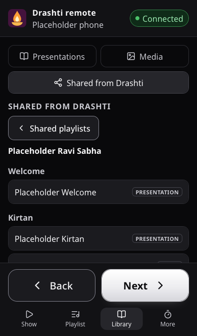

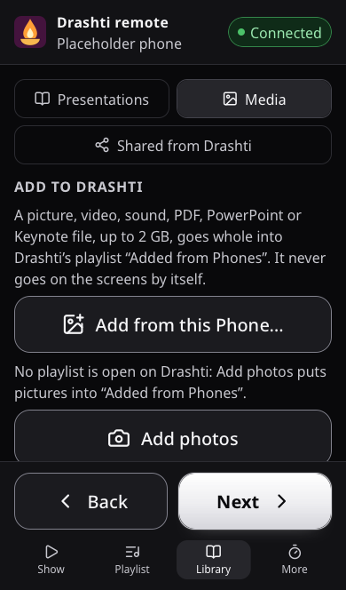

## If something is not right

- **"Not connected"** at the top: the page tries again by itself. Check that you are on the mandir's Wi-Fi, and ask the operator whether Drashti is open and the network is on in **Phones**.
- **"This device was removed"**: ask the operator to pair it again (a new code).
- **"Drashti has stopped"** over the whole page: Drashti stopped on its computer because that computer's access was removed or ended, or could not be checked for 15 days (Drashti opens only for a Gmail its owner has let in, and checks over the internet). A video or a sound playing on your phone stops with it, and nothing on your page works until Drashti is started there again and let in: tell the operator. Your phone stays paired, and the page carries on by itself once Drashti is back.
- **The screen goes dark during the talk**: on an iPhone or iPad, **Settings**, **Display & Brightness**, **Auto-Lock**, and choose a longer time for the evening. Put it back afterwards.
- **A button says it cannot be done**: The phone opens its one playlist and explains the limit once each time Simple Mode comes on. Use that playlist’s rows, Next and Back, the clears and Clear all, Put it back, Black-out, the Wallpaper, live zoom and Back to Whole; Play resumes what is paused. A Repeat Slides playlist starts only when it is that one playlist. A long press on its own rows offers Rename and Remove from playlist with Undo; wallpapers can be chosen, renamed and deleted with Undo. Pro-only controls are hidden or dimmed, and the computer refuses their requests too: another playlist, putting something up from Media or the library outside that playlist, music Pause or track changes, marker jumps, timers, messages, lower thirds, stage setup and other setup need Pro Mode. Taking something off the screens still works. A refusal names the permitted playlist; with Pro access it explains how to leave Simple Mode at the computer, and Simple-only access offers no way to Pro Mode.
  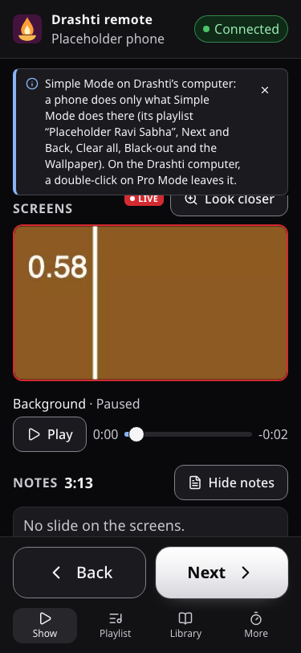

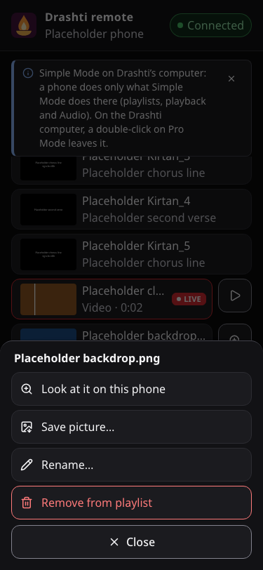

What the page never does on its own: what you look at, zoom or play on your phone stays there unless you tap **Show this zoom on the screens**. Ordinary files sent with **Add from this Phone…** go to **Added from Phones**. **Add photos** uses the ordinary playlist open in **Pro Mode** (without one, **Added from Phones**); in **Simple Mode** every file sent either way goes to the end of Simple Mode’s playlist, but a video or sound goes into **Added from Phones** when that playlist is a Repeat Slides one. Nothing added goes on the screens by itself. Setting Drashti up is the operator's (**The Drashti computer**, above), and the Access List stays on the owner's computer.
