# Drashti on your phone or iPad: a guide for presenters

This guide describes **1.0.0-alpha.23**, where a phone shows the sabha and, in Pro Mode, moves a PowerPoint or a PDF: since alpha.23 everything else is done on Drashti's computer.

Live captions are **Trial** and start off. They can slow the screens while on. Ask the operator about a slowdown. The switch is on the Drashti computer.

For anyone who speaks or leads from the front: you see what is on the screens, your notes and the next slide, the **Sabha flow** and the **Chat**, on your phone, your iPad or a laptop. While the Drashti computer is in Pro Mode, you can also put up a PowerPoint or a PDF from the playlist and move through it yourself: the screens follow. It costs nothing and needs no app: it is a page that Drashti itself shows on the mandir's Wi-Fi.

## What a phone does

Since alpha.23 a phone does less than before, the same for every phone, iPad, laptop or script paired as a Remote:

- **In Simple Mode** (on the Drashti computer): the phone shows the **Sabha flow**, what is on the screens and the **Chat**, with no controls. Nothing on it changes the show.
- **In Pro Mode**: all of that, and it also puts up a PowerPoint or a PDF (a Keynote deck too) from the playlist open on the phone, moves through it with **Next** and **Back**, and can take its slide off the screens.
- **In neither mode** does a phone play, put up or change videos, pictures, sounds or music, the wallpapers, timers, the stage message, messages or announcements, or change Drashti's set-up. Kirtans, lyrics, a passage from **Books** and presentations of words do not go up from a phone either: the operator puts those up on the computer. Phones no longer send files to Drashti or see playlists shared with them.
- **A PowerPoint's own videos and sounds** (the ones made in the deck) play as they were made when its slide goes up, and a deck with its own slide timings moves on by itself as it does from the computer. Nothing else on a phone plays a video or a sound.

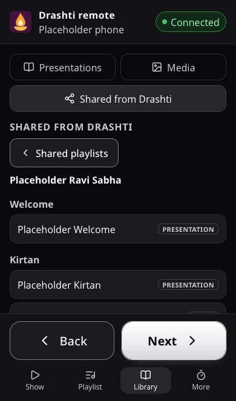

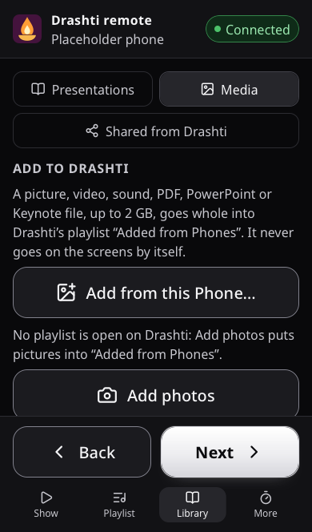

## Once: pair your phone or iPad

1. Join the **mandir's Wi-Fi** (the same network as the Drashti computer, not a guest network).
2. Ask the operator to pair it. On the Drashti computer they press **Phones** in the header, type a name for your phone (for example "Remote: speaker's iPad"), and press **Pair a Remote device**. A QR code and a six-digit code appear for two minutes.
3. On your phone or iPad, point the **camera** at the QR code and open the link. (Or open the address the operator reads out, for example `http://192.168.1.20:8740`, and type the code.)
4. The page says **Connected** at the top. That's it: it stays paired. Next time, just open it again.

## Once: put it on your Home Screen

So it opens like an app, from one tap:

- **iPhone or iPad** (in Safari): tap the **Share** button (the square with an arrow), then **Add to Home Screen**, then **Add**.
- **Android phone or tablet** (in Chrome): tap the **⋮** menu, then **Add to Home screen** (or **Install app**).
- **A laptop** (Windows or Mac, in Edge or Chrome): open the **⋯** or **⋮** menu, then **Apps** (or **Cast, save and share**), then **Install this site as an app** (or **Create shortcut**). Or simply bookmark the page.

## Using it, in both modes

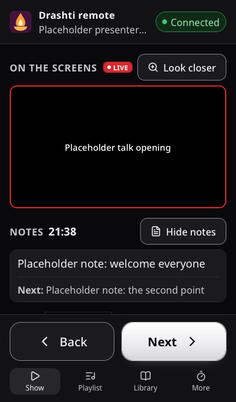

- **At the top: what is on the screens now**, with a red LIVE badge (or **Black-out** or **Wallpaper** while one of them covers the picture). With nothing up, it shows the wallpaper the operator chose, as the screens do. Under it are the lines the operator sees under LIVE: **File missing** when the live slide's background or sound is not there, **Moves on by itself in** with the time left when a slide moves on by itself, and **Timer for the audience** with its name while a timer is up on the hall's screens.
- **Under it: Notes.** Your notes for this slide, and below them the next slide's notes. **Hide notes** and **Show notes** switch them off and on; your phone remembers which. The notes are the slides' own notes in Drashti, the ones the stage screens show: at the Drashti computer, open the presentation in the editor, pick a slide, then choose **Slides**, **Notes…**; it works even with a text box selected. With nothing selected, **Notes** in the Inspector is another way. Notes stay on the phone and stage screens, never the audience picture.
- Under the notes, **Next** says in words what the next press on the computer puts up (the presentation and slide, a deck's click, the next item, or a file that is missing), beside a picture of the next slide.
- **Sabha flow** (since alpha.23), on the phone in both modes: the sabha's running order that the operator chose on the computer (a PDF, in its **Sabha flow** panel), to read only. **Now** is the item the operator marked as where the sabha is, and **Next up**, larger, is the item after it in full (a video's row with a film mark), or **Last item**. **Open Sabha flow…** shows the **Read list**, each item as "1 · Program · Details · Duration · Presenter" in the PDF's own language with Now and Next up marked and the total at the bottom, and the **PDF page**, with **Larger**, **Smaller** and **Fit** (and **Page** back and forward when it has more than one). It follows the computer: another PDF chosen, Now moved on, or the flow removed. When Drashti could not read the PDF's words (a scan, say), it says so and shows the page. Nothing on the phone changes the flow, and it is never on the hall's or the stage screens.
- **Repeating** under the live picture: slides are going round by themselves (Repeat Slides), started and stopped on the computer.

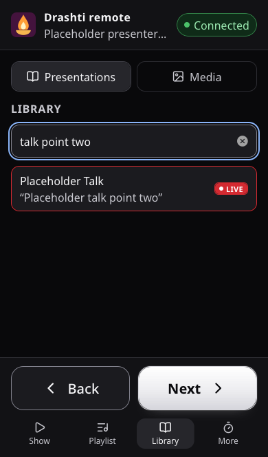

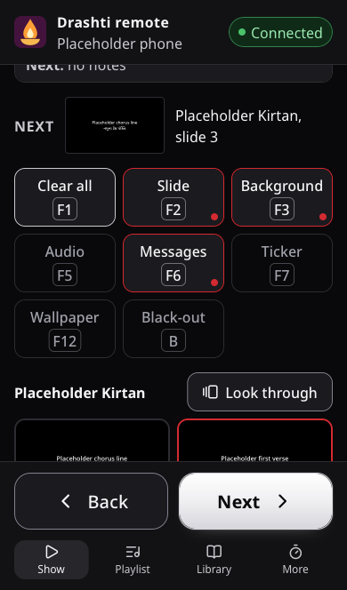

The operator can always change the screens from the computer; your page follows whatever is up.

**On the stage screens** (and a tablet used as a stage display): the layout the operator chose, with your notes or the next slide if it has them, and a message from the operator over it, sometimes flashing as it comes up; the hall never sees that message. In a video's last 10 seconds, **Video ends in 0:08** runs across the top, so you know the hall is about to change.

**An iPad, or a laptop**, shows the same, with more room side by side.

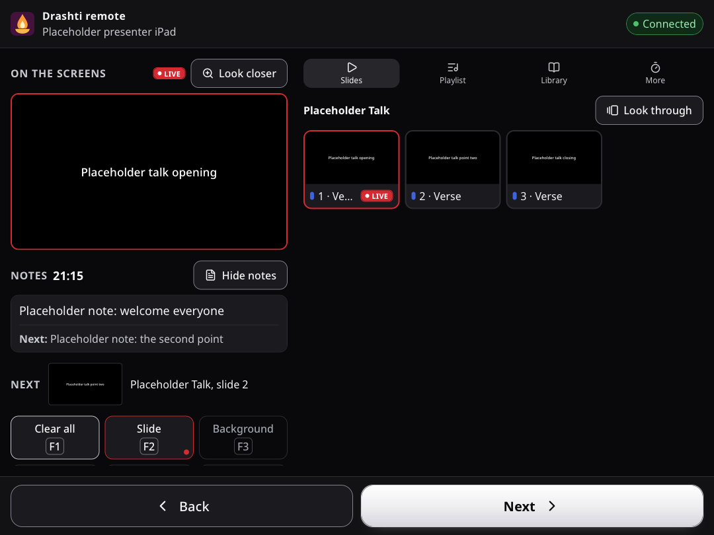

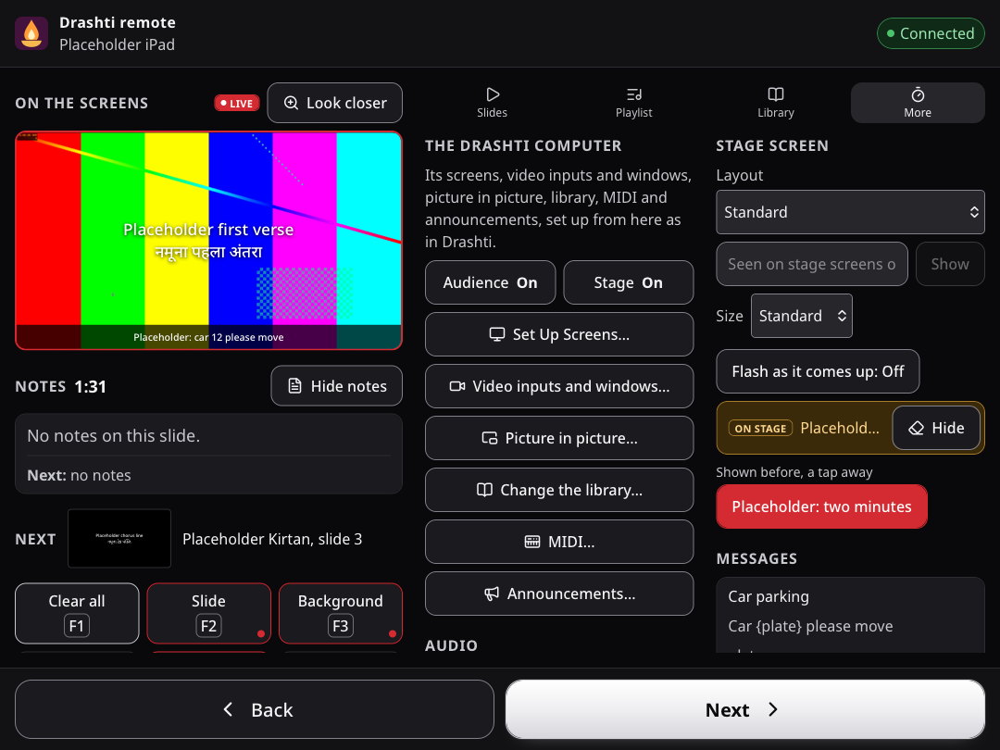

**Preparing slides, at the Drashti computer.** **Edit slides…** opens a window of its own, in Pro Mode and (from a row’s right-click menu) in Simple Mode: **Words**, **Insert**, **Arrange**, **Design**, **Motion** and **Slides**. It prepares text and lists, tables and cropped pictures, grouped and aligned elements, a background and one shared master, timed effects and the slide order. **Undo** and **Redo** include typing and drags; Save keeps the last words still being typed, and closing or switching presentations asks before losing changes. The show controls remain in the operator window. Older presentations and imported decks keep their playback; the phone follows the authored transitions, element effects and automatic advance in step with the screens. See the operator guide for editing.

## In Pro Mode: a PowerPoint or a PDF from the playlist

- **Playlist** shows the playlist open on the phone, with a row for each slide under its PowerPoint, PDF or Keynote deck's name; choose another playlist from the list above it. Only the PowerPoint and PDF items are offered there: a kirtan, words, a passage from **Books**, a video, a picture or a sound stays on the computer. A tap on the name folds or opens its slides, and a tap on a slide puts it up at once; LIVE marks the row that is up.
  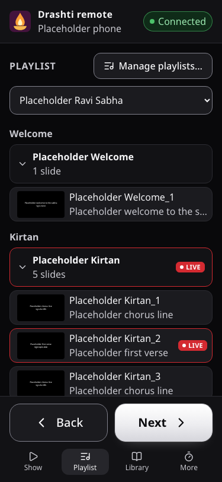
- **Next** and **Back**, at the bottom of the page, move through the PowerPoint or PDF on the screens, whichever put it up (you or the operator). A deck that came in with its animations goes one click at a time. **Next** stops at the deck's last slide: it never goes on to the next item in the playlist, or to a video. Tapping fast is safe: two quick taps on **Next** go on two slides and never zoom the page, and pulling down at the top does not reload it.
- **Clear slide** takes the deck's slide off the screens, while a PowerPoint or a PDF is up. Nothing else comes off from a phone.
- **Look closer** (beside **On the screens**, or tap the live picture) shows what is on the screens over your whole phone, sharp. Two fingers zoom in and out, up to 400% (two quick taps too), and one finger moves what you have zoomed; **Close**, or your phone's own Back (Android's back, an iPhone's swipe from the edge), goes back. It is a view on your phone alone: nothing there changes the screens.

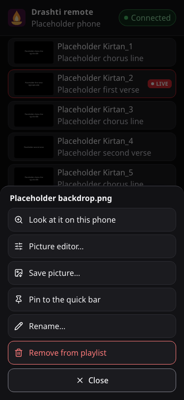

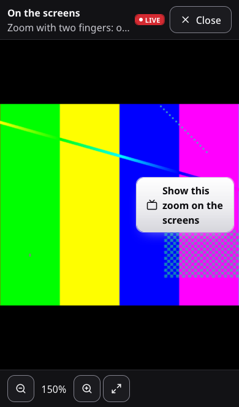

## The chat

**Chat** is one group chat for everyone whose phone is paired with this Drashti computer, as a WhatsApp group is: the operator, the Remote phones and iPads (in Simple Mode too), the Announcements phones, and the phones that scanned the operator's Chat QR code. Everyone in it sees every message and every name. It goes over the mandir's Wi-Fi to the Drashti computer only, never the internet, and it is never on the screens or the stream.

- **The first time**, type your name under **Your name in the chat** and tap **Join the chat**. Everyone sees it above your messages, and your phone remembers it. **Change name**, then **Save name**, changes it. Your name is your own for the day: **Operator** (or anything that reads like it) is the operator's, and a name someone else has today is taken.
- **The messages**: the newest at the bottom, each with the sender's name above it and the time under it; yours are on the right. The operator's messages, written at the Drashti computer, are marked **On the computer**: a name alone never is. The day's messages are there when you open the chat. Scrolled up to read, **New messages** takes you back down.
- **To write**: type in **Message** (up to 500 characters, emoji too) and tap **Send**. After a few at once, the page asks you to wait a moment.
- **To speak instead**: the page says **Tap 🎤 on your keyboard to speak**. Tap the microphone on your phone's keyboard, say the words, and when they are typed, tap **Send**. Drashti never listens to your microphone: your keyboard types what you say (and, depending on your phone, may send your voice to the keyboard's maker, such as Apple or Google, to do it).
- **A new message from someone else**, while the page is open: an Android phone buzzes, an iPhone or iPad plays a short sound, at most once every few seconds however busy the chat is, and **Chat** shows how many you have not read. On another tab (**Playlist**, say), a banner in place of the page's top line shows who it is from and the words (tap it to open **Chat**). While **Show** is open (and on an iPad, where the show is always beside the rest) there is no banner and no sound, so nothing moves under your finger and nothing is heard in the sabha: an Android phone only buzzes. Neither the buzz nor the sound starts until you have tapped the page once after opening it: phones allow neither before that. With the phone locked, or the browser put away, nothing comes: the messages are there when you open the page again.
- **From the Chat QR code**: the phone opens **Drashti chat**, a page with the chat alone. It works for today only; tomorrow, scan a new code. A Remote phone needs none: its **Chat** tab is the same chat, and scanning the code never undoes its pairing. An Announcements phone opens the same page with **Open the chat** on its announcements page.
- The chat is kept on the Drashti computer for today only. The operator can clear it, and can remove a person from it (that phone is no longer paired).

## If something is not right

- **"Not connected"** at the top: the page tries again by itself. Check that you are on the mandir's Wi-Fi, and ask the operator whether Drashti is open and the network is on in **Phones**.
- **"This device was removed"**: ask the operator to pair it again (a new code).
- **"Drashti has stopped"** over the whole page: Drashti stopped on its computer because that computer's access was removed or ended, or could not be checked for 15 days (Drashti opens only for a Gmail its owner has let in, and checks over the internet). Nothing on your page works until Drashti is started there again and let in: tell the operator. Your phone stays paired, and the page carries on by itself once Drashti is back.
- **No buzz or sound for a new chat message**: tap the page once after opening it (phones allow neither before that). An iPhone never buzzes for a web page, and its sound follows the ring switch and the volume. With the phone locked, nothing comes until you open the page again.
- **"This Chat QR has ended"** after scanning the Chat QR code: it works for 10 minutes after the operator shows it, or until they stop it. Ask them to show it again.
- **The screen goes dark during the talk**: on an iPhone or iPad, **Settings**, **Display & Brightness**, **Auto-Lock**, and choose a longer time for the evening. Put it back afterwards.
- **A button says it cannot be done**: since alpha.23 the Drashti computer refuses a phone what the rule above does not allow, and the page says which, in one of these:
  - "Simple Mode is on at Drashti’s computer: this phone shows the Sabha flow, what is on the screens and the chat. Run the show on the computer." The computer is in Simple Mode, where a phone has no controls.
  - "From a phone, only a PowerPoint or a PDF goes up. Put this up on the computer." A kirtan, words, a passage from Books or Repeat Slides: the operator puts it up.
  - "No PowerPoint or PDF is on the screens: put one up from the playlist first." Next, Back or Clear slide with no PowerPoint or PDF up.
  - "A phone cannot play, put up or change videos, pictures or sounds. Use Drashti’s computer."
  - "Phones cannot add or share files with Drashti." Files go into Drashti on the computer.
  - "A phone cannot change this. Use Drashti’s computer." Timers, messages, the stage, announcements, the screens and setting Drashti up.

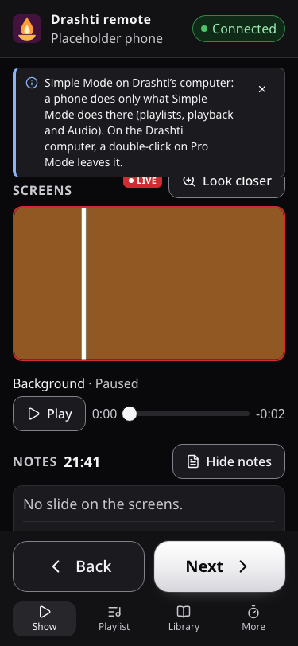

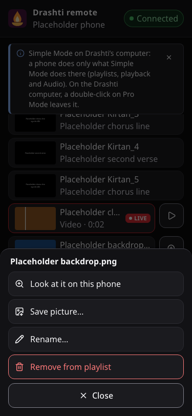

What the page never does on its own: nothing you look at or zoom on your phone changes the screens. In Simple Mode the phone changes nothing; in Pro Mode it puts up only a PowerPoint or a PDF you tap, and moves only inside it. No phone plays, puts up or changes videos, pictures or sounds, sends or receives files, or changes timers, messages, the stage, announcements or Drashti's set-up: the operator does those on the computer, and the Access List stays on the owner's computer.
